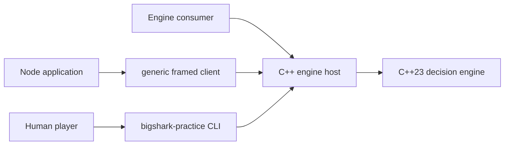

# BigShark

BigShark is a platform-neutral no-limit Texas Hold'em decision and GTO engine.
Its C++23 strategy core produces deterministic, replayable decisions and
serves them over a local framed Protobuf protocol. A generic TypeScript
process client and an offline human-vs-bot practice table consume the engine;
the repository ships no game-platform client. The former River Club Agent API
integration was retired by [RFC 0040](docs/rfcs/0040-retire-river-club-agent-api.md).

## Project Status

BigShark is under active development.

| Area | Status |
| --- | --- |
| Modular C++ poker, solver, policy, and service targets | Implemented |
| Framed Protobuf engine host and generic Node client | Implemented |
| Deterministic replay and golden behavior tests (native) | Implemented |
| Protobuf IDL, generated bindings, and compatibility gates | Implemented |
| Offline practice table (easy/medium/engine bot tiers) | Implemented |
| Multiway turn strategy via nested river continuation values | RFC 0039 Accepted, implementation in progress |

The platform-neutral architecture is defined in
[RFC 0001](docs/rfcs/0001-engineering-architecture.md), the engine
protocol in [RFC 0002](docs/rfcs/0002-protobuf-engine-protocol.md), and the
strict TypeScript application layer in
[RFC 0003](docs/rfcs/0003-typescript-application-layer.md).

## Architecture



The engine is a local process: cards, turn ownership, legal actions, and
settlement are inputs from the embedding application, not network state.
Engine decisions use public cards and the hero's own hole cards only.

Start with the [documentation index](docs/README.md) for architecture, design,
protocol, development, and RFC material.

## Capabilities

- C++23 poker evaluation, equity estimation, range tracking, and policy logic.
- Exact heads-up river sequence-form solving when HiGHS is available.
- Deterministic bounded DCFR fallback when HiGHS is unavailable.
- Framed Protobuf engine host and a strict TypeScript generic process client.
- Versioned Protobuf schema with Buf linting and breaking-change checks.
- Cross-language binary and ProtoJSON vectors, including 64-bit integer and
  unknown-field behavior.
- Reproducible multi-street exploitability and convergence benchmarks.
- Offline practice table with easy, medium, and engine-served bot tiers.
- Debug, release, sanitizer, and Linux GCC verification lanes.

## Requirements

Runtime:

- Node.js 20 or newer
- npm
- unzip for the pinned Protobuf compiler bootstrap

C++ development:

- CMake 3.20 or newer
- Ninja
- A C++23-capable Clang or GCC toolchain
- clang-format
- Optional HiGHS for exact river linear programming

## Quick Start

Clone the repository, install pinned Node dependencies, and build the release
engine:

```bash
git clone https://github.com/Zzzode/BigShark.git
cd BigShark
npm ci
cmake --preset release
cmake --build --preset release
ctest --preset release
npm run check
```

The release preset publishes the local executable at `bin/bigshark-engine`.
That generated binary is intentionally excluded from Git.

## Using the Engine

The engine host is a local framed-Protobuf process. Start it from
`apps/engine-host` (`build/release/apps/engine-host/bigshark-engine
--serve-proto`) and speak the
[engine protocol](docs/reference/protobuf-engine-protocol.md) over stdio.
Node applications use the generic client in `clients/node/`.

Play hands offline against the bots:

```bash
./build/release/engine/bigshark-practice --seats 6 --difficulty engine
./build/release/engine/bigshark-practice --seats 2 --difficulty medium
```

See the [offline practice table](docs/development/practice-table.md) for
flags and bot-tier labels. The engine strategy and operating rules are in
[AGENTS.md](AGENTS.md) and [strategy/PLAYBOOK.md](strategy/PLAYBOOK.md).

## C++ Development

The root `CMakePresets.json` defines `debug`, `release`, and `asan` workflows.

```bash
cmake --preset debug
cmake --build --preset debug
ctest --preset debug

cmake --preset release
cmake --build --preset release
ctest --preset release
```

Only `release` publishes `bin/bigshark-engine`. See
[Build and Test](docs/development/build-and-test.md) for formatting,
sanitizers, compilation database behavior, and the full release gate.

Run the deterministic multi-street solver benchmark with:

```bash
cmake --build --preset release --target benchmark-multistreet
```

See [Benchmarking](docs/development/benchmarking.md) for fixture definitions,
quality thresholds, and the CSV output contract.

Run the reproducible Linux GCC lane with:

```bash
docker build -f tools/ci/Dockerfile.linux -t bigshark-linux-verify:ci .
docker run --rm bigshark-linux-verify:ci
```

GitHub Actions runs the same containerized Linux gate for pushes to `main` and
for pull requests.

Validate documentation and local links with:

```bash
npm run check
```

Validate the Protobuf IDL and generated C++/TypeScript bindings with:

```bash
npm run proto:check
cmake --build --preset release --target protobuf-check
```

The authoritative schema is
[`proto/bigshark/engine/engine.proto`](proto/bigshark/engine/engine.proto).
See the [Protobuf protocol reference](docs/reference/protobuf-engine-protocol.md)
for amount semantics, generated output ownership, and compatibility policy.

Material architecture and protocol changes follow the
[RFC process](docs/rfcs/README.md) and the repository
[`rfc-authoring` skill](.codex/skills/rfc-authoring/SKILL.md).

## Security and Fair Play

- The repository contains no game-platform credentials or network client.
- Never place secrets in source, logs, issues, or commits.
- Never infer unrevealed cards or coordinate through hidden information.

Report vulnerabilities according to [SECURITY.md](SECURITY.md).

## Contributing

See [CONTRIBUTING.md](CONTRIBUTING.md) for development rules, verification
requirements, and the RFC process.

## License

BigShark is licensed under the
[Apache License 2.0](LICENSE). Bundled dependency notices are listed in
[THIRD_PARTY_NOTICES.md](THIRD_PARTY_NOTICES.md).

## Repository Map

| Path | Purpose |
| --- | --- |
| `AGENTS.md` | Authoritative agent instructions and project rules |
| `CLAUDE.md` | Symbolic link to `AGENTS.md` |
| `LICENSE` | Apache License 2.0 terms |
| `THIRD_PARTY_NOTICES.md` | Bundled dependency attribution |
| `docs/README.md` | Documentation index and policy |
| `docs/design/gto-engine.md` | Detailed C++ engine and solver design |
| `docs/reference/protobuf-engine-protocol.md` | Framed Protobuf IDL and generation contract |
| `docs/development/practice-table.md` | Offline practice CLI |
| `docs/rfcs/` | Architecture proposals and RFC process |
| `docs/rfcs/0001-engineering-architecture.md` | Accepted repository and module architecture |
| `docs/rfcs/0002-protobuf-engine-protocol.md` | Accepted typed engine protocol |
| `docs/rfcs/0003-typescript-application-layer.md` | Implemented strict TypeScript application policy |
| `CMakePresets.json` | Fixed debug, release, and sanitizer workflows |
| `proto/` | Protobuf source, Buf configuration, compatibility baseline, and vectors |
| `engine/` | C++ poker, solver, policy, service, tests, and solver benchmarks |
| `apps/engine-host/` | C++ engine process composition root |
| `clients/node/` | Platform-neutral TypeScript engine process client |
| `tools/` | Native CI tooling and TypeScript project/RFC/docs checks |
| `bin/` | Documentation/RFC checker launchers and the published engine executable |
| `strategy/PLAYBOOK.md` | Baseline poker decision framework |
| `strategy/table-notes.md` | Reviewed opponent and table observations |
| `.codex/skills/` | Exploitative style selector and style modules |
| `sessions/` | Local ignored historical journals (no tracked reader) |
