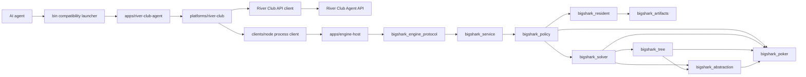

# System Architecture

Status: Current

## Purpose

BigShark is an agent-driven no-limit Texas Hold'em system. The current product
integrates with River Club, while the C++ decision process consumes a compact
normalized context over a framed Protobuf protocol.

The repository separates three concerns:

1. Platform operation: authentication, table discovery, seating, polling,
   deadlines, legal-action submission, and journaling.
2. Engine process integration: process lifecycle, request framing, timeouts,
   and response correlation.
3. Poker decisions: hand evaluation, range construction, equity estimation,
   heuristic policy, and river equilibrium solving.

The TypeScript application and River adapter boundaries and the C++ target
split are implemented. The framed Protobuf engine protocol (RFC 0022) is the
only engine protocol. It carries a G/F contribution ledger, phase-tagged pot
layers, observation provenance, and capability tuples. The engine-host
accepts `protocol_version` field 1 == 3 on every frame. The handler replays
from the true hand-start root (no mid-street rebase) and validates the
declared G/F ledger and pot state against the native replay. Capability
tuples (`hu-r1`) are advertised; `sixmax-r1` is gated on T2–T5 completion.
The resident layer serves blueprint decisions (flop-rooted, turn-rooted,
river-rooted, and preflop). The resident mapper rotates actor indices so
the button is always at index 0, matching blueprint root identity for any
physical button position. Preflop decisions build a hand-start root
GameState; postflop decisions build a flop-rooted GameState. Terminal-only
resolving runs on an AUTOMATIC blueprint miss, with a labeled operational
fallback (check/call/fold) when the resolver also misses.

## Runtime Components

## Component Boundaries

| Component | Owns | Must not own |
| --- | --- | --- |
| `engine/` | Poker, solver, abstraction, policy, service, protocol library, resident lookup, artifacts, resolver, and solver-owned benchmarks | Authentication, HTTP, room discovery, platform tokens |
| `bigshark_abstraction` (RFC 0008 stage 3) | Card bucketing, declared ordered action menus, abstraction identity (`AbstractionId`), and the typed mismatch refusal; depends only on the rules layer | Knowledge of solvers, storage, or IO, and any modification of the rules. The solver's live menu is a thin adapter over the lifted builder (bit-for-bit identical decisions, replay 156/0/0); card buckets and `AbstractionId` are consumed by the flop class library and class-based `resolve_root` (W4a/W4c) |
| `bigshark_tree` (RFC 0008 stage 4 L3) | The seat-count-agnostic abstract public betting tree (`AbstractTree`): abstracted action nodes, probability-free public-card chance nodes, and fold/showdown terminal ledgers built from an L1 `GameDef` and an L2 menu; links only `bigshark_poker` and `bigshark_abstraction` | Regrets, ranges, hole cards, policy, probabilities on chance edges, per-deal conditioning, and any solver, transitional rules adapter (heads-up or multiway), storage/transport, or private-holding evaluator (enforced unconditionally at build time by allowlisting the compiler-resolved include closure — which macro-paste, line-splice, digraph, no-space, and `#import` spellings cannot evade — and at link time by the link-negative test). A build that crosses a deterministic node/depth/byte bound throws the typed `tree_resource_exhausted`, never a truncated tree; the byte bound covers requested retained capacity |
| `bigshark_solver::solve` (RFC 0008 stage 4 L4) | The single unified solver seam: routes a two-seat identity tree to heads-up CFR with the numeric core unchanged (bit-for-bit under both drivers and every runout variant), and explicitly refuses unsupported shapes with the typed `unsupported_tree_shape` | Silent approximation of a model it does not solve, conflating a shape refusal with a malformed request (the exception is not `invalid_argument`), and a self-assigned guarantee level on the result (the source-to-guarantee map is L6). The river LP/DCFR and experimental multistreet solvers are reachable but refuse-only this stage |
| `apps/engine-host` | C++ process composition, framed Protobuf host (`--serve-proto`, the default serving mode) | Platform mapping or strategy rules |
| `clients/node` | Generic engine process lifecycle, framed Protobuf request/response, timeouts, and FIFO correlation | River fields or poker strategy |
| `platforms/river-club` | River API, state parsing, normalization, legality checks, action submission, and journaling | Independent poker strategy |
| `apps/river-club-agent` | River session composition, timing, stop-loss, and model override window | Reusable adapter or client logic |
| `bin/` | Stable launchers into compiled TypeScript and the published engine executable | Reusable implementation |
| `.codex/skills/` | Human-readable exploitative style guidance | Transport or platform API details |
| `strategy/` | Poker policy baseline and observed table notes | Protocol implementation |

## Decision Flow

1. The River Club runner obtains an authoritative state snapshot.
2. `platforms/river-club/src/mapper.ts` converts the River room into a
   `DecisionRequest` with G/F contribution ledger, phase-tagged pot layers,
   TransitionEvent path, observation provenance, and rule profile.
3. `clients/node/proto-engine-process-client.ts` sends the framed request
   to the persistent C++ host.
4. The protocol handler validates the G/F ledger and phase-tagged pot layers,
   replays the TransitionEvent path from the true hand-start root, and routes
   by solver_mode to the service, blueprint, resolving, or heuristic paths.
   On the resident path, the policy layer first looks up a blueprint in
   `bigshark_resident`; on an AUTOMATIC blueprint miss the bounded
   terminal-only resolver runs; if the node is turn/river the blueprint-
   derived subgame resolver runs next; if the node is on the flop the
   flop-rooted depth-limited resolver (RFC 0025) runs with uniform priors;
   if all resolver paths miss, a labeled operational fallback
   (check/call/fold) is served. Off-tree action lines are tolerated: the
   blueprint replay stops at the first off-tree action and uniform priors
   are used for post-off-tree seats.
5. The River adapter verifies that the action and amount remain legal.
6. The runner refreshes the server snapshot immediately before submission.
7. River Club validates the hand ID, revision, action, and amount atomically.
8. Commands and responses are appended to `sessions/*.jsonl` for replay.

## Safety Invariants

- The server is authoritative for cards, turn ownership, legal actions, and
  stack movement.
- No component may infer hidden cards or use undocumented endpoints.
- The engine may choose only from the legal action set supplied in its input.
- A bet or raise amount is a target total for the current street.
- A stale state causes a fresh decision. An old action is never replayed.
- The Node layer owns operational fallback behavior when the engine is
  unavailable or returns an invalid action.
- Tokens remain outside the repository and session logs.

## Remaining Coupling

- The framed Protobuf protocol (RFC 0022) is the only engine protocol.
  Its IDL and generated-code checks exist under `proto/`.
- River action history is replayed as a TransitionEvent path; only past-street
  rounded display text remains text-only.
- The River runner invokes the River CLI as a local child process.
- A second platform has not yet validated the adapter boundary.

See [RFC 0001](../rfcs/0001-engineering-architecture.md) for the accepted
adapter boundary and
[RFC 0022](../rfcs/0022-complete-cash-hand-protocol.md) for the complete
cash-hand protocol.

## Deployment Constraints

- The engine is built as C++23.
- The current exact LP path optionally uses HiGHS.
- BigShark has no direct CoreFoundation dependency; vendored dependencies
  select their own platform libraries.
- The `linux-release` preset is verified with GCC 12 on Debian bookworm,
  without HiGHS, through `tools/ci/Dockerfile.linux`.
- `release` is the only preset that publishes `bin/bigshark-engine`.
- `debug` and `asan` keep their binaries inside their preset build directories.

## Capability Boundary

The live engine is a hybrid poker decision engine:

- Preflop: a trained 6-max preflop profile (flop-terminal, full-range
  100 BB) is published as an artifact and served through the resident
  layer. The resident mapper rotates actor indices so the button is at
  index 0, matching the blueprint root for any physical button position.
  Other table sizes and stack depths fall back to the charts or
  operational fallback.
- Flop and turn: deterministic Monte Carlo equity plus heuristics;
  resident blueprint libraries serve flop-rooted decisions at the
  `approximate` guarantee level when a configured root matches. Flop
  libraries may be a packed `BSFLIB02` file written directly by training
  (RFC 0027) or a directory of schema-v3 SQLite class artifacts; the packed
  form is the canonical artifact and a launch may use only one binary
  library.
- River: exact sequence-form LP when available and within budget, otherwise
  bounded DCFR; resident blueprints serve river-rooted decisions at the
  `certified_bound` guarantee level.
- Terminal-only resolving: on an AUTOMATIC blueprint miss, the
  bounded terminal-only resolver runs; if it also misses, the turn/river
  subgame resolver (blueprint-derived or uniform-prior) runs; if the node
  is on the flop, the flop-rooted depth-limited resolver (RFC 0025) runs
  with uniform priors and the equity frontier evaluator; if all resolver
  paths miss, a labeled operational fallback (check/call/fold) is served.
- Engine-served practice tier: the practice simulator forwards bot
  decisions to the engine via framed Protobuf.
- Experimental multi-street CFR: offline and test-only.

The current implementation must not be represented as a complete equilibrium
solver for every street, stack depth, table size, betting structure, or poker
variant. The preflop profile is a declared-profile coverage result, not a
full-game GTO solution.
