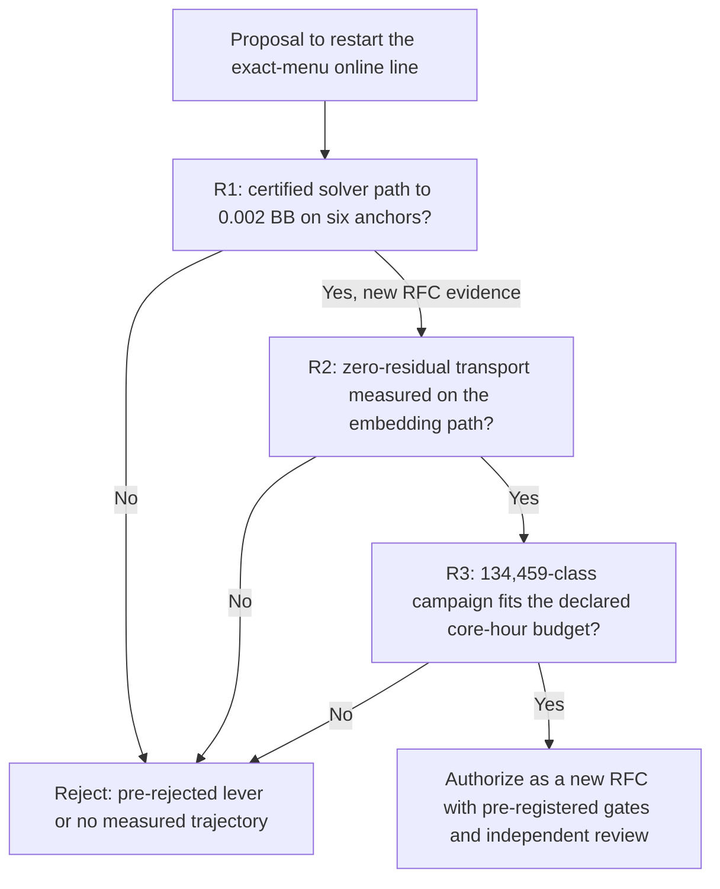

# Decision Record: Exact-Menu Online River Blueprint Is Closed

Status: Current
Date: 2026-11-18
Scope: the RFC 0049/0050 line — offline exact cap-0 river equilibrium
artifacts served through the online bounded-menu path against the frozen
0.002 BB e_embed gate.

This record exists so the line is not re-walked. It states what the
RFC 0050 campaign proved, the three independent walls that close the
online route, and the exact, falsifiable conditions under which a
restart would be legitimate. "Run it longer" is not one of them. The
companion record
[m2-certification-terminal-state.md](m2-certification-terminal-state.md)
formalizes the same evidence as the closed cap-1/cap-0 menu dilemma and
adds the M2-specific B0-margin restart criterion (R4).

## 1. Decision

The exact-menu online river blueprint is **closed, not paused**. RFC
0050 delivered its structural result (the pure-menu wall can be made
zero) but the online 0.002 BB serving line has no feasible path under
the current solver family, transport design, and compute scale. No
implementation, schema, codec, mount, host, wire, or threshold change is
authorized by this record; any restart requires a new RFC that satisfies
the criteria in section 4 against the evidence standards in section 4.4.

## 2. What remains true — the structural result is retained

When the served menu matches the solved exact cap-0 menu, the pure-menu
structural term is genuinely zero. All six decision-bearing anchors
measured a zero pure-menu term with `pure_menu_measured=1` (a measured
zero, not an unmeasured default — the distinction that withdrew an
earlier claim during Stage 2), and the result was reproduced bitwise
across independent processes. This eliminates the 22-31 BB pure-menu
wall measured on bounded-menu policies in RFC 0049, but only inside a
tree that serves the exact menu. Memory was never the constraint: the
exact RiverGame allocates ~202 MiB (40x under the 8 GiB offline
envelope) and a single-anchor exact policy (39.55-141 MiB) fits the
256 MiB resident budget. Do not "fix" memory in a future restart; it is
not a wall.

## 3. The three independent blocking walls

Each wall alone is sufficient. A restart must clear all three.

### 3.1 Convergence wall — no trajectory toward the gate

The linear-average CFR/RM+ river kernel loses its steep ~-1.0 log-slope
law after roughly the first 200 iterations. On the rank-0 anchor
(28 threads, exact cap-0), the decisive three-rung measurement recorded
0.24053200 BB at iteration 400, a best of 0.14159415 BB at iteration
800 — still **71x over the 0.002 BB gate** — and a rise to 0.17584872 BB
at iteration 1600 (NashConv increased 24.2%; three-point OLS slope
-0.2259). The values were bitwise identical across two independent
processes, and the flattening is already present in single-thread data,
so this is neither noise nor a threading artifact. CFR guarantees only
an O(1/sqrt(T))-style upper envelope on average-strategy exploitability,
not pointwise monotonicity; the non-monotone tail is intrinsic to the
objective and solver, not an initialization defect (see the warm-start
analysis cited in section 7).

### 3.2 Coverage wall — campaign arithmetic does not close

The online frontier is 134,459 canonical classes (2,598,960 concrete
boards). Measured throughput is 6.1-27.2 s per iteration per anchor,
and the D303 thread-scaling probe established a 2.2561x ceiling at
28 threads (~42% Amdahl serial fraction): the kernel is compute-bound
and largely incompressible in parallel. Even under the **optimistic,
since-refuted** assumption that the early -1.0 law persisted to a
~26,000-iteration crossing, each anchor costs ~43 h single-thread
(~19 h on a 28-thread box); multiplied by 134,459 anchors that is
~5.78 million core-hours, roughly 292 wall-years on one 28-core box.
The measured non-monotone tail is worse than this lower bound because it
offers no crossing iteration at all.

### 3.3 Transport wall — exact policies cannot reach the bounded online tree

Online serving runs on bounded cap-k trees. Embedding an exact-menu
policy into that tree reintroduces the pure-menu residual measured at
22.13-31.43 BB regardless of solve quality; packing and compression
cannot remove edges the served tree does not contain. No zero-residual
transport scheme exists. The Stage 3 addendum that would design the
persistence and serving container was independently reviewed, then
suspended because its serving-quality half cannot be made
convergence-neutral and its gate (a Stage 1 PASS) does not exist.

## 4. Restart criteria

A restart proposal must name the criterion it satisfies and attach the
evidence specified below. The criteria are independent: satisfying one
does not relax the others.

### R1 — A certified solver path to the gate (algorithm criterion)

A solver family other than linear-average CFR/RM+ demonstrates, on the
existing exact cap-0 rank-0 tree and then all six decision-bearing
anchors, a measured trajectory to e_embed <= 0.002 BB within a declared
iteration and wall envelope, with an exploitability guarantee that
applies to the average policy actually served. Candidate families
include exploitability-descent / game-space optimization and
regularized mirror or saddle methods; note their monotone guarantees
typically concern a saddle gap, not the one-sided NashConv this project
scores, so the guarantee must be translated into the project's metric
before the run, not after.

The following do **not** satisfy R1 and are pre-rejected on existing
evidence: longer walls or more iterations of the unchanged solver; more
threads (the 2.2561x ceiling is measured); same-game warm-start (it is
the D307 resume trajectory, bitwise-identical to an uninterrupted solve,
and cannot change the trajectory); averaging-weight, discounting (DCFR),
or vanilla-regret switches (uniform averaging and vanilla RM were
measured worse during the RFC 0047 campaign; the linear RM+ mode is the
measured best on this tree).

### R2 — A zero-residual transport (serving criterion)

A serving design under which the exact policy reaches online decisions
with a measured pure-menu term of zero through the actual embedding path
— not merely inside the solved tree — on all six anchors, with the
measurement recorded as a measured zero (`pure_menu_measured=1`
discipline; an unmeasured default zero is invalid evidence). The
existing RFC 0047 certified margin-gadget spine is the closest
scaffolding, but no margin transport for this path has been built or
measured.

### R3 — Campaign compute that fits a declared budget (scale criterion)

R3 may only be evaluated after R1 evidence exists, because without a
measured crossing trajectory there is no per-anchor iteration count to
budget. The proposal must declare the offline budget in core-hours and
show the closed arithmetic: measured per-anchor solve time under R1
times 134,459 classes, divided by the measured (not assumed) parallel
efficiency, fits the budget. The baseline to beat is the optimistic
~5.78 million core-hour lower bound in section 3.2. Hardware improvements
can satisfy R3 only in combination with R1; compute alone cannot
resurrect a path whose measured trajectory never reaches the gate.

### 4.4 Evidence standards for any restart

- Native bench targets under the existing `bigshark_rfc0047_bench`
  guard, exercising the real solver and scoring path; no source-text or
  log-pattern tests.
- Pre-registered gates, rungs, and verdicts before the long run; the
  four-typed PASS / CONVERGENCE_NO_GO / BUDGET_NO_GO / INCONCLUSIVE
  taxonomy, with unmeasured defaults never reported as measured zeros.
- Bitwise reproducibility across independent processes and across the
  thread counts used in the budget arithmetic.
- Independent non-author review per the RFC process, with every numeric
  claim recomputed from sealed receipts.
- A new RFC. An amendment to RFC 0050 cannot carry a restart because the
  campaign's measurement-only authorization is spent and the closed
  verdict is part of the record.

## 5. What does not justify a restart

- "Just run longer" / a larger wall on the unchanged solver: the
  BUDGET_NO_GO verdict is a decision, not a pause, and the decisive run
  already extended the trajectory to iteration 1600 where it worsened.
- More cores, bigger machines, or distributed workers without R1: the
  serial fraction and the missing trajectory are both measured.
- Warm starts, checkpoint reuse, or parameter retuning of the same
  CFR family: foreclosed analytically or measured inferior.
- Relaxing or replacing the 0.002 BB gate, or adopting a different
  quality contract: that is a separate program with its own RFC, not a
  restart of this line, and must not be presented as one.
- A single-anchor success: the coverage (3.2) and transport (3.3) walls
  remain independently binding.

## 6. Restart evaluation flow

## 7. Evidence index

- Campaign RFC: [RFC 0050](../rfcs/0050-exact-menu-offline-blueprint-feasibility.md)
  and its ledger row in [the RFC registry](../rfcs/README.md).
- Final measured conclusion:
  [final-evidence-and-conclusion.md](../plans/ablation/rfc0050/final-evidence-and-conclusion.md).
- Warm-start analytical foreclosure:
  [warm-start-legitimacy.md](../plans/ablation/rfc0050/warm-start-legitimacy.md).
- Sealed receipts (census, calibration, exact convergence, thread
  scaling, resume cost, boundary, deep rerun, decisive run):
  [docs/plans/ablation/rfc0050/](../plans/ablation/rfc0050/).
- Predecessor no-go records with the same evidentiary discipline:
  RFC 0043 (offline equity blueprint structural no-go), RFC 0045
  (instrument inadequacy), RFC 0047/0049 (bounded-menu materiality and
  the wide-menu Stage 1 NO-GO).

## 8. Maintenance rule

This record is Current while the river solver kernel, the 0.002 BB gate,
the online resident envelope, and the frontier size (134,459 classes)
remain as described. If any of them changes, the corresponding wall must
be re-evaluated against its own criterion above and this record updated
in the same change; the closure itself stands until at least one
criterion is met with the section 4.4 evidence.
