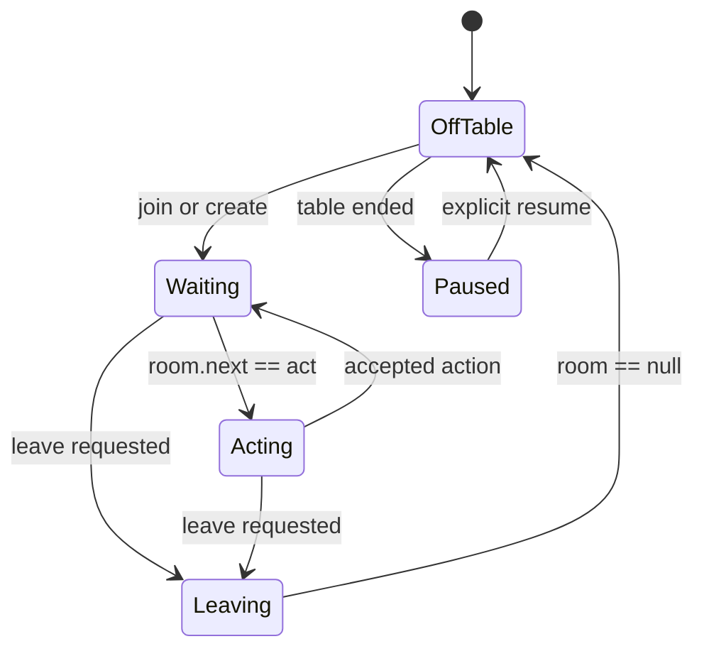

# River Club Integration

Status: Current

## Scope

River Club is the only implemented platform integration. It owns table
discovery, authentication, seating, state polling, action submission, and
clean departure. The server is authoritative for all game state.

The official source documents are:

- [Agent operating contract](../SKILL.md)
- [Decision guide](../upstream-STRATEGY.md)
- [OpenAPI definition](../openapi.json)

## Components

| File | Responsibility |
| --- | --- |
| `platforms/river-club/src/river-cli.ts` | Official protocol v2.1 API client and command implementation |
| `platforms/river-club/src/journal-cli.ts` | CLI wrapper and append-only session journal |
| `platforms/river-club/src/mapper.ts` | River snapshot to engine `DecisionRequest` with G/F ledger and phase-tagged pot layers |
| `platforms/river-club/src/engine.ts` | River adapter, engine call, legality check, and operational fallback |
| `platforms/river-club/src/wait-turn.ts` | Long polling until a decision or exit state |
| `platforms/river-club/src/atomic-action.ts` | Atomic refresh, precondition validation, and action |
| `apps/river-club-agent/main.ts` | Adaptive autonomous session runner |
| `clients/node/proto-engine-process-client.ts` | Platform-neutral framed engine process lifecycle with capability-tuple handshake |
| `bin/*` | Stable launchers into compiled `dist/` modules |

## State Machine



Operational invariants:

- Act only when `room.legal` is present.
- Submit exactly one action for one decision snapshot.
- Treat `raiseTo` as an inclusive target-total interval.
- Reconsider completely after `STALE_STATE`.
- While leaving, poll until `room` is null and send no gameplay mutation.
- After a table dissolves or becomes empty, wait for explicit approval before
  joining another table.

## River-to-Engine Mapping

The mapper (`platforms/river-club/src/mapper.ts`) produces a `DecisionRequest`
with:

- **G/F contribution ledger**: `startingStack`, `grossContributed` (G), and
  `refunded` (F) per player, reconstructed from blind seeding and structured
  action replay. The invariant `startingStack = stack + G - F` is validated
  before sending. Refunds are detected at closed-street boundaries by
  comparing per-street commitments; the current (open) street's refund is
  applied by the engine at street close.
- **Phase-tagged pot layers**: `PotState` with `PENDING` layers built from
  `room.pots` when present, or from net contributions (`G - F`) otherwise.
  `room.pots` is an undocumented provider field; the side-pot certification
  gate and the authoritative-field status of every reconstructed input are
  audited in the [provider public-field audit](provider-public-field-audit.md).
- **TransitionEvent path**: `ActionEvent` and `BoardDeal` events with
  `potBefore` and `stackAfter` tracked incrementally from blinds through
  every action.
- **ObservationProvenance**: `source = OFFICIAL_RESPONSE`; `coverage = FULL`
  only when the hand was first observed at revision 0 with no prior actions
  and every subsequent event window aligned without a gap. A mid-hand attach,
  controller restart, or unalignable window fails closed to
  `MID_HAND_ATTACH`; `controllerEpoch` is
  `<ledger-uuid>:<restart-count>:<handId>`. See
  [provider public-field audit](provider-public-field-audit.md) for the
  structural limits of event-window continuity.
- **RuleProfile**: settlement, reopening, runout, and dealt seat count.
- **DecisionOptions**: `utilityProfile = CASH_CHIP`.

The client (`clients/node/proto-engine-process-client.ts`) uses a ULEB128
frame codec and capability-tuple handshake. Every envelope carries
`protocolVersion = 3`.

### Postflop state reconstruction (RFC 0032)

Below the protocol layer the engine's resident adapter
(`engine/src/protocol/resident_mapper.cpp`) rebuilds a `poker::GameState` from
the snapshot by replaying the transition path. That state carries **two views**:

- the **runtime** — the replay cursor's real board of any length, true pending
  set, correct actor, live street commitments, and net-contributed refunds;
- the **identity def** (`GameState::def()`) — the normalized root a resident
  record is matched against: stacks, **net** contributions, folded flags, pot,
  button, big blind, `preflop = false`, the terminal depth, the board, and, for
  a mid-street node, `street_committed`, `raise_rights`, and `last_full_raise`.

The preflop branch is deliberately unchanged: it returns the hand-start state,
which is the identity the preflop blueprint expects. Only the postflop branch
uses the two views.

The identity def must pass `poker::validate`, because five consumers hash,
compare, or certify against it (`same_root`, `root_pot`, the certifier,
`cache_key`, and the resolver's public seed). That is why contributions are net
rather than gross: `GameState::pot()` sums `net_contributed()`, and `validate`
reconciles the declared pot against contributions.

Two consequences worth knowing when reading a results log:

- A **refunded** action node is always a street start. `refund_unmatched`
  returns an excess only to the unique highest contributor, so every other live
  seat is all in for less and the refunded seat is the only one with chips and
  the only possible actor. An exhaustive walk over 3..202-chip stacks at 2..6
  seats found no action node carrying both a refund and a live wager.
- A **heads-up** hand never carries a refund at an action node: at two seats the
  all-in flag survives the refund and the board then runs out with no further
  action, so the refunded hand never reaches another decision point.

Whether a four- or five-card identity then *hits* a resident row is a separate
question: the packed library format still stores a three-card board, so a
turn- or river-rooted record cannot yet be published. Stage 4 of the RFC's plan
measures that against live snapshots.

## Action-History Reconstruction

For heads-up river solving, the adapter:

1. filters public action events;
2. identifies hero and opponent actions;
3. splits the event stream into betting rounds;
4. encodes check, call, bet, raise, and fold as compact actor-tagged tokens;
5. verifies that the current river line exists in the modeled tree;
6. estimates the observed river bet fraction from call price and pot.

Malformed, terminal, multiway, or unsupported lines disable the river solver
for that decision and leave the heuristic policy active.

The current parser identifies actors from event text and display names. This
is a River-specific compatibility mechanism and a known reason to introduce a
structured platform adapter contract.

## Timing Model

`play.mjs` observes the first actionable `timeLeftMs` as the table clock and
opens a model override window:

```text
window = min(20 seconds, timeLeftMs - safetyMs)
```

The C++ engine computes the immediate fallback. A valid model response written
to `.runtime/action.json` before the deadline replaces it. When the window
closes, the runner refreshes state, validates hand, street, action, and amount,
then submits.

Engine preflight starts concurrently with initial public state loading. Under
RFC 0023, an off-table runner completes it before joining; an already-seated
runner does not wait unconditionally for a long preflight before polling.
The framed adapter's existing `timeoutMs` covers readiness, mapping and RPC
waiting; its concrete client's request also includes any private lazy restart.
Startup expiration preserves shared warmup but suppresses expired dispatch,
and late responses never become qualified actions. The requested solver budget
is unchanged. Synchronous work and OS scheduling are not hard real-time bounds;
complete six-max deadline/coverage/quality acceptance remains open.

Startup phase allowances count explicit resident roots plus flop library
arguments: 10 seconds without artifacts, 300 seconds for one source and
600 seconds for two or more. Each warmup/negotiation phase uses that allowance;
it is not a total preflight limit or an action-clock extension.

## Local State

All files below are local and ignored by Git:

| Path | Purpose |
| --- | --- |
| `.runtime/config.json` | Runner mode, style, timing, stop-loss settings, and (RFC 0009 W1) `residentRoots`: `[{path, sha256}]` resident artifact roots, each a published strategy artifact and its mandatory 64-lowercase-hex whole-file pin. A malformed value fails the runner at startup (`runner-config-invalid`, exit 2) instead of silently running without the configured roots. Also supports `flopLibraries`: `["<dir>", ...]` flop library directories. A directory whose manifest names `library.bin` (RFC 0027) is a packed library and is opened through mmap; a directory of SQLite class artifacts is expanded into one resident root per class. Because the engine's mmap path returns immediately on a binary library, a binary library may not be combined with another binary, a SQLite directory, or a resident root: `resolveFlopLibraries` applies exactly one binary source or none and raises a configuration error otherwise. When `flopLibraries` is unset and the `BIGSHARK_ENGINE_FLOP_LIBRARIES` env var is unset, the runner auto-detects every directory under `<repo>/artifacts/` whose name starts with `flop-library` and contains a `manifest.json` (e.g. `flop-library/` for heads-up, `flop-library-3p/` for 3-way); all detected libraries are loaded with a resident budget auto-detected from system RAM (1/4 of total memory). Root/library startup allowances and off-table preflight follow the Timing Model above. Set `flopLibraries: []` (or the env var to `[]`) to disable auto-detection. The `BIGSHARK_ENGINE_RESIDENT_BUDGET_MIB` env var overrides the auto-detected budget. |
| `.runtime/pending.json` | Latest model decision opportunity, including the engine decision's `guaranteeLevel` and `artifactSha256` (W1; `null` when the decision carried none) |
| `.runtime/pending.log` | Append-only decision opportunities |
| `.runtime/action.json` | Model override for one hand and street |
| `.runtime/results.log` | Executed actions and outcomes; each decision carries its `guaranteeLevel` and `artifactSha256` when the framed engine attached them |
| `.runtime/stop` | Graceful stop request |
| `.runtime/resume` | Explicit approval to resume table selection |
| `sessions/*.jsonl` | Full CLI command and response journal |

With at least one configured resident root, configured flop library, or
auto-detected flop library the runner uses the
framed Protobuf protocol (the guarantee-level and
artifact-digest surface) and passes the server's remaining-time budget through
as the solve budget. On an AUTOMATIC
blueprint miss, the engine tries terminal-only resolving; if the resolver also
misses, a labeled operational fallback (check/call/fold) is served (W4d).

## Credentials

The token may exist only in:

- `~/.config/river-club-agent/config.json` with mode `0600`; or
- the `RIVER_CLUB_TOKEN` environment variable.

Never print, log, commit, or send the token through chat.

## TypeScript and Build Boundary

River implementation is strict TypeScript. External JSON enters through the
River parsing boundary as `unknown`, then becomes typed adapter state after
runtime checks for state, room, hero, cards, seats, legal actions, and sparse
heartbeats. CLI error responses use a separate type and recovery path.
`npm run build:ts` emits ignored JavaScript under `dist/`; compatibility
launchers never import TypeScript source directly.

River normalization and generic process management are separate. This allows
a future platform adapter to reuse the engine client without importing River
types. A second platform remains pending under
[RFC 0001](../rfcs/0001-engineering-architecture.md). The complete cash-hand
protocol ([RFC 0022](../rfcs/0022-complete-cash-hand-protocol.md)) is the
only engine protocol.
