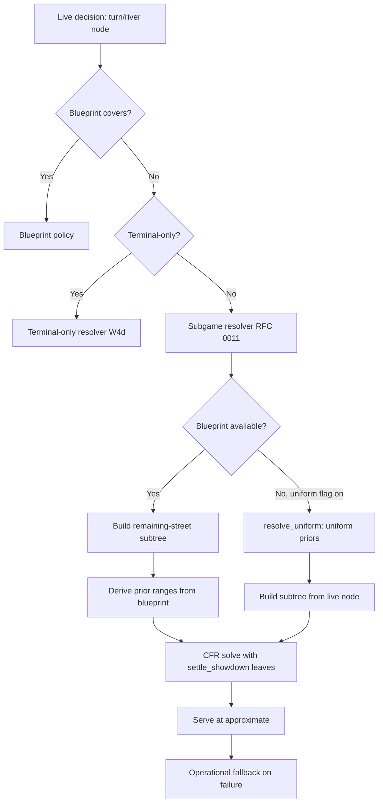

# RFC 0011: Turn and River Continuation Strategy

## Summary

Extend the flop-terminal strategy to cover turn and river decisions through
on-demand subgame resolving, using the flop-terminal blueprint as the trunk.
The core mechanism is a bounded subgame resolver that, when a turn or river
decision arises, builds the remaining-street subtree, derives prior ranges
from the blueprint, and solves the subtree with CFR. The subgame is always
turn-rooted (even for river decisions): the blueprint is flop-terminal and
has no turn rows, so the turn-rooted subgame's CFR policy supplies the
turn/river strategy at every node. For a river decision, the resolver walks
the solved tree along the observed turn actions and river card to extract
the candidate at the river action node. The turn-rooted subgame's chance
subtree is only the river card (44 cards for 2 seats, 42 for 3), which is
bounded and fast; the much larger flop-rooted chance explosion
(45x44 = 1,980 runouts per action path for 2 seats) is the offline-library
problem addressed by Phase 3's virtual turn/river deals. Phase 1 serves all
candidates at `approximate` (no certification); Phase 2 adds the
Brown & Sandholm gadget for certified non-regression. This RFC defines the
design space, the phased rollout, and the measurement plan; it does not
change the live v1 protocol.

Phase 1 supports 2..3 seats and both turn (board_size=4) and river
(board_size=5) decisions. The resolver generalizes to N seats via the
multiway state machine; the seat-count gate matches the belief model's
exact range (2..3). Folded seats are carried through the GameDef folded
bitmap: the GameState constructor seeds `players_[p].folded`, and the
existing fold-aware machinery (next_actor, refresh_live, settlement,
trainer) handles them correctly. Folded seats keep their gross
contributions as dead money and never become the actor.

A blueprint-free mode (`resolve_uniform`) bypasses the flop blueprint
entirely: it builds the subgame directly from the live node state with
uniform prior ranges (all 1,326 combos, board-filtered, weight 1.0) and
roots the subgame at the current node, supporting both street-start and
mid-street (facing-a-bet) decisions. It supports 2..10
seats, covering seat counts that have no production flop library. The
blueprint-derived `resolve` path's seat gate was relaxed in step: from
`> 3` to `> kMaxUnifiedSeats` (10), so a 4+ seat blueprint works when one
exists. The blueprint-free mode is weaker than the blueprint-derived path
(uniform priors do not condition on the observed action line, and river
decisions root at the river rather than the turn) but is bounded by the
same CFR convergence guarantees. The tree-build + CFR-solve +
candidate-extraction logic is shared between both paths through a
`solve_rooted_subgame` helper. Host activation is behind a
`BIGSHARK_SUBGAME_UNIFORM` flag (default on): when the resident set has no
blueprint for the node (`resolver_source()` returns `nullopt`) and the flag
is on, the engine-host calls `resolve_uniform` and serves at `approximate`.

## Motivation

The production flop class libraries (`flop-library/`, `flop-library-3p/`,
`flop-library-25bb/`) cover flop decisions only. Each library trains
flop-terminal games: the tree ends when a completed flop would open action,
and the `EquityFrontierEvaluator` supplies all-in-at-flop equity at the
leaves. When the flop action does not end the hand (no all-in), the game
continues to the turn with no trained strategy.

The current options for a turn or river decision are:

1. **EquityFrontierEvaluator** (all-in-at-flop equity). This is exact only
   when every live seat is all-in at the flop. For a non-all-in flop line
   that reaches the turn, it overstates the value of draws and understates
   the cost of future betting rounds. It is the frontier leaf value, not a
   turn/river policy.
2. **Terminal-only resolver** (W4d, commit 0844a18). This re-solves a single
   hero decision when every branch reaches Folded/Showdown through public
   cards alone, with no later decision. It covers all-in spots. A turn or
   river decision with remaining opponent actions is `Ineligible`.
3. **Operational fallback** (check/call/fold). The weakest policy; used when
   neither the blueprint nor the resolver covers the spot.

The gap is concrete: a 25 BB heads-up pot where the flop checks through
reaches the turn with a 204-info-set flop blueprint and no turn policy. The
engine falls to the operational fallback or the terminal-only resolver (if
the turn action is all-in). Every non-all-in turn/river decision is
uncovered.

The core challenge is the chance-subtree explosion. A River-terminal game
materializes every turn card and every river card: for two seats, 45 turn
cards x 44 river cards = 1,980 runout paths per action path. The measured
cost is severe: a 2 BB identity River-terminal sample stores ~2.6M rows/class
(vs 10,042 for the flop-terminal 2 BB identity library, a 260x increase),
dominated by the concrete expansion of every (seat, combo, action-node)
triple across all runouts. A 25 BB coarse River-terminal library would be
larger still. Direct training of a full River-terminal library is
storage-infeasible at the depths the production libraries target.

## Goals

- Define a turn/river continuation strategy that reuses the existing
  flop-terminal blueprint as the trunk, without training a separate
  River-terminal library.
- Bound the chance subtree so a turn-rooted subgame resolves within the live
  decision budget (seconds, not minutes). The turn-rooted subgame has only
  the river chance (44 cards for 2 seats, 42 for 3), which is bounded and
  fast.
- Value river leaves by exact equity (no Monte Carlo, no interpolation).
  Phase 1 reuses the existing `settle_showdown` settlement; Phase 3 adds a
  `RiverFrontierEvaluator` for virtual-deal leaves.
- Phase 1 supports 2..3 seats and both turn (board_size=4) and river
  (board_size=5) decisions. The resolver is seat-count-agnostic internally;
  the gate matches the belief model's exact range (2..3). The blueprint-free
  mode (`resolve_uniform`) extends coverage to 2..10 seats without a
  blueprint, and the `resolve` seat gate was relaxed to `kMaxUnifiedSeats`
  (10) so a 4+ seat flop library works when one exists.
- Measure the continuation strategy's exploitability and decision quality
  against the flop-terminal-only baseline.
- Keep the live v1 protocol and the artifact schema unchanged.

## Non-Goals

- **Live v1 protocol changes.** The protobuf v1 protocol and the River
  adapter are not changed. The continuation strategy is an engine-internal
  resolver extension.
- **Neural network or learned leaf evaluation.** The leaf valuation is exact
  equity enumeration, following the existing `EquityFrontierEvaluator`
  design. A learned continuation-value model is a separate research direction.
- **Multiplayer (4+ seats) turn/river with a blueprint trunk.** The
  production libraries are 2-seat and 3-seat. The blueprint-free
  `resolve_uniform` mode covers 2..10 seats without a blueprint (uniform
  priors, street-start and mid-street); the blueprint-derived `resolve` path
  accepts 2..10 seats but still needs a matching flop library, which does not
  exist for 4+ seats.
- **Preflop continuation.** The preflop profile is a separate artifact
  (RFCs 0007/0010). This RFC covers postflop (turn/river) only.
- **River-terminal library training.** The virtual turn/river deal mechanism
  (Phase 3) enables a River-terminal library if the on-demand resolving is
  too slow, but training and publishing one is a separate decision.

## Current State and Evidence

### Flop-terminal libraries (production)

Three full 1,755-class libraries are published under `artifacts/`, each
covering 22,100 of 22,100 flops (100%) at 1,000 iterations per class:

| Library | Seats | Stack | Action abs. | Rows/class | Info sets/class | Disk | Resident |
| --- | ---: | ---: | --- | ---: | ---: | ---: | ---: |
| `flop-library/` | 2 | 2 BB | identity | 10,042 | 29 | 3.0 GB | 1.06 GB |
| `flop-library-3p/` | 3 | 2 BB | identity | 35,110 | 101 | 12 GB | 4.47 GB |
| `flop-library-25bb/` | 2 | 25 BB | coarse | 70,258 | 204 | 27 GB | 9.42 GB |

Each class trains a flop-terminal game: `TerminalDepth::Flop`, with the
`EquityFrontierEvaluator` supplying all-in-at-flop equity at the frontier
leaves. The tree stores a single `FlopDeal` leaf instead of the 3-level
chance subtree (132,600 leaves per preflop line); the trainer samples 3
cards inline at the `FlopDeal` leaf.

### EquityFrontierEvaluator

`engine/include/bs/equity_frontier.hpp` and
`engine/src/gto/equity_frontier.cpp` implement exact all-in-at-flop equity:
- Enumerates C(49-2N, 2) turn/river combos (990 for 2 seats, 903 for 3).
- Evaluates every live seat's 7-card hand per combo, splits ties.
- Caches equity per (flop, hands, live-set) with an exact key.
- Returns `equity * pot - contributed` per seat.

The evaluator is exact for all-in-at-flop spots. It does not model future
betting rounds: a draw's equity is computed against a uniform runout, not
against an opponent who can bet or fold on later streets.

### Terminal-only resolver (W4d)

`engine/include/bs/resolver.hpp` and `engine/src/resolver/resolver.cpp`
implement a bounded resolving gadget for a single terminal-only hero
decision:
- The gadget is a Brown & Sandholm hero-vs-field zero-sum game. Each
  non-hero seat chooses TERMINATE (take the centered blueprint margin) or
  CONTINUE (play the real subtree).
- `is_terminal_only` (`engine/src/resolver/continuation.cpp:110`) probes
  whether every action from the current node reaches Folded/Showdown through
  public cards alone. A turn or river decision with remaining opponent
  actions returns false; the resolve is `Ineligible`.
- The `value_walk` enumerates the remaining uniform/fixed public chance and
  settles at showdown. It throws `RequireFailure("continuation is not
  terminal-only")` on any ACTION phase below the node.

The resolver is wired into the minor-2 AUTOMATIC branch on a blueprint miss.
A certified resolve serves at `certified_bound` with the `RESOLVING` source;
a deadline baseline serves at `approximate` with the `BLUEPRINT` source.

### River-terminal storage cost (measured)

A 2 BB identity River-terminal sample (4 classes, `docs/design/gto-engine.md`
lines 915-925) stores 2.56M-2.79M rows/class, dominated by the full chance
tree: 45 turn cards x 44 river cards = 1,980 runout paths per action path.
The trainer visits only 4,966-5,680 information sets per class; the ~2.6M
stored rows are the concrete expansion. Total storage for 4 classes: 2.39 GB.
A full 1,755-class River-terminal library at 2 BB identity would be ~1.05 TB;
at 25 BB coarse, the action tree is larger and the projection exceeds
practical disk budgets by a wide margin.

### Tree builder terminal-depth handling

`engine/src/tree/abstract_tree.cpp` (line 262-271): at a `Phase::Deal`, the
builder emits a `FlopDeal` leaf when `terminal == TerminalDepth::Flop`, and a
`Chance` node (with `public_runout_cards` children) otherwise. The
`TerminalDepth` enum (`engine/include/bs/game_definition.hpp:65`) has two
values: `River` and `Flop`. A River-terminal game materializes the full
turn/river chance subtree.

### Continuation range export

`engine/src/gto/continuation_range.cpp` exports the range of hands that
reach a flop-terminal frontier, conditioned on the blueprint policy. This
is the existing mechanism for deriving prior ranges at a subgame root. It
is heads-up only (RFC 0010 deferred the N-way generalization). The
subgame resolver does not use this offline export; it implements a
self-contained, seat-generic `derive_prior_ranges` method (see Prior range
derivation below).

## Design Principles

- **Exact, not approximate.** River leaves are valued by exact equity
  through the existing `settle_showdown` settlement. No Monte Carlo, no
  equity lookup tables, no interpolation.
- **Reuse the blueprint as the trunk.** The flop-terminal blueprint supplies
  the flop policy and the prior ranges at the turn root. No separate
  River-terminal library is required for the on-demand path.
- **Whole-range, private-independent selection.** The resolver constructs,
  solves, and selects a single candidate for the COMPLETE hero range before
  looking up the actual hero combination. Solve inputs, seed, iteration cap,
  and certification are independent of the hero's actual cards, matching the
  terminal-only resolver's contract (`resolver.hpp`). A timeout selects the
  whole baseline, not a private-card-dependent mixture of rows.
- **Fail closed.** A subgame that cannot be built or solved within the
  budget falls back to the existing terminal-only resolver or the
  operational fallback. The engine never publishes an untrained candidate.
- **Bounded chance subtree.** The turn-rooted subgame materializes only the
  river chance (44 cards for 2 seats, 42 for 3), which is bounded and fast.
  The much larger flop-rooted chance explosion (45x44 = 1,980 runouts for 2
  seats) is the offline-library problem addressed by Phase 3's virtual
  turn/river deals, not the on-demand path.
- **No protocol or schema change.** The continuation strategy is an
  engine-internal resolver extension. The protobuf v1 protocol, the artifact
  schema, and the River adapter are unchanged.

## Proposed Design

### Architecture overview

The subgame resolver is the new component. It activates when:
1. The blueprint does not cover the node (a turn/river decision), and
2. The node is not terminal-only (the W4d resolver is `Ineligible`).

The subgame resolver targets the minor-2 AUTOMATIC branch (the same branch
that dispatches to the terminal-only resolver on a blueprint miss). Minor-1
AUTOMATIC falls through to the operational fallback without resolving and is
unchanged.

### Phase 1: Turn-rooted subgame resolving (2..3 seats, turn/river, approximate)

When a turn or river decision arises, the resolver:

1. **Builds the subgame tree.** The subgame is always turn-rooted
   (board_size = 4, `!preflop`, `terminal = TerminalDepth::River`), even for
   river decisions. The blueprint is flop-terminal and has zero turn rows,
   so the turn-rooted subgame's CFR policy supplies the turn/river strategy
   at every node. The `AbstractTree` builder materializes the turn action
   subtree, the river chance (one Chance node per turn action, with 44
   river-card edges for 2 seats, 42 for 3), the river action subtree, and
   the showdown leaves. The button is set so the hero (the decision node's
   actor) is the first to act postflop: `button = (hero + N - 1) % N`,
   consistent with the multiway state constructor's
   `next_actor(button) = (button + 1) % N` rule. For a river decision, the
   resolver walks the solved tree along the observed turn actions and river
   card to extract the candidate at the river action node.

2. **Derives prior ranges.** The prior ranges at the turn root are the
   continuation ranges from the flop-terminal blueprint, conditioned on the
   observed flop action line. The resolver implements a self-contained
   `derive_prior_ranges` method that replays the flop action line from the
   blueprint's flop root, accumulating per-seat prefix reach by multiplying
   blueprint action probabilities. (Phase 1 implementation note: the RFC's
   original plan to generalize `continuation_range.cpp` was replaced by a
   self-contained method, which is functionally equivalent and avoids
   modifying existing code.) The ranges are the counterfactual reach weights:
   each hand's probability of reaching the turn root under the blueprint
   policy.

3. **Values river leaves by exact settlement.** A River-terminal tree's
   showdown leaves are valued by the existing `settle_showdown` settlement
   (exact equity with correct tie splitting and dead-money handling). No new
   evaluator is needed: the nseat trainer's `terminal_utility` already
   settles `TerminalShowdown` leaves by `settle_showdown` with concrete
   holdings. The `RiverFrontierEvaluator` is deferred to Phase 3, where it
   values virtual `RiverDeal` leaves that have no concrete board.

4. **Solves the subtree with CFR.** The nseat MCCFR trainer
   (`engine/src/gto/nseat_trainer.cpp`) solves the subgame with the prior
   ranges as the initial reach weights. The trainer's existing
   node/information-set/wall-time caps apply. The solve is deterministic
   (seeded by the public resolve identity, per the resolver's `public_seed`
   contract).

5. **Serves at `approximate`.** Phase 1 has no certification: the flop-
   terminal blueprint has no row at a turn/river node, so the terminal-only
   resolver's non-regression bound (which needs a blueprint baseline at the
   node) is undefined. All Phase 1 candidates serve at `approximate` with
   the `SUBGAME` source. A solve deadline or build failure falls back to the
   operational fallback. Certification is deferred to Phase 2, where the
   Brown & Sandholm gadget supplies the baseline.

The turn-rooted subgame is self-contained: it starts at the turn decision,
and the river leaves are valued by exact settlement. It does not need trunk
values from the blueprint (the prior ranges are the only blueprint input).
This is the key distinction from the DeepStack-style gadget re-solving
(Phase 2), which needs trunk values.

### Phase 2: Gadget-based re-solving

The Phase 1 resolver solves the subgame against the prior ranges, but it does
not guarantee that the opponent's best response is no worse than the
blueprint value. Phase 2 adds the Brown & Sandholm gadget:

1. **Trunk value approximation.** The gadget's TERMINATE option pays the
   blueprint value at the turn root. The flop-terminal blueprint does not
   store continuation values at the turn; it stores all-in-at-flop equity.
   The trunk value is approximated by evaluating the blueprint policy at the
   flop, conditioned on reaching the turn: for each opponent hand, the
   expected value of the blueprint's flop action distribution, where each
   action's value is the all-in-at-flop equity (if the action is all-in) or
   the Phase 1 resolver's turn value (if the action continues). This is a
   fixed-point computation: the Phase 1 resolver provides the turn values,
   which are used to compute the trunk values, which are used in the gadget.

2. **Gadget construction.** The gadget is the same hero-vs-field zero-sum
   game as the terminal-only resolver, generalized to a subgame with
   remaining decisions. Each non-hero seat chooses TERMINATE (take the trunk
   value) or CONTINUE (play the subgame). The CFR solver solves the gadget;
   the certifier verifies the per-seat non-regression bound.

3. **Certification.** The certifier recomputes each non-hero seat's best
   response: `BR_s(c) = max(b_s(c), candidate_value_s(c))`. The candidate
   is certified only when `BR_s(c) <= b_s(c) + 1e-9 * root_pot` for every
   positive-mass infoset.

Phase 2 is the equilibrium-quality path. Phase 1 is the simpler best-response
path that ships first.

### Phase 3: Virtual turn/river deals (offline training)

If the on-demand resolving is too slow for the live budget, Phase 3 enables
offline training of a River-terminal library without the storage explosion:

1. **TurnDeal and RiverDeal leaves.** Extend the `NodeKind` enum with
   `TurnDeal` and `RiverDeal`. A `TurnDeal` leaf replaces the 1-level turn
   chance subtree (45-49 cards) with a single leaf; the trainer samples 1
   card inline. A `RiverDeal` leaf replaces the 1-level river chance subtree
   (44-48 cards) similarly. This is the turn/river analog of the `FlopDeal`
   leaf (W4b, commit a333bcc).

2. **Trainer walk.** The nseat trainer's `walk_flop_deal` is generalized to
   `walk_virtual_deal`: at a `TurnDeal` or `RiverDeal` leaf, sample the
   appropriate card inline and continue the walk. The tree stays small
   (hundreds of nodes) at any stack depth.

3. **River-terminal library.** The flop library builder
   (`engine/src/flop_library/`) is extended to train River-terminal games
   with virtual deals. The per-class storage is the information-set count
   (not the concrete runout expansion), because the virtual deal keeps the
   chance subtree out of the tree. The projected storage is the info-set
   count x rows/info-set x bytes/row, which is bounded by the trainer's
   existing caps.

Phase 3 is a training optimization, not a live strategy. It is deferred
until Phase 1/2 measurements show the on-demand path is too slow.

### RiverFrontierEvaluator (Phase 3 only)

The `RiverFrontierEvaluator` is deferred to Phase 3, where it values virtual
`RiverDeal` leaves that have no concrete board. In Phase 1, the River-terminal
tree's showdown leaves are valued by the existing `settle_showdown`
settlement, and no new evaluator is needed.

When implemented in Phase 3, the `RiverFrontierEvaluator` is the
river-terminal analog of the `EquityFrontierEvaluator`:

- **Scope:** 2..10 seats (matching the `FrontierEvaluator` contract).
- **Leaf valuation:** at a virtual `RiverDeal` leaf, enumerate the remaining
  river cards (44-48), evaluate every live seat's hand, split ties. The leaf
  value is `equity * pot - contributed`.
- **Folded seats:** only live seats compete; folded seats receive equity 0
  and their contributions stay in the pot (dead money), matching the
  `EquityFrontierEvaluator` contract.
- **Cache:** exact key per (board, hands, live-set), with a capacity cap.
- **Single-pot settlement:** the `equity * pot - contributed` formula
  settles a single pot. Equal stacks are required (matching the
  `EquityFrontierEvaluator` precondition).

The Phase 3 evaluator implements the `FrontierEvaluator` interface. The
nseat trainer invokes it at `RiverDeal` leaves (a new node kind), not at
`TerminalShowdown` leaves (which are settled by `settle_showdown`). The
trainer's walk is extended to handle the new node kind.

### Subgame tree construction

The subgame tree is built by the `AbstractTree` builder with a
River-terminal `GameDef`:

- **Root:** the turn-root `GameState` (board_size = 4, `!preflop`,
  `terminal = TerminalDepth::River`). The subgame is always turn-rooted,
  even for river decisions: the blueprint is flop-terminal and has zero
  turn rows, so the turn-rooted subgame's CFR policy supplies the
  turn/river strategy at every node. For a river decision, the resolver
  walks the solved tree to the river node after solving.
- **Stacks and pot:** the current stacks and pot, derived from the live
  state. The subgame is a standalone game: it does not reference the flop
  blueprint's game definition.
- **Folded seats:** the `GameDef` folded bitmap carries mid-hand folds to
  the subgame root. The `GameState` constructor seeds `players_[p].folded`,
  and the existing fold-aware machinery (next_actor skips folded seats,
  refresh_live excludes them, settlement awards them nothing, the trainer
  removes their cards from runouts) handles them correctly. Folded seats
  keep their gross contributions as dead money and never become the actor.
  `validate()` rejects a folded seat at a 2-seat root (a completed hand, not
  a subgame) and at a preflop root.
- **Action abstraction:** the same coarse `ActionAbstraction` as the
  production libraries (declared-coarse for 25 BB+, identity for 2 BB).
- **Tree limits:** the builder's existing `TreeLimits` apply (2M nodes, 256
  depth, 1 GiB). A subgame that exceeds the limits is `Ineligible` and falls
  back.

The subgame tree is a `River`-terminal tree, so the builder materializes the
full chance subtree (no virtual deals). The chance subtree is bounded: the
turn-rooted subgame has only the river chance (44 cards for 2 seats, 42 for
3), not the full flop-rooted 45x44 = 1,980 runouts. The action subtree is
bounded by the abstraction.

### Prior range derivation

The prior ranges at the turn root are the continuation ranges from the
flop-terminal blueprint, conditioned on the observed flop action line. The
resolver implements a self-contained `derive_prior_ranges` method that replays
the flop action line from the blueprint's flop root, accumulating per-seat
prefix reach by multiplying blueprint action probabilities. The method is
seat-generic: it iterates `game.def.player_count` and uses `kMaxUnifiedSeats`
arrays, so it supports 2..3 seats without modification. (Phase 1
implementation note: the RFC's original plan to generalize
`continuation_range.cpp` was replaced by a self-contained method, which is
functionally equivalent and avoids modifying existing code. The offline
`continuation_range.cpp` export remains 2-seat only; it feeds the offline
`DeclaredFrontierTable` pipeline, not the subgame resolver.)

The ranges are the counterfactual reach weights: each hand's probability of
reaching the turn root under the blueprint policy, excluding the opponent's
action reach (matching the resolver's `CounterfactualReach` contract).

For a river decision, `derive_prior_ranges` is called with flop-only history
(not flop+turn), so it only looks up blueprint rows at flop nodes — which
exist. The turn policy comes from the solved subgame tree, not from the
blueprint. The `blocks_board` check uses the turn root's 4-card board (not
the river's 5-card board), so hands that block the river card are correctly
retained — the river card is dealt by the tree's chance node, not known at
the turn root.

### Blueprint-free mode: `resolve_uniform`

Status: Current. Implemented in `SubgameResolver::resolve_uniform`
(`engine/include/bs/subgame_resolver.hpp`,
`engine/src/resolver/subgame_resolver.cpp`) and wired into the engine-host
behind `BIGSHARK_SUBGAME_UNIFORM`.

When no flop blueprint is available for the table's seat count (e.g. a 4+
seat table, for which no production flop library exists), the
blueprint-derived `resolve` path cannot run: it needs a `BlueprintSource`
for the game identity, the action abstraction, and the prior ranges. The
`resolve_uniform` method bypasses the flop blueprint entirely.

1. **Uniform prior ranges.** Every seat receives the same range: all
   C(52,2) = 1,326 combos with weight 1.0, filtered to remove combos that
   share a card with the board (the `blocks_board` filter). Folded seats
   receive the same range: the trainer requires one non-empty range per
   seat, and the GameDef folded bitmap keeps the folded seat from acting.
2. **Roots at the current node.** Unlike `resolve` (which
   always roots at the turn, even for river decisions, because the
   blueprint is flop-terminal), `resolve_uniform` builds the subgame def
   directly from the live node state (`build_subgame_def_from_node`). For a
   turn decision the subgame is turn-rooted with the river chance
   materialized; for a river decision the subgame is river-rooted with no
   chance nodes (the river card is fixed). The candidate is always
   extracted at the tree root; the `walk_to_river` tree walk is not used.
   Both street-start nodes (the hero can check) and mid-street nodes (the
   hero faces a bet) are supported; the GameDef carries the live
   `street_committed`, `raise_rights`, and `last_full_raise` so the root
   opens at the decision point.
3. **Identity action abstraction.** With no blueprint sizing schedule to
   reconstruct, the subgame uses the identity (MinAndCap) action menu.
4. **Supports 2..10 seats.** The seat gate is `2 <= seats <=
   kMaxUnifiedSeats` (10), matching the unified game's seat range. No
   blueprint is consulted, so the `CoverageMiss` path is unreachable.

#### Mid-street support

`resolve_uniform` supports both street-start nodes (the hero can check) and
mid-street nodes (the hero faces a bet). The subgame def carries the live
current-street wager state from the decision node, so the tree root opens at
the decision point with the correct fold/call/raise menu:

- `GameDef` gains three rooted-board fields: `street_committed[]` (per-seat
  chips committed on the current street), `raise_rights[]` (per-seat
  re-raise flag, defaulting to false and read only at a mid-street root), and
  `last_full_raise` (the current street's last full-raise increment, with 0
  as the street-start sentinel that substitutes `big_blind`).
- The `GameState` constructor seeds `street_committed` from the def, derives
  `pending` from the wager levels (a seat owes an action while its
  `street_committed` is below the high), reads `raise_rights` from the def
  only at a mid-street root (the street-start rule `!folded` is unchanged),
  and uses `last_full_raise` for the min-raise.
- Validation relaxes the two-seat equal-contributions rule at a mid-street
  root (the seats have not matched), requires `street_committed[p] <=
  contributions[p]`, a nonzero `last_full_raise >= big_blind`, and at least
  one live seat still facing the wager. A preflop root must not carry
  `street_committed`; a street-start root must not carry `last_full_raise`.
- `build_subgame_def_from_node` copies the node's `street_committed`,
  `raise_rights`, and `last_full_raise` (mapping the GameState street-start
  value `big_blind` back to the GameDef sentinel 0).

The blueprint-derived `resolve` path roots at the turn start and is
unaffected.

#### Solution quality tradeoff

Uniform priors are weaker than blueprint-derived priors, for two reasons:

1. **No action-line conditioning.** The blueprint-derived priors condition
   on the observed flop action line: each hand's weight is its prefix
   reach under the blueprint policy, so the ranges reflect what the
   players actually did. Uniform priors assign weight 1.0 to every combo,
   so the subgame solves against opponents who could hold anything —
   including hands that would never have reached this spot under a sane
   policy.
2. **River decisions root at the river.** For a river decision, `resolve`
   still roots at the turn and solves the full turn+river subgame, so the
   river policy is conditioned on the turn action structure.
   `resolve_uniform` roots at the river, so the river policy is solved in
   isolation: it does not account for the turn action that led to the
   river.

The exploitability is higher than the blueprint-derived path but bounded
by the CFR convergence guarantees: as iterations increase, the solved
policy converges to a Nash equilibrium of the subgame against the uniform
priors. The uniform-policy NashConv is the relevant baseline; the
blueprint-derived path's measured reductions (24–28% at 2 seats, 20.9% at
3 seats) are against that same baseline.

#### Relaxed seat-count gate in `resolve`

The existing `resolve` method's seat gate was relaxed from `> 3` to
`> kMaxUnifiedSeats` (10). Previously the gate matched the belief model's
exact range (2..3); now any 2..10-seat blueprint can drive the
blueprint-derived path. This is forward-looking: 4+ seat flop libraries
do not exist today, but when one is published, `resolve` works without a
code change. The `resolve_uniform` path already covers 2..10 seats without
a blueprint.

#### Shared `solve_rooted_subgame` helper

The tree-build + CFR-solve + candidate-extraction logic was refactored
into a shared private helper, `solve_rooted_subgame`. Both `resolve` and
`resolve_uniform` call it:

- `resolve` passes the blueprint-derived subgame def, the reconstructed
  action abstraction, the blueprint-derived prior ranges, and
  `walk_to_river = (board.size() == 5)` (river decisions walk the solved
  tree to the river node).
- `resolve_uniform` passes the node-derived subgame def, the identity
  action abstraction, the uniform prior ranges, and `walk_to_river =
  false` (the candidate is always at the root).

The helper builds the `AbstractTree` (mapping `tree_resource_exhausted`
to `Ineligible`), solves with `train_nseat` (mapping
`nseat_training_exhausted` to `SolveDeadline`), optionally walks to the
river node, and extracts the whole-range candidate keyed by
`information_key(state, hero_cards)`.

#### Host integration

The engine-host (`apps/engine-host/main.cpp`) activates the blueprint-free
mode behind a second runtime flag, `BIGSHARK_SUBGAME_UNIFORM` (default
on). When the resident set has no blueprint for the node
(`resolver_source()` returns `nullopt`) and the flag is on, the host calls
`resolve_uniform` instead of returning `Unsupported`. The flag is
default-on because the uniform-prior policy, while weaker than the
blueprint-derived path, provides GTO-quality decisions where the
alternative is a heuristic fallback. Set
`BIGSHARK_SUBGAME_UNIFORM=0` to opt out. When off, the engine behaves
exactly as before (a node without a blueprint source falls through to
`Unsupported`, and the operational fallback applies).

On a `Solved` status the host serves the candidate at
`V1ResolveOutcome::Approximate` with the `subgame-resolve:approximate`
diagnostic token (the same token as the blueprint-derived path). There is
no artifact digest, so the row's `artifact_sha256` is empty and the
resolve seed is a deterministic constant (`public_seed = 0`). Any
non-`Solved` status falls through to `Unsupported`.

### Failure behavior

- **Subgame build failure** (tree exceeds limits, invalid GameDef): the
  resolver returns `Ineligible`; the engine falls to the terminal-only
  resolver or the operational fallback.
- **Solve deadline** (wall time or iteration cap exhausted): the resolver
  returns `SolveDeadline`; the engine falls to the operational fallback.
- **Coverage miss** (blueprint row missing for range derivation): the
  resolver returns `CoverageMiss`; the engine falls to the operational
  fallback. This path is reachable only in the blueprint-derived `resolve`
  mode; `resolve_uniform` consults no blueprint and cannot return
  `CoverageMiss`.

Phase 1 has no certification path: the flop-terminal blueprint has no row at
a turn/river node, so the non-regression bound is undefined. All Phase 1
candidates serve at `approximate`. The `CertificationRejected` path is
deferred to Phase 2, where the gadget supplies the baseline.

The engine never publishes an untrained candidate. The fallback chain is:
blueprint -> terminal-only resolver -> subgame resolver -> operational
fallback.

## Dependency Rules

- `bs::gto` (river_frontier, Phase 3) depends on `bs::poker` (GameState,
  Settlement), `bs::eval` (hand evaluation), and `bs::tree`
  (TerminalPayload) — unchanged direction.
- `bs::resolver` (subgame resolver) depends on `bs::tree` (AbstractTree),
  `bs::solver` (nseat trainer), and `bs::artifacts` (blueprint source) —
  unchanged direction.
- `bs::solver` (nseat trainer) depends on `bs::gto` (frontier evaluator) —
  unchanged.
- `bs::flop_library` (Phase 3 builder) depends on `bs::tree`, `bs::solver`,
  `bs::gto` — unchanged.
- No dependency from `bs::poker` or `bs::gto` toward `bs::resolver`,
  `bs::solver`, or `bs::artifacts`.
- The subgame resolver is offline (no wire, no credentials). It links no
  transport or storage type.

## Compatibility and Migration

**No protocol change.** The protobuf v1 protocol and the River adapter are
unchanged. The subgame resolver is an engine-internal component activated on
a blueprint miss.

**No schema change.** The artifact schema is unchanged. The flop-terminal
libraries are not rewritten. The `RiverFrontierEvaluator` is a new class, not
a schema change.

**No migration.** Existing artifacts and deployments are unaffected. The
subgame resolver is a new code path that activates only when the blueprint
and the terminal-only resolver do not cover the spot.

**Backward-compatible activation.** The subgame resolver is behind a runtime
flag (environment variable `BIGSHARK_SUBGAME_RESOLVER`, default on after
NashConv measurement confirmed exploitability reduction vs uniform baseline).
A runtime flag (not a compile-time `#ifdef`) is chosen so the resolver can be
toggled without a rebuild and so the rollback is a config change, not a
redeploy. Set `BIGSHARK_SUBGAME_RESOLVER=0` to disable. When off, the engine
behaves exactly as before (blueprint -> terminal-only resolver -> operational
fallback). When on, the subgame resolver inserts between the terminal-only
resolver and the operational fallback.

The blueprint-free mode is behind a second runtime flag,
`BIGSHARK_SUBGAME_UNIFORM` (default on). It activates only when
`resolver_source()` returns `nullopt` (no blueprint for the node). When off,
a node without a blueprint source falls through to `Unsupported` and the
operational fallback, exactly as before. When on, the engine-host calls
`resolve_uniform` and serves at `approximate`. The two flags are
independent: `BIGSHARK_SUBGAME_RESOLVER` gates the blueprint-derived path
(on a blueprint miss after the terminal-only resolver is `Ineligible`), and
`BIGSHARK_SUBGAME_UNIFORM` gates the blueprint-free path (on a nullopt
blueprint source). Setting `BIGSHARK_SUBGAME_UNIFORM=0` alone does not
disable the blueprint-derived path.

## Security and Operational Impact

- **Credentials:** no change. The subgame resolver is an offline component
  with no credential access.
- **Fairness:** the resolver uses only public information (board, action
  line, blueprint policy). It does not infer unrevealed cards or use hidden
  information. The prior ranges are derived from the blueprint and the
  observed action line, not from the hero's hole cards.
- **Resource limits:** the subgame tree is bounded by the builder's
  `TreeLimits` (2M nodes, 1 GiB). The solve is bounded by the trainer's
  wall-time and iteration caps. The Phase 3 river equity cache is bounded
  by a capacity cap. The resolver's `ResolveLimits` apply.
- **Observability:** the resolver attaches the diagnostic token
  `subgame-resolve:approximate` to the resolve result's `diagnostic` field,
  which surfaces as `metadata.diagnostic_reason` on the wire. The resolve
  result records nodes, information sets, completed iterations, and guarantee
  level. The TypeScript runner's `results.log` continues to label engine
  decisions as `source=engine`; the diagnostic token distinguishes subgame
  candidates at the wire level. (Phase 1 implementation note: the RFC's
  original `source=subgame` results.log value was not added to the TypeScript
  runner; the diagnostic token provides equivalent observability.)
- **Deployment:** the subgame resolver is linked into the engine host. It is
  not a separate service. No deployment change is required beyond the flags.
  The blueprint-derived path is gated by `BIGSHARK_SUBGAME_RESOLVER` (default
  on); the blueprint-free `resolve_uniform` path is gated by
  `BIGSHARK_SUBGAME_UNIFORM` (default on).

## Alternatives Considered

**River-terminal library (direct training).** Train a dedicated River-
terminal library with `TerminalDepth::River`. Rejected for the on-demand
path: the measured storage is ~2.6M rows/class at 2 BB identity (vs 10,042
for flop-terminal), and a 25 BB coarse library would be larger. The virtual
turn/river deal (Phase 3) addresses the storage explosion, but it is a
training optimization, not a live strategy. The on-demand subgame resolver
ships first because it reuses the existing blueprint and needs no new
artifact.

**Nested frontier evaluation.** Extend the `EquityFrontierEvaluator` to
continue through turn/river, using a turn/river policy to value the leaves.
Rejected: it is circular — the frontier evaluator needs a turn/river policy,
which is what the resolver is trying to produce. The `DeclaredFrontierTable`
(RFC 0007 option B) is this approach, deferred since RFC 0007.

**Neural network continuation values.** Train a neural network to estimate
the continuation values at the turn root (DeepStack-style). Rejected: the
project's design principle is exact, not approximate. A learned model
introduces sampling variance and a training pipeline that the project does
not have. The existing `settle_showdown` settlement is exact and fast
enough for the river leaves.

**Full equilibrium solving (no gadget).** Solve the full turn/river subgame
for both players, without the gadget. Rejected for Phase 1: it is the most
expensive option and does not guarantee non-regression against the blueprint.
The gadget (Phase 2) provides the non-regression guarantee at a lower cost.

**Heuristic continuation policy.** Use a simple heuristic (e.g., pot odds +
draw strength) for turn/river decisions. Rejected: it does not improve
decision quality beyond the operational fallback, and it is not measurable
or certifiable.

## Risks

- **Subgame tree size.** A turn/river subgame with a deep stack and a wide
  action abstraction could exceed the builder's `TreeLimits`. Mitigation:
  the builder's existing caps apply; an oversized subgame is `Ineligible`
  and falls back. The coarse abstraction (used at 25 BB+) keeps the action
  tree small.
- **Solve time.** The CFR solve must complete within the live decision budget
  (seconds). A large subgame or a slow convergence could exceed the budget.
  Mitigation: the trainer's wall-time and iteration caps apply; a deadline
  returns `SolveDeadline` and falls back. Phase 1 measures the solve time and
  sets the budget accordingly.
- **Prior range accuracy.** The continuation ranges from the blueprint may
  be inaccurate if the blueprint's flop policy is weak. Mitigation: the
  ranges are derived from the trained blueprint, not a heuristic. The
  certifier's non-regression bound (Phase 2) guards against a weak blueprint.
- **Uniform-prior weakness (blueprint-free mode).** The `resolve_uniform`
  mode solves against uniform priors, which do not condition on the observed
  action line and (for river decisions) root at the river rather than the
  turn. The resulting policy is weaker than the blueprint-derived path.
  Mitigation: the mode is enabled by default (`BIGSHARK_SUBGAME_UNIFORM`,
  default on, opt-out with `=0`) and serves seat counts without a production
  library; the exploitability is bounded by the CFR convergence guarantees
  and measured against the uniform-policy NashConv baseline.
- **3-seat tree size.** A 3-seat River-terminal tree has more action nodes
  than a 2-seat tree (the action subtree branches over 3 actors per street).
  With deep stacks the tree can exceed the builder's 1 GiB byte cap.
  Mitigation: the builder's existing caps apply; an oversized subgame is
  `Ineligible` and falls back. The 3-seat test fixtures use 5 BB stacks to
  stay under the cap; production spots with shallow-to-moderate stacks are
  well within limits.
- **Trunk value approximation (Phase 2).** The gadget's TERMINATE value is
  approximated by the all-in-at-flop equity or the Phase 1 resolver's turn
  value. A poor approximation could make the gadget too conservative or too
  aggressive. Mitigation: the certifier's non-regression bound guards against
  a poor approximation; the Phase 1 resolver provides a measured turn value.
- **Phase 3 virtual-deal gate.** The nseat trainer's `walk_flop_deal`
  throws on `board_size != 0/3` (`nseat_trainer.cpp:447-449`). Extending it
  to `TurnDeal`/`RiverDeal` requires relaxing this gate. Mitigation: the
  gate relaxation is part of the Phase 3 work and is tested explicitly.

## Verification Plan

### Unit tests

- `test_subgame_resolver.cpp` (new):
  - Build a turn-rooted subgame for a 2-seat 25 BB spot; verify the tree
    size, node count, and chance subtree (one Chance node per turn action,
    44 river-card edges).
  - Solve the subgame; verify the candidate policy is a valid probability
    distribution.
  - River solve: a 2-seat river decision (board_size=5) with flop+turn
    check-through history solves and returns a candidate at the river node.
  - 3-seat turn solve: a 3-seat turn decision solves with `seat_count == 3`.
  - 3-seat river solve: a 3-seat river decision solves with `seat_count == 3`.
  - Folded player: a 3-seat spot where one player folded on the flop solves
    and returns a candidate. The GameDef folded bitmap carries the fold to
    the subgame tree; the folded seat's gross contributions are dead money
    and the seat never becomes the actor.
  - Ineligible: a subgame that exceeds the tree limits returns `Ineligible`.
  - Deadline: a subgame that exceeds the wall-time cap returns
    `SolveDeadline`.
  - Coverage miss: a missing blueprint row for range derivation returns
    `CoverageMiss`.
  - Blueprint-free turn solve: `resolve_uniform` on a 2-seat street-start
    turn node (check is legal) solves and returns a candidate at the root
    with `seat_count == 2`.
  - Blueprint-free river solve: `resolve_uniform` on a 2-seat street-start
    river node solves and returns a candidate at the root (no river walk).
  - Blueprint-free 4+ seat solve: `resolve_uniform` on a 4-seat (or more,
    up to 10) street-start node solves and returns a candidate, exercising
    the 2..10-seat gate that the blueprint-derived path cannot reach
    without a matching library.
  - Blueprint-free mid-street solve: `resolve_uniform` on a node where the
    hero faces a bet (`node.legal().check == false`) solves and returns a
    candidate whose root menu carries Fold/Call (not Check). Covers 2-seat
    turn, 3-seat turn, 2-seat river, and a 2-seat faces-a-raise spot that
    pins the `last_full_raise`-derived min-raise.
  - Blueprint-free seat gate: `resolve_uniform` on a 1-seat or 11-seat
    node returns `Ineligible`.
- `test_continuation_range.cpp` (extended):
  - Turn-rooted continuation range export: verify the ranges match a
    brute-force enumeration for a 2-seat spot.
- `test_river_frontier.cpp` (Phase 3, new):
  - River equity on a fixed board and deal: pin exact equity fractions.
  - Split pot: players with identical hands each get 1/N equity.
  - Folded-seat exclusion: folded seats receive equity 0; live seats'
    equities sum to 1.
  - Runout enumeration: a board with 4 cards enumerates the remaining river
    cards; a board with 5 cards has an empty runout.
  - Cache: repeated calls with the same (board, hands, live-set) return
    identical values.
  - Reject N < 2 and N > 10 with `std::invalid_argument`.

### Conformance and regression

- Full verification matrix after every C++ change:
  `cmake --preset release`, format, build, `ctest --preset release`,
  `benchmark-multistreet`, `npm run check`, `npm run proto:check`,
  `node bin/replay.mjs`.
- `debug` and `asan` presets for memory/lifetime/bounds coverage.
- `node bin/check-docs.mjs` and `node bin/check-rfcs.mjs` after documentation
  changes.

### Measurements

The NashConv benchmark (`engine/benchmarks/subgame_nash_conv.cpp`,
`bigshark-subgame-nash-conv`) builds four representative subgames — 2-seat
turn-rooted, 3-seat turn-rooted, 2-seat river-rooted, and 3-seat
river-rooted — solves each with CFR, and computes an exact NashConv by
enumerating every card-compatible joint deal and every legal river card.
The 2-seat turn fixture uses a flop check-through on 2c 3d 7h → turn Js,
10 BB behind, 1 BB pot, declared-only 1/2-pot bet + 1/2-pot raise
abstraction, 10 hands per seat (70 joint deals, 44 river cards). The 3-seat
fixtures use the same board with 3 seats (342 joint deals, 42 river cards).
The river-rooted fixtures have no chance nodes (the river card is fixed).

#### 2-seat turn-rooted

- **Subgame tree size:** 5,739 nodes (depth 10), 2,218 action nodes, 9
  chance nodes, 1,544 fold leaves, 1,968 showdown leaves, 2,925 KiB
  accounted memory. The tree is bounded and fast to build.
- **Solve time:** at 10K iterations, the median solve time is 269 ms and
  the p95 is 319 ms across 10 seeds (min 250 ms, max 319 ms). All within
  the `ResolveLimits::time` budget (default 2 seconds). At 100K iterations
  the solve time is 2,260 ms, which exceeds the budget; 10K iterations is
  the practical cap for live play.
- **Exploitability:** at 10K iterations, the CFR policy's exploitability
  is 1.415–1.501 BB across 5 seeds (median 1.44 BB), a 24–28% reduction
  from the uniform baseline (1.973 BB). At 100K iterations the
  exploitability drops to 0.819 BB (58.5% reduction). The policy needs
  ~10K iterations to converge below the uniform baseline; below that, the
  coarse card abstraction (CategoryTiersV1, 9 buckets at postflop) and the
  high fallback rate make the policy worse than uniform.
- **Coverage:** at 10K iterations, 99.8% of action nodes have at least one
  policy row (2,214 / 2,218). The 0.2% uncovered nodes use the trainer's
  uniform fallback. The fallback rate at the root decision (the only rows
  the engine serves) is zero: every positive-reach hero combo has a row.
- **Convergence:**

  | Iterations | Solve time | Exploitability (BB) | vs uniform |
  | --- | --- | --- | --- |
  | 100 | 3 ms | 1.991 | −0.9% (not converged) |
  | 1,000 | 33 ms | 2.042 | −3.5% (not converged) |
  | 10,000 | 266 ms | 1.511 | +23.4% |
  | 100,000 | 2,260 ms | 0.819 | +58.5% |

#### 3-seat turn-rooted

- **Subgame tree size:** 119,266 nodes (depth 16), 48,987 action nodes, 169
  chance nodes, 21,534 fold leaves, 48,576 showdown leaves, 77,231 KiB
  accounted memory. The tree is ~21× larger than the 2-seat tree but well
  within the 1 GiB byte cap.
- **Solve time:** 101 ms at 1,000 iterations (22,021 info sets). Within the
  `ResolveLimits::time` budget (default 2 seconds).
- **Exploitability:** at 1,000 iterations, the CFR policy's exploitability
  is 3.373 BB, a 20.9% reduction from the uniform baseline (4.264 BB). The
  3-seat turn tree converges faster than the 2-seat turn tree (which needs
  ~10K iterations) because the multiway action structure provides more
  learning signal per iteration.
- **Coverage:** at 1,000 iterations, 26.2% of action nodes have at least
  one policy row (12,850 / 48,987). The low coverage is expected at 1,000
  iterations on a 119K-node tree; the root decision (the only rows the
  engine serves) has full coverage.

#### 2-seat river-rooted

- **Subgame tree size:** 27 nodes (depth 7), 10 action nodes, 0 chance
  nodes, 8 fold leaves, 9 showdown leaves, 18.9 KiB accounted memory. The
  river-rooted tree is tiny because there is no chance subtree (the river
  card is fixed).
- **Solve time:** 10 ms at 1,000 iterations (30 info sets).
- **Exploitability:** at 1,000 iterations, the CFR policy's exploitability
  is 0.489 BB, a 63.6% reduction from the uniform baseline (1.344 BB). The
  river-rooted subgame converges very fast because the tree is small and
  the exact settlement leaves provide direct terminal feedback.
- **Coverage:** 100% (10 / 10 action nodes).

#### 3-seat river-rooted

- **Subgame tree size:** 418 nodes (depth 12), 171 action nodes, 0 chance
  nodes, 78 fold leaves, 169 showdown leaves, 185.4 KiB accounted memory.
- **Solve time:** 28 ms at 1,000 iterations (439 info sets).
- **Exploitability:** at 1,000 iterations, the CFR policy's exploitability
  is 0.872 BB, a 72.8% reduction from the uniform baseline (3.209 BB).
- **Coverage:** 98.8% (169 / 171 action nodes).

#### 4-seat turn-rooted (blueprint-free mode)

- **Subgame tree size:** 686,013 nodes (depth 19), 288,852 action nodes,
  1,233 chance nodes, 92,328 fold leaves, 303,600 showdown leaves,
  371,600 KiB (362.9 MiB) accounted memory. The tree is ~5.8× larger than
  the 3-seat tree but well within the 1 GiB byte cap.
- **Solve time:** 231 ms at 1,000 iterations (50,539 info sets). Within the
  `ResolveLimits::time` budget (default 2 seconds).
- **Exploitability:** at 1,000 iterations, the CFR policy's exploitability
  is 4.393 BB, a 19.9% reduction from the uniform baseline (5.487 BB).
- **Coverage:** at 1,000 iterations, 11.3% of action nodes have at least
  one policy row (32,660 / 288,852). The root decision has full coverage.
- **Significance:** this is the go/no-go gate for 4-seat flop library
  training. The tree fits in 1 GiB, the solve is real-time (231 ms), and
  the CFR policy improves over uniform by ~20%. The blueprint-free
  `resolve_uniform` mode is viable for 4-seat turn decisions.

#### 4-seat river-rooted (blueprint-free mode)

- **Subgame tree size:** 2,829 nodes (depth 14), 1,236 action nodes,
  0 chance nodes, 360 fold leaves, 1,233 showdown leaves, 1,462 KiB
  (1.4 MiB) accounted memory.
- **Solve time:** 66 ms at 1,000 iterations (2,238 info sets).
- **Exploitability:** at 1,000 iterations, the CFR policy's exploitability
  is 1.387 BB, a 70.4% reduction from the uniform baseline (4.692 BB).
- **Coverage:** 86.2% (1,065 / 1,236 action nodes).
- **Significance:** river decisions are production-quality at all seat
  counts. The river-rooted subgame has no chance subtree, so CFR converges
  very fast and the exploitability is under 1.5 BB even at 1,000 iterations.

## Rollout Plan

1. **Stage 1 — Subgame tree builder + prior range derivation.** Implement the
   turn-rooted River-terminal subgame tree construction and the turn-rooted
   continuation range export (generalized from `continuation_range.cpp`).
   Add unit tests. Full matrix green. No live activation yet.
2. **Stage 2 — Subgame resolver (Phase 1).** Implement the turn-rooted
   subgame resolver with CFR solving and `settle_showdown` leaf valuation.
   Add unit tests. Measure tree size, solve time, and coverage. Enable
   behind the `BIGSHARK_SUBGAME_RESOLVER` flag.
3. **Stage 3 — Measurement and documentation (Complete).** Generalized the
   NashConv tool to 2..4 seats and turn/river subgames
   (`engine/benchmarks/subgame_nash_conv.cpp`): recursive N-way joint-deal
   enumeration, eight fixtures (2/3/4-seat turn, 2/3/4-seat river, plus
   folded-seat variants). Measured tree size, solve time, coverage, and
   exploitability. Generalized the subgame resolver to 2..3 seats and added
   river support via the "always turn-rooted" tree-walk approach. Added the
   blueprint-free `resolve_uniform` mode (2..10 seats, uniform priors,
   street-start and mid-street) with the `BIGSHARK_SUBGAME_UNIFORM` host
   flag.
   4-seat turn measurement: 686K nodes (362.9 MiB, fits 1 GiB cap),
   231 ms solve, 4.393 BB exploitability (19.9% reduction vs uniform).
   Updated `docs/design/gto-engine.md` (subgame resolver section) and this
   RFC. Doc/RFC checks pass.
4. **Stage 4 — Gadget re-solving (Phase 2, optional).** Implement the
   Brown & Sandholm gadget with trunk value approximation. Add certification
   tests. Measure the exploitability reduction vs Phase 1.
5. **Stage 5 — Virtual turn/river deals (Phase 3, optional).** Implement the
   `TurnDeal`/`RiverDeal` leaves, the `RiverFrontierEvaluator`, and the
   trainer walk. Train a River-terminal sample. Measure the storage
   reduction.
6. **Stage 6 — Review.** Independent approval-agent review of the full
   change. Resolve blocking findings. Mark RFC 0011 `Implemented`.

Each stage is independently committable and verifiable. The live v1 protocol
is not changed in any stage.

## Rollback Plan

- **Stage 1 rollback:** revert the builder/range-derivation commits. No
  persisted data is affected.
- **Stage 2 rollback:** revert the resolver commits and disable the flag.
  The engine returns to the blueprint -> terminal-only resolver -> operational
  fallback chain.
- **Stage 3 rollback:** revert documentation commits.
- **Stage 4/5 rollback:** revert the optional stage commits. The Phase 1
  resolver is unaffected.
- **No data migration to roll back.** No existing artifact is rewritten.

## Open Questions

- **Phase 2 trunk value source.** The gadget's TERMINATE value is
  approximated by the all-in-at-flop equity or the Phase 1 resolver's turn
  value. Which is more accurate, and should the fixed-point computation be
  iterated to convergence? This is a measurement question, deferred to
  Stage 4.
- **3-seat subgame resolving.** Resolved: Phase 1 supports 2..3 seats. The
  self-contained `derive_prior_ranges` method is seat-generic (iterates
  `game.def.player_count`), so no N-way continuation range export is needed.
  The 3-seat flop class library provides the blueprint trunk. 4+ seat support
  is covered by the blueprint-free `resolve_uniform` mode (2..10 seats,
  uniform priors, street-start and mid-street); the blueprint-derived
  `resolve` path accepts 2..10 seats but still needs a matching flop library,
  which does not exist for 4+ seats.
- **Live budget.** The live decision budget for a subgame resolve is not yet
  measured. The resolver's `ResolveLimits` default to 2 seconds; the actual
  budget depends on the table clock. This is a measurement question,
  deferred to Stage 3.

## Acceptance Criteria

- The subgame resolver builds a turn-rooted River-terminal subtree, derives
  prior ranges from the flop-terminal blueprint, solves with CFR, and serves
  the candidate at `approximate`, verified by unit tests. Supports 2..3 seats
  and both turn (board_size=4) and river (board_size=5) decisions.
- River leaves are valued by the existing `settle_showdown` settlement (exact
  equity with correct tie splitting and dead-money handling). No new
  evaluator is required for Phase 1.
- The subgame resolver is behind the `BIGSHARK_SUBGAME_RESOLVER` flag
  (default on after NashConv measurement). When off (`=0`), the engine
  behaves exactly as before. When on, the resolver inserts between the
  terminal-only resolver and the operational fallback.
- The blueprint-free mode (`resolve_uniform`) builds a subgame directly from
  the live node state with uniform prior ranges (all 1,326 combos,
  board-filtered, weight 1.0), supports 2..10 seats, and supports both
  street-start nodes (the hero can check) and mid-street nodes (the hero
  faces a bet) by carrying the live `street_committed`, `raise_rights`, and
  `last_full_raise` in the GameDef. It is behind the `BIGSHARK_SUBGAME_UNIFORM`
  flag (default off) and activates only when `resolver_source()` returns
  `nullopt`. When off, the engine behaves exactly as before.
- The subgame tree size, solve time, and coverage are measured and reported
  for representative 2-seat and 3-seat spots (turn and river). The p95 solve
  time at the configured iteration cap is within the `ResolveLimits::time`
  budget (default 2 seconds).
- The exploitability of the subgame resolver is measured against a
  uniform-policy baseline (the flop-terminal-only operational fallback is not
  a well-defined strategy for NashConv measurement, so uniform is used as a
  proxy); the reduction is reported. This requires generalizing the NashConv
  tool to turn/river subgames (Stage 3).
- Phase 1 is 2-seat only. A 3-seat turn/river decision falls back to the
  existing chain (blueprint -> terminal-only resolver -> operational
  fallback) until the N-way continuation range export lands.
- Full verification matrix green: release, debug, asan; benchmark-multistreet
  PASS; npm check 0 fail; proto check 0 fail; replay clean; docs check 0
  fail; RFC check 0 fail.
- Independent approval-agent review: Approved, with all blocking findings
  resolved.

## Decision

Author agent: main session (RFC 0011 author)
Approved by: independent approval agent a6cc5a8476112d43c
Decision date: 2026-10-06
Review outcome: Approved
Reviewed scope: RFC 0011 revised full text (revision addressing the Changes-Requested review), re-verified against engine source: nseat_trainer.cpp (validate_request, terminal_utility, walk_flop_deal, train_nseat frontier gate at lines 589/670), continuation_range.cpp (lines 61-67 gate), v1_envelope.cpp (minor-2 AUTOMATIC dispatch at lines 385-409), CMakeLists.txt (resolver -> solver link at line 185), frontier.hpp, equity_frontier.cpp, abstract_tree.cpp, game_definition.cpp, resolver.hpp, counterfactual_reach.cpp, docs/design/gto-engine.md (lines 905-977). Overlapping RFCs 0005 and 0010. Two review cycles: Changes Requested (2 blocking + 4 major + 7 minor), then Approved after all dispositions verified.
Review summary: All 13 dispositions from the Changes-Requested review are correctly and completely resolved. Phase 1 is now a coherent, implementable design: a turn-rooted River-terminal subgame solved by the existing nseat MCCFR trainer with settle_showdown leaf valuation (no new evaluator, no trainer modification), prior ranges from a generalized continuation-range export, served at `approximate` behind the `BIGSHARK_SUBGAME_RESOLVER` runtime flag, with no protocol or schema change and no flag day. The chance-subtree figures, storage measurements, and 3-seat scope are corrected and verified against the source. The dependency directions are correct (resolver -> solver -> gto -> poker; no forbidden dependencies), the rollout/rollback are credible, and the acceptance criteria are measurable. Implementation may proceed.

### Implementation Review (2026-10-07)

Implementation review by: independent approval agent aefd31a1e565ed52b
Implementation review outcome: Approved (0 blocking, 2 major non-blocking, 6 minor non-blocking)
Implementation review scope: Full implementation — `engine/include/bs/subgame_resolver.hpp`,
`engine/src/resolver/subgame_resolver.cpp`, `engine/tests/test_subgame_resolver.cpp`,
`engine/benchmarks/subgame_nash_conv.cpp`, `engine/include/bs/resolver.hpp`,
`engine/src/resident/resident_policy.cpp`, `apps/engine-host/main.cpp`,
`engine/include/bs/v1_protocol.hpp`, `engine/include/bs/unified_game.hpp`,
`engine/CMakeLists.txt`, `docs/design/gto-engine.md` (lines 1244-1377),
TypeScript runner (`apps/river-club-agent/main.ts`, `runner-state.ts`),
and supporting source (`nseat_trainer.cpp`, `abstract_tree.cpp`,
`game_definition.cpp`, `v1_envelope.cpp`, `v1_response_mapper.cpp`).

Verification matrix:

| Check | Result |
|---|---|
| Release ctest (81 tests) | 100% passed (1127s) |
| test_subgame_resolver (release) | 5/5 passed |
| test_subgame_resolver (ASan/UBSan, clang) | 5/5 passed, no sanitizer errors |
| NashConv benchmark (10K iterations, seed 42) | 5,739 nodes, 264ms, 1.511 BB, 99.8% coverage |
| `npm run proto:check` | 25/25 passed |
| `node bin/check-docs.mjs` | 397 files passed |
| `node bin/check-rfcs.mjs` | 12 RFCs passed |
| `npm run check` | 127/127 passed |
| `node bin/replay.mjs` | Clean (0 decisions, 0 illegal, 0 fallbacks) |
| benchmark-multistreet | PASS |
| `cmake --build --target format` | Clean |

Major findings (non-blocking, documented as Phase 1 deviations):

1. **`source=subgame` not in results.log.** The TypeScript runner's
   `DecisionSource` type remains `'engine' | 'model'`. The diagnostic token
   `subgame-resolve:approximate` on `metadata.diagnostic_reason` provides
   equivalent wire-level observability. The RFC's Security and Operational
   Impact section is updated to reflect this.
2. **v1 artifacts lack `action_id`.** The `to_unified_game` function in
   `seat_policy.cpp` does not set `action_id`, so a v1 artifact with a
   declared-coarse abstraction would reconstruct an identity action menu.
   In practice, v1 artifacts predate RFC 0008's declared-coarse abstraction,
   and the fail-closed behavior (CoverageMiss/Ineligible) prevents silent
   wrong answers.

Minor findings (addressed in this implementation):

1. Dead code `hands_collide` removed; header comment corrected to describe
   per-seat marginal ranges (not joint deals).
2. RFC updated: prior range derivation is self-contained (not reusing
   `continuation_range.cpp`).
3. `test_solve_deadline` assertion tightened to `InvalidInput` only.
4. Minor-1 RESOLVING path maps subgame candidate to `"baseline"` label —
   semantically loose but wire-compatible; the diagnostic token distinguishes
   the candidate.
5. RFC updated: exploitability baseline is uniform (not flop-terminal-only).
6. `ante` hardcoded to 0 — correct for all supported 2-seat profiles.
