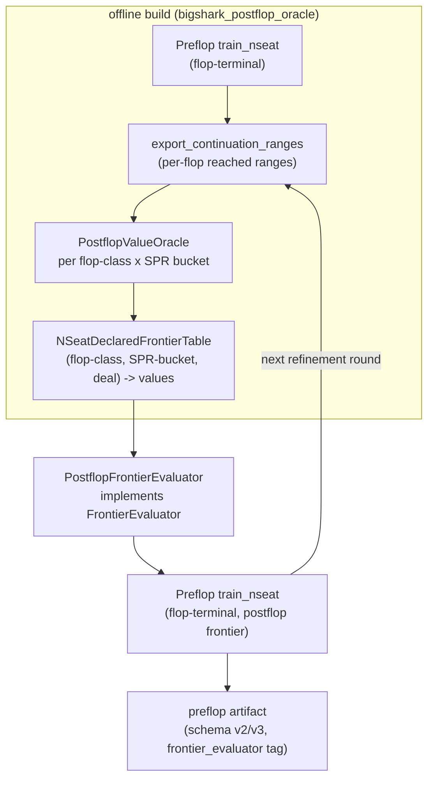

# RFC 0013: Preflop Phase 2: Postflop-Aware Frontier Evaluation

## Summary

Replace the all-in-at-flop `EquityFrontierEvaluator` with a postflop-aware
frontier evaluator that values each preflop frontier leaf by the equilibrium
value of the postflop (flop/turn/river) game. The postflop value is computed
offline by solving flop-rooted river-terminal subgames with the existing
`nseat_trainer`, extracting per-deal root values, and storing them in a
declared frontier table keyed by (flop class, SPR bucket). An iterative
refinement loop re-solves the postflop with the ranges that actually reach
each flop, converging to the depth-limited equilibrium. This removes the
jam/fold approximation that causes 24.81 BB exploitability at 100 BB, while
keeping GTO (CFR-solved values) as the default and retaining the equity
frontier only for short stacks where it is correct.

## Motivation

The published heads-up preflop blueprint (100 BB, 100K iterations,
`artifacts/preflop-profile/`) has measured NashConv 99.24 chips, i.e.
exploitability 49.62 chips = **24.81 BB** (big blind is 2 chips; NashConv /
player_count / big_blind). This is far too high for production play. The
design doc already states the cause: "the all-in-at-flop frontier
approximation ignores postflop betting"
(`docs/design/gto-engine.md`).

The `EquityFrontierEvaluator`
(`engine/src/gto/equity_frontier.cpp`) values a frontier leaf as
`equity * pot - contributed`, where `equity` is the exact showdown equity
after enumerating every turn/river runout. This is the value of getting
**all-in on the flop** and running out the board with no further betting. It
is exactly correct only for a jam/fold game. At 100 BB the postflop betting
tree (flop/turn/river bets, raises, folds, bluffs, pot control) creates and
destroys most of the EV, so a preflop strategy trained to maximize all-in
equity systematically mis-values hands: it over-values hands that jam well
and under-values hands that play well postflop, and it is blind to the
stack-to-pot ratio (SPR) that governs postflop strategy.

The same approximation exists one street deeper in the flop library
(`engine/src/flop_library/flop_library.cpp`): flop-rooted artifacts are
`TerminalDepth::Flop` and use the same equity frontier, so they model flop
betting but assume all-in for turn/river.

The governing philosophy is GTO by default; heuristics are permitted only in
extreme fallback. A 24.81 BB leak is not an extreme fallback, so the frontier
must become postflop-aware with CFR-solved values, not a heuristic patch.

## Goals

- A `PostflopFrontierEvaluator` implementing `bs::gto::FrontierEvaluator`
  that returns CFR-solved postflop equilibrium values (not all-in equity) for
  a frontier leaf.
- A heads-up 100 BB preflop blueprint trained with the postflop frontier
  whose NashConv exploitability is materially below the current 24.81 BB
  (target: under 10 BB), measured by the existing
  `bigshark-preflop-nash-conv` tool.
- Reuse of existing infrastructure: `nseat_trainer`, continuation-range
  export, flop class canonicalization, the declared-table pattern, and the
  preflop NashConv tool.
- A bounded offline build: a fixed number of postflop solves per
  (flop class, SPR bucket), each solved once, with O(1) lookup at training
  time.
- Retention of `EquityFrontierEvaluator` for stack depths where jam/fold is
  correct (<= 15 BB).

## Non-Goals

- Replacing the `nseat_trainer` or the CFR algorithm. The postflop solve uses
  the existing trainer unchanged.
- Changing the wire protocol, the engine host, or the live decision path.
  The frontier evaluator is offline solver-side tooling; the resident layer
  consumes the published preflop artifact exactly as today.
- A neural-network or learned value model. Phase 2 uses tabulated CFR-solved
  values only.
- Full multiway (3+ seat) postflop value tables in the first instance. The
  design is seat-generic; the first implementation and measurement target
  heads-up, with multiway staged later.
- Real-time (per-decision) postflop solving during live play. The postflop
  value table is precomputed offline.

## Current State and Evidence

### The frontier contract and the equity evaluator

`engine/include/bs/frontier.hpp` defines `FrontierEvaluator`:

```cpp
virtual std::vector<double> evaluate(std::span<const int> flop,
                                     std::span<const std::array<int, 2>> hands,
                                     const bs::tree::TerminalPayload& ledger) const = 0;
```

The contract (RFC 0007, extended by RFC 0010): values are expectations over
the policy's action distribution, **not** conditioned on the acting player's
own holding; 2..10 seats; folded seats receive equity 0 and their chips stay
in the pot. The `TerminalPayload` carries, per seat, `contributed`,
`refunded`, `stack`, and `folded`, plus the board and live-seat order
(`engine/include/bs/abstract_tree.hpp`). The evaluator therefore has
everything needed to compute the pot and the SPR.

`EquityFrontierEvaluator`
(`engine/include/bs/equity_frontier.hpp`,
`engine/src/gto/equity_frontier.cpp`) enumerates all
`C(49-2N, 2)` turn/river combos, evaluates each live seat's 7-card hand,
splits ties, and returns `equity * pot - contributed`. Results are cached per
(flop, hands, live-set). This is exact all-in-at-flop equity.

### The preflop training pipeline

`engine/benchmarks/preflop_profile_builder.cpp` builds a flop-terminal
preflop `GameDef` (`board_size = 0`, `terminal = TerminalDepth::Flop`),
trains with `train_nseat` and the `EquityFrontierEvaluator`, and publishes a
schema-v2/v3 artifact. The `nseat_trainer`
(`engine/src/gto/nseat_trainer.cpp`) samples a joint deal per sweep, walks
the preflop tree, and at each `FlopDeal` leaf samples 3 flop cards and calls
`frontier->evaluate(flop, hands, payload)`. The frontier value is the only
postflop signal the preflop strategy sees.

### Measured exploitability

- Heads-up, 100 BB, 100K iterations: NashConv 99.24 chips; exploitability
  49.62 chips = 24.81 BB (10K MC deals). Source:
  `docs/rfcs/0010-multiway-frontier-evaluation.md` and
  `docs/design/gto-engine.md`. (RFC 0010's prose labels 49.62 as "BB"; with
  `big_blind = 2` chips the correct BB figure is 24.81 BB.)
- 3-way, 10 BB, 100K iterations: NashConv 11.79 chips; exploitability
  1.964 BB (quoted from RFC 0010; the rounded 11.79/3/2 = 1.965 does not
  reproduce exactly because the source NashConv has more precision). The
  approximation is tolerable at 10 BB because jam/fold is close to correct
  at short stacks.
- The 3-way identity action tree exceeds the 2M-node cap past ~16 BB, so
  100 BB multiway requires the coarse `DeclaredOnly` menu (RFC 0008), which
  is already accepted by the trainer.

### Existing building blocks Phase 2 reuses

1. **Continuation-range export** (`engine/include/bs/continuation_range.hpp`,
   RFC 0007): `export_continuation_ranges(policy, tree, ranges)` computes,
   for every flop reached with positive probability, the per-seat combo
   distribution at the frontier (the "reached ranges"), accumulated across
   every preflop line that reaches the flop, with exact card removal. Its
   header states these ranges are "the input to the offline blueprint
   evaluation that produces the `DeclaredFrontierTable` (option A)." This is
   precisely the range input the postflop oracle needs. Note: the export is
   currently **2-seat only** (the implementation throws on
   `player_count != 2`); Phase 2 is heads-up so this is sufficient, but
   Stage 4 (multiway) requires generalizing the export alongside the N-seat
   table.

2. **Exact per-deal utility oracle**
   (`engine/include/bs/stage6/exact_oracle.hpp`):
   `exact_deal_utility(def, holes, policies)` computes the exact expected
   per-seat utility for one fixed joint deal by full recursion over the real
   L1 tree, averaging over runouts and policy randomness. It is the
   validation reference for root-value extraction on small enumerable games.

3. **Declared frontier table** (`engine/include/bs/frontier.hpp`,
   `DeclaredFrontierTable`): RFC 0007 option A, an immutable
   (flop, joint deal) -> per-seat values map. It is **heads-up only** today
   (fixed-size `Entry` for 2 seats).

4. **N-seat MCCFR trainer** (`engine/include/bs/nseat_trainer.hpp`):
   `train_nseat` accepts a postflop root (`board_size` 3..5) and
   `TerminalDepth::River`, so it can solve flop-rooted river-terminal games
   today with no algorithm change.

5. **Flop class canonicalization** (RFC 0009/0012): 1,755
   suit-isomorphism flop classes, already used by the flop library and the
   resident `resolve_root` path.

6. **Preflop NashConv tool**
   (`engine/benchmarks/preflop_nash_conv.cpp`): loads a published preflop
   artifact and computes Monte Carlo NashConv. It currently hard-codes the
   `EquityFrontierEvaluator`; Phase 2 generalizes it to accept the declared
   postflop table so the measurement is consistent with training.

### Why the equity frontier fails at 100 BB (mechanism)

1. **No postflop betting modeled.** The value is `equity * pot`, the value
   of an all-in flop. The entire flop/turn/river betting tree is absent, so
   the preflop strategy cannot learn that a line's value depends on the
   postflop strategy it enables.
2. **Range-deal mismatch.** Showdown equity of a specific joint deal is
   range-independent (pure card equity). The equilibrium value of a holding
   in a postflop game is range-dependent: the opponent's strategy is a
   function of the range, and the value of a hand depends on the range
   composition. The equity frontier cannot represent this.
3. **SPR blindness.** The value is identical for any stack depth that covers
   the pot. Postflop strategy is primarily SPR-dependent; at 100 BB the SPR
   after a typical preflop line is 3-10x, where all-in equity is a poor
   proxy for played-out value.
4. **Model bias, not sampling error.** More CFR iterations reduce sampling
   noise but cannot reduce the structural error of valuing every flop as an
   all-in. The 24.81 BB is dominated by model bias.

## Design Principles

- **GTO by default.** Frontier values are CFR-solved equilibrium values of
  the postflop game. No heuristic leaf values, no interpolation, no equity
  approximation at 100 BB.
- **Exact, declared, offline.** Per-deal root values come from solved games
  and are stored in a declared table. The table is a declared input, exactly
  like RFC 0007 option A; the evaluator never invents a value.
- **Fail closed.** A missing (flop class, SPR bucket, deal) entry throws; it
  never silently falls back to all-in equity. A fallback to the equity
  frontier is an explicit, builder-selected policy for short stacks only.
- **Reuse, don't rebuild.** The trainer, continuation-range export, flop
  classes, declared-table pattern, and NashConv tool already exist; Phase 2
  wires them together and adds the missing oracle driver and N-seat table.
- **Bounded cost.** The number of postflop solves is
  `flop_classes x SPR_buckets`, a fixed offline budget. Training-time lookup
  is O(1). The iterative loop has a round cap and a convergence stop.
- **One strategy core.** All solving goes through `train_nseat`. No parallel
  TypeScript or heuristic strategy is introduced.

## Proposed Design

### Components



1. **`PostflopValueOracle`** (new, offline). For each
   (flop class, SPR bucket) config:
   - Build a flop-rooted river-terminal `GameDef`: `board` = the class
     representative, `board_size = 3`, `terminal = TerminalDepth::River`,
     stacks and contributions set to the SPR bucket's representative pot and
     effective stack.
   - Solve with `train_nseat` (MCCFR, `DeclaredOnly` action abstraction to
     keep the 100 BB tree tractable, bounded iterations, deterministic seed
     derived from the config identity).
   - Extract per-deal root values: a policy-following traversal of the solved
     abstract tree. At each action node the row is addressed directly by
     `(own_card_bucket, node_index)` from `NSeatPolicy::rows()`; actions are
     enumerated weighted by the average-policy probability; chance nodes
     enumerate the turn then the river (or a bounded Monte Carlo estimate
     with a pinned sample count); terminals settle via `settle_showdown` /
     `settle_fold`. The output is one per-seat value vector per joint deal.
   - On small enumerable fixtures the traversal is cross-checked against
     `stage6::exact_deal_utility`. This requires adapting the solved
     `NSeatPolicy` (keyed by `(own_card_bucket, node_index)` on the abstract
     tree) to a `BehaviorPolicy` (which walks the real L1 `GameState` tree).
     This adapter is **new code** — no existing adapter was found in the
     codebase — and is included in the oracle's effort estimate.

2. **`NSeatDeclaredFrontierTable`** (generalize `DeclaredFrontierTable`).
   Stores per-deal root values for 2..10 seats, keyed by
   (canonical flop class, SPR bucket, per-seat sorted hole cards). Implements
   `FrontierEvaluator`. The existing heads-up `DeclaredFrontierTable` is
   retained for the 2-seat fixed-size path; the N-seat table uses a hash map
   with an exact key (same fail-closed, no-collision discipline as the equity
   cache). The table records its build identity in metadata: flop class set,
   SPR bucket boundaries, action abstraction, iteration count, seed, and the
   range digest of the reached ranges used.

3. **`PostflopFrontierEvaluator`** (new). Implements `FrontierEvaluator`. At
   `evaluate(flop, hands, ledger)`:
   - Canonicalize the flop to its suit-isomorphism class representative.
   - Compute the pot (`sum seats[].contributed`) and the effective stack
     (`min` over live seats of `seats[].stack`); derive the SPR
     `effective_stack / pot`.
   - Map the SPR to a bucket via the table's declared boundaries.
   - Look up the value for the specific joint deal in the declared table.
   - Return the per-seat values. A missing entry throws
     `std::invalid_argument` (fail closed).

4. **Iterative refinement loop** (new, offline orchestration). A driver that:
   - Round 0: trains the preflop policy with `EquityFrontierEvaluator`
     (today's behavior) to seed the reached ranges.
   - Exports continuation ranges per flop.
   - Runs the oracle for every (flop class, SPR bucket) with the reached
     ranges and rebuilds the table.
   - Round k >= 1: retrains the preflop policy with
     `PostflopFrontierEvaluator` over the new table, re-exports ranges, and
     rebuilds the table.
   - Stops when the maximum per-deal root-value change between consecutive
     tables is below a convergence threshold (default 0.1 BB) or a round cap
     (default 4) is reached.

### SPR bucketing

The postflop strategy is primarily a function of the SPR. The declared
bucket set is: `(0,1], (1,2], (2,4], (4,7], (7,12], (12, inf]`, six buckets.
Each bucket is solved at its midpoint SPR (the last bucket at a representative
deep SPR, e.g. 15). The bucket boundaries and representative SPRs are part of
the table's declared identity; changing them is a new table. The frontier
evaluator maps the leaf SPR to its bucket; the quantization error is bounded
by the bucket width and is reported, not hidden. The last bucket `(12, inf]`
has unbounded width, so the bucket-width error bound does not apply to it: at
100 BB heads-up, a limped pot (pot ~3 BB, stack ~97 BB) yields SPR ~32, far
from the representative SPR of 15. The strategic error from using an SPR-15
equilibrium for an SPR-32 situation is acknowledged as an unbounded tail.
If the convergence study shows material error in this tail, the bucket is
split (e.g. `(12,20], (20, inf]`) in a follow-up table revision.

### Value scaling from representative pot to actual pot

The oracle solves each (flop class, SPR bucket) at the bucket's representative
pot and effective stack. The actual frontier leaf almost always has a different
pot: different preflop lines produce different contributions even at the same
SPR. The stored values must be scaled to the actual pot before return.

The action abstraction uses pot-fraction bet sizing (`abstraction.hpp`), so the
postflop game is **scale-invariant**: every bet, raise, and pot quantity is a
fixed fraction of the current pot. If all chip quantities are multiplied by a
constant `k`, every action sequence has the same probabilities and every
terminal utility is multiplied by `k`. The equilibrium strategy is unchanged;
only the chip values scale.

The table stores **dimensionless per-pot-unit values**: the oracle divides
each per-seat root value by the representative pot before storing. The
evaluator multiplies by the actual pot at the frontier leaf:

```
value_actual[seat] = value_stored[seat] * (pot_actual / pot_representative)
```

where `pot_actual = sum seats[].contributed` at the leaf and
`pot_representative` is the bucket's declared representative pot (recorded in
the table metadata).

**Net-delta handling.** The frontier evaluator returns the total per-seat
chip utility (pot share minus contributed), not a pot share alone. The
representative solve uses declared per-seat contributions that match the
bucket's representative preflop line (e.g. for heads-up: SB contributes 0.5 BB,
BB contributes 1 BB, normalized to the representative pot). The
scale-invariance argument applies to the total utility because both the pot
share and the contributed amount scale by the same factor. The evaluator
returns the scaled total utility; the caller (`train_nseat`) already handles
the ledger subtraction, so no double-counting occurs.

**Contribution proportions.** Different preflop lines produce different
contribution proportions (a limped pot is 1:2 SB:BB; a 3-bet pot is closer to
1:1). The representative solve uses the proportions of the bucket's declared
reference line. The error from proportion mismatch within a bucket is a
second-order effect (the pot share is the dominant term; the contributed
amount is already sunk) and is bounded by the bucket width. This error is
reported in the convergence study, not hidden.

### Range assumption and the frontier contract

The frontier contract requires values not conditioned on the acting player's
own holding. The postflop oracle solves with the **reached ranges** exported
by `export_continuation_ranges` (the per-flop distribution accumulated across
preflop lines), which are public, range-level inputs. The per-deal root value
returned by the evaluator is the equilibrium value of that specific deal
under the postflop policy trained on those ranges; it is not conditioned on
the traverser's own cards beyond the deal itself, matching the contract. The
iterative loop refines the ranges (and hence the values) over rounds.

### Effort estimate

Heads-up Phase 2 (Stages 1-3 below):

- N-seat declared frontier table + evaluator + SPR bucketing: ~1.5 weeks.
- Postflop value oracle (driver, root-value traversal, exact-oracle
  cross-check): ~2.5 weeks.
- Iterative refinement orchestration + builder/NashConv-tool wiring:
  ~1.5 weeks.
- Measurement, convergence study, documentation: ~1 week.

Total: ~6.5 weeks for a heads-up 100 BB result. Multiway (Stage 4) is
additional and dominated by the larger joint-deal storage and solve cost.

## Dependency Rules

- The oracle, the N-seat table, and the evaluator live in the offline solver
  layer. The oracle links `bigshark_solver` (for `train_nseat`) and may link
  `bigshark_stage6_eval` only for the `exact_deal_utility` cross-check (the
  stage6 eval target already links the solver directly).
- `PostflopFrontierEvaluator` implements `bs::gto::FrontierEvaluator` and is
  consumed only by `train_nseat` (via the existing `frontier` pointer) and
  the preflop NashConv tool. It is never linked by the service, host, or
  protocol targets.
- No dependency is introduced from the poker/abstraction/tree layers toward
  the solver. The `FrontierEvaluator` interface stays in
  `include/bs/frontier.hpp`; the new evaluator includes it, not the reverse.
- The `nseat_trainer` is unchanged. No new strategy core is created.

## Compatibility and Migration

- **Wire protocol:** unchanged. The frontier evaluator is offline; the
  resident layer reads the published preflop artifact as today.
- **Artifact format:** schema v2/v3 is unchanged. The manifest adds a
  `frontier_evaluator` tag value (`exact-equity-all-in-flop` vs
  `postflop-declared-table-v1`) and the table identity, so a consumer can
  tell which frontier produced the artifact. Old artifacts remain valid and
  load unchanged.
- **Builders:** `preflop_profile_builder` adds a frontier selector
  (default: equity for <= 15 BB, postflop-declared for deeper stacks when a
  table is supplied). The equity path is retained and is still the default
  when no table is present.
- **NashConv tool:** generalized to accept the declared table so the measured
  exploitability matches the trained frontier. The equity path remains for
  regression.
- **Migration is staged and reversible:** each stage is independently
  shippable behind the builder selector; reverting to the equity frontier is
  a builder flag and a retrain, never a data migration.

## Security and Operational Impact

- **Credentials/fairness:** no change. The component is offline, opens no
  network connections, and uses no hidden information. The frontier values
  are computed from public ranges and the joint deal the trainer already
  samples; the evaluator does not condition on the traverser's own holding.
- **Resource limits:** the offline build is bounded by
  `flop_classes x SPR_buckets` solves, each under `NSeatTrainerLimits`. The
  declared table size is bounded by the joint-deal count per config times the
  number of configs; for heads-up with 169-combo ranges this is on the order
  of a few GiB and is reported in the manifest (counted, not estimated).
- **Observability:** the manifest records solve count, iterations, wall time,
  table bytes, SPR bucket boundaries, convergence delta per round, and the
  range digest. The NashConv tool reports the frontier tag used.
- **Failure behavior:** a solve that crosses a resource cap throws
  `nseat_training_exhausted`; the build fails rather than publishing a partial
  table. A missing table entry at training time throws; the trainer never
  substitutes a heuristic value.

## Alternatives Considered

1. **On-demand nested solving per frontier leaf.** Solve a flop-rooted
   river-terminal subgame at every frontier leaf during preflop training.
   Rejected: the trainer visits millions of leaves; a CFR solve per leaf is
   infeasible (years of compute). The declared table amortizes one solve over
   every leaf that shares a (flop class, SPR bucket).

2. **Neural-network postflop value model.** Train a network to predict
   postflop value from (flop, deal, pot, stacks, ranges), with the subgame
   resolver generating training data (DeepStack-style). Rejected for Phase 2:
   it adds ML training/serving/versioning infrastructure, the range input is
   high-dimensional, and a learned value function is an approximation that
   conflicts with the GTO-by-default requirement. It remains a future option
   if the declared table proves too coarse.

3. **River-terminal flop blueprints (full postflop artifacts).** Train the
   flop library to `TerminalDepth::River` so the blueprint itself contains
   the postflop strategy. Rejected: a river-terminal flop artifact is
   ~597 MB per class (per the flop library's own measurement), times 1,755
   classes is ~1 TB. The declared table stores only root values (~KiB-MiB per
   config), three orders of magnitude smaller, because it discards the policy
   and keeps only the value.

4. **More CFR iterations on the equity frontier.** Rejected: the 24.81 BB is
   model bias (the frontier model omits postflop betting), not sampling
   error. Additional iterations reduce variance around the wrong value; they
   cannot fix the structural error.

5. **Subgame resolver as the frontier oracle.** Use the RFC 0011 resolver to
   value frontier leaves. Rejected as the primary path: the resolver is
   turn-rooted (it solves turn/river decisions, not flop-rooted games) and is
   a per-decision live solve with a 2-second budget, not a batch offline
   evaluator. The oracle approach reuses the same `train_nseat` core but is
   shaped for offline batch solving and tabulation. The resolver remains the
   live turn/river path.

6. **Keep the equity frontier, add a postflop heuristic correction.** Rejected
   on principle: a heuristic correction is not GTO and is exactly what the
   governing philosophy reserves for extreme fallback.

## Risks

- **SPR bucketing error.** Quantizing the SPR into six buckets introduces
  error at bucket boundaries. Mitigation: report the per-bucket solve SPR and
  the measured value discontinuity at boundaries; refine the bucket set if
  the discontinuity is material. The bucket set is declared identity, so a
  change is a new, comparable table.
- **Range aggregation across preflop lines.** `export_continuation_ranges`
  sums reach across lines, so the postflop solve uses an aggregated range
  rather than the line-specific range. Mitigation: this is the same
  aggregation RFC 0007 already declares; the iterative loop reduces the
  resulting error round over round. If line-specific conditioning proves
  necessary, a future revision can key the table by (flop class, SPR bucket,
  line class).
- **Root-value extraction cost.** Enumerating turn/river for every joint deal
  is the dominant offline cost. Mitigation: the traversal is offline and
  bounded; a pinned Monte Carlo estimate is permitted with a declared sample
  count, and the exact enumeration is retained for the validation fixtures.
- **Convergence of the iterative loop.** Depth-limited iteration is not
  guaranteed to converge in one step. Mitigation: a round cap and a
  convergence threshold; the loop is monotone in the sense that each round's
  table is built from the previous round's ranges, and the NashConv is
  measured each round so a non-improving round is visible and stoppable.
- **Multiway storage.** 3+ seat joint-deal tables grow combinatorially.
  Mitigation: Stage 4 uses sparse caching (store only sampled deals) or a
  smaller reached range, and is gated on the heads-up result.

## Verification Plan

- **Unit tests:** N-seat table round-trip (store/load/lookup, missing-entry
  throw); SPR bucketing mapping; flop canonicalization; evaluator returns the
  declared values exactly.
- **Root-value cross-check:** on a small enumerable flop-rooted river-terminal
  fixture, the policy-following traversal matches `stage6::exact_deal_utility`
  within floating tolerance.
- **Equity-frontier regression:** at <= 15 BB the equity frontier is
  unchanged; its existing tests and the HU NashConv regression
  (99.24 chips within MC noise) still pass.
- **NashConv measurement:** train a heads-up 100 BB preflop blueprint with
  the postflop frontier and run `bigshark-preflop-nash-conv` (generalized to
  the declared table). Report exploitability in chips and BB at 10K MC deals.
  Acceptance target: under 10 BB.
- **Convergence study:** run the iterative loop to the round cap and report
  the per-round NashConv and max root-value delta.
- **Full verification matrix** after any C++ change: `cmake --preset release`,
  format, build, `ctest --preset release`, `benchmark-multistreet`,
  `npm run check`, `npm run proto:check`, `node bin/replay.mjs`, plus
  `node bin/check-rfcs.mjs` and `node bin/check-docs.mjs`.

## Rollout Plan

- **Stage 1 (foundation):** N-seat declared table + `PostflopFrontierEvaluator`
  + SPR bucketing, with a hand-built one-config table. Verify the root-value
  traversal against `exact_deal_utility` on a small game. Independently
  shippable and reversible.
- **Stage 2 (heads-up table):** the oracle builds the full
  1,755-class x 6-SPR-bucket table with fixed (round-0) reached ranges. Train
  a heads-up 100 BB preflop blueprint with the postflop frontier and measure
  NashConv. Stop condition: measured exploitability is reported and below the
  24.81 BB baseline.
- **Stage 3 (iterative refinement):** run the refinement loop to convergence
  or the round cap. Report per-round NashConv and delta. Stop condition:
  convergence threshold met or the round cap reached with no improvement.
- **Stage 4 (multiway, later):** extend the table and evaluator to 3+ seats
  with sparse caching, gated on the heads-up result and the 4-seat flop
  library work.

## Rollback Plan

- The builder selector defaults to the equity frontier when no declared table
  is present, so removing or renaming the table directory restores the
  previous behavior with no code change.
- Each stage is behind the selector and the manifest tag; rolling back a
  published artifact is a retrain with the equity frontier.
- No schema migration is introduced, so there is no data rollback. The
  declared table is a build artifact that can be deleted and rebuilt.

## Open Questions

- Is six SPR buckets the right quantization, or should the bucket set be
  derived from the SPR distribution that actually arises in the preflop tree
  (e.g. k-means on observed SPRs)? Resolved after Stage 2 measures the
  boundary discontinuity.
- Should the root-value traversal enumerate turn/river exactly or use a pinned
  Monte Carlo estimate for the full 1,755-class build? Resolved by the Stage 1
  cost measurement.
- Does the iterative loop need line-specific range conditioning, or is the
  RFC 0007 cross-line aggregation sufficient? Resolved by the Stage 3
  convergence study.

## Acceptance Criteria

- `PostflopFrontierEvaluator` implements `FrontierEvaluator` and returns
  CFR-solved postflop values from a declared table; a missing entry throws.
- A heads-up 100 BB preflop blueprint trained with the postflop frontier has
  NashConv exploitability **below 10 BB** (down from 24.81 BB), measured by
  the generalized `bigshark-preflop-nash-conv` at 10K MC deals.
- The root-value traversal agrees with `stage6::exact_deal_utility` on the
  validation fixture within `1e-9` times the root pot.
- The iterative refinement runs to a convergence threshold of 0.1 BB or the
  round cap, with per-round NashConv and delta reported.
- The equity frontier remains the default and unchanged for <= 15 BB, and its
  regression tests pass.
- `node bin/check-rfcs.mjs` and `node bin/check-docs.mjs` pass, and the
  design/reference docs are updated in the same change.

## Decision

Author agent: preflop-phase2-design (workflow wf_b9342c1b-6d6)
Approved by: independent approval agent a8b1a7013fc915669
Decision date: 2026-10-08
Review outcome: Approved
Reviewed scope: RFC 0013 full text, re-verified against engine source: frontier.hpp (FrontierEvaluator interface, DeclaredFrontierTable heads-up only), equity_frontier.hpp/cpp (all-in-at-flop equity computation), exact_oracle.hpp (exact_deal_utility), nseat_trainer.hpp/cpp (board_size 3..5, TerminalDepth::River default), continuation_range.hpp/cpp (2-seat export, line 65 gate), abstraction.hpp (pot-fraction bet sizing, scale invariance), preflop_nash_conv.cpp (hard-coded EquityFrontierEvaluator, line 256), preflop_profile_builder.cpp (frontier_evaluator tag, line 199), flop_library.cpp (TerminalDepth::Flop, kTotalClasses=1755), game_definition.hpp (settle_showdown/settle_fold), CMakeLists.txt (solver links, stage6_eval PRIVATE link). Two review cycles: Request Changes (1 blocking + 3 minor + 4 nits), then Approved after all dispositions verified.
Review summary: All findings from the initial review are resolved. The blocking finding (missing value-scaling specification) is resolved by a dedicated section specifying dimensionless per-pot-unit stored values, the pot_actual/pot_representative scaling formula, and the scale-invariance justification. The approach is GTO (CFR-solved equilibrium values, no heuristics at 100 BB), the infrastructure claims are verified against the codebase, the rejected alternatives are correctly rejected, the effort estimate (~6.5 weeks) is reasonable, and the plan is actionable with measurable acceptance criteria. Implementation may proceed.
