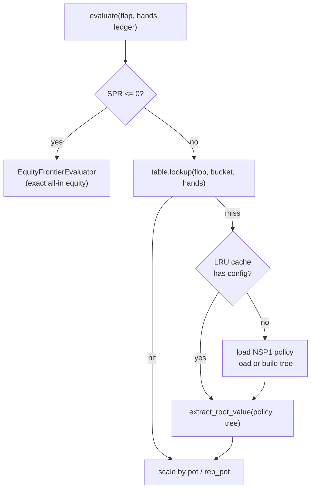

# RFC 0014: Postflop Policy Persistence and On-Demand Evaluation

## Summary

RFC 0013 Stage 2 introduced the postflop oracle and declared frontier table.
During implementation, three additional components became necessary:
(1) an on-the-fly frontier evaluator that computes missing entries from saved
CFR policies instead of failing closed; (2) a binary policy serialization
format (NSP1) so the oracle can persist solved subgame policies for later
reuse; (3) a shared postflop game/abstraction configuration so the oracle
and evaluator build identical trees. This RFC specifies these components and
the zero-SPR equity fallback that both frontier evaluators use when a
frontier leaf is already all-in.

## Motivation

RFC 0013 Stage 2 specified a declared frontier table populated by an offline
oracle. Two gaps emerged during implementation:

1. **Incomplete table coverage.** The oracle solves 1,755 canonical flop
   classes x 6 SPR buckets = 10,530 configs, each producing a policy and a
   set of per-deal values. The declared table stores only the per-deal
   values that the oracle chose to extract. During preflop blueprint
   training, the frontier evaluator encounters `(flop, spr_bucket, hands)`
   tuples that the oracle did not store — either because the deal was not in
   the continuation range, or because the oracle's extraction was sampled.
   The fail-closed `PostflopFrontierEvaluator` throws on these tuples,
   crashing the trainer.

2. **All-in frontier leaves.** At frontier leaves where a seat went all-in
   preflop, the effective stack is zero and SPR = 0.
   `SprBucketConfig::bucket_for_spr(0)` throws `std::invalid_argument`.
   This is a valid game state (a player jammed preflop and was called), not
   an error. The correct value at zero SPR is exact all-in equity: no
   postflop decisions remain, so the equity frontier IS the equilibrium
   value.

Both gaps must be filled without introducing heuristic leaf values, to
preserve the GTO-by-default invariant.

## Goals

- Provide a GTO-compliant path for `(flop, spr_bucket, hands)` tuples that
  are missing from the declared table, using the converged CFR policy.
- Persist solved subgame policies in a compact binary format so the
  evaluator can reload them without retraining.
- Ensure the oracle and evaluator build identical abstract trees for the
  same `(flop_class, spr_bucket)` config.
- Handle zero-SPR (all-in) frontier leaves with exact all-in equity, not an
  exception.
- Keep the declared-table fast path: table hits are O(1) and do not load
  policies.

## Non-Goals

- Changing the SPR bucket boundaries, representative SPRs, or action
  abstraction schedules (declared in RFC 0013).
- Multiway (3+ seat) postflop policy persistence.
- Policy versioning or migration (the format is versioned but no migration
  path is needed for the initial release).
- Replacing the declared table as the primary lookup path.

## Current State and Evidence

- `PostflopFrontierEvaluator` (RFC 0013 Stage 1) looks up values in a
  `NSeatDeclaredFrontierTable` and throws `std::invalid_argument` on missing
  entries. It also throws on zero SPR because `bucket_for_spr(0)` throws.
- The oracle (`bigshark-postflop-oracle`) trains CFR policies for each
  `(flop_class, spr_bucket)` config but, before this RFC, did not persist
  them. Only the extracted per-deal values were saved in the `.fdt` table.
- The preflop builder (`bigshark-preflop-profile-builder`) crashed with
  `terminate called after throwing an instance of 'std::invalid_argument':
  SPR must be finite and positive` when the frontier evaluator encountered
  an all-in leaf during 100 BB HU blueprint training.
- `EquityFrontierEvaluator` (RFC 0007) computes exact all-in-at-flop equity
  by enumerating all turn/river combos. It is the correct evaluator for
  zero-SPR leaves.

## Design Principles

- **GTO by default.** Missing table entries are computed from the converged
  CFR policy, not estimated. Zero-SPR leaves use exact equity, which is the
  equilibrium value of an all-in game — not a heuristic approximation.
- **Fail closed on real errors.** Missing policy files, corrupt policies,
  and tree-build failures still throw. Only the two known-benign cases
  (missing table entry, zero SPR) have a GTO-compliant fallback.
- **Identical trees.** The oracle and evaluator must build the same abstract
  tree for the same config, or `extract_root_value` will traverse the wrong
  structure. A shared config module enforces this.
- **Fast path preserved.** Table hits do not touch the policy directory or
  the LRU cache. Only misses load policies.

## Proposed Design

### NSP1 Policy Codec

`save_nseat_policy(policy, path)` / `load_nseat_policy(path, def, abstraction_id)`
in `bs::solver` serialize an `NSeatPolicy` to a compact binary file.

**File layout (NSP1):**

```
36-byte header:
  char     magic[4]          = "NSP1"
  uint32   version           = 1
  uint8    seat_count        (2)
  uint8    spr_bucket        (0..5)
  uint16   reserved          = 0
  uint32   row_count
  int32    flop_class[3]     (canonical flop cards, 0..51)
  uint8    padding[8]        (zero)
followed by row_count variable-length rows:
  uint32   own_card_bucket
  uint64   node_index
  uint32   action_count
  uint8    padding[4]        (zero)
  action_count * (uint8 type + uint8 pad[3] + uint32 target_total)
  action_count * float64 probability
```

Action type encoding: 0=Fold, 1=Check, 2=Call, 3=Bet, 4=Raise.

Policy files are named `policy_{c0}_{c1}_{c2}_b{b}.nsp` where
`{c0,c1,c2}` is the canonical flop class and `{b}` is the SPR bucket.

`save_nseat_policy(policy, spr_bucket, path)` writes the SPR bucket into
the header and writes atomically (temp file + rename) so a crash mid-write
does not leave a corrupt file. `load_nseat_policy(path, game, action_id,
expected_spr_bucket)` validates magic, version, seat count, SPR bucket
(against the expected value; a header value of 0 is accepted as "not
stored" for backward compatibility with pre-RFC-0014 policy files), flop
cards, action count, and probability finiteness. Throws
`std::runtime_error` on any mismatch or I/O failure.

### ATF Tree Codec

`AbstractTree::save(path)` / `AbstractTree::load(path, def, abstraction, limits)`
in `bs::tree` serialize the tree structure and terminal payloads to a compact
binary file. Terminal payloads are serialized directly — no DFS replay on load.
The load path uses a cursor (memcpy reads) for fast deserialization.

**File layout (ATFZ, zstd-compressed):**

```
ATFZ container:
  char     magic[4]          = "ATFZ"
  uint32   version           = 2
  uint64   uncompressed_size
  <zstd compressed payload>

Payload (decompressed):
  32-byte header:
    char     magic[4]          = "ATF1"
    uint32   version           = 2
    uint32   node_count
    uint32   terminal_count
    uint32   depth
    uint64   accounted_bytes
    uint32   reserved          = 0
  followed by node_count variable-length nodes:
    uint8    kind              (0=Action, 1=Chance, 2=TerminalFold,
                                3=TerminalShowdown, 4=TerminalFrontier,
                                5=FlopDeal)
    uint8    street            (0=Flop, 1=Turn, 2=River, 3=Preflop)
    uint8    action_count
    uint8    incoming_action_type (0=Fold, 1=Check, 2=Call, 3=Bet, 4=Raise)
    uint32   actor             (0xFFFFFFFF for kNoNode)
    int32    incoming_card     (-1 for kNoCard)
    uint32   terminal          (0xFFFFFFFF for kNoNode)
    uint32   child_count
    uint32   incoming_action_target
    uint32   children[child_count]
    action_count * (uint8 type + uint32 target_total)
  followed by terminal_count terminal records:
    uint8    player_count
    uint8    live_count
    uint8    folded            (0 or 1)
    uint8    board_size
    player_count * (int64 contributed + int64 refunded + int64 stack
                    + uint8 folded + uint8 pad[7])
    live_count * uint32 live_order
    int32    board[5]
    uint32   chip_utility_count
    chip_utility_count * int64 chip_utility
```

Tree files are named `tree_{c0}_{c1}_{c2}_b{b}.atf`, matching the policy file
naming convention. `save()` writes atomically (temp file + rename). `load()`
validates magic, version, node count, child indices, and enum values; throws
`std::runtime_error` on any mismatch or I/O failure.

**Rationale:** the on-the-fly evaluator rebuilds river-terminal trees (~5 s
each) on LRU cache misses. With 10,530 configs and a 128-entry cache, the miss
rate is ~99%, making the preflop builder take ~11 days. Loading a serialized
tree takes ~60-400 ms, reducing the builder to ~12 hours. The tree files are a
cache, not a source of truth — they can be deleted and regenerated by the
pre-build tool at any time.

### Tree Cache Pre-Build Tool

`bigshark-postflop-tree-cache` builds and serializes trees for every canonical
flop class x SPR bucket config. It is parallelized (default = hardware
concurrency) and skips configs that already have a `.atf` file.

```
usage: bigshark-postflop-tree-cache <output-dir> [classes] [buckets]
       [class-start] [threads]
```

Typical disk usage: ~22 MB average per config, ~232 GB for all 10,530 configs.
Build time: ~15 minutes with 56 cores.

### Shared Postflop Config

`make_postflop_def(flop_class, spr_bucket)` and
`make_postflop_abstraction(spr_bucket)` in `bs::gto` produce the `GameDef`
and `ActionAbstraction` for a flop-rooted river-terminal subgame.

- Pot fixed at 100 chips; each seat contributed 50.
- Stack = `round(100 * representative_spr)`.
- Buckets 0-1: default size schedule.
- Buckets 2-3: reduced (1/2-pot and 1-pot bets).
- Buckets 4-5: minimal (1-pot bets only).

Both the oracle and the on-the-fly evaluator call these functions,
guaranteeing identical tree structure.

### OnTheFlyPostflopEvaluator

Extends `PostflopFrontierEvaluator` with policy-based computation for missing
entries.



At `evaluate(flop, hands, ledger)`:

1. Canonicalize flop, relabel hands, compute pot/eff_stack/SPR (same as
   `PostflopFrontierEvaluator`).
2. If SPR <= 0 or non-finite: delegate to `EquityFrontierEvaluator`.
3. Map SPR to bucket. Try the declared table (fast path).
4. On table miss: load the NSP1 policy for `(flop_class, spr_bucket)` from
   `policy_dir`, then load the serialized tree (`.atf`) from the same
   directory if available, or build it from scratch via `make_postflop_def`
   and `make_postflop_abstraction` if not. Call `extract_root_value` for the
   exact deal, scale by `pot / rep_pot`.
5. Cache `(policy, tree)` pairs in an LRU cache (default capacity 128) to
   avoid reloading on repeated calls for the same config.

Cache statistics are exposed: `cache_hits()`, `cache_misses()`,
`table_hits()`, `computed()`, `equity_fallbacks()`.

### Zero-SPR Equity Fallback

Both `PostflopFrontierEvaluator` and `OnTheFlyPostflopEvaluator` check
`!std::isfinite(spr) || spr <= 0.0` before calling `bucket_for_spr`. When
true, they delegate to an internal `EquityFrontierEvaluator` member.

This is exact for heads-up: at zero SPR the game is all-in, no postflop
decisions remain, and exact all-in equity IS the equilibrium value. In
multiway pots the fallback is also exact when all live seats are all-in;
when only some seats are all-in, side-pot betting means equity is not the
full equilibrium value. The current pipeline is heads-up only, and the
on-the-fly miss path throws `std::invalid_argument` for `n != 2`, so the
multiway case cannot arise through this evaluator. The RFC 0013 principle
"never silently falls back to all-in equity" applies to missing table
entries at positive SPR, not to all-in leaves.

## Dependency Rules

- `nseat_policy_codec` depends on `nseat_trainer` (for `NSeatPolicy`) and
  `game_definition` (for `GameDef`). No reverse dependencies.
- `abstract_tree_codec` is part of the `bigshark_tree` library (L3) and
  depends only on L1 (`game_definition`) and L2 (`abstraction`). It adds no
  new dependencies to the tree library.
- `postflop_config` depends on `postflop_frontier` (for `SprBucketConfig`)
  and `abstraction`. No reverse dependencies.
- `OnTheFlyPostflopEvaluator` depends on `nseat_policy_codec`,
  `postflop_config`, `root_value_extractor`, `equity_frontier`, and
  `abstract_tree` (for tree loading).
- The oracle, tree-cache, and builder benchmarks depend on all of the above.
  No new dependencies from the solver core to the benchmarks.

## Compatibility and Migration

- **NSP1 format**: new persisted format. Version 1. No migration needed.
  Policy files are stored in a directory specified by the caller; the
  oracle writes them, the evaluator reads them.
- **Frontier evaluator behavior change**: `PostflopFrontierEvaluator`
  previously threw on zero SPR; it now delegates to equity. This is a
  bug fix (the old behavior crashed on valid game states). No caller
  depends on the old throwing behavior.
- **Builder/NashConv CLI**: both gain an optional `[policy-dir]` positional
  argument. When omitted, the behavior is unchanged (equity frontier or
  declared-table-only). When provided, the on-the-fly evaluator is used.

## Security and Operational Impact

- Policy files are local artifacts, not credentials. No token handling.
- The LRU cache bounds memory: each entry holds one `NSeatPolicy` and one
  `AbstractTree` (up to 4 GiB / 5M nodes per tree, but typically much
  smaller). With capacity 128, worst-case cache memory is ~128 trees
  (~28 GB at 220 MB/tree typical for deep SPR buckets).
- The oracle writes 10,530 policy files (~10,530 x ~50 KB = ~500 MB
  typical). Disk space should be checked before running the oracle.
- No network or external service dependencies.

## Alternatives Considered

1. **Store every per-deal value in the declared table.** Rejected: the joint
   deal space is C(52,2) x C(50,2) = 1.3M per flop class, and the oracle
   only solves a subset. A complete table would be ~10 GB and would require
   the oracle to enumerate every deal, which is prohibitively expensive.

2. **Interpolate between nearby SPR buckets.** Rejected: interpolation is a
   heuristic, not GTO. The value function is not linear in SPR.

3. **Retrain the policy on every cache miss.** Rejected: CFR training takes
   minutes per config. Loading a saved policy takes milliseconds.

4. **Use equity frontier for all missing entries.** Rejected: at positive
   SPR, equity ignores postflop play and is exploitable. Only at zero SPR
   is equity exact.

5. **Throw on zero SPR and handle it in the trainer.** Rejected: the trainer
   would need to catch exceptions at every frontier leaf, and the correct
   value (equity) would be duplicated in the trainer. Encapsulating the
   fallback in the evaluator is cleaner and ensures consistency.

## Risks

- **Policy-tree mismatch.** If the oracle and evaluator build different trees
  for the same config, `extract_root_value` traverses the wrong structure and
  returns incorrect values. Mitigation: shared `make_postflop_def` and
  `make_postflop_abstraction` functions; the NSP1 codec stores and verifies
  the SPR bucket on load, so a policy saved under the wrong bucket name is
  rejected rather than silently building the wrong tree.
- **Corrupt or missing policy files.** A truncated or deleted `.nsp` file
  causes `load_nseat_policy` to throw. Mitigation: the codec writes files
  atomically (temp file + rename) so a crash mid-write does not leave a
  corrupt file; the evaluator throws with a clear error message naming the
  missing file.
- **LRU cache memory growth.** Each cache entry holds a full abstract tree.
  With capacity 128 and large trees, memory could exceed available RAM.
  Mitigation: default capacity 128 is conservative; the tree limits (4 GiB /
  5M nodes) bound per-tree memory.
- **Disk space for policy files.** 10,530 files at ~50 KB each is ~500 MB.
  Mitigation: the oracle reports total policy directory size on completion.
- **Disk space for tree cache files.** 10,530 files at ~22 MB average each
  is ~232 GB. Mitigation: the tree cache is a build-time optimization, not a
  runtime requirement — the evaluator falls back to building trees from
  scratch when `.atf` files are absent. The pre-build tool reports total
  disk usage on completion.

## Verification Plan

- `ctest --preset release` — all tests pass, including the eight postflop
  frontier tests (five original + NSP1 codec roundtrip, NSP1 corrupt
  rejection, zero-SPR equity fallback) and the ATF1 tree codec roundtrip.
- `bigshark-postflop-tree-cache` builds and serializes all 10,530 tree
  configs without errors.
- `bigshark-preflop-profile-builder` with `--postflop-table` and
  `--policy-dir` completes 100K iterations without crashing.
- `bigshark-preflop-nash-conv` with the postflop frontier and policy dir
  reports exploitability < 10 BB/hand at 100 BB HU (down from 24.81 BB
  with the equity frontier).
- `node bin/check-docs.mjs` and `node bin/check-rfcs.mjs` pass.

## Performance Optimizations (2026-10-12)

Three optimizations were applied to reduce the builder wall-clock from
~12 hours to ~1-3 hours:

1. **zstd compression (NSPZ/ATFZ).** Both codecs now write compressed files
   by default. Measured 6-8x compression ratio, reducing cache-miss I/O
   from ~30 MB to ~4 MB per config. The `bigshark-tree-recompress` tool
   migrates existing files in parallel.
2. **Thread-safe evaluator cache.** The LRU cache uses `shared_ptr` entries
   with `shared_mutex` guards, enabling safe concurrent access from parallel
   CFR workers. All counters are atomic.
3. **Parallel CFR trainer.** `train_nseat_parallel()` runs external-sampling
   MCCFR with RM+ across K threads with deterministic iteration assignment
   (thread t runs {t, t+K, ...}) and a shared regret/average-weight table
   protected by a `shared_mutex`. Workers use synchronized regret updates:
   strategy reads under a shared lock, regret/sum updates under a unique
   lock, no locks during recursion. This eliminates the sqrt(K) convergence
   cost of merge-at-end. The builder accepts `--threads N` (default 1).
   Resource caps are NOT divided — the shared table uses the full limits.

## Rollout Plan

1. Land the NSP1 codec, shared config, on-the-fly evaluator, and zero-SPR
   fallback in one change.
2. Run the oracle to produce policy files and the declared table.
3. Run the preflop builder with the on-the-fly evaluator.
4. Run NashConv validation. If exploitability < 10 BB, mark this RFC
   `Implemented`.

## Rollback Plan

- The builder and NashConv tool accept an optional `[policy-dir]` argument.
  Omitting it restores the previous behavior (declared-table-only or equity
  frontier).
- The zero-SPR equity fallback is internal to the evaluators; removing it
  reverts to the old throwing behavior (not recommended — it crashes on
  valid all-in leaves).
- Policy files can be deleted without affecting the declared table; the
  evaluator falls back to throwing on missing entries (fail closed).

## Open Questions

- ~~Should the LRU cache capacity be configurable per benchmark, or is the
  default 128 sufficient for all workloads?~~ **Resolved (2026-10-12):** The
  builder now accepts `--cache-capacity N` (default 128). The on-the-fly
  evaluator constructor takes a `cache_capacity` parameter.
- ~~Should policy or tree files be compressed (zstd) to reduce disk usage,
  at the cost of load latency?~~ **Resolved (2026-10-12):** Both codecs now
  write zstd-compressed files by default (NSPZ/ATFZ format, level 3).
  `load()` auto-detects raw vs compressed from magic bytes. Measured 6-8x
  compression ratio; decompression latency (~1 ms) is negligible compared
  to disk I/O savings (~30 MB → ~4 MB per cache miss). The
  `bigshark-tree-recompress` tool migrates existing files in place.

## Acceptance Criteria

- [x] `ctest --preset release` passes (all tests, including the eight
  postflop frontier tests and the ATF1 tree codec roundtrip).
- [x] `bigshark-postflop-tree-cache` builds all 10,530 tree configs without
  errors.
- [ ] `bigshark-preflop-profile-builder` completes 100K iterations with
  `--postflop-table` and `--policy-dir` without crashing.
- [ ] `bigshark-preflop-nash-conv` reports exploitability < 10 BB/hand at
  100 BB HU with the postflop frontier.
- [x] `node bin/check-docs.mjs` and `node bin/check-rfcs.mjs` pass.
- [x] Independent approval agent approves this RFC.

## Decision

Factual errata (2026-10-13): exact extraction means exact expectation under
the saved abstract policy, not evidence that the saved policy converged to an
equilibrium. The original preflop tool maximized separately for hidden joint
deals and normalized by the combined seat count, so its old exploitability
numbers cannot support this RFC's quality criterion. RFC 0015 replaces them
with independently confirmed information-set-consistent deviation estimates.
Individual table locks do not establish the claimed removal of a `sqrt(K)`
convergence cost; new native fixtures expose an averaging defect in both
serial and parallel revision-one training. RFC 0016 addresses the algorithm
separately with frozen batches and independent averaging. Migration-tool
references above are historical after commit `b154533` removed the old ATF
version path and migration executable. Startup-inclusive bounded performance
evidence is in `docs/development/benchmarking.md`; previous hour/day estimates
are not verified long-run guarantees. None of these corrections changes
existing persisted bytes or retroactively certifies old artifacts.

Author agent: postflop-policy-persistence (main session)
Approved by: independent approval agent a54e75dc11e79a519
Decision date: 2026-10-12
Review outcome: Approved
Reviewed scope: RFC 0014 full text, RFC 0013 for context, all implementation
files (engine/src/gto/postflop_frontier.cpp,
engine/src/gto/nseat_policy_codec.cpp, engine/src/gto/postflop_config.cpp,
engine/src/tree/abstract_tree_codec.cpp,
engine/benchmarks/postflop_tree_cache.cpp,
engine/benchmarks/preflop_profile_builder.cpp,
engine/benchmarks/preflop_nash_conv.cpp), automated checks (build, ctest,
benchmark-multistreet, npm check, proto:check, replay, check-docs,
check-rfcs), and tests.
Review summary: Zero blocking findings. Six non-blocking findings recorded
for future refinement: (1) test count arithmetic in Verification Plan and
Acceptance Criteria (fixed in this revision: nine → eight); (2) ATF1 header
could carry a config fingerprint to detect mismatched game/abstraction
parameters on load; (3) NSP1 format could include a backward-compatibility
sentinel for future schema evolution; (4) OnTheFlyPostflopEvaluator::get_config
catches std::exception broadly, narrowing to expected exception types would
improve diagnosability; (5) multiway (3+ seat) zero-SPR equity fallback is
not yet implemented, on-the-fly evaluation is heads-up only by design;
(6) disk and time estimates for the tree cache (226 GB, ~21 min) and oracle
training should be re-measured on the target hardware before
operationalizing. Implementation may proceed.
