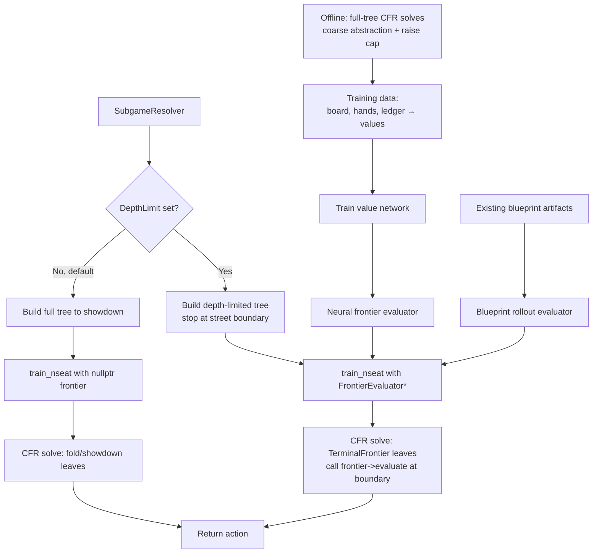
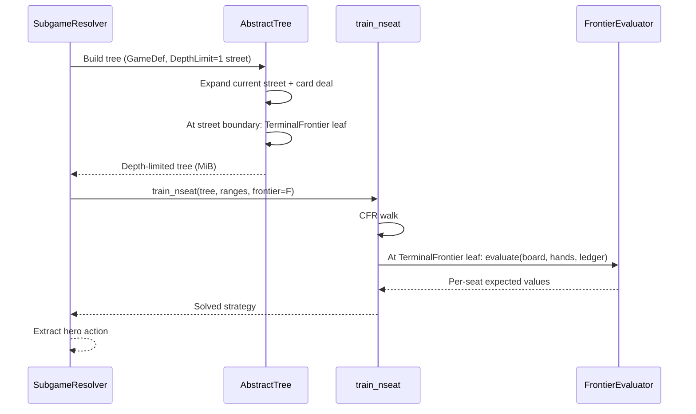

# RFC 0024: Depth-Limited Resolving with Value Estimation

## Summary

The `SubgameResolver` builds the full public tree from the turn root to
showdown for every decision. At six seats and 100 BB stacks, this tree is
estimated at 150-250 GiB (extrapolated from T3 measurements; the measured
5/6-seat trees exceed the 1 GiB builder cap at all stacks), exceeding physical
memory. This RFC adds depth-limited resolving: the resolver builds a tree
covering a bounded number of betting streets, and a frontier evaluator
supplies per-seat expected utility at the street-boundary leaves instead of
expanding to showdown. The existing `FrontierEvaluator` interface is
generalized in place from flop-only to any street boundary (3/4/5-card board).
The trainer's `terminal_utility` and `walk` are extended to dispatch on
`node.kind == NodeKind::TerminalFrontier` for non-flop-terminal trees. The
complete six-max feature remains In Progress.

## Motivation

The `SubgameResolver` (`engine/src/resolver/subgame_resolver.cpp`) already
handles turn and river decisions (RFC 0011, Implemented). It builds a
turn-rooted subgame tree (line 485-515) and solves it with `train_nseat`
(line 535). The subgame is always `TerminalDepth::River` — the full tree to
showdown. There is no depth limit.

The T3 feasibility measurement (`docs/plans/t3-six-seat-feasibility.md`)
showed that at the current coarse action abstraction (declared-only, 1/2-pot
bet + 1/2-pot raise, no raise-count cap):

- 2-seat: feasible at all stacks (complete solves, trees under 12 MiB).
- 3-seat: tree fits at all stacks (up to 605 MiB at 100 BB) but trainer caps
  bind.
- 4-seat: tree fits at 10 BB (363 MiB) but trainer byte cap exceeded; tree
  exceeds 1 GiB at 25/100 BB.
- 5/6-seat: tree exceeds the 1 GiB builder cap at ALL stacks, including 10 BB.

The six-seat 100 BB full tree is estimated at 150-250 GiB by extrapolating
from the measured growth rates: the 2→3-seat node multiplier at 100 BB is
47× (20,739 → 970,891), the 3→4 multiplier is estimated at 8-15× (the 10 BB
measured 3→4 multiplier is 5.8×, and deeper stacks increase the multiway
explosion), and the per-seat multiplier continues at 4-6× for 5→6 seats. At
~600 bytes/node, this yields 150-250 GiB. This exceeds the machine's 109 GiB
RAM and is not a cap-tuning problem.

Modern imperfect-information game solvers (DeepStack, Libratus, Pluribus,
ReBeL) use depth-limited resolving: solve a bounded-depth subgame and estimate
the value at the boundary with a learned or precomputed function. The
real-time tree is MiB, not GiB. This RFC brings that architecture to BigShark.

Note: the terminal-only resolver (`build_model` in
`engine/src/resolver/counterfactual_reach.cpp`) is a separate code path that
walks the game state directly without building a tree. Its `is_terminal_only`
check limits it to river/all-in decisions. This RFC does NOT change that
path; it targets the `SubgameResolver`/`train_nseat` tree-based path.

## Goals

- Generalize `FrontierEvaluator` in place: the `evaluate` method accepts a
  3/4/5-card board (not just a 3-card flop), enabling value estimation at any
  street boundary.
- Add a `DepthLimit` to `AbstractTree`: the builder creates
  `TerminalFrontier` leaves at the street boundary when the limit is reached.
- Extend the trainer's `walk` and `terminal_utility` to dispatch on
  `node.kind == NodeKind::TerminalFrontier` for non-flop-terminal trees,
  calling the frontier evaluator at the boundary leaves.
- Extend the trainer's validation gate to require a non-null frontier
  evaluator when the tree contains `TerminalFrontier` leaves, regardless of
  `TerminalDepth`.
- The `SubgameResolver` passes a `DepthLimit` to `AbstractTree` and a non-null
  `FrontierEvaluator*` to `train_nseat` for depth-limited resolves.
- Preserve the existing exact path (full tree, `TerminalDepth::River`, null
  frontier evaluator) as the default and for offline data generation.
- Preserve all existing wire protocols, artifact formats, and game definitions.

## Non-Goals

- Implementing a neural network value estimator. This RFC generalizes the
  interface and extends the tree/trainer/resolver; the NN implementation is a
  follow-up RFC.
- Changing the CFR algorithm, the trainer's regret update rule, or the walk
  structure (beyond the terminal-leaf dispatch).
- Changing the wire protocol, protobuf IDL, or artifact formats.
- Raising the `TreeLimits` or `NSeatTrainerLimits` caps (a separate concern).
- Adding a raise-count cap to the action abstraction (complementary, not part
  of this RFC).
- Changing the terminal-only resolver (`build_model`) or its `is_terminal_only`
  check. That path is unchanged.
- Six-max quality certification. The qualification proposal
  (`docs/plans/sixmax-gto-qualification.md`) still applies.

## Current State and Evidence

### Two resolver paths

The engine has two distinct resolver paths:

1. **Terminal-only resolver** (`build_model` in
   `engine/src/resolver/counterfactual_reach.cpp:62`): walks the game state
   directly, no tree. Uses `is_terminal_only`
   (`engine/src/resolver/continuation.cpp:110`) to verify that after every
   available action, the game auto-runs to fold/showdown. Limited to
   river/all-in decisions. Uses `continuation_utility_all_seats` for leaf
   values. **This RFC does not change this path.**

2. **Tree-based subgame resolver** (`SubgameResolver` in
   `engine/src/resolver/subgame_resolver.cpp`): builds a turn-rooted
   `AbstractTree` (line 515) and solves it with `train_nseat` (line 535).
   Accepts turn (board_size=4) and river (board_size=5) decisions (line 436).
   The subgame is always `TerminalDepth::River` — the full tree to showdown.
   Passes `nullptr` for the frontier evaluator (line 536). **This is the path
   this RFC extends.**

### Tree builder

`AbstractTree` (`engine/src/tree/abstract_tree.cpp`) builds the full public
tree from a `GameDef`. The DFS (line 252-329) processes each node by
`state.phase()`:

- `Phase::Folded` → `TerminalFold` leaf
- `Phase::Showdown` → `TerminalShowdown` leaf
- `Phase::Frontier` → `TerminalFrontier` leaf (line 277-285; only for
  flop-terminal games)
- `Phase::Deal` → `Chance` or `FlopDeal` node (line 286-295)
- `Phase::Action` → `Action` node with the full action menu (line 296-304)

There is no street-boundary depth limit. The tree stops only at fold, showdown,
or the flop-terminal frontier.

`TerminalDepth` (`engine/include/bs/game_definition.hpp:65`) is
`{ River, Flop }`. `Flop` means the game ends at the flop (RFC 0007); `River`
means the full tree to showdown.

### Frontier evaluator

`FrontierEvaluator` (`engine/include/bs/frontier.hpp:39`):

```cpp
virtual std::vector<double> evaluate(std::span<const int> flop,
                                     std::span<const std::array<int, 2>> hands,
                                     const bs::tree::TerminalPayload& ledger) const = 0;
```

The `flop` parameter is 3 cards. Two implementations exist:

- `EquityFrontierEvaluator` (`engine/include/bs/equity_frontier.hpp:25`):
  exact equity by enumerating all turn/river combos from a 3-card flop. The
  "all-in at flop" approximation — assumes no postflop betting.
- `DeclaredFrontierTable` (`engine/include/bs/frontier.hpp:66`): immutable
  lookup table. Heads-up only, flop-specific.

### Trainer leaf dispatch

`train_nseat` (`engine/src/gto/nseat_trainer.cpp`) accepts a
`const gto::FrontierEvaluator* frontier = nullptr` parameter (line 328).

The walk (line 585-599) dispatches on `state.phase()`:

```cpp
switch (state.phase()) {
  case Phase::Folded:
  case Phase::Showdown:
  case Phase::Frontier:
    return terminal_utility(ctx, state, node_index);
  case Phase::Deal: ...
  case Phase::Action:
    return walk_action(ctx, state, node_index, own_reach);
}
```

`terminal_utility` (line 389-423) dispatches on `state.phase()`:
- `Phase::Folded` → fold settlement
- `Phase::Frontier` → `ctx.frontier->evaluate(state.board(), ctx.holes, payload)`
  (line 417). Throws if `ctx.frontier == nullptr` (line 411-413).
- `Phase::Showdown` → showdown settlement
- else → throw "non-terminal game state" (line 422-423)

The validation gate (line 925-927) requires a non-null frontier evaluator
only for `TerminalDepth::Flop` games:

```cpp
if (tree.def().terminal == poker::TerminalDepth::Flop && !frontier)
  throw std::runtime_error("nseat trainer: a flop-terminal game requires a frontier evaluator");
```

### The gap

For a depth-limited `TerminalDepth::River` tree, the builder would create
`TerminalFrontier` leaves at street boundaries where `state.phase() ==
Phase::Action` (the game is about to enter a new betting street). The walk
would dispatch to `walk_action` (because `state.phase() == Phase::Action`),
not `terminal_utility`. And `terminal_utility` would fall through to the
"non-terminal game state" throw (line 422) because `state.phase()` is neither
`Folded`, `Frontier`, nor `Showdown`. The trainer cannot currently handle
`TerminalFrontier` leaves outside flop-terminal games.

## Design Principles

- **Depth-limited by option, exact by default.** The `DepthLimit` is opt-in;
  the default is the full tree. Existing callers are unchanged.
- **Generalize the existing interface, don't add a new one.** `FrontierEvaluator`
  is generalized in place (3/4/5-card board). No dual-interface shim.
- **Dispatch on node kind, not game phase.** The trainer's leaf dispatch must
  check `node.kind == NodeKind::TerminalFrontier` before the phase-based
  checks, because depth-limited frontier leaves have `state.phase() ==
  Phase::Action`.
- **No game-definition changes.** The depth limit is a tree-builder/resolver
  parameter, not a `GameDef` field. `TerminalDepth` semantics are unchanged.
- **Imperfect information is first-class.** The frontier evaluator receives
  the joint deal and the public ledger, and must not condition on a seat's own
  holding. This matches the existing `FrontierEvaluator` contract.

## Proposed Design

### Architecture overview



### 1. Generalize FrontierEvaluator in place

`engine/include/bs/frontier.hpp`: rename the `flop` parameter to `board` and
lift the 3-card restriction to 3/4/5 cards. Update the contract comment.

```cpp
class FrontierEvaluator {
 public:
  virtual ~FrontierEvaluator() = default;
  // Per-seat chip utility for the given board and joint deal.
  // `board` is 3 (flop), 4 (turn), or 5 (river) card ids.
  // `hands` is per-seat sorted hole cards (2 each, 2..10 entries).
  // `ledger` is the terminal payload's seat ledger.
  // Returns one value per seat in chip units.
  // Throws on a missing entry or unsupported seat count (fail closed).
  virtual std::vector<double> evaluate(std::span<const int> board,
                                       std::span<const std::array<int, 2>> hands,
                                       const bs::tree::TerminalPayload& ledger) const = 0;
};
```

The interface name stays `FrontierEvaluator`; "frontier" is interpreted as the
boundary of the solved subgame, not specifically the flop.

`EquityFrontierEvaluator` is extended to handle 4/5-card boards:

- **3 cards (flop)**: enumerate all turn/river combos (current behavior).
  Exact equity, all-in-at-flop approximation.
- **4 cards (turn)**: enumerate all river combos. Exact equity, all-in-at-turn
  approximation (assumes no river betting).
- **5 cards (river)**: return the showdown settlement directly (no cards to
  deal). Exact.

`DeclaredFrontierTable` is unchanged: it remains flop-specific and heads-up
only. It is a special case that only works at the flop. When `evaluate` is
called with a 4/5-card board, it throws `std::invalid_argument` (fail closed),
consistent with the interface contract that unsupported configurations must
throw rather than return approximate values.

### 2. Depth-limited tree builder

Add a `DepthLimit` to `AbstractTree` construction:

```cpp
// engine/include/bs/abstract_tree.hpp (addition)

// A street-count depth limit. When the builder is about to open a new betting
// street and (state.street() - root_street) >= max_streets, it creates a
// TerminalFrontier leaf instead of an Action node. nullopt means no limit
// (full tree to showdown, the current behavior).
struct DepthLimit {
  std::optional<std::size_t> max_streets;
  static DepthLimit none() { return {std::nullopt}; }
  static DepthLimit streets(std::size_t n) {
    if (n == 0)
      throw std::invalid_argument("DepthLimit: max_streets must be >= 1");
    return {n};
  }
};
```

`max_streets = 0` is rejected because it would make the root a
`TerminalFrontier` leaf, producing `SolveDeadline`. When set, `max_streets`
must be >= 1.

**Preflop-rooted trees are unsupported with a `DepthLimit`.** The `Street`
enum's historical ordering (`Preflop = 3`, after `River = 2`;
`heads_up.hpp:18`) breaks the street-offset arithmetic for preflop-rooted
trees: `Flop(0) - Preflop(3) = -3` wraps to a huge `size_t`, making the
first flop Action node a frontier leaf. The `DepthLimit` is valid only for
flop-rooted (`root_street = Flop`) and turn-rooted (`root_street = Turn`)
subgames, which are the cases the `SubgameResolver` and offline training
pipeline use. The `AbstractTree` constructor validates this and throws if a
`DepthLimit` is set for a preflop-rooted game.

The `AbstractTree` constructor accepts an optional `DepthLimit`:

```cpp
AbstractTree(const GameDef& def, const ActionAbstraction& action,
             TreeLimits limits, DepthLimit depth = DepthLimit::none());
```

The builder stores the root's street (`root_street_`). At each `Phase::Action`
node, before generating the action menu, the builder checks:

```cpp
if (depth_limit_.max_streets &&
    static_cast<std::size_t>(static_cast<int>(frame.state.street()) -
                             static_cast<int>(root_street_)) >=
        *depth_limit_.max_streets) {
  // Depth limit reached: create a TerminalFrontier leaf.
  node.kind = NodeKind::TerminalFrontier;
  node.terminal = tree_.terminals_.size();
  TerminalPayload payload = make_terminal(frame.state, false, budget_);
  grow_to_fit(tree_.terminals_, tree_.terminals_.size() + 1, budget_);
  tree_.terminals_.push_back(std::move(payload));
} else {
  // Existing Action node path.
  node.kind = NodeKind::Action;
  ...
}
```

The depth-limit check uses `state.street() - root_street`, which counts
completed betting streets. For a turn-rooted subgame (root_street=Turn):

- `max_streets = 1`: turn betting is included (street offset 0 < 1). After the
  river card deal, the river Action node has offset 1 >= 1 → TerminalFrontier
  leaf. The tree covers turn betting + river deal, cut at the river boundary.
- `max_streets = 2` (or `nullopt`): turn + river betting, full tree to
  showdown. Current behavior.

For a flop-rooted subgame (root_street=Flop) with `max_streets = 1`: flop
betting is included. After the turn card deal, the turn Action node has
offset 1 >= 1 → TerminalFrontier leaf. The tree covers flop betting + turn
deal, cut at the turn boundary.

### 3. Trainer leaf dispatch extension

The trainer's `walk` and `terminal_utility` are extended to handle
`TerminalFrontier` leaves at any street boundary.

**Walk** (`nseat_trainer.cpp:585`): add a terminal-node check before the
phase-based dispatch:

```cpp
double walk(SweepContext& ctx, const GameState& state, std::size_t node_index,
            double own_reach) {
  const TreeNode& node = ctx.tree->node(node_index);
  if (node.is_terminal())
    return terminal_utility(ctx, state, node_index);
  switch (state.phase()) {
    ...
  }
}
```

This routes all terminal leaves (including depth-limited `TerminalFrontier`
leaves with `state.phase() == Phase::Action`) to `terminal_utility`.

**terminal_utility** (`nseat_trainer.cpp:389`): dispatch on
`node.kind == NodeKind::TerminalFrontier` before the phase-based checks:

```cpp
double terminal_utility(SweepContext& ctx, const GameState& state,
                        std::size_t node_index) {
  const TreeNode& node = ctx.tree->node(node_index);
  if (!node.is_terminal())
    throw std::runtime_error("nseat trainer terminal reached a non-terminal tree node");
  const TerminalPayload& payload = ctx.tree->terminal(node.terminal);

  // Frontier leaf: flop-terminal (Phase::Frontier) OR depth-limited
  // (Phase::Action at a street boundary). Both use the frontier evaluator.
  if (node.kind == NodeKind::TerminalFrontier) {
    if (ctx.frontier == nullptr)
      throw std::runtime_error(
          "nseat trainer reached a frontier leaf without a frontier evaluator");
    if (payload.folded)
      throw std::runtime_error("nseat trainer frontier terminal does not match the tree leaf");
    const std::vector<double> values =
        ctx.frontier->evaluate(state.board(), ctx.holes, payload);
    if (values.size() != state.player_count())
      throw std::runtime_error("nseat trainer frontier evaluator returned the wrong seat count");
    return values[ctx.traverser];
  }

  // Existing phase-based dispatch for fold/showdown.
  if (state.phase() == Phase::Folded) { ... }
  if (state.phase() != Phase::Showdown)
    throw std::runtime_error("nseat trainer terminal reached a non-terminal game state");
  ...
}
```

The existing `Phase::Frontier` branch (line 406-421) is replaced by the
`node.kind == NodeKind::TerminalFrontier` check, which handles both
flop-terminal and depth-limited frontier leaves. The `Phase::Folded` and
`Phase::Showdown` branches are unchanged.

**Validation gate** (`nseat_trainer.cpp:925`): extend to require a non-null
frontier evaluator when the tree contains any `TerminalFrontier` leaf,
regardless of `TerminalDepth`:

```cpp
if ((tree.def().terminal == poker::TerminalDepth::Flop ||
     tree.has_frontier_leaves()) && !frontier)
  throw std::runtime_error(
      "nseat trainer: a tree with frontier leaves requires a frontier evaluator");
```

This **extends** (not replaces) the existing `TerminalDepth::Flop`-only check.
The `TerminalDepth::Flop` condition must be retained because preflop-rooted
flop-terminal games have `FlopDeal` leaves (not `TerminalFrontier` leaves) at
the flop boundary — the tree builder creates `FlopDeal` nodes for
`Phase::Deal` in flop-terminal games (`abstract_tree.cpp:287-292`), so
`has_frontier_leaves()` returns false for those trees. Without the
`TerminalDepth::Flop` condition, the gate would not require a frontier
evaluator for an existing supported configuration, weakening the early-
validation guarantee (the runtime null check in `walk_flop_deal` at
`nseat_trainer.cpp:536-537` would still throw, but only at solve time).

The same extension applies to the second validation gate in
`debug_run_one_nseat_sweep` (`nseat_trainer.cpp:1087`), which has an identical
`TerminalDepth::Flop`-only check. Both gates must be updated together.

The `train_nseat` contract documentation in `nseat_trainer.hpp:251-254`
(which describes the frontier evaluator requirement in terms of
`terminal == TerminalDepth::Flop`) is updated to reflect the extended
condition: a non-null evaluator is required when the tree is flop-terminal
OR contains `TerminalFrontier` leaves.

For O(1) validation, the `AbstractTree` sets a `bool has_frontier_leaves_`
flag during DFS construction (checked when a `TerminalFrontier` node is
created) and exposes it via a `has_frontier_leaves()` accessor. The trainer's
validation gate reads this flag instead of traversing the tree, avoiding
O(n) overhead on every `train_nseat` call.

### 4. SubgameResolver integration

The `SubgameResolver` is extended to support depth-limited resolves:

1. **Tree construction** (`subgame_resolver.cpp:515`): pass the `DepthLimit`
   to `AbstractTree`. The `ResolveLimits` struct gains an optional
   `DepthLimit depth_limit` field (default `none()`).

2. **Trainer call** (`subgame_resolver.cpp:535`): pass the frontier evaluator
   to `train_nseat`. The `SubgameResolver` holds a
   `const gto::FrontierEvaluator*` (nullable; when null, the resolver requires
   a full tree with no frontier leaves — the current behavior).

3. **Result labeling**: the resolve result reports whether frontier leaves
   were present and the frontier evaluator was used, so callers can
   distinguish exact from approximate decisions.

The `SubgameResolver` does NOT change its turn/river acceptance gate (line
436). It still accepts board_size=4 and board_size=5. The depth limit only
affects how much of the tree is built.

**Depth-limit and decision-street constraint.** The `SubgameResolver` always
builds a turn-rooted subgame, even for river decisions
(`subgame_resolver.cpp:478-484`). For a river decision (board_size=5), the
resolver walks the turn actions and river card to reach the river Action node,
then extracts candidate actions from that node's action menu
(`:570-571`). With `max_streets = 1`, the river Action node becomes a
`TerminalFrontier` leaf (street offset 1 >= 1) with no action menu and no
policy row, so the resolver returns `SolveDeadline` instead of a legal action.

Therefore:

- `max_streets = 1` is valid **only for turn decisions** (board_size=4), where
  the root Action node is the decision point and has an action menu.
- For **river decisions** (board_size=5), `max_streets` must be >= 2 (or
  `nullopt`), so the river Action node retains its action menu.
- The `SubgameResolver` validates this constraint at tree construction: if
  `board_size == 5` and `depth_limit.max_streets` is set and < 2, it returns
  `InvalidInput` (or clamps to 2, depending on the configured policy). This
  validation is a resolver-level guard, not a tree-builder guard, because the
  tree builder does not know which node the resolver will extract actions
  from.

### 5. Offline training pipeline (follow-up RFC)

The frontier evaluator for depth-limited resolving needs to estimate the value
of the remaining game. Options:

- **EquityFrontierEvaluator**: exact equity, assumes all-in (no future
  betting). Available immediately after the interface generalization. Accurate
  for all-in situations, approximate otherwise.
- **Blueprint rollout evaluator**: looks up a pre-trained blueprint strategy
  at the boundary and rolls out the remaining streets. More accurate than
  equity, requires existing blueprint artifacts. Does not exist for 5+ seats.
- **Neural network evaluator**: a neural network that predicts values from
  (board, hands, ledger). The DeepStack approach. Requires a training
  pipeline: solve many subgames to convergence (using coarse abstraction +
  raise-count cap), generate (board, hands, ledger) → values data, train the
  network, validate on held-out subgames.

The training pipeline and neural network evaluator are a follow-up RFC. This
RFC enables the architecture; the estimator quality is a separate concern.

### Data flow



## Dependency Rules

- `engine/tree` depends on `engine/poker` and `engine/abstraction` (existing).
  It does NOT depend on `engine/resolver` or `engine/gto`.
- `engine/gto` (where `FrontierEvaluator` lives) depends on `engine/tree` (for
  `TerminalPayload`) and `engine/poker`. It does NOT depend on
  `engine/resolver`.
- `engine/resolver` depends on `engine/tree`, `engine/poker`, and
  `engine/gto` (for `FrontierEvaluator`). It does NOT depend on a specific
  evaluator implementation.
- `EquityFrontierEvaluator` depends on `engine/poker` (for equity computation)
  and `engine/tree` (for `TerminalPayload`). It does NOT depend on
  `engine/resolver`.
- No dependency is added from `engine/poker` to any solver or resolver module.

## Compatibility and Migration

- **Existing callers**: the `AbstractTree` constructor's `DepthLimit` parameter
  defaults to `none()`, so existing callers get the current full-tree behavior.
  No caller is forced to migrate.
- **FrontierEvaluator**: the interface is generalized in place. The `flop`
  parameter is renamed to `board`; the signature is otherwise unchanged.
  Existing implementations (`EquityFrontierEvaluator`, `DeclaredFrontierTable`)
  are updated to match. Callers that pass a 3-card flop are unaffected.
- **SubgameResolver**: the `FrontierEvaluator*` parameter is nullable. When
  null, the resolver requires a full tree with no frontier leaves (current
  behavior). When non-null, the resolver can handle depth-limited trees.
- **Trainer**: the validation gate is extended (not replaced) from
  `TerminalDepth::Flop`-only to "flop-terminal OR any tree with
  `TerminalFrontier` leaves." The `TerminalDepth::Flop` condition is retained
  because preflop-rooted flop-terminal games have `FlopDeal` leaves (not
  `TerminalFrontier` leaves) and would otherwise bypass the gate. Existing
  flop-terminal games still require a frontier evaluator. Existing
  `TerminalDepth::River` games without frontier leaves are unaffected (no
  `TerminalFrontier` leaves → no evaluator required).
- **Wire protocol**: no changes. The depth limit and frontier evaluator are
  engine-internal.
- **Artifact formats**: no changes to existing artifact formats. Existing
  artifacts remain readable. However, depth-limited trees are **build-only**
  in this RFC: they are not persisted via the ATF codec's `save`/`load`
  path. The codec's `load()` validates `node.kind == expected_kind`
  (`abstract_tree_codec.cpp:717`), where `expected_kind` for `Phase::Action`
  is `NodeKind::Action`. A depth-limited tree's `TerminalFrontier` leaf at a
  `Phase::Action` street boundary would fail this validation, so `load()`
  rejects depth-limited trees even though `save()` would serialize them (the
  codec already encodes `TerminalFrontier` as byte 4). This is acceptable
  because depth-limited trees are short-lived solver inputs, not durable
  artifacts. A future RFC that needs to persist depth-limited trees must
  extend the codec to handle `TerminalFrontier` at `Phase::Action` boundaries.
- **Game definitions**: no changes. `TerminalDepth` semantics are unchanged.

## Security and Operational Impact

- **Fairness**: the frontier evaluator must not condition on a seat's own
  holding to estimate an opponent's value. This is enforced by the interface
  contract (inherited from the existing `FrontierEvaluator`).
- **Resource limits**: the depth-limited tree is bounded by `TreeLimits`
  (existing). The frontier evaluator's compute cost is bounded by its
  implementation (equity enumeration is bounded by the board; blueprint
  rollout is bounded by the blueprint tree; neural network inference is
  bounded by the network size).
- **Observability**: the resolve result reports whether frontier leaves were
  present and the evaluator was used. This allows monitoring the quality of
  real-time decisions.
- **Fallback**: if the frontier evaluator fails (throws, returns invalid
  values), `terminal_utility` throws, `train_nseat` propagates the exception,
  and the `SubgameResolver` catches it and returns `InvalidInput` (existing
  behavior at line 540-542). For a depth-limited tree, there is no exact
  continuation fallback — the tree is not terminal-only by construction, so
  the continuation walk would throw. The effective fallback is a coverage
  miss, not an exact decision.
- **No credentials, network, or private-card reads** are introduced.

## Alternatives Considered

- **Introduce a new `ValueEstimator` interface with a compatibility shim**:
  considered in the original draft. Rejected because `train_nseat` already
  takes `const gto::FrontierEvaluator*`; generalizing `FrontierEvaluator` in
  place avoids the dual-interface complexity. The in-place generalization is
  simpler and touches fewer files.

- **Raise-count cap only (no depth-limited resolving)**: capping bets/raises
  per street reduces the tree size but does not address the fundamental
  multiway explosion. At six seats and 100 BB, even r=2 produces a ~4 GiB
  tree (T3 analysis), which is feasible for offline training but too large
  for real-time resolving. The raise-count cap is complementary to
  depth-limited resolving, not a replacement. Rejected as the sole solution.

- **Raise the resource caps**: the 1 GiB tree cap and 1 GiB trainer cap are
  engineering safety bounds. Raising them allows larger trees but does not
  address the solve time (hours to days per subgame at six seats) or the
  real-time deadline (seconds). Rejected as the sole solution.

- **Extend `TerminalDepth` to `{ River, Turn, Flop }`**: this would make the
  depth limit a game-definition property. Rejected because the depth limit is
  a resolver-level concern (how much of the game to solve), not a game
  definition (the game is always the full game). Mixing the two would
  complicate the game-definition identity checks and artifact compatibility.

- **Change the terminal-only resolver (`build_model`)**: that path is
  intentionally terminal-only and is not the bottleneck for six-max. The
  `SubgameResolver`/`train_nseat` path is the one that builds large trees.
  Rejected as the target.

## Risks

- **Frontier evaluator accuracy**: the quality of depth-limited resolving
  depends on the accuracy of the frontier evaluator. The
  `EquityFrontierEvaluator` assumes all-in (no future betting), which is
  approximate for non-all-in situations. Mitigation: the resolve result
  labels the leaf-value source; the exact full-tree path remains available
  for verification; the neural network evaluator (follow-up RFC) improves
  accuracy.

- **Training data generation cost**: generating training data for a neural
  network evaluator requires solving many subgames to convergence, which is
  the very problem this RFC addresses. Mitigation: use coarse abstractions
  (raise-count cap, fewer bet sizes) for offline data generation; the value
  network generalizes to unseen states. Deferred to a follow-up RFC.

- **Walk dispatch change**: adding `node.is_terminal()` at the start of
  `walk` changes the dispatch for all terminal leaves. Mitigation: the
  existing `Folded`/`Showdown`/`Frontier` phases already route to
  `terminal_utility`, so the change is a no-op for existing trees. The new
  path only affects depth-limited trees with `TerminalFrontier` leaves at
  `Phase::Action`.

- **Blueprint evaluator availability**: the `BlueprintValueEstimator`
  (rollout) depends on existing blueprint artifacts that do not exist for 5+
  seats. The first deployment may need to rely on `EquityFrontierEvaluator`
  at the boundary, which is exact equity but assumes no future betting.
  Acknowledged as a limitation of the first deployment.

## Verification Plan

- **Unit tests**:
  - `DepthLimit` tree construction: verify that a depth-limited tree has
    `TerminalFrontier` leaves at the street boundary and no Action nodes
    beyond the limit. Verify the root street is stored and the offset check
    is correct for turn-rooted and flop-rooted subgames.
  - `FrontierEvaluator` generalization: verify that `EquityFrontierEvaluator`
    handles 3/4/5-card boards correctly (3-card: turn+river enumeration;
    4-card: river enumeration; 5-card: direct settlement).
  - Trainer walk dispatch: verify that `walk` routes `TerminalFrontier`
    leaves with `Phase::Action` to `terminal_utility`, and that
    `terminal_utility` calls `ctx.frontier->evaluate`.
  - Trainer validation gate: verify that a tree with `TerminalFrontier`
    leaves and a null frontier evaluator throws, and that a tree without
    frontier leaves with a null evaluator succeeds.
  - SubgameResolver depth-limited path: verify that the resolver builds a
    depth-limited tree, passes the frontier evaluator to `train_nseat`, and
    returns a valid action.

- **Integration tests**:
  - Depth-limited resolving on a 3-seat turn-rooted subgame with
    `max_streets = 1`: verify the tree is significantly smaller than the
    full tree and the resolver produces a legal action.
  - Comparison: solve the same subgame with the full tree (exact) and with
    depth-limited resolving + `EquityFrontierEvaluator` (approximate), and
    compare the resulting actions. Report the agreement rate.

- **Benchmarks**:
  - Extend the T3 harness (`subgame_nash_conv.cpp --t3`) to measure
    depth-limited trees: 2..6 seats x 10/25/100 BB with `max_streets = 1`.
    Verify that six-seat 100 BB depth-limited trees fit in memory and solve
    within a measured budget.

- **Gates**:
  - `ctest --preset release` (full suite)
  - `ctest --preset asan` (affected targets)
  - `npm run check`, `npm run proto:check`
  - `node bin/replay.mjs`
  - `node bin/check-docs.mjs`, `node bin/check-rfcs.mjs`
  - `benchmark-multistreet`

## Rollout Plan

1. **Phase 1 — Interface and tree builder** (this RFC):
   - Generalize `FrontierEvaluator` to 3/4/5-card boards.
   - Extend `EquityFrontierEvaluator` to handle 4/5-card boards.
   - Add `DepthLimit` to `AbstractTree` with the street-offset check.
   - Unit tests for the tree builder and interface.
   - No trainer or resolver changes yet; the depth-limited tree is built but
     not solved.

2. **Phase 2 — Trainer integration**:
   - Add `node.is_terminal()` check at the start of `walk`.
   - Extend `terminal_utility` to dispatch on `node.kind ==
     NodeKind::TerminalFrontier`.
   - Extend the validation gate to require a frontier evaluator for any tree
     with frontier leaves.
   - Unit tests for the trainer dispatch and validation.

3. **Phase 3 — Resolver integration**:
   - Add the optional `DepthLimit` and `FrontierEvaluator*` to
     `SubgameResolver`.
   - Integration tests and T3 benchmark extension.
   - This enables depth-limited resolving with `EquityFrontierEvaluator`.

4. **Phase 4 — Better estimators** (follow-up RFC):
   - Blueprint rollout evaluator (uses existing artifacts).
   - Neural network evaluator + training pipeline (DeepStack approach).

Each phase is independently shippable and does not change existing behavior
(the depth limit is opt-in).

## Rollback Plan

- The `DepthLimit` parameter defaults to `none()`, so existing callers are
  unaffected. Removing the parameter restores the current behavior.
- The `FrontierEvaluator` generalization is in-place; the signature change is
  a parameter rename (`flop` → `board`) that does not affect callers.
- The trainer's `node.is_terminal()` check in `walk` is a no-op for existing
  trees (all terminal leaves already route to `terminal_utility`).
- The `SubgameResolver`'s `FrontierEvaluator*` parameter is nullable. Setting
  it to null restores the current behavior.
- No persisted data, wire protocol, or artifact format changes are made.

## Open Questions

- **First deployment estimator**: should the first depth-limited resolver use
  `EquityFrontierEvaluator` (exact equity, all-in assumption, available
  immediately) or wait for a blueprint/neural estimator (more accurate,
  requires artifacts/training)? This is a Phase 3/4 decision.

- **Depth limit for real-time play**: what `max_streets` should the real-time
  resolver use? `max_streets = 1` (current street only) is the fastest but
  relies most on the frontier evaluator. `max_streets = 2` is more accurate
  but slower. This depends on the evaluator's accuracy and the real-time
  deadline. To be determined by benchmarking in Phase 3.

- **Raise-count cap interaction**: should the depth-limited tree use a
  raise-count cap to further reduce size? The T3 analysis suggests r=2 is a
  good offline trade-off. This is a separate RFC.

## Acceptance Criteria

- `FrontierEvaluator::evaluate` accepts a 3/4/5-card board;
  `EquityFrontierEvaluator` handles all three board sizes correctly.
- `AbstractTree` accepts a `DepthLimit` and creates `TerminalFrontier` leaves
  at the street boundary, verified by unit tests.
- The trainer's `walk` routes `TerminalFrontier` leaves (including those with
  `Phase::Action`) to `terminal_utility`, which calls the frontier evaluator.
- The trainer's validation gate requires a non-null frontier evaluator for
  any tree with `TerminalFrontier` leaves.
- The `SubgameResolver` builds and solves a depth-limited tree with a frontier
  evaluator and returns a legal action.
- The `SubgameResolver` validates the depth-limit/decision-street constraint:
  `max_streets = 1` with board_size=5 is rejected (or clamped to >= 2);
  `max_streets = 1` with board_size=4 is accepted.
- A six-seat 100 BB depth-limited tree (`max_streets = 1`) fits in memory and
  solves within a measured budget, reported by the T3 harness.
- Existing full-tree behavior is unchanged (all existing tests pass).
- All gates pass: release CTest, ASan (affected targets), Node, protocol,
  replay, docs/RFC checks, multistreet benchmark.
- Independent implementation review recorded.
- The complete six-max feature stays In Progress; this RFC is an enabling
  architecture, not a quality claim.

## Decision

Author agent: main session (zzzode)
Approved by: independent approval agent (task aa7275cebed6c0369)
Decision date: 2026-10-15
Review outcome: Approved
Reviewed scope: RFC 0024 revision 4 (all sections, 849 lines), verified against engine source: nseat_trainer.cpp, nseat_trainer.hpp, abstract_tree.cpp, abstract_tree_codec.cpp, abstract_tree.hpp, heads_up.hpp, frontier.hpp, equity_frontier.hpp, game_definition.hpp, subgame_resolver.cpp. Structural checks (check-rfcs.mjs, check-docs.mjs) confirmed passing.
Review summary: All three third-round findings verified as correctly addressed: (1) validation gate extends (not replaces) the TerminalDepth::Flop check, retaining the condition for preflop-rooted flop-terminal games with FlopDeal leaves; (2) pseudocode and prose consistent on has_frontier_leaves(); (3) persistence boundary (build-only depth-limited trees) clearly specified with accurate codec citations. Both proactive fixes (max_streets >= 1 validation, preflop-rooted rejection) correct and well-justified. Walk dispatch change verified as a true no-op for existing trees. Depth-limit/decision-street constraint necessary and correctly placed at the resolver level. Compatibility, rollout, and rollback credible with no flag day. One non-blocking minor finding: child-enqueuing for TerminalFrontier leaves at Phase::Action boundaries is implicit (relies on empty actions vector); implementation may add an explicit node.is_terminal() guard for clarity. Residual risks: frontier evaluator accuracy (EquityFrontierEvaluator all-in assumption), first-deployment estimator quality, max_streets for real-time play deferred to Phase 3 benchmarking.

## Change Log

- 2026-10-14: Initial draft.
- 2026-10-14: Revised after independent approval-agent review (Changes
  Requested). Corrected the resolver code path (target `SubgameResolver`/
  `train_nseat`, not `build_model`); corrected the `is_terminal_only` claim
  (it limits the terminal-only resolver, not `SubgameResolver`); specified
  the trainer's `walk`/`terminal_utility` dispatch on `node.kind`; adopted
  in-place `FrontierEvaluator` generalization (no new `ValueEstimator`
  interface); corrected the 150-250 GiB estimate citation; specified
  `EquityFrontierEvaluator` behavior at 4/5-card boards; corrected the
  fallback description; specified the `DepthLimit` street-offset counting
  mechanism.
- 2026-10-14: Revised after second independent approval-agent review (Changes
  Requested). Added the depth-limit/decision-street constraint: `max_streets =
  1` is valid only for turn decisions (board_size=4); river decisions
  (board_size=5) require `max_streets >= 2` or `nullopt`, with resolver
  validation. Added the second validation gate in `debug_run_one_nseat_sweep`
  (`nseat_trainer.cpp:1087`). Added the `nseat_trainer.hpp:251-254` contract
  documentation update. Fixed the enum-class subtraction pseudocode to cast
  to the underlying type. Specified `DeclaredFrontierTable` throws on 4/5-card
  boards. Replaced the `tree_has_node_kind` traversal with a construction-time
  `has_frontier_leaves_` flag for O(1) validation. Corrected the 10 BB 3→4
  multiplier from 5.9× to 5.8×.
- 2026-10-14: Revised after third independent approval-agent review (Changes
  Requested). Changed the validation gate from "replace" to "extend": the
  `TerminalDepth::Flop` condition is retained alongside the new
  `has_frontier_leaves` check, because preflop-rooted flop-terminal games
  have `FlopDeal` leaves (not `TerminalFrontier` leaves) and would otherwise
  bypass the gate. Corrected the Compatibility section's claim about
  flop-terminal games. Fixed the validation gate pseudocode to use
  `tree.has_frontier_leaves()` (matching the prose). Specified the
  persistence boundary: depth-limited trees are build-only, not persisted
  via the ATF codec's `save`/`load` path. Added `max_streets >= 1` validation
  to `DepthLimit::streets()`. Added the preflop-rooted `DepthLimit`
  unsupported constraint (Street enum ordering breaks the offset arithmetic).
- 2026-10-15: Implementation complete (Phases 1-3). `DepthLimit` added to
  `AbstractTree` with construction-time `has_frontier_leaves_` flag;
  `FrontierEvaluator` generalized to 3/4/5-card boards;
  `EquityFrontierEvaluator` handles turn (river enumeration) and river (direct
  settlement) boards; trainer `walk`/`terminal_utility` dispatch on
  `NodeKind::TerminalFrontier`; validation gate requires a non-null frontier
  evaluator for frontier-leaf trees; `SubgameResolver` accepts
  `ResolveLimits::depth_limit` and `set_frontier_evaluator`; depth-limit/
  decision-street constraint rejects `max_streets=1` for river decisions.
  11 unit tests in `test_depth_limited.cpp` plus 1 river-rejection test in
  `test_subgame_resolver.cpp`. All gates pass: release CTest 92/92, ASan
  affected targets, Node, protocol, replay, docs/RFC checks, multistreet
  benchmark. Integration tests in `test_depth_limited_integration.cpp`:
  3-seat depth-limited subgame (18.1x tree-size reduction, 876k→48k nodes)
  and 2-seat full-tree vs depth-limited comparison (16.2x node reduction,
  42k→2.6k nodes; 72x information-set reduction, 13.5k→187). T3 harness
  benchmark extension remains as follow-up work.
