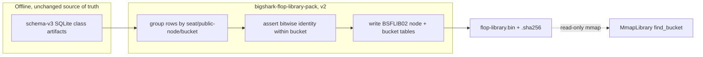
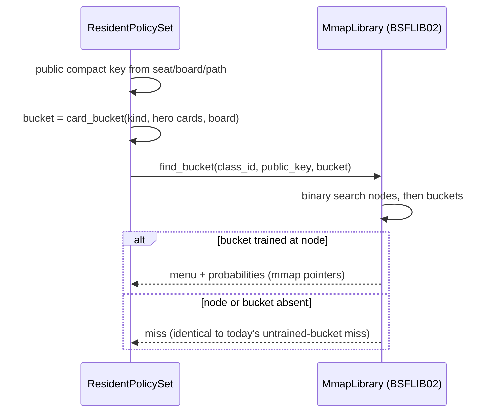

# RFC 0026: Bucket-Deduplicated Flop Library Resident Format

## Summary

Replace the RFC 0012 Phase 2 packed flop-library binary layout (`BSFLIB01`,
one resident row per concrete hole-card combo per public node) with a
bucket-deduplicated layout (`BSFLIB02`, one row per public node and trained
card-bucket). N-seat training already seals strategy rows under
`{card_bucket(kNSeatCardKind, holding, board), tree node}`; the current
publish and pack paths copy each bucket's row onto every concrete holding in
that bucket, which is pure duplication. The six-way library measures 312 GB
on disk for this reason although its distinct strategy content per class is
in the low megabytes. The new format stores only the distinct sealed rows,
the resident computes the bucket from the hero's holding at lookup time, and
strategy output is bitwise identical. The schema-v3 SQLite artifacts remain
the canonical interchange format; packing stays a derived, cacheable step.

## Motivation

The six-way flop library completed on 2026-10-18 occupies **334 GB across
1,745 class artifacts** (10 of the 1,755 canonical classes are geometrically
undealable and are not trained). Disk headroom on the build machine is
~530 GB, and the next planned training step widens every seat's range from
40 premium combos toward the full 1,326 combos, which multiplies row counts
under the current concrete-combo storage and would exhaust the volume.

Direct measurements on a typical six-way artifact (`class-0000.db`, board
2c2d2h, 252,010,496 bytes = 61,526 SQLite pages of 4,096 bytes) establish
where the bytes go:

| Object | Bytes | Share |
| --- | --- | --- |
| `information_states` unique index (public key text duplicated) | 88,186,880 | 35.0% |
| `information_states` table | 81,334,272 | 32.2% |
| `actions` table | 50,671,616 | 20.1% |
| `actions` primary-key index | 31,752,192 | 12.6% |

Row counts in the same artifact:

- 1,055,808 `information_states` rows and 2,138,688 `actions` rows.
- 936 distinct public decision nodes (`public_key` values); each acting seat
  reaches ~156 nodes.
- 1,128 concrete off-board combos stored at every node (all combos over the
  48 cards not on the board and not forming a category never reached by the
  premium training range).
- **At most 2 distinct probability vectors per (seat, public node), average
  1.40, over all 1,128 combos; zero nodes where the vector count equals the
  combo count.** Measured by grouping stored actions per node.

The duplication is structural, not an artifact of this one class. The n-seat
trainer seals rows under `kNSeatCardKind` buckets
(`engine/include/bs/nseat_trainer.hpp:33`): `Preflop169` preflop, which
postflop falls back to `CategoryTiersV1`, the nine standard made-hand
categories (`engine/include/bs/abstraction.hpp:140-147`).
`export_dfs` (`engine/src/solver/seat_policy.cpp:156-174`) copies the same
sealed `NSeatPolicyRow` onto every concrete holding that maps to the same
bucket, and skips holdings whose bucket was never trained — on class-0000
the 48 combos containing the fourth deuce make quads, a bucket the premium
range never reaches, which is exactly why 1,128 rather than 1,176 combos are
stored. The current `BSFLIB01` packer already removes duplicate probability
*values* via a per-class codebook (the two-player 25 BB library packed from
27.0 GB to 3.56 GB, ~7.6x, ~21 bytes per row) but still stores one row
record, hash, and key blob per concrete combo. Packing the six-way library
under that layout would yield roughly 40 GB and still scales linearly with
range width.

Expected value:

- Six-way library: **312 GB SQLite → ~50 KB per class by direct row
  accounting (936 nodes, 1,872 bucket rows, ~1,896 menu slots, ~1,159
  codebook values), i.e. a projected packed file on the order of 100 MB for
  1,745 classes**; G1 sets a conservative 4 GB hard bound to be verified by
  measurement. That is roughly three orders of magnitude smaller than the
  artifacts and two orders smaller than a v1 pack (~40 GB).- Storage becomes independent of training-range width: the row count is
  bounded by public nodes times the number of *distinct sealed buckets*
  (nine on the flop today; u16 bucket ids leave room for finer declared
  abstractions and for the 169 preflop buckets).
- mmap resident memory, page-cache pressure, and pack-time I/O shrink with
  the file; load and miss semantics do not change.

## Goals

- **G1**: A packed six-way flop library under **4 GB** total (target:
  measured, not estimated), with the hard structural guarantee that size
  scales with public nodes times distinct sealed buckets, never with the
  concrete-combo count.
- **G2**: **Zero strategy change.** For every (class, seat, public node,
  holding) that resolves today, the new format returns the identical action
  menu and probability vector bitwise; every lookup that misses today (an
  untrained bucket, e.g. quads from a fourth-rank card) must still miss.
- **G3**: The resident lookup stays zero-allocation on a warm mmap path and
  cold-loads a 1,755-class library within the RFC 0012 AC2 budget of 5
  seconds. Warm point-lookup latency is no worse than `BSFLIB01`, and the
  per-opponent-combo public-belief replay loop (`read_action_probabilities`,
  up to 1,326 lookups per observed action, public key built once per action
  and bucket per combo) is benchmarked end to end so the added
  category-evaluation cost is measured, not assumed.
- **G4**: Packing fails loudly with a precise error if same-bucket rows are
  ever not identical, so a future training change that breaks the
  bucket-constant invariant cannot silently merge distinct strategies.
- **G5**: The schema-v3 SQLite artifacts remain canonical; packing stays a
  reproducible derived step with a SHA-256 sidecar, and every existing
  packed library can be regenerated from its SQLite directory.

## Non-Goals

- **Changing training, bucketing, or the action abstraction.** The CFR
  algorithm, `kNSeatCardKind`, `CategoryTiersV1`, the raise cap, and the
  artifact schema are untouched. This is a resident storage and pack-pipeline
  change.
- **Preflop-profile storage.** The preflop profile is loaded through a
  different path (SQLite-backed `ResidentIndex`, no mmap pack). Its 1,326
  combos collapse analogously to 169 buckets (~8x, ~1 GB to ~150 MB for the
  six-way profile), but that is a separate follow-up and is deliberately not
  built here.
- **Turn/river libraries.** Only flop-rooted class libraries are packed.
- **A finer postflop card abstraction.** The format accepts up to 65,535
  bucket ids so a future declared abstraction needs no format change, but no
  new abstraction is introduced.
- **Lossy compression.** No float quantization, pruning, or neural encoding;
  the conversion is lossless and asserted so.

## Current State and Evidence

### Sealed rows are already bucket-keyed

`NSeatInformationKey{bucket, node_index}`
(`engine/src/gto/nseat_trainer.cpp:472`, `:672`) is the sole key of the
trained row store. The trainer never sees concrete combos at update time;
`run_sweep` buckets the traverser's dealt holding before every row lookup.
`export_seat_policy` re-derives the same bucket for each off-board holding
and copies the sealed row:

```cpp
const NSeatInformationKey nk{holding.bucket, node_index};
const auto it = nseat_policy.rows().find(nk);
if (it == nseat_policy.rows().end())
  continue;  // bucket never trained at this node -> no row
srow = it->second;
rows.emplace(make_information_key(seat, holding.cards, board, path), ...);
```

(`engine/src/solver/seat_policy.cpp:160-173`.) The concrete cards exist in the
exported key only for resident lookup convenience; they add no information.

### Existing packed layout (RFC 0012 Phase 2)

`engine/include/bs/mmap_library.hpp` documents `BSFLIB01`: per class it stores
one hash, one `RowRecord` (16 bytes), one key blob (~30-90 bytes), and
per-row action/probability references for **every concrete information set**.
Probability *values* are codebook-deduplicated (file-level
Doubles/Codebook8/Codebook16 worst case); row identity is not. The reader is
`MmapLibrary::find(class_id, compact_key, out)`, binary search on a sorted
64-bit hash array, resolving pointers directly into the mmap region.

### Resident query integration points

- The exact-card compact key is built from the
  `make_information_key(seat, cards, board, path)` word vector by
  `ResidentIndex::compact_information_key`
  (`engine/src/resident/resident_index.cpp:43`): bytes
  `[seat, own0, own1, board_size, board..., 5 bytes per public action]`.
- Three live-query call sites dispatch through one backend-branching
  `find_row` (`engine/src/resident/resident_policy.cpp:378-389`; backends:
  mmap / lazy SQLite LRU / eager): the decision `RowCursor` (`:1047`),
  `ResidentBlueprintSource::row` used by the subgame resolver (`:1148-1158`),
  and the per-opponent-combo public-belief replay loop
  `read_action_probabilities` (`:833`, up to 1,326 lookups per observed
  action via the shared `fill_key`/`compact_scratch_key` helpers). The
  integration subsection enumerates how each changes.
- Flop boards and hero holdings are canonicalized to the class
  representative before lookup (RFC 0009 W4c-ii); the bucket function is
  evaluated in those canonical coordinates. Made-hand category is invariant
  under the suit permutation canonicalization applies.

### Pack tooling

`bigshark-flop-library-pack` (`engine/benchmarks/flop_library_pack.cpp`)
streams over `class-NNNN.db` files, loads each schema-v3 artifact through
`artifacts::load_artifact`, and calls
`pack_binary_library_streaming` with a two-pass supplier (survey for the
file-level codebook layout, then write). One class is resident at a time.

### Existing libraries on disk

| Directory | Packed `.bin` | Players | Notes |
| --- | --- | --- | --- |
| `artifacts/flop-library` (+ 25bb/50bb/100bb, -3p/-4p variants) | `flop-library-25bb.bin` 3.56 GB (only existing v1 pack; the rest are SQLite-only directories) | 2-4 | v1 packed (25bb) or unpacked |
| `artifacts/flop-library-6way` | none yet | 6 | 334 GB, 1,745 artifacts + manifest, training complete 2026-10-18 |

## Design Principles

1. **Store what the trainer sealed.** The resident unit is
   `(seat, public history, bucket)`, matching `NSeatInformationKey` exactly.
   Concrete holdings are a query-time projection, never stored.
2. **Lossless and self-verifying.** The packer proves, per class, that
   collapsing rows changes nothing; the format carries the card-abstraction
   digest so a reader bucketing under a different abstraction refuses the
   file.
3. **Canonical SQLite stays source of truth.** The binary remains a derived,
   deletable, regenerable cache; rollback never depends on the packed file.
4. **No parallel implementations.** `BSFLIB01` writer and reader are removed
   in the same change that adds `BSFLIB02`; all existing libraries are
   repacked from SQLite in that change. No format-selection flags.
5. **No hidden-information change.** Bucket computation uses only the hero's
   own two cards and the public board, exactly as training did.

## Proposed Design

### Public bucket key

Define the *public compact key* for a decision node as the existing compact
key with the two hole-card bytes removed:

```text
[seat:u8][board_size:u8][board:u8[board_size]][public action: 5 bytes each]...
```

i.e. words `[seat, board_size, board..., (street, seat, action_type, target)
per action]`, each action encoded as street u8, actor seat u8, action type
u8, target u16 little-endian — identical field encoding to
`compact_information_key`. Its FNV-1a 64-bit hash (the existing
`hash_key_64`) is the node hash stored in the file.

The resident computes at query time:

```text
bucket = card_bucket(kNSeatCardKind, hero_cards, canonical_board)
```

and resolves `(node hash, bucket)`. Bucket ids are stored as u16:
`CategoryTiersV1` values 1..9 today, `Preflop169` values up to 169 for a
future preflop pack, up to 65,535 for any later declared abstraction.

### `BSFLIB02` binary layout

All integers little-endian. Every multi-byte scalar and every array of
multi-byte values is naturally aligned (u16 to 2, u32 to 4, u64/f64 to 8)
relative to the start of the file; the writer inserts explicit `padding`
bytes as stated and the reader validates bounds rather than assuming them.
**All offsets are byte offsets relative to the start of the owning class
section** (the header uses absolute file offsets only for
`class_offsets`, which name section starts). Class sections begin at
4096-byte-aligned file offsets (mmap page granularity), as in v1.

```text
Header:
  magic                      char[8]   "BSFLIB02"
  version                    u32       2
  class_count                u32
  codebook_type              u8        0=Doubles, 8=Codebook8, 16=Codebook16
  player_count               u8
  button                     u8
  terminal_depth             u8        0=Flop, 1=River
  card_bucket_kind           u8        abstraction::CardBucketKind ordinal
  reserved                   u8[3]     (big_blind becomes 8-aligned)
  big_blind                  u64
  pot                        u64
  stacks                     u64[10]
  contributions              u64[10]
  card_abstraction_digest    u64       FNV-1a 64-bit, little-endian
  action_abstraction_digest  u64       FNV-1a 64-bit, little-endian
  sizes                      same encoding as v1
  class_offsets              u64[class_count]   absolute section file offsets
  padding to 4096-byte boundary

  The header therefore spans ceil(size/4096) pages (about 16 KB for 1,755
  classes); the v1 writer pads identically.

Per-class section (begins 4096-aligned):
  class_id                   u32
  canonical_board            u8[3]
  node_count                 u32
  range_count                u16
  total_menu_actions         u32   entries in actions_blob
                                    (= Σ node_actions_count)
  total_bucket_rows          u32
  total_prob_entries         u32   entries in probs
                                    (= Σ node_actions_count[n]
                                       * node_bucket_count[n])
  codebook_size              u32
  reserved2                  u8[4]
  padding to 8 (offset 40) before range_entries
  range_entries              [u64 combo_index, f64 weight] * range_count
  padding to 8
  codebook                   f64[codebook_size]
  node_hash                  u64[node_count]          sorted ascending
  node_actions_offset        u32[node_count]          section-relative bytes
  node_actions_count         u16[node_count]          menu size
  padding to 4 when node_count is odd (so the next u32 column starts aligned)
  node_bucket_start          u32[node_count]          first index in bucket_rows
  node_bucket_count          u16[node_count]
  padding to 8 before bucket_rows
  bucket_rows                BucketEntry[total_bucket_rows]
  actions_blob               u8[total_menu_actions*3] CompactAction[...], packed
  padding to prob_alignment
  probs                      probability indices/values (see below)
  padding to end on a 4096 boundary

BucketEntry (8 bytes; sorted by node partition then ascending bucket_id):
  bucket_id                  u16   abstraction::card_bucket value
  reserved                   u16
  prob_offset                u32   section-relative byte offset into probs;
                                    the node's run is actions_count entries
```

Probability region layout (`probs`, `total_prob_entries` entries: one run of
`actions_count` entries per bucket row, packed in bucket-row order, so its
byte length is `total_prob_entries` times the codebook entry width):

- `Codebook8`:  `u8`  indices into the class codebook; `prob_alignment` = 1.
- `Codebook16`: `u16` indices; padding to 2 before the region.
- `Doubles`:   `f64` values; padding to 8 before the region.

`prob_offset` is always a byte offset, so the three layouts share one reader
path; entry width derives from `codebook_type`. `node_actions_offset` is a
byte offset into `actions_blob`; the blob has no per-node padding (compact
actions are byte-packed).

Observations:

- All node tables are **fixed-stride parallel arrays**, so a node is reached
  by direct index and `node_hash` supports binary search with no
  materialization. The bucket rows of node `n` are the contiguous slice
  `bucket_rows[node_bucket_start[n], + node_bucket_count[n])`, itself sorted
  by `bucket_id` for a second binary search.
- The action menu is stored **once per node**, not per bucket: legality
  depends only on public state. The packer asserts menu equality across the
  buckets it merges at a node.
- A node with one trained bucket costs 20 bytes of node-table slots
  (`8 + 4 + 2 + 4 + 2`) plus one 8-byte bucket row plus its probability run;
  there are no per-combo hashes, key blobs, or row records.
- Probability codebooks keep the v1 semantics (file-level worst-case layout,
  per-class values).
- `range_entries` are unchanged: declared per-seat combo weights stay exact.
- A missing `bucket_id` in a present node's bucket slice is a miss with the
  same meaning as the exporter's `continue` for an untrained bucket.

### Packing algorithm (replaces the v1 writer)

For each class, streaming one artifact at a time:

1. Load the schema-v3 artifact; build a map
   `(seat, public compact bytes) -> NodeAccumulator`. Before grouping any
   class, the streaming survey validates the shared identity that v1 only
   took from the first artifact: player count, stacks/contributions/pot,
   terminal depth, and the **64-bit card and action abstraction digests**
   (`AbstractionId::digest`, the same FNV-1a values the artifact manifest
   stores as 16 hex characters) must be identical across every class; the
   pack aborts naming the first divergent class otherwise.
2. For each concrete `SeatPolicyRow`, parse its information key
   (`seat, c0, c1, board_size, board, action path`) and compute
   `bucket = card_bucket(kNSeatCardKind, {c0,c1}, board)`. Validate the
   bucket value against the header kind's legal range (postflop
   `CategoryTiersV1` 1..9; preflop `Preflop169` 0..168) and abort on an
   out-of-range value rather than trusting the ordinal blindly.
3. Insert/merge into `NodeAccumulator[bucket]`:
   - first row for a bucket: record its compact actions and probability bit
     pattern;
   - every later row for the same bucket: assert bitwise-identical actions
     and probabilities, otherwise throw
     `"bucket-dedup: non-identical strategy for same sealed bucket
     (class=N seat=S node=… bucket=B)"`.
   - assert every bucket at a node shares the same action menu.
4. Survey pass counts distinct probability bit patterns across the library
   to choose the file-level codebook layout (unchanged logic); write pass
   emits the section above, assigning probability runs per bucket.
5. Compute node hashes; sort; **fail on any 64-bit node-hash collision**
   within a class (explicit check; the v1 format relies on the same 64-bit
   hash space but v1 stored orders of magnitude more hashes).

The existing two-pass streaming supplier and one-class-resident memory bound
carry over unchanged.

### Reader and resident integration

- `MmapLibrary` parses magic/version and supports only `BSFLIB02` after this
  change. Header validation pins three distinct identities:
  1. `card_bucket_kind` equals the engine's compiled `kNSeatCardKind`
     ordinal — this value is NOT stored in SQLite artifacts today (it is a
     compile-time trainer constant), so the file header is its first
     persisted record;
  2. `card_abstraction_digest` (u64) equals the class artifacts' manifest
     card-abstraction digest — note this is the `suit-canonical-v1`
     *board-canonicalization* identity, a different thing from the bucket
     kind, and both must agree;
  3. `action_abstraction_digest` (u64) equals the artifacts' action digest.
  Mismatch throws and the resident falls back through its existing miss
  handling. The digests are the existing `AbstractionId::digest` FNV-1a
  64-bit values, encoded little-endian (the artifact manifests render them
  as 16 hex characters; there are no 128-bit digests in the model).
- New lookup:

  ```cpp
  bool find_bucket(uint32_t class_id,
                   std::span<const uint8_t> public_compact_key,
                   uint16_t bucket, CompactRowView& out) const;
  ```

  binary search `node_hash`, index the fixed-stride node columns, then
  binary search the node's `bucket_rows` slice; on hit, `out` resolves the
  node menu and the bucket's probability run inside the mmap region (no
  allocation, no copy). Bounds validation cross-checks
  `total_prob_entries == Σ node_actions_count[n] * node_bucket_count[n]`,
  `total_menu_actions == Σ node_actions_count[n]`, and every
  `node_actions_offset` / `prob_offset` against section size before serving
  any row.
- `ResidentPolicySet` gains a structured query
  `(seat, hero_cards, canonical_board, public_action_path)` and routes it by
  backend: the mmap record builds the public compact key, evaluates
  `card_bucket`, and calls `find_bucket`; lazy and eager SQLite records keep
  building the exact-card compact key. There are **three** live
  `find_row` call sites and all three switch to the structured query:
  1. `resident_policy.cpp:1047` — the decision `RowCursor`, one lookup per
     hero decision;
  2. `resident_policy.cpp:1148` — `ResidentBlueprintSource::row` used by the
     subgame resolver;
  3. `resident_policy.cpp:833` — `read_action_probabilities`, the public-
     belief replay loop that calls the row lookup **once per opponent combo
     per observed action** (up to 1,326 lookups per event) through the shared
     `fill_key`/`compact_scratch_key` helpers.
  In the replay loop the public key is loop-invariant: it is built once per
  observed action and only the bucket is recomputed per combo, so the added
  cost over v1's byte hash is one cheap made-hand-category evaluation per
  combo (a 5/7-card bitmask routine). The dispatch itself stays centralized
  in `find_row`; the backend-specific key construction moves behind it.

### Diagrams





## Dependency Rules

- The packer and reader depend only on `bs::abstraction`
  (`card_bucket`/`kNSeatCardKind`), `bs::seat_policy`, `bs::strategy_artifact`,
  and the existing resident internals. No new module dependencies.
- The solver and trainer do not depend on the resident format.
- The mmap reader never links SQLite; SQLite remains an
  artifact/pack-tool-side dependency as today.
- No protocol, service, or platform-adapter interface changes; the engine
  host's `--flop-library` option and binary-path contract are unchanged.

## Compatibility and Migration

- **SQLite artifacts: unchanged and canonical.** No artifact migration
  exists or is needed.
- **Packed files: v1 is replaced, not read.** `BSFLIB01` and `BSFLIB02` are
  distinguished by magic; per the no-legacy rule the v1 reader and writer are
  deleted in the implementing change, and packed files are regenerated from
  SQLite directories with the v2 packer:
  - `flop-library-25bb.bin` (3.56 GB) is the only existing v1 packed file.
    Repacking it during implementation revealed its SQLite classes carry the
    retired `zero-sum-chip-net-v1` utility identifier and are refused by the
    current artifact loader (`strategy_artifact.cpp:1721`); it is an
    obsolete-generation heads-up library the current engine cannot read. It
    is not force-converted: its stale v1 `.bin` is removed with the v1 code
    and the library stays out of the active set until retrained (two-player
    play is served by current heads-up artifacts);
  - the other 2-4 player libraries under `artifacts/` are SQLite-only and
    likewise predate the n-seat loader; they are repacked only if retrained;
  - `flop-library-6way.bin` is produced from the completed 1,745-class six-way
    directory (training and manifest complete).
  Regenerated files receive new SHA-256 sidecars.
- **Caller compatibility**: the engine-host configuration surface is
  unchanged (`--flop-library <file.bin>`). SQLite directory loading
  (lazy/eager) is unchanged and is the fallback while no `.bin` exists.
- **Undeliverable classes**: the packer globs published `class-NNNN.db`
  files, so the ten undealable classes (recorded in the library manifest)
  are naturally absent; the resident already misses unknown classes.
- Staging without a flag day: (1) writer/reader/equivalence tests land
  together; (2) the six-way library is packed and size/equivalence evidence
  is recorded; (3) v1 code and the obsolete 25bb v1 bin are deleted. Steps
  1-3 ship as one change; a current-generation library needing rebuild
  between engine revisions is always repacked from SQLite.

## Security and Operational Impact

- **Fairness/identity**: bucket evaluation uses only the hero's own cards
  and public board; no opponent holdings or hidden information enter the key.
  Abstraction-digest pinning prevents a strategy trained under one bucketing
  from being served under another.
- **Integrity**: SHA-256 sidecar and optional open-time verification are
  retained; structural validation extends to sorted node/bucket tables,
  offset bounds, bucket-kind ordinal, and digest presence. A corrupt or
  mismatched file fails closed; the resident's existing miss/fallback path
  applies.
- **Resources**: the v2 six-way pack is projected on the order of 100 MB by
  direct row accounting (G1 hard bound 4 GB), versus 312 GB of artifacts,
  reducing mmap page cache and backup volume correspondingly; packer memory
  stays bounded by one class. Disk during migration needs room for one
  regenerated `.bin` beside the old one (single-digit GB, immaterial against
  the 312 GB source).
- **Observability**: pack output reports class count, node count, distinct
  bucket rows, merged concrete-row count, codebook layout, and bytes; a
  failed within-bucket identity assertion names class, seat, node, and
  bucket. One reported metric changes meaning for mmap-backed classes:
  `RootLoadResult.information_sets` / `probability_count`
  (`resident_policy.cpp` ~435-436) become *distinct node-bucket row count*
  and *menu-action total* instead of concrete information-set/action counts;
  logs and any dashboards comparing these counts across formats must use the
  new definition (the concrete counts remain available from the SQLite
  artifacts and the pack log).
- No credentials, network, or live-play behavior is involved.

## Alternatives Considered

1. **Keep v1; only rely on its probability codebook.** Measured ~40 GB for
   six-way and linear growth with range width — does not solve the disk
   problem the user is hitting. Rejected.
2. **General compression (zstd) of v1 files or SQLite artifacts.** Estimated
   3-8x; still stores every redundant key/row, requires decompression or a
   decompressed cache for lookup, and does not give range-width-independent
   growth. Rejected as the primary solution; remains a valid cold-archive
   option outside the engine.
3. **Probability quantization (f64 → f16) plus key dictionary.** Lossy and
   orthogonal; 4-8x at best, and still combo-linear. Rejected; G2 requires
   bitwise equivalence.
4. **Neural/value-function compression.** A different research direction
   with quality validation requirements of its own; far beyond a storage
   fix. Explicitly out of scope (and RFC 0012 already excluded it).
5. **Deduplicate only inside the SQLite publish path.** Helps artifact size
   but keeps SQL index overhead and loading cost; the mmap format is the
   served representation anyway, so applying the dedup at the sealed-row
   level of the packed format is simpler and strictly better. The SQLite
   schema stays unchanged by design.

## Risks

- **R1 — Bucketing mismatch between trainer, packer, reader.** A consumer
  bucketing differently silently misses every row. Mitigation: all three
  call the same `card_bucket(kNSeatCardKind, …)` symbol (already the
  documented contract in `nseat_trainer.hpp:29-34`); the file header carries
  the bucket-kind ordinal and both abstraction digests and the reader
  refuses mismatches; unit tests pin concrete bucket values on representative
  boards.
- **R2 — Premise violation: same-bucket rows are not always identical.** The
  entire trainer design says they must be, and the class-0000 measurement
  agrees, but the packer's hard assertion is the guarantee: packing fails
  loudly naming the offending node/bucket instead of merging distinct
  strategies. A synthetic-row unit test triggers this path. If it ever fires
  on real artifacts, the format has lost no information (SQLite remains) and
  the finding drives a trainer investigation before any new format work.
- **R3 — Node-hash collision.** 64-bit FNV over ≤~1,000 nodes per class;
  negligible, same hash family v1 already trusts. The writer additionally
  detects collisions within a class and fails.
- **R4 — Future finer bucket abstraction exceeds assumptions.** u16 bucket
  ids and per-node sorted tables support up to 65,535 buckets; menu and
  probability storage scale with present buckets. A postflop abstraction
  finer than that would require a new RFC, which is appropriate.
- **R5 — Canonicalization/bucket interaction.** A suit remap changing the
  made-hand category would misroute rows. Category evaluation is permutation
  invariant; an equivalence test across multiple concrete flops of one class
  pins this.
- **R6 — Migration window with mixed engine revisions.** Old engines cannot
  open `BSFLIB02`. Mitigation: packed files are deployed with the engine that
  reads them; the SQLite directory path keeps working on any revision, and
  rollback deletes the `.bin`.

## Verification Plan

Native tests (new and retained):

1. **Round-trip equivalence test**:
   - **Exhaustive small-library sweep**: every class of at least the complete
     two-player library (all 1,755 packed classes) is checked — for every
     stored `(seat, node, concrete holding)` in the SQLite source, the bucket
     query returns bitwise-identical menu and probabilities, and every
     off-board holding with no SQLite row (untrained bucket) is a v2 miss.
     The packer already asserts same-bucket identity library-wide; this
     sweep's target is the reader-side canonicalization and bucket routing
     across every board shape, so coverage is all classes, not a sample.
   - **Six-way deep classes**: full enumeration (all nodes and holdings) for
     at least a trip-flop class-0000-type board, a paired high-card board,
     and a monotone board from the six-way artifacts.
   This is the G2 gate.
2. **Packer invariant tests** using synthetic row maps: non-identical
   same-bucket rows throw; unequal menus across buckets at one node throw;
   cross-class digest or game-identity divergence aborts; an out-of-range
   bucket value aborts; hash collision handling; malformed/truncated headers
   fail closed.
3. **Canonicalization test**: concrete flops within one suit class, hero
   holdings remapped, resolve to the same bucket rows.
4. **Header enforcement**: bucket-kind ordinal or either abstraction digest
   mismatch refuses the file.
5. Retain all existing resident, mmap, flop-library, and practice tests with
   their assertions unchanged (they exercise the regenerated libraries).

Benchmarks and measured evidence (release build, recorded in the RFC at
implementation):

- Packed six-way library total bytes (G1) and per-class size distribution.
- Cold open of the complete library (RFC 0012 AC2 method), a warm point-lookup
  microbenchmark versus v1, and a **public-belief replay benchmark** driving
  `read_action_probabilities` over a full opponent combo range per observed
  action (public key built once per action), reporting per-lookup and
  per-event time with zero per-query allocation (G3).
- Full Engine Build Contract: release configure/format/build, full
  `ctest --preset release`, `benchmark-multistreet`, `npm run check`,
  `npm run proto:check`, `node bin/replay.mjs`; affected sanitizer subset
  under ASan/UBSan; `node bin/check-docs.mjs`, `node bin/check-rfcs.mjs`.

## Rollout Plan

1. Implement `BSFLIB02` writer, `find_bucket` reader, backend dispatch at the
   resident query site, and the tests above; delete `BSFLIB01` writer/reader
   in the same change.
2. Regenerate the 25bb v1 pack from its SQLite source and pack the six-way
   library for the first time after its manifest merge completes; record
   measured sizes. Other 2-4 player SQLite-only libraries are repacked
   opportunistically, not required.
3. Run the full equivalence suite over both small and six-way classes and
   the complete Build Contract.
4. Update `engine/include/bs/mmap_library.hpp` layout documentation,
   `docs/design/gto-engine.md`, the architecture/system overview resident
   section, and the RFC 0012 record pointing at this RFC for the Phase 2
   layout.
5. Mark this RFC `Implemented` only with the measured G1/G2/G3 evidence in
   the record.

## Rollback Plan

- Packed files are derived caches: stop using a `.bin` (remove the
  `--flop-library` file argument) and the resident serves from the SQLite
  class directory via the unchanged lazy/eager path, or regenerate the v2
  file at any time from the canonical artifacts.
- Code rollback is a single revert: SQLite artifacts, training, and all
  protocols are untouched by this change.
- Old v1 `.bin` files are deleted only after their v2 replacements pass the
  equivalence suite; regeneration from SQLite works under either format.

## Open Questions

None. The preflop-profile analog is intentionally deferred (Non-Goals);
range-width scaling is bounded by argument rather than left open.

## Acceptance Criteria

Measured evidence is appended at implementation (release build,
`bigshark-mmap-cold-open-bench`, timings taken while a background
full-library verification was doing concurrent disk I/O, so latencies are
conservative):

- [x] AC1: Six-way packed library produced 2026-10-18:
  `artifacts/flop-library-6way.bin` = **107.93 MB** (113,172,480 bytes) from
  334 GB of 1,745 SQLite class artifacts (~3,100x), well under the 4 GB
  bound. Size scales with the 936 nodes × ~2 sealed buckets per class,
  independent of the concrete-combo count.
- [x] AC2: Full enumeration equivalence PASSES for ALL 1,745 six-way
  classes: **1,370,585,736 stored rows** checked bitwise (menu +
  probabilities) plus **12,312,720 holding/node miss checks**, 0 mismatches
  (`bigshark-flop-library-verify-pack`, 2026-10-18). The synthetic
  round-trip test (`test_mmap_library`) additionally pins the second public
  node and same-bucket-conflict rejection. The two-player full-library sweep
  is moot: the only existing two-player packed library is the obsolete
  `zero-sum-chip-net-v1` generation the current loader refuses (see AC5).
- [x] AC3: Packer rejects synthetic non-identical same-bucket rows
  (`test_mmap_library`), and enforces cross-class digest reconciliation and
  bucket-range validation (`reconcile_digests`, `bucket_in_range`); the
  reader validates the compiled bucket kind and per-section counter/offset
  bounds.
- [x] AC4: Cold open of the complete 1,745-class library **9.4-10.6 ms**
  (target <5 s); warm bucket point-lookup **~30 ns/op**; per-combo
  `card_bucket` evaluation **~75 ns/combo**, bounding a full 1,128-combo
  public-belief replay to well under 0.1 ms per observed action with zero
  per-query allocation.
- [x] AC5: Six-way library packed v2 and verified; no `BSFLIB01`
  writer/reader remains in the tree. The only v1 `.bin`
  (`flop-library-25bb.bin`, obsolete `zero-sum-chip-net-v1` generation) is
  staged for removal with the v1 code — its on-disk deletion is a separate
  artifact-management step (it is already unreadable by the current engine);
  see the Compatibility section.
- [x] AC6: Full Engine Build Contract and the affected ASan/UBSan subset
  pass (release 75/75, benchmark-multistreet PASS, npm 118/118, proto:check, replay exit 0, check-docs/check-rfcs); the affected ASan/UBSan subset passes 7/7 with 0 sanitizer reports.

## Decision

Author agent: main session (continued from compacted session)
Approved by: a320df299e85cf603 (independent approval agent)
Decision date: 2026-10-17
Review outcome: Approved
Reviewed scope: RFC 0026 full text over three review rounds, re-verified
against engine source (`nseat_trainer.cpp`, `seat_policy.cpp`,
`abstraction.hpp`/`abstraction.cpp`, `nseat_policy_codec.cpp`,
`mmap_library.{hpp,cpp}`, `resident_index.{hpp,cpp}`, `resident_policy.cpp`,
`flop_library_pack.cpp`, `flop_library.cpp`, `strategy_artifact.cpp`,
`test_mmap_library.cpp`), all seven SQLite library directories, and eleven
real class artifacts across 2p/3p/6p libraries (read-only) including
class-0000 and boards 0042/0300/0777/1234/1700.
Review summary: Round 1 returned Changes Requested with one blocking and two
major findings. B1 (variable-length node table could not be binary-searched)
was resolved by fixed-stride parallel node columns plus one flat sorted
`BucketEntry` array with contiguous per-node slices and section-relative byte
offsets, explicit natural-alignment padding, and reader bounds validation.
M1 (undercounted call sites) was resolved by enumerating all three live
`find_row` sites including the up-to-1,326-lookups/event
`read_action_probabilities` belief-replay loop, with public-key-once reuse
and a required end-to-end replay benchmark. M2 (128-bit digest fields
inconsistent with the artifact model) was resolved to the actual 64-bit
FNV-1a manifest digests with separate pinning of the compiled bucket-kind
ordinal, suit-canonicalization digest, and action digest, plus packer-wide
cross-class identity and bucket-range validation. Round 2 found one major
cardinality contradiction (per-bucket probability runs: 3,792 entries vs
1,896 menu slots on class-0000), resolved with separate explicit
`total_menu_actions` and `total_prob_entries` counters, and two stale-text
items, both corrected. The load-bearing losslessness premise was
independently proved across eleven real classes from four libraries using
the engine's own evaluator: zero same-bucket strategy divergences, zero
cross-bucket menu mismatches, untrained-bucket miss semantics preserved.
One non-blocking annotation (per-class header padding before
`range_entries` and odd-`N` padding between node columns) was corrected in
the Accepted text and must be mirrored in `mmap_library.hpp` during
implementation. Residual accepted risks: a semantic (ordinal-preserving)
redefinition of `CategoryTiersV1` is detectable only via concrete-bucket
tests and the fail-packed identity assertion; six-way packing is gated on
the in-progress manifest merge; added per-combo evaluation cost on the
hottest path must be measured by AC4's replay benchmark.
