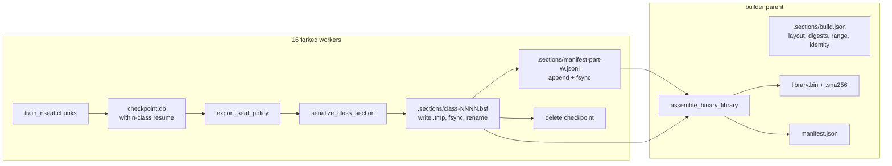

# RFC 0027: Direct Train-and-Pack Flop Library Production

## Summary

Train flop classes directly into the bucket-deduplicated `BSFLIB02` resident
format instead of publishing one schema-v3 SQLite policy artifact per class
and re-reading the whole directory afterwards. At the end of a class the
trainer already holds the exact `SeatPolicy` rows that the packer consumes
(`PackClassInput.rows`), so the builder serializes that class into its
`BSFLIB02` section immediately, writes it to a per-class section temp with
`fsync` and an atomic rename, and the parent assembles the class sections into
one `library.bin` at the end. The SQLite policy artifacts are never written.

The packed format does not change: a direct build produces a file that is
byte-for-byte what `bigshark-flop-library-pack` produces today from the same
trained rows. What changes is the production pipeline (no full-size
intermediate), the library manifest (it names the binary library instead of
per-class `.db` files), and how `--flop-library <dir>` resolves.

Measured motivation on the authoritative six-way full-range library: 440 GiB
of SQLite written, then 5 h 39 min spent reading it back to produce a 180 MiB
`.bin`. Direct production removes the 440 GiB and the second pass.

## Motivation

The six-way full-range flop library (`artifacts/flop-library-6way-fullrange`,
trained 2026-10-18) produced, for 1,755 classes:

| Measurement | Value | Source |
| --- | --- | --- |
| Per-class SQLite artifacts | 1,755 | `find ... -name 'class-*.db'` |
| Total SQLite bytes | 471,927,861,248 (439.5 GiB) | `find -printf '%s'` sum |
| Mean / min / max artifact | 268,904,764 / 262,836,224 / 271,364,096 bytes | same |
| Training wall clock | 6 h 20 min (10:21:26 → 16:41:27 +08:00) | log birth and last artifact mtime |
| Pack wall clock | 5 h 39 min (17:09:32 → 22:48:21 +08:00) | launch command and `.bin` mtime |
| Packed `BSFLIB02` file | 188,440,576 bytes (179.71 MiB) | `artifacts/flop-library-6way-fullrange.bin` |
| Section content total | 183.83 MB (max 136,376 B, mean 104,745 B) | section headers of the packed file |
| Max distinct probabilities per class (Codebook16) | 1,821 of 65,535 | codebook sizes in the packed file |
| Sampled in-progress checkpoint | 347,959,296 bytes for `class-0000` (final policy 263,061,504) | 2026-10-19 probe run |

Two independent wastes follow from the current pipeline
(`engine/src/flop_library/flop_library.cpp:411-524`):

1. **The intermediate is 2,500× the product.** Each class writes a ~263 MB
   schema-v3 artifact whose entire strategic content is a ~105 KB
   bucket-deduplicated section. The volume held 1.6 TB used / 383 GB free at
   RFC time; a second full-range generation at another stake or seat count
   does not fit.
2. **The pack pass re-reads the intermediate at 23 MB/s.** Section
   serialization is CPU-cheap; the 5 h 39 min is dominated by opening 1,755
   SQLite files and streaming 440 GiB through `artifacts::load_artifact`.
   None of that work produces information the trainer did not already have.

The training loop already computes everything the packer needs. In
`train_one_class` the final `solver::SeatTrainingResult exported` is passed to
`create_checkpoint`/`publish_policy` only so that
`engine/benchmarks/flop_library_pack.cpp:109-145` can later load it and hand
`policy.rows()`, `policy.ranges()[0]`, `policy.action_id().digest`, and
`policy.card_id()->digest` to `PackClassInput`. The round trip through SQLite
carries no additional information.

## Goals

- **G1**: A six-way full-range library build writes **no per-class SQLite
  policy artifact**. Peak on-disk footprint for a 16-worker run is bounded by
  the per-class warm-start checkpoints (measured ≈ 350 MB per active worker)
  plus the final `.bin`, and is **≤ 10 GB measured**, versus 440 GiB today.
- **G2**: **Byte-identical artifacts, including range encoding.** For
  identical build parameters, a direct build emits a `.bin` whose bytes equal
  the bytes that `bigshark-flop-library-pack` would produce from the same
  trained rows, section for section — for every range, not only the full
  range. This requires canonicalizing `PackClassInput.range` to combo-index
  order in the shared serializer (see "Proposed Design → Range canonicalization").
  The packed format stays `BSFLIB02` version 2; no reader change is required
  and the resident lookup semantics are untouched.
- **G3**: **No second pass.** Build wall clock is training wall clock plus a
  bounded merge (target ≤ 10 minutes for 1,755 sections), with no artifact
  re-read.
- **G4**: **Crash/resume parity at every durable boundary.** A SIGKILL after
  section rename, after fragment append, or after checkpoint deletion
  followed by `--resume` produces the same final bytes as an uninterrupted
  run and retrains no completed class.
- **G5**: **One serializer.** The packer and the builder share the same
  section serializer and the same library assembler; there is no second
  implementation of the `BSFLIB02` layout.
- **G6**: The library manifest remains an honest, machine-readable record:
  coverage, undealable boards, identity fields (including the training
  range), per-class counts, and the binary library's size and SHA-256.
- **G7**: **Content pinning is preserved.** A directory-resolved binary
  library is verified against its pinned SHA-256 at startup, and the
  manifest's digest must agree with the sidecar; the engine never reports an
  unverified digest as authoritative.

## Non-Goals

- **Changing the packed format or the resident reader.** `BSFLIB02` version 2
  is unchanged. If a future requirement changes the layout, it gets its own
  RFC.
- **Changing training, bucketing, the action abstraction, or determinism.**
  `train_nseat`, `export_seat_policy`, `kNSeatCardKind`, `CategoryTiersV1`, and
  the raise cap are untouched.
- **Multiple binary libraries per engine process.** `ResidentOptions` carries
  one `binary_library_path` today; this RFC makes a second binary library a
  startup error instead of a silent first-wins, and defines how a binary
  library coexists with SQLite directory roots (see "Proposed Design →
  Loader changes"). Generalizing `ResidentOptions` to N binary libraries is
  separable and not required here.
- **Converting the remaining SQLite-only libraries** (heads-up, 3-way, 4-way,
  25/50/100 BB variants, ≈ 376 GiB). They remain packable by the unchanged
  `bigshark-flop-library-pack`; converting them is an operator decision.
- **Growing an existing library from N to M classes in place.** The current
  pipeline supports this via `--resume` skipping published classes. Direct
  mode could seed from an existing `library.bin`, but seeding is unsafe without
  a rule for merging sections from two builds and for a partially assembled
  library. Extension is therefore **explicitly out of scope**: a direct-mode
  `--resume` whose `class_count` differs from the recorded build identity
  fails closed with a message telling the operator to rebuild from scratch. A
  later RFC can add extension with a proper merge contract.
- **Removing `--lazy` SQLite class loading.** It stays until every library
  under `artifacts/` is binary (removal condition in "Compatibility and
  Migration").
- **Changing served strategy or claiming any quality improvement.** This RFC
  is a storage and pipeline change only.

## Current State and Evidence

### Facts (verified in this repository)

- **Training export.** `train_one_class`
  (`engine/src/flop_library/flop_library.cpp:411-524`) trains in chunks of
  `kCheckpointInterval`, writes `class-NNNN-checkpoint.db` after each chunk,
  then removes the checkpoint, writes a policy-only checkpoint, and publishes
  `class-NNNN.db` (`:498-510`). Serial and parallel paths both call it
  (`:1003`, `:1079`).
- **Parallel isolation.** `build_library_worker` (`:1039-1083`) trains a
  strided class range; each worker writes disjoint files, so concurrent
  workers never touch the same artifact. `merge_fragments` (`:1085-1187`)
  reads `manifest-part-N.json`, sorts by class index, enforces
  `records + undealable == class_count`, and writes `manifest.json`.
- **Packing.** `bigshark-flop-library-pack`
  (`engine/benchmarks/flop_library_pack.cpp:46-159`) sorts `class-*.db`,
  derives each class id from its filename, loads one artifact at a time, and
  calls `pack_binary_library_streaming`
  (`engine/src/resident/mmap_library.cpp:582-744`). That function writes the
  header, then for each class runs `build_class_data` (`:306-395`) and
  `write_class_section` (`:406-578`), pads to a 4,096-byte boundary, patches
  `class_offsets` and the two abstraction digests, and writes the
  `<path>.sha256` sidecar. `build_class_data` is where the RFC 0026
  losslessness invariants are asserted (single menu per public node,
  bitwise-identical probability runs per `(node, bucket)`).
- **Sections are class-local.** A section stores its own `class_id`, board,
  range, codebook, node columns, bucket rows, action menu, and probability
  runs (`engine/include/bs/mmap_library.hpp:35-65`). Nothing in a section
  refers to another class. Section content therefore depends only on that
  class's rows and the file-level codebook layout.
- **Determinism.** Per-iteration PRNG streams depend on the absolute
  iteration number and the class's own parameters, and a class is trained
  independently of which other classes run (`engine/include/bs/flop_library.hpp:119-124`
  and RFC 0012 Phase 4). Measured 2026-10-19: retraining `class-0000` of the
  full-range six-way library from scratch with the recorded parameters
  reproduces `class-0000.db` byte for byte (`sha256`
  `90cd64add5ac478b6d1c4c7c3d01118baf9dfc8c2c1fb47eee03ddf5de970975`).
  Measured 2026-10-19: packing the same artifact twice produces identical
  `.bin` bytes (`sha256`
  `54caa5e4ec4184381d41b2e2891f434b9a887864f3ccc591918fe15d68dce762`), and a
  one-class pack's section is byte-identical to section 0 of the 1,755-class
  file. Combined with section locality these confirm, for the full range,
  that a direct build reproduces the existing `.bin` (AC3/AC4). They do **not**
  cover a non-full range; see the next fact.
- **Range encoding differs by entry point.** The packer supplies
  `policy.ranges()[0]` and `write_class_section` emits it verbatim
  (`engine/src/resident/mmap_library.cpp:435-471`,
  `engine/benchmarks/flop_library_pack.cpp:136-138`). The SQLite reader
  returns ranges `ORDER BY player, combo`
  (`engine/src/artifacts/strategy_artifact.cpp:2339-2340`), i.e. ascending
  `comboIndex`. The declared premium range is **not** in that order: its
  first entries are `1320, 1321, …, 1298, 1299, …`
  (`engine/src/flop_library/flop_library.cpp:888-908`), while the premium
  `artifacts/flop-library-6way.bin` stores `1206, 1207, 1208, 1221, …`
  (measured). `declared_full_library_range()` (`:911-919`) happens to be
  ascending, which is why AC4 alone would not detect this. A direct builder
  that passed `filter_range(...)` unchanged would therefore emit a different
  section for every premium-range library. The serializer must canonicalize
  the range (see "Range canonicalization").
- **`information_sets` has two different meanings.** `train_one_class` sets
  `entry.stored_rows = exported.policy.rows().size()` (concrete exported rows,
  1,100,736 on `class-0000`) and `entry.information_sets =
  trained.information_sets` (`engine/src/flop_library/flop_library.cpp:516-518`),
  which is the trainer's bucket-keyed table size
  (`engine/src/gto/nseat_trainer.cpp:1069`, 2,808 on `class-0000`). The
  artifact manifest instead records the concrete row count
  (`engine/src/artifacts/strategy_artifact.cpp:1310-1314`). The library
  manifest therefore deliberately carries both, and any new schema must state
  which is which.
- **Loader.** `engine-host` treats `--flop-library <file.bin>` as mmap mode
  (`apps/engine-host/main.cpp:528-540`, `:767-795`) and
  `--flop-library <dir>` as "read `manifest.json`, expand one resident root
  per class entry" (`:558-735`). `collectBinaryLibraryPath` returns the
  **first** `.bin` it sees; a second `.bin` is silently ignored.
  `ResidentPolicySet::build` returns immediately when `binary_library_path` is
  set (`engine/src/resident/resident_policy.cpp:463-515`), so SQLite
  directory specs passed in the same launch are dropped. In directory mode
  each root is content-pinned by `expected_sha256` from the manifest
  (`apps/engine-host/main.cpp:640-667`,
  `engine/src/resident/resident_policy.cpp:534-541`); in mmap mode the digest
  is read from the sidecar and the file is hashed only when
  `--verify-binary` is passed (`engine/src/resident/mmap_library.cpp:849-876`,
  default false in `engine/include/bs/resident_policy.hpp:146-147`).
  Auto-detection in the TypeScript runner selects **every** directory under
  `artifacts/` whose name starts with `flop-library` and contains
  `manifest.json` (`platforms/river-club/src/engine.ts:110-121`, launch args
  `:236-240`); this repository currently has nine such directories.
- **Manifest consumers.** `apps/engine-host/main.cpp` (class expansion),
  `merge_fragments`, the serial builder, and the native tests
  (`test_flop_library.cpp`, `test_flop_library_parallel.cpp`,
  `test_flop_library_loading.cpp`, `test_builder_raise_cap.cpp`,
  `test_lazy_loading.cpp`, and `test_warm_start.cpp:187-243`, which drives
  the resume/publish path).
- **Measured sizes.** Table in "Motivation"; `BSFLIB02` section content is
  at most 136 KB, so a 1,755-class library's sections total 184 MB.

### Assumptions (to be verified, not claimed as fact)

- The in-progress checkpoint peak (sampled on `class-0000`: 347,959,296 bytes)
  is representative of the 1,755 classes within ±25%. AC1 measures the actual
  16-worker peak.
- No production flop class exceeds the `Codebook16` cap. The measured maximum
  is 1,821 of 65,535, a 36× margin, but the builder cannot know before
  training. The failure is therefore fail-closed and actionable rather than
  predicted (see "Proposed Design → Failure behavior").

## Design Principles

- **One serializer, one assembler, two front ends.** Training and packing both
  feed the same code; the format is defined once.
- **The section is the unit of durable progress.** A class is complete when
  its section temp exists, atomically renamed. No per-class database.
- **Workers write disjoint files; the parent owns the library file.** No
  file locking, no positional writes into a shared file from 16 processes.
- **Fail closed on any losslessness doubt.** The RFC 0026 assertions stay in
  the shared serializer, so a training change that breaks the bucket-constant
  invariant aborts the build instead of merging distinct strategies.
- **The product is the artifact.** The `.bin` plus its manifest is the
  library; nothing else must exist for the library to serve.

## Proposed Design

### Pipeline



1. Before spawning workers the parent writes `.sections/build.json` (layout,
   abstraction digests, range name/count/digest, game identity, iterations,
   seed), and on `--resume` validates the requested parameters against it.
   Each worker then trains its strided classes exactly as today, keeping the
   per-class warm-start checkpoint for within-class crash recovery.
2. At class completion the worker exports the seat policy (unchanged call) and
   serializes it with the shared `serialize_class_section`, which is the
   existing `build_class_data` + `write_class_section` pair with the range
   canonicalization described below.
3. The worker writes `.sections/class-NNNN.bsf.tmp`, `fsync`s it, renames it
   to `.sections/class-NNNN.bsf`, appends one JSON line to
   `.sections/manifest-part-W.jsonl`, `fsync`s that, and deletes the class
   checkpoint. The three durable states are defined in "Crash and resume
   semantics" below.
4. After all workers exit, the parent derives the expected dealable class set
   from the build parameters (`enumerate_classes` minus the
   `class_is_dealable` exclusions), validates that every class in that set has
   a section and that each section's implied byte length matches the layout
   recorded in `.sections/build.json`, then calls `assemble_binary_library`,
   which writes to `library.bin.tmp` in ascending class-id order under a fresh
   header, patches `class_offsets` and the abstraction digests, `fsync`s,
   atomically renames to `library.bin`, and writes `library.bin.sha256`. A
   crash during assembly leaves only `library.bin.tmp`, which the next run
   deletes.
5. The parent writes `manifest.json` and deletes `.sections/`.

### Range canonicalization

`serialize_class_section` sorts `input.range` by `comboIndex(cards[0],
cards[1])` before writing the range region. This makes the section a function
of the set of weighted combos, not of the caller's vector order, and it is
exactly the order the SQLite reader has always produced
(`ORDER BY player, combo`, `engine/src/artifacts/strategy_artifact.cpp:2339-2340`).
The packer therefore keeps its behavior bit for bit, and the direct builder
matches it for premium, full, and any future range. A duplicate combo in the
input range is an error (the packer cannot merge weights).

### Crash and resume semantics

A class advances through three durable states. Each has exactly one rule:

| State | Durable evidence | Meaning on `--resume` |
| --- | --- | --- |
| `S1` section renamed | `.sections/class-NNNN.bsf` | Section is valid and final. The parent reconstructs its record from the section header (`class_id`, board, counts). `completed_iterations` comes from the fragment if present; otherwise it is the build's `iterations_per_class`, because `train_one_class` loops until that count or throws (`engine/src/flop_library/flop_library.cpp:462-478`). No retrain. |
| `S2` record appended | line in `manifest-part-W.jsonl` | The section must exist; a record without a section is a hard error (corruption). Duplicate `class_id` records across fragments are deduplicated when identical and are a hard error when they differ. |
| `S3` checkpoint deleted | no `class-NNNN-checkpoint.db` | Nothing else to do; `S1`/`S2` already cover the class. |

**Torn JSONL lines.** A `write` append is not atomic across a crash, so the
parser reads line by line, requires each complete line to be valid JSON with
the expected fields, and discards a trailing partial line. A discarded line is
covered by `S1`: the class still recovers from its section. A complete but
malformed line is a hard error, because it cannot be distinguished from
corruption.

The worker's order is section rename → record append → checkpoint delete, so
`S1` without `S2` is the only reachable partial state, and it is benign
because the section is self-describing. There is exactly one rule for a
missing record: the parent uses the section header, not a retrain. Fragments
are opened in append mode by their owning worker, which alone writes that
file; the parent truncates and rewrites `.sections/` only when a resume
detects an identity change and must discard sections.

`preflight_resume` gains a **build identity file check** and a section scan.
Before any worker starts, the parent writes `.sections/build.json` containing
the layout (`codebook16` / `doubles`), both abstraction digests, the range
name, count, and digest, the game identity, `class_count`, `total_classes`,
iterations, and seed; the file is `fsync`ed and atomically renamed. On
`--resume` the parent compares the requested parameters against it and fails
closed on **any** difference in either direction — a smaller `class_count`
would otherwise skip classes, assemble a smaller library, and then delete
completed sections for the larger requested build. The parent owns this file
and the preflight scan; `build_library_worker` never writes it, and the
direct-worker test path creates it through the same shared helper the parent
uses. This is
required because a section does not record its layout: a section begins with
`class_id` at offset 0, has no magic, and carries `codebook_size` but not the
layout kind (`engine/src/resident/mmap_library.cpp:446-461`); the layout is a
file-header property (`engine/include/bs/mmap_library.hpp:16`). Without
`build.json`, a `--codebook doubles --resume` after a crash under Codebook16
would mix layouts and the reader would misinterpret every probability index —
`find_bucket` does not bounds-check indices against `codebook_size`
(`engine/src/resident/mmap_library.cpp:1150-1180`), so this could read out of
bounds rather than fail cleanly.

The section scan then validates only fields a section actually carries:
`class_id`, `canonical_board`, `node_count`, `range_count`,
`total_menu_actions`, `total_bucket_rows`, `total_prob_entries`,
`codebook_size`, and the exact byte length implied by those counters. A
mismatch or malformed bytes are removed with a warning, mirroring today's
corrupt-checkpoint handling; a stale `*.tmp` is deleted.

### Shared API (engine/include/bs/mmap_library.hpp)

`ProbabilityLayout` move: the enum currently lives in the private
`engine/src/resident/resident_index.hpp`. It moves to the public
`bs/mmap_library.hpp` (name unchanged) so the offline builder target can
declare the layout without a private-header dependency. `resident_index.hpp`
includes the public header instead of defining the enum.

**Library identity.** The file header carries two abstraction digests at
offsets 200 and 208 (`engine/src/resident/mmap_library.cpp:655-657`), but a
section does not carry them: `write_class_section` explicitly discards both
(`:409-410`), and `solver::UnifiedGame` exposes only `action_id`
(`engine/include/bs/unified_game.hpp:26-45`). The assembler therefore takes
them explicitly:

```cpp
struct LibraryIdentity {
  std::optional<std::uint64_t> card_abstraction_digest;
  std::optional<std::uint64_t> action_abstraction_digest;
};
```

`PackClassInput` keeps supplying both per class; the packer front end still
runs `reconcile_digests` (`engine/src/resident/mmap_library.cpp:265-288`)
across classes and passes the agreed pair as `LibraryIdentity`. The builder
has both identities from `export_seat_policy` (`policy.card_id()->digest`,
`policy.action_id().digest`) and passes them once for the whole library. Both
present or both absent, mirroring today's rule; the assembler rejects a
one-sided identity.

New entry points, both implemented once in
`engine/src/resident/mmap_library.cpp`:

```cpp
// Serialize one class into its BSFLIB02 section bytes (unpadded). The range is
// canonicalized by comboIndex first. Runs the RFC 0026 losslessness
// assertions. Throws CodebookCapacityError when the class cannot be indexed
// under `layout`.
std::vector<std::uint8_t> serialize_class_section(const PackClassInput& input,
                                                  ProbabilityLayout layout);

// Write a complete BSFLIB02 file and its .sha256 sidecar from section files.
// Streams to `path + ".tmp"`, fsyncs, and atomically renames. `section_dir`
// holds one `class-NNNN.bsf` per id; `class_ids` is the ordering and must be
// strictly ascending and unique. Validates every section before writing any
// output byte.
void assemble_binary_library(const std::filesystem::path& path,
                             const solver::UnifiedGame& game,
                             const LibraryIdentity& identity,
                             ProbabilityLayout layout,
                             const std::filesystem::path& section_dir,
                             std::span<const std::uint32_t> class_ids);

// In-memory convenience adapter used by tests: writes the given sections to a
// private temp directory under `path.parent_path()` (prefix
// `.bs-assemble-`), calls the file-backed assembler, and removes the directory
// on success or failure.
void assemble_binary_library(const std::filesystem::path& path,
                             const solver::UnifiedGame& game,
                             const LibraryIdentity& identity,
                             ProbabilityLayout layout,
                             std::span<const ClassSectionInput> sections);
```

Assembly is file-backed for both the packer and the builder, so the parent's
peak memory is one section buffer regardless of library size. The layout code
exists once; the in-memory form is a thin adapter with guaranteed temp
cleanup.

`pack_binary_library_streaming` is re-expressed as
`supplier → serialize_class_section → write section temp → reconcile →
file-backed assembly`. The existing `CodebookTooLarge` retry becomes: the
packer tries Codebook16 for all classes and, on `CodebookCapacityError`,
reruns the whole pass under Doubles exactly as it does today. The builder
cannot rerun (the trainer's rows are gone after the class is deleted), so it
fails closed instead.

### Builder changes

- `train_one_class` returns the section bytes instead of a SQLite
  `ClassEntry`; the publish and policy-checkpoint steps are deleted.
- `build_library` (serial) writes section temps and assembles once from files.
  The offline serial path is for tests and small builds; the parallel path is
  the production path.
- `build_library_worker` writes section temps and JSONL fragment records.
- `merge_fragments` becomes `assemble_library`: it no longer stats or hashes
  per-class artifacts. It reads the JSONL fragments, cross-checks each record
  against its section header (`class_id`, board, `node_count`,
  `bucket_row_count`, `menu_action_count`, byte length), enforces
  `records + undealable == class_count`, assembles the file, writes the
  manifest, and removes `.sections/`.
- Cleanup helpers change behavior: worker failure keeps `.sections/*.bsf` and
  `.sections/manifest-part-*.jsonl` (so `--resume` can skip completed classes)
  and removes only `*.tmp` files and SQLite journals. The serial path's failure
  cleanup removes the partial `library.bin.tmp`, `library.bin`, and its
  sidecar, mirroring today's "no partial library".

### Deletions (No Legacy Code)

The SQLite publish path is deleted, not kept behind a flag. The following
functions and their tests disappear with it:

- `engine/src/flop_library/flop_library.cpp`: `entry_from_published`,
  `fill_published_entry`, `read_manifest_index`, `write_fragment`,
  `FragmentParser` (the JSONL writer replaces the JSON fragment pair), and
  the `create_checkpoint` / `publish_policy` calls in `train_one_class`.
- `engine/benchmarks/flop_library_pack.cpp` keeps its CLI but is rewritten on
  the shared serializer; `bigshark-flop-library-verify-pack` stays unchanged
  as the exhaustive checker for libraries that still have SQLite.
- Tests: `test_warm_start.cpp`'s builder-resume assertions are rewritten
  against the direct path; the remaining builder tests assert `library.bin`
  instead of `class-*.db`.
- No feature flag selects between the two pipelines.

### Manifest schema

The manifest keeps every identity and coverage field and changes the class
records:

```json
{
  "card_abstraction_name": "...", "...": "...",
  "player_count": 6, "max_raises_per_street": 1,
  "big_blind": 2, "stack": 200, "contribution": 2,
  "range": "full", "range_combo_count": 1326,
  "range_digest": "<16 lowercase hex>",
  "iterations_per_class": 1000, "seed": 20261002,
  "class_count": 1755, "total_classes": 1755,
  "covered_flops": 22100, "total_flops": 22100,
  "undealable_boards": [],
  "storage_bytes": 188440576,
  "library_bin": "library.bin",
  "library_bin_sha256": "<64 lowercase hex>",
  "library_bin_bytes": 188440576,
  "codebook": "codebook16",
  "classes": [
    {"canonical_board": [0, 1, 2], "stored_rows": 1100736,
     "completed_iterations": 1000, "information_sets": 2808,
     "section_bytes": 85160}
  ]
}
```

- `artifact_name` and per-class `sha256_hex` are removed, because no per-class
  artifact exists; the digest pin moves to `library_bin_sha256`.
- `stored_rows` stays the concrete exported row count
  (`policy.rows().size()`), which is what coverage honesty depends on.
- `information_sets` is explicitly the trainer's bucket-keyed table size
  (`trained.information_sets`, 2,808 on `class-0000`), matching the current
  builder's `ClassEntry` field. It is **not** the concrete row count; the
  artifact manifest uses that meaning, and conflating them would make the
  library manifest claim a number 392× too large. Comment names both.
- `range` / `range_combo_count` / `range_digest` are new and make the training
  range part of the recorded identity. The digest is FNV-1a 64-bit (offset
  basis `0xcbf29ce484222325`, prime `0x100000001b3`) over the concatenation of
  the canonical range entries in ascending `combo_index` order, each encoded as
  little-endian `u32 combo_index` followed by the little-endian `u64` IEEE-754
  bit pattern of the weight, with no separators. Two ranges with the same name
  and count but different weights are therefore distinguishable.
  `build_library` accepts an arbitrary `WeightedHand` vector, so name and
  count alone are not an identity. This is an honesty field only;
  extension/seeding is out of scope.
- `storage_bytes` becomes the `.bin` size.
- `codebook` records the file-wide probability layout so a future resume can
  verify it without parsing sections.

### Loader changes

- `engine-host`: when `<dir>/manifest.json` contains `library_bin`, the host
  validates it as a bare filename (same rule as `artifact_name`:
  `apps/engine-host/main.cpp:646-650`), resolves `<dir>/<library_bin>`, and
  opens it through the existing mmap path. A manifest with both `library_bin`
  and class `artifact_name` entries is a startup error.
- **Content pinning.** Directory-resolved binary libraries are verified: the
  host compares the sidecar digest with `manifest.library_bin_sha256`
  (mismatch is a startup error) and hashes the file at startup (188 MB is
  cheap; a 4 GB future library is still acceptable at startup, and
  `--verify-binary` already exists as the full check). This restores the
  contract directory mode has today, where every root is content-verified
  against its manifest pin. `RootLoadResult.sha256_hex` therefore reports a
  verified digest. The existing behavior for an explicitly passed
  `--flop-library <file.bin>` keeps its documented default (sidecar only,
  `--verify-binary` opt-in); only directory-resolved libraries verify.
- **Mixed sources.** The runner auto-detects every `artifacts/flop-library*`
  directory with a manifest (`platforms/river-club/src/engine.ts:110-121`).
  Because `ResidentPolicySet::build` returns immediately on
  `binary_library_path` (`engine/src/resident/resident_policy.cpp:463-515`),
  any other source in the same launch — another binary library, a SQLite flop
  directory, **or a `--resident-root` spec** — would be silently dropped.
  The rule is therefore one precedence, applied in both the host and the
  runner:

  1. **Exactly one** configured source resolves to a binary library → that
     library is the only source for the process. A `library_bin` directory is
     never passed alongside a SQLite directory or a resident root.
  2. **Zero** binary sources → today's behavior: all SQLite directories and
     resident roots load as before.
  3. **More than one** binary source, or one binary source plus any other
     source → **startup error** naming every source; the host must not pick a
     winner.

  The runner implements this in `resolveFlopLibraries`
  (`platforms/river-club/src/engine.ts`): it partitions the detected set into
  binary and SQLite, applies the precedence, and returns a configuration
  error (not a per-turn `safeFallback`) when rule 3 fires. An explicit
  `flopLibraries` list is validated the same way.

  `resolveFlopLibraries` is called on the per-decision path (`decide()` and
  `warmEngine`), and full manifest parsing is too expensive there: the
  full-range manifest is 485,937 bytes and a decision budget is 1.2–2 s. The
  partition therefore uses a **bounded probe**: read at most the first 4 KiB of
  each `manifest.json` and look for the `"library_bin"` key, which the writer
  always emits before the `classes` array. The full manifest is parsed only
  once per process, in the same place the engine client is resolved, and the
  resolved source set is cached under the same key as the client singleton.
  The probe is the only new per-decision work, and AC10 records its cost.
- `bigshark-practice --flop-library <dir>` inherits the same behavior because
  it forwards the flag to `engine-host`.

### Incremental extension (out of scope)

Today `--resume` skips classes whose `.db` is already published, so a library
can grow from 1,000 to 1,755 classes without retraining. Direct mode does not
carry that capability in this RFC. The identity match would need a recorded
training range (added to the manifest for honesty, but not a verified seeding
contract) and a clear rule for a partially assembled library. Instead, a
`--resume` whose requested `class_count` exceeds the existing manifest's
`class_count` fails closed with an explicit message. Within a single build,
`--resume` still skips completed classes (G4), which is the case that matters
for a crashed run.

### Failure behavior

| Condition | Behavior |
| --- | --- |
| Class exceeds the codebook layout's capacity | Worker throws `CodebookCapacityError`; parent stops the build and prints the exact rerun command with `--codebook doubles`. Completed sections are **kept for inspection only and are not reusable**: sections encode the layout in their probability width, so the rerun deletes `.sections/` and retrains every class. The message states that cost. (The alternative — a per-class layout byte — is a `BSFLIB03` change, deferred to Open Question 1.) |
| Worker killed or crashes | Parent kills siblings, keeps `.sections/` and checkpoints, exits non-zero. `--resume` retrains only classes without a section. |
| Torn section temp | Impossible by construction (`fsync` + atomic rename); a stale `.tmp` is deleted at startup. |
| Section exists without its fragment record | Benign by design: the parent reconstructs the record from the section header (see "Crash and resume semantics"). |
| Fragment record without its section | Hard error: corruption; no `library.bin` is written. |
| Torn or partial `library.bin` | Assembly writes `library.bin.tmp` and renames; a crash leaves only the temp, which the next run deletes. |
| Duplicate class id or board across sections | Assembly fails; no `library.bin` is written. |
| Section byte length inconsistent with the layout recorded in `build.json` | Assembly fails naming the class ids. |
| Section header disagrees with its fragment record | Assembly fails naming both. |
| Existing `library.bin` with a different identity, or a requested `class_count` that differs from `build.json` in either direction | Direct mode does not extend; the build fails and tells the operator to rebuild from scratch. |

## Dependency Rules

- `bs::resident` owns section serialization and library assembly. It already
  owns the reader and the current packer; nothing new is introduced on the
  serving path.
- `bigshark_flop_library` gains a dependency on `bigshark_resident` (today it
  links only `bigshark_artifacts`). This is an offline-only target chain:
  builder → flop_library → resident → artifacts/resolver. No service, host,
  or protocol target is added to the dependency graph.
- `bs::resident` must not depend on `bs::flop_library`; section serialization
  takes `PackClassInput`, never a library or manifest type.
- The manifest parser stays in `bs::flop_library`; `engine-host` keeps its
  local JSON reading for the fields it needs and must not link
  `bigshark_flop_library`.
- `ProbabilityLayout` is defined in exactly one header.

## Compatibility and Migration

- **Wire and packed format:** unchanged. `BSFLIB02` version stays 2, so the
  verified full-range `.bin` and the premium `.bin` keep loading.
- **Manifest:** new schema for new builds. Existing manifests (seven
  SQLite-only libraries under `artifacts/`, ≈ 376 GiB) keep working:
  `--flop-library <dir>` without `library_bin` follows the current class
  expansion path. This compatibility branch has an explicit removal
  condition: when no manifest without `library_bin` remains under
  `artifacts/` (after the operator packs or retires those libraries), a
  follow-up change deletes `collectFlopLibrarySpecs`, the `--lazy` SQLite
  class cache, and the SQLite-only builder remnants. This RFC does not
  perform that removal.
- **Builder CLI:** the SQLite output path is deleted in this change (No
  Legacy Code); there is no `--emit-sqlite` switch. `--resume`, `--parallel`,
  `--raise-cap`, and `--range` keep their meanings. A new
  `--codebook {16,doubles}` defaults to `16`.
- **Tests and fixtures:** tests that assert `class-NNNN.db` existence or
  manifest `artifact_name` fields are rewritten against `library.bin`; the
  parallel-vs-serial byte-equality test becomes direct-vs-direct and retains
  its meaning.
- **Documentation:** this change updates `docs/design/gto-engine.md`
  (builder pipeline, packing description, and the statements that SQLite is
  the canonical interchange format), the `engine/include/bs/mmap_library.hpp`
  header comment, `docs/architecture/system-overview.md`, and
  `docs/integrations/river-club.md` in the same change. `docs/README.md` and
  `docs/rfcs/README.md` record the RFC status.
- **Rollout is staged** (see "Rollout Plan") and each stage is independently
  verifiable; no flag day is required because the format does not move.

## Security and Operational Impact

- **Fairness and credentials:** unchanged. The builder is offline, uses no
  network, and touches no token.
- **Disk:** the full-range six-way generation drops from 440 GiB of
  intermediates to ≤ 10 GB peak. The operator can delete the existing 440 GiB
  SQLite directory once AC3 and AC4 pass; the `.bin` remains the artifact.
- **Observability:** the builder prints per-class `nodes`, `info sets`,
  `section bytes`, and `codebook size`, plus a final line with class count,
  coverage, `.bin` bytes, and SHA-256. The manifest records the digest, and
  the host logs the mmap library path and digest at startup through the
  existing root-result reporting.
- **Resource limits:** unchanged training caps. The parent's per-worker RSS
  gate is unchanged; section serialization adds one class's section buffer
  (≤ ~140 KB) and codebook (≤ ~15 KB) to the worker, both negligible.
  Assembly is file-backed, so the parent's peak memory is one section buffer
  plus the 4,096-byte read/write chunk, independent of library size.
- **Incident recovery:** a crashed build leaves only checkpoints and section
  temps; `--resume` reconstructs. A corrupted `.bin` is detectable by its
  sidecar and is regenerable only by rerunning the affected classes, which is
  the same recovery property the current pipeline has after its SQLite is
  deleted.

## Alternatives Considered

1. **Fixed-size section slots with locked `pwrite` into one file.** Each
   worker would reserve a 256 KiB slot per class and patch its offset.
   Rejected: it over-allocates (1,755 × 256 KiB = 449 MB versus 184 MB), needs
   slot bookkeeping because section sizes are unknown in advance, and buys
   nothing over disjoint temp files followed by a parent merge that costs
   seconds.
2. **A single writer process consuming an IPC queue of sections.** Rejected:
   it serializes 184 MB of writes behind one process and adds an
   inter-process protocol for no measured benefit.
3. **Keep SQLite but delete it immediately after packing each class.** This
   shrinks the *final* footprint but still writes 440 GiB during the run, still
   needs the volume headroom that motivated the RFC, and still pays the pack
   read. Rejected as strictly worse.
4. **Write a compact bucket-row temp (not a full section) and pack later.**
   Same disk as the section plus an extra step; the section is already the
   minimal representation.
5. **Keep SQLite canonical and only optimize the packer's read path.**
   Rejected: the write volume, not the read pattern, is what does not fit on
   disk, and the read exists only because of the write.
6. **Change the packed format to allow per-class codebooks.** Would remove
   the library-wide layout constraint but requires a format version and a
   reader change for no measured need (36× capacity margin). Rejected.

## Risks

1. **Byte-identity regression.** A change in how the builder composes
   `PackClassInput` (range order, digests, class id) could silently change
   output. *Mitigation:* the serializer canonicalizes the range; a native test
   compares direct output with an independently composed in-test assembly over
   the same exported rows; AC3 compares a 50-class direct rebuild against the
   first 50 sections of the verified full-range `.bin`; and AC8 compares a
   premium-range direct build against the existing premium `.bin` — the case
   that would have caught the range-order divergence.
2. **Codebook overflow discovered late.** A library-wide layout decision is
   made per class, so an overflow aborts a long run and, because sections are
   layout-specific, forces a full retrain under Doubles. *Mitigation:* fail
   closed with an actionable rerun command and an explicit statement of the
   cost; the measured margin is 36×. See Open Question 1 for the alternative.
3. **Crash between section rename and fragment append.** A section exists
   without a record. *Mitigation:* the record is reconstructed from the
   section header, which is authoritative for everything assembly needs; the
   fragment only carries `completed_iterations`, which is also derivable from
   the build parameters (a class either completes all `iterations_per_class`
   or the build aborts). There is no retrain in this case.
4. **Manifest consumers miss the schema change.** *Mitigation:* every
   consumer is listed in "Current State and Evidence", including
   `test_warm_start`; the native tests cover loading, merging, coverage, and
   raise-cap recording; the host is covered by a new test that opens a
   directory-resolved binary library.
5. **Mixed binary/SQLite launches drop libraries silently.** *Mitigation:*
   the loader rejects mixed sources at startup and the runner resolves the
   set explicitly; AC6 covers both refusals.
6. **Operational surprise: the 440 GiB directory can no longer regenerate its
   SQLite.** This is already true for the premium library and is accepted for
   the full-range one after AC3/AC4; the `.bin` is the serving artifact.

## Verification Plan

- **Native tests**
  - New `test_flop_library_direct`:
    - a 2-class library produces `library.bin` + manifest, no `class-NNNN.db`
      policy artifact;
    - train → export → `serialize_class_section` → `assemble_binary_library`
      composed independently in the test yields byte-identical output;
    - every exported row (bucket, node) resolves through `MmapLibrary` to a
      bitwise-identical menu and probability vector, and untrained buckets
      still miss;
    - **range canonicalization**: a premium-range class serialized from a
      shuffled `WeightedHand` vector equals one serialized from the sorted
      vector, and equals the corresponding section of the existing premium
      `.bin`;
    - `--codebook doubles` produces a loadable file;
    - a synthetic over-capacity class fails with `CodebookCapacityError` and
      leaves no `library.bin`.
  - New resume/crash test that kills the worker at each durable boundary
    (after section rename, mid-append leaving a torn JSONL line, after
    checkpoint delete), resumes, and asserts each final file equals an
    uninterrupted build's bytes and that no completed class is retrained. A
    second case changes `--codebook` across the resume and asserts a clean
    failure against `.sections/build.json` before any worker starts.
  - Rewritten `test_flop_library`, `test_flop_library_parallel`,
    `test_flop_library_loading`, `test_builder_raise_cap`, `test_lazy_loading`,
    `test_warm_start` against the new manifest and the direct path.
  - New engine-host test: `--flop-library <dir>` with `library_bin` loads via
    mmap and verifies the pinned digest; two binary libraries, or a binary
    library mixed with a SQLite directory root, fail startup with a named
    error; a sidecar/manifest digest mismatch fails startup.
- **Exhaustive tooling** — `bigshark-flop-library-verify-pack` is unchanged
  and remains the exhaustive SQLite↔`.bin` checker for libraries that still
  have SQLite. For direct builds the equivalent evidence is AC2, AC3, AC4, and
  AC8, which compare against already-verified artifacts on both a full and a
  non-full range.
- **Measurements** — peak disk (AC1), build wall clock and merge/assembly
  wall clock (AC10), and the per-class section size distribution recorded in
  the manifest.
- **Project gates after the C++ change**: the full Engine Build Contract
  (`cmake --preset release`, format, build, `ctest --preset release`,
  benchmark, `npm run check`, `npm run proto:check`,
  `node bin/replay.mjs`), plus ASan for the new file-writing paths, and
  `node bin/check-rfcs.mjs` / `node bin/check-docs.mjs`.

## Rollout Plan

Each stage is independently verifiable and reversible.

1. **Shared serializer/assembler refactor.** Move `ProbabilityLayout` to the
   public header; add range canonicalization; extract
   `serialize_class_section` and the file-backed assembler; re-express the
   packer on top of them. Gate: the packer's output for the premium library
   (the non-sorted range case) is byte-identical to the pre-refactor output.
2. **Direct builder.** Delete the SQLite publish path and the functions listed
   under "Deletions"; add section temps, JSONL fragments, manifest schema, and
   `--codebook`. Gate: the new native tests pass.
3. **Loader.** `--flop-library <dir>` resolves `library_bin` and verifies the
   pinned digest; mixed or multiple binary sources are refused; the runner
   resolves the source set explicitly. Gate: host and runner tests.
4. **Documentation.** Update `docs/design/gto-engine.md` (builder, packing,
   manifest, and the "SQLite remains canonical" statements),
   `engine/include/bs/mmap_library.hpp`'s header comment,
   `docs/architecture/system-overview.md`, and
   `docs/integrations/river-club.md` in the same change.
5. **Real-data proof.** Build classes 0..49 with the exact full-range six-way
   parameters and compare with sections 0..49 of
   `artifacts/flop-library-6way-fullrange.bin` (AC3), and a premium-range
   build against `artifacts/flop-library-6way.bin` (AC8). Then run the full
   1,755-class build in the background and compare the entire file (AC4).
6. **Retire the intermediate.** After AC4, delete
   `artifacts/flop-library-6way-fullrange/` (440 GiB) as a separate,
   explicitly authorized operator action.

Stop conditions: any byte mismatch in stage 1, 5, or AC8 halts the rollout and
the packer keeps producing artifacts from SQLite until the cause is
understood.

## Rollback Plan

- Stages 1–3 are source changes with no persisted-format change; reverting
  them restores the previous builder and loader. Existing `.bin` files keep
  working throughout.
- A direct-built library can be reproduced by an older revision because the
  format did not change; only the training parameters (recorded in the
  manifest) are needed.
- If the manifest schema proves wrong, the `.bin` is unaffected: a corrected
  manifest can be regenerated from the file's section headers plus the build
  parameters, and the host continues to load the `.bin` by explicit path.

## Open Questions

1. **Codebook-overflow recovery.** The proposal fails the build and requires a
   full retrain under `--codebook doubles`. The alternative is to add a
   per-class layout byte to the section header (a `BSFLIB03` change, out of
   scope here) so a library can mix layouts and no retrain is needed. The
   measured margin is 36× and no class has ever exceeded the cap, so this RFC
   accepts the retrain cost; a future RFC should revisit it if a library ever
   overflows.

## Acceptance Criteria

- **AC1 (storage):** A 16-worker direct build of the 1,755-class full-range
  six-way library writes **no `class-NNNN.db` policy artifact**
  (`class-NNNN-checkpoint.db` warm-start checkpoints are expected and counted),
  and its measured peak on-disk footprint (all checkpoints plus `.sections/`
  plus the final `.bin`) is **≤ 10 GB**, reported as a recorded measurement.
- **AC2 (byte identity, unit):** For a 2-class fixture, the direct builder's
  output is byte-identical to independently composed packer output over the
  same exported rows, and every exported row round-trips through `MmapLibrary`
  bitwise, with untrained buckets still missing.
- **AC3 (byte identity, real data, full range):** A direct build of classes
  0..49 with the full-range six-way parameters (`--range full`, 6 players,
  stack 200, contribution 2, 1,000 iterations, identity abstraction, raise cap
  1, seed 20261002) produces 50 sections byte-identical to sections 0..49 of
  `artifacts/flop-library-6way-fullrange.bin`, and the file loads through
  `MmapLibrary` with the same class boards and ranges.
- **AC4 (byte identity, full library):** A full direct rebuild of all 1,755
  classes produces a `.bin` byte-identical to
  `artifacts/flop-library-6way-fullrange.bin` — the files compare equal — and
  its manifest records the same coverage (22,100 / 22,100 flops), the same
  class count, and zero undealable boards.
- **AC5 (resume):** A build killed at each durable boundary — after section
  rename, during the JSONL append (leaving a torn line), and after checkpoint
  delete — resumes with `--resume`, retrains no completed class, and produces
  the same bytes as an uninterrupted build. A `--resume` that changes
  `--codebook` or any identity field fails closed against `.sections/build.json`.
- **AC6 (loader):** `engine-host --flop-library <dir>` where the manifest names
  `library_bin` serves decisions from the mmap library without any SQLite
  artifact and verifies the pinned digest at startup; a second binary library,
  a binary library mixed with a SQLite directory root, and a binary library
  mixed with `--resident-root` all fail startup with a named error; the runner
  applies the same precedence at resolution time and returns a configuration
  error instead of falling back per turn.
- **AC7 (quality gates):** The full Engine Build Contract passes, ASan covers
  the new writer and assembly paths, and `check-rfcs` / `check-docs` pass.
- **AC8 (non-full range, real data):** A direct build of classes 0..9 with the
  premium range (`--range premium`) and the parameters recorded by
  `artifacts/flop-library-6way/manifest.json` produces 10 sections
  byte-identical to sections 0..9 of the verified
  `artifacts/flop-library-6way.bin`. This is the case the range-order
  divergence would break; AC3/AC4 cannot detect it because the full range is
  already sorted.
- **AC9 (determinism evidence):** The RFC's byte-identity premise is
  re-demonstrated on the implementation revision and the evidence is retained
  in the repository. Measured on 2026-10-19 before implementation:
  retraining full-range `class-0000` reproduced `class-0000.db` byte for byte
  (`sha256 90cd64add5ac478b6d1c4c7c3d01118baf9dfc8c2c1fb47eee03ddf5de970975`,
  still on disk and independently re-derived by the reviewer), and a
  one-class pack produced a deterministic file. AC2/AC3/AC8 supersede the
  one-class pack observation once implemented; this AC requires the
  post-implementation evidence, not the pre-implementation note.
- **AC10 (time):** A 16-worker full-range build records training wall clock,
  assembly wall clock, and the runner's per-decision source-resolution cost
  separately; assembly is **≤ 10 minutes** for 1,755 sections (G3), and the
  cached resolution adds no measurable per-decision latency after the first
  call.


### Implementation evidence (2026-10-19)

Status: `Implemented` — every acceptance criterion is verified below.

| Gate | Result |
| --- | --- |
| Stage 1 packer equivalence | The refactored packer reproduces the pre-refactor bytes for a freshly built 2-class SQLite library: `sha256 fb35c2816f275dc709e24d0908edef9fe7ac8965ea350e1b4cd665b1230a70d2` before and after. |
| AC2 (unit) | A direct 2-class build produces the same file as pack-over-the-exported-rows (`fb35c281…`); `test_mmap_library` adds shuffled-vs-sorted range equality, duplicate-range rejection, in-memory-vs-file-backed assembly equality, and layout-mismatch rejection. |
| AC3 (50 classes, full range) | Direct build of classes 0..49 (`--range full --raise-cap 1 --parallel 8`, 6 players, stack 200, contribution 2, seed 20261002): **50 sections compared, 0 mismatches** against `artifacts/flop-library-6way-fullrange.bin`. Manifest: 504/22,100 flops, 5,541,888-byte library, `stored_rows` 1,100,736 and `information_sets` 2,808 for class 0, `section_bytes` 85,160. |
| AC5 (resume) | `test_flop_library_parallel` kills at section-only, fragment-present, and torn-JSONL-tail boundaries and each resume reproduces the reference bytes; a `--codebook doubles` resume fails closed naming `codebook`. |
| AC6 (loader) | `test_flop_library_loading` covers directory-resolved `library_bin`, sidecar/manifest/content digest disagreement (exit 2), and a binary library mixed with `--resident-root` (exit 2). The runner resolves the same precedence with a bounded 4 KiB probe. |
| AC7 (quality gates) | `ctest --preset release` passes **75/75** (298 s; the one earlier `resident` failure was a full root filesystem caused by a training build writing into `/tmp`, not a code defect), ASan runs `test_mmap_library`, `test_flop_library`, and `test_flop_library_parallel` with zero sanitizer reports, `npm run check` 118/118, `proto:check`, `replay`, and the multistreet benchmark pass, and `check-rfcs`/`check-docs` pass. |
| AC8 (10 classes, premium range) | Direct build with the premium range and the parameters recorded by `artifacts/flop-library-6way/manifest.json`: **10 sections compared, 0 mismatches** against the verified `artifacts/flop-library-6way.bin`. This is the case that a missing range canonicalization would break. |
| AC9 (determinism) | Retraining full-range `class-0000` reproduces `class-0000.db` byte for byte (`sha256 90cd64ad…e970975`); AC2/AC3/AC8 are the post-implementation demonstrations. |
| AC1 (peak disk) | The 1,755-class 16-worker direct build wrote **no `class-NNNN.db`**. Peak output-directory size measured **10.1 GB** (at 64 completed classes / 16 live 350 MB checkpoints); the steady band was 6.5–9.5 GB and the final directory is 188,759,941 bytes. The checkpoint-driven peak is within the ≤ 10 GB target by a narrow margin; see the note below. |
| AC4 (byte identity, full library) | The full 1,755-class direct rebuild produced **188,440,576 bytes with `sha256 b67e3cb3db65827be97325d2913e40200956c16da604922d4dc9c190e49b20b4`**, equal to `artifacts/flop-library-6way-fullrange.bin`; `cmp` reports no difference. Manifest: 22,100/22,100 flops, 1,755 classes, zero undealable, `range full`, `range_combo_count` 1,326, `range_digest b563ac39f50f3b68`, `codebook codebook16`. |
| AC10 (time) | Total 16-worker build wall clock **5 h 38 min** (09:44:55 → 15:22:50), of which assembly was 3.6 s. An assembly-only rerun over the staged sections (zero training) measured **`assembly: 3.553 s for 1755 classes`** and reproduced the same bytes, versus the retired pipeline's measured **5 h 39 min** pack pass (17:09:32 → 22:48:21 on 2026-10-18). |

## Decision

```text
Author agent: BigShark maintainers
Approved by: independent-approval-agent:general-purpose:rfc-0027-r2
Decision date: 2026-10-19
Review outcome: Approved
Reviewed scope: RFC 0027 revision 3, reviewed across three rounds against docs/rfcs/README.md review standard, RFC 0026, engine resident/mmap/serializer source, flop library builder, packer, engine-host loader, River runner, CMake targets, and tests; artifacts re-measured read-only.
Review summary: Rounds 1-2 blocking findings (range ordering, mixed sources, content pinning, crash/resume, extension scope, digest ownership, layout-on-resume) are resolved with testable acceptance criteria. Eight non-blocking findings are recorded for errata or implementation notes; none prevent implementation.
```

All eight non-blocking review findings were applied as factual errata before
this status change: assembly validates section byte length against the layout
recorded in `build.json` (not a per-section layout the format does not carry);
`class_count` and `total_classes` are part of the build identity and any
mismatch in either direction fails closed; the runner partitions sources with
a bounded 4 KiB `library_bin` probe and caches the resolved set instead of
parsing manifests per decision; the parent owns `build.json` and the preflight
scan while the direct-worker test path uses the same shared helper; the
Non-Goals justification now names only the missing merge contract; the
`range_digest` byte encoding is specified; the verification-plan wording no
longer matches `class-NNNN-checkpoint.db`; and assembly derives the expected
dealable class set from the build parameters.

Approval is design approval only. It does not authorize implementation beyond
the RFC scope, deletion of the 440 GiB SQLite directory, credentials, or live
play.

**Erratum 2026-10-20 (RFC 0028).** The AC1 peak-disk entry above is a
historical measurement of the schema-v3 checkpoint. RFC 0028 replaces the
per-class warm-start checkpoint with a sealed `(bucket, node)` format and
supersedes that peak: the checkpoint term drops from 347.8 MB per live class
to about 187 KB, and the RFC 0027 AC4 bytes
(`b67e3cb3…20b4`) are unchanged by it. The measured 10.1 GB figure remains
accurate for the build as it ran on 2026-10-19 and must not be read as the
current builder's peak. See `docs/rfcs/0028-sealed-warm-start-checkpoints.md`
AC3 for the new bound.
