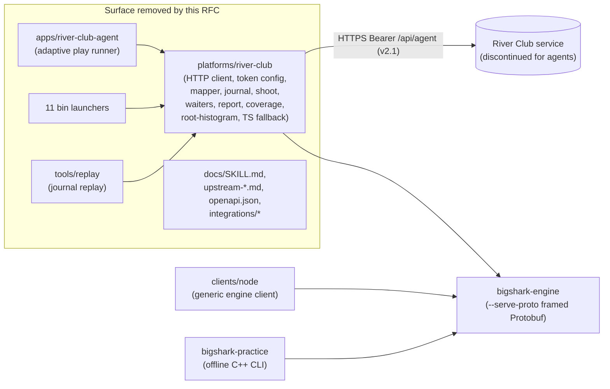
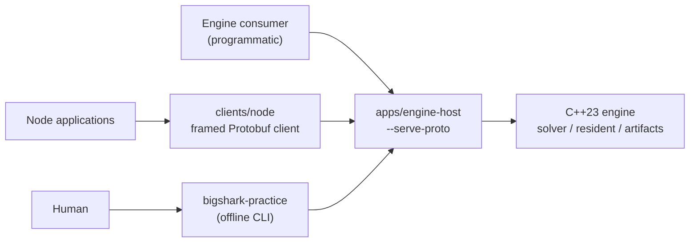

# RFC 0040: Retire the River Club Agent API v2.1 integration

## Summary

The project owner reported on 2026-10-27 that River Club has discontinued the
Agent API v2.1: agent integration is no longer supported and the access path
the entire platform layer was built around cannot serve another decision.
This RFC removes the complete River Club integration surface — the
`river-club-agent` runner application, the `platforms/river-club` adapter and
CLI emulation, the eleven River-specific bin launchers, the session-journal
replay tool, the imported upstream contract documents, and the live-play
operating instructions — and re-grounds the repository on what remains
independently valuable: the platform-neutral C++23 engine, the engine host,
the generic framed-Protobuf Node client, the offline practice table, and the
build/RFC tooling. Generic poker knowledge assets (`strategy/`,
`.codex/skills/`) are retained. No replacement game-platform adapter is built
and no wire or artifact format changes.

## Motivation

- **Fact (owner-provided):** River Club no longer supports Agent API v2.1
  integration, reported by the project owner on 2026-10-27. The repository
  cannot verify provider status externally and takes this as the owner's
  authoritative statement about their account and provider relationship.
- **Consequence:** the adapter's only authentication path is an issued Bearer
  token (`RIVER_CLUB_TOKEN` or `~/.config/river-club-agent/config.json`)
  against the provider's `/api/agent` endpoint. The config-path constant is at
  `river-cli.ts:22-23`, the token/URL credential resolution at
  `:100-102`, and the `/api/agent` endpoint at `:171`. Without token
  issuance the runner, atomic shooter, waiters, and journaling CLI cannot
  produce a single legal action.
- **Maintenance cost of keeping dead code:** 28 TypeScript files in two
  packages, eleven user-facing launchers, five imported upstream documents
  describing a dead HTTP contract, a replay tool whose input corpus can no
  longer grow, and the majority of `AGENTS.md` would keep instructing every
  future session to operate a CLI that cannot work. CI would keep type-
  checking and testing the dead surface, and the CI verification shell script
  still contains a (currently `.dockerignore`-masked) invocation of the
  deleted replay command.
- **Project policy:** the "No Legacy Code" mandate requires replacing old
  code by deletion, without feature flags, compatibility shims, or
  deprecated-but-kept paths.
- **Expected value:** a smaller truthful repository whose documents describe
  only components that exist, a reduced secret-handling surface, and clear
  positioning for the engine-only work that remains (notably RFC 0039).

## Goals

- The tracked repository contains no executable, build wiring, config, or
  Record/Current documentation that uses or instructs use of the River Club
  Agent API v2.1.
- The engine, engine host, generic Node client, protobuf contract, offline
  practice table, and all engine verification suites remain functionally
  unchanged and fully green.
- Generic poker knowledge assets (`strategy/PLAYBOOK.md`,
  `strategy/table-notes.md`, `.codex/skills/`) are retained as
  provider-neutral knowledge.
- Local user data (`sessions/`, `.runtime/`) and the gitignored internal
  reference material under `/local/` are untouched and never published.
- Every surviving document's status and operational instructions are
  truthful after the deletion.

## Non-Goals

- Building any replacement game-platform or website adapter. The reference
  client's private website protocol stays limited to gitignored notes under
  `/local/` per the owner's 2026-10-27 decision; no bridge is scheduled.
- Live play, automated or otherwise. No live-play authorization exists, and
  this RFC neither grants nor implies one.
- Changes to engine strategy, solver, resident, or artifact code. The only
  engine-side edit is a comment-only reword in
  `engine/include/bs/stage6/practice_table.hpp`.
- Changes to the framed engine Protobuf protocol or any persisted artifact
  format.
- Editing the bodies of historical RFCs beyond the metadata/errata
  transitions this RFC specifies.
- Deleting local-only untracked data (`sessions/`, `.runtime/`, `/local/`).

## Current State and Evidence

### What exists today

The engine process boundary is the framed Protobuf protocol over stdio; the
River adapter was only one possible consumer of it. Evidence for each
component:

| Component | Files | Evidence |
| --- | --- | --- |
| Runner application | `apps/river-club-agent/main.ts`, `runner-state.ts` + 2 tests | `main.ts:157` `spawnSync`s the River CLI; implements the adaptive executor and `.runtime` contract |
| Platform adapter | `platforms/river-club/src/*.ts` (15 source, 9 test), `CMakeLists.txt` stub | `river-cli.ts:22-23` config path, `:100-102` token/URL resolution, `:171` `/api/agent`; `journal-cli.ts:37` spawns the CLI; `mapper.ts` maps River rooms to `DecisionRequest`; `engine.ts` holds the legal operational fallback wrapper; `atomic-action.ts`, `wait-turn.ts`, `wait-seat.ts`, `report.ts`, `coverage.ts`, `root-histogram.ts`, `root-histogram-cli.ts`, `resolver_eligibility.ts`, `observation.ts`, `json.ts`, `types.ts` |
| Bin launchers | `bin/bigshark.mjs`, `play.mjs`, `shoot.mjs`, `wait-turn.mjs`, `wait-seat.mjs`, `river-club`, `replay.mjs`, `report.mjs`, `coverage.mjs`, `root-histogram.mjs`, `cpp-engine.mjs` (4 runner/agent files + 24 platform files = 28 TypeScript files in the two packages) | Each is a thin dynamic import of a deleted compiled module |
| Journal replay | `tools/replay/{main,journal}.ts` + test, `fixtures/synthetic-rooms.json`, `README.md` | `main.ts:6-7` imports `platforms/river-club/src/engine.js` and `types.js`; inputs are River rooms/River journal JSONL |
| Upstream contract docs | `docs/SKILL.md`, `docs/upstream-STRATEGY.md`, `docs/upstream-AGENTS.md`, `docs/upstream-CLAUDE.md`, `docs/openapi.json` | Imported v2.1 operating contract, decision guide, skill agent rules, OpenAPI definition |
| Integration docs | `docs/integrations/river-club.md`, `docs/integrations/provider-public-field-audit.md` | The whole `docs/integrations/` directory is River-specific |
| Build wiring | root `CMakeLists.txt` (`add_subdirectory(platforms/river-club)`), `package.json` (`test:node:compiled` globs), `tsconfig.json` (`platforms/**/*.ts` include), `tools/typescript/check-source-policy.ts` (source root), `tools/ci/verify-linux.sh` (guarded `node bin/replay.mjs` block, masked in CI today only because `.dockerignore` excludes `sessions/`), `_golden_scan2.mjs` (already non-functional scratch script referencing a fixture no longer present in the tracked tree) | Direct references confirmed |
| Operating instructions | `AGENTS.md` Operating Rules 1-9, State Machine, Decision Time Budget, Decision Input Order, Failure Recovery, Operating Loop, Bankroll Rules, Review and Evolution; `README.md` River Club Setup/Playing sections; `SECURITY.md` token section; `.gitignore` `.river-club/`; `docs/architecture/system-overview.md`; `docs/development/build-and-test.md:86,404` (replay gate) | Live-play procedure for the dead API |

### What survives independently

- `engine/` — the sole strategy core. A repository-wide audit
  (`git grep -il "river-club"`) finds exactly one engine hit: a "never reads
  `~/.river-club` config" assurance comment in
  `engine/include/bs/stage6/practice_table.hpp:12`. The hundreds of other
  engine hits for "river" are the poker street (river game, river boundary,
  river GTO), not the provider.
- `apps/engine-host/` — the C++ composition root serving framed Protobuf;
  it has no River references.
- `clients/node/` — a generic framed-engine process client tested against a
  fake engine fixture; no River types.
- `proto/` — the engine-facing protocol; unaffected.
- `engine/benchmarks/practice_simulator.cpp` (`bigshark-practice`) — a
  self-contained offline human-vs-bot CLI with `easy`/`medium`/`engine`
  rosters, documented in `docs/development/practice-table.md`. It supports
  non-interactive smoke runs (`--hands N --seed S`).
- All native engine suites, including golden/differential strategy tests,
  `sixmax_hand_ledger`, resident policy tests, stage-6 tests, benchmarks,
  and the RFC 0036/RFC 0039 measurement harnesses.
- Strategy artifacts (BSFLIB/BSWARM/preflop profiles), training tooling,
  RFC process, docs tooling, mutation tooling.

### RFC ledger interaction

RFC 0022 (Complete Cash-Hand Protocol) is an unfinished
Accepted/Implementing proposal whose entire target was a provider-facing
cash-hand ledger with "provider gates remain open" (per the docs index).
Those gates are now impossible. It becomes `Superseded` by this RFC.
Historical `Implemented` RFCs describing work that once shipped in the
adapter (e.g. RFCs 0019, 0021, 0023) remain as historical records, matching
the RFC 0038 precedent: deleting code does not falsify the history of its
having existed, and mass status churn would obscure rather than clarify.

Two other unfinished RFCs mix surviving engine deliverables with
provider-facing portions and receive an explicit adjudication rather than
a status change:

- **RFC 0009 (Unified Engine Delivery and Live Promotion):** the engine
  delivery, artifact-boundary, resident, and protocol work stands; the
  "live promotion" scope and the `River adapter` owner are voided by this
  RFC, as is the `node bin/replay.mjs` clause in its verification plan
  (`0009...md:1181`). RFC 0009 already carries a dated Historical note for
  RFC 0038; a parallel dated errata note is added naming RFC 0040. Its
  status does not change.
- **RFC 0032 (Preserve the Full Board Through the Decision Pipeline):**
  the engine-resident board-preservation work stands; the `River adapter`
  owner, the platform test evidence in the deleted
  `platforms/river-club/tests/w1-resident-wiring.test.ts` (`0032...md:579`,
  `:1097`), and any replay gate are voided by this RFC. A dated errata
  note is added naming RFC 0040. Its status does not change.

These notes are factual errata plus a superseding-RFC link, which the RFC
immutability rules permit; they do not rewrite the historical bodies.

## Design Principles

- **Delete, do not deprecate:** no feature flag, shim, or frozen copy in the
  repository. The `/local/` directory is not a relocation target; it is only
  for internal reference notes.
- **Engine primacy preserved:** the engine remains the only strategy core;
  removing a consumer changes nothing at the protocol boundary.
- **Truthful documents:** Current/Record documents describe only surviving
  components. Historical plans retain dated evidence but give no executable
  instructions for deleted commands.
- **Explicit authorization:** the owning module is removed at the project
  owner's explicit direction (2026-10-27), which is the authorization for
  this cross-module blast radius. The owner also decided to retain generic
  poker assets and not to build a website bridge.
- **Occam's razor:** no replacement abstraction is introduced to fill the
  adapter's place.

## Proposed Design

### 1. Code and launcher deletions

Delete the following tracked paths exactly:

- `apps/river-club-agent/` (whole directory)
- `platforms/` (whole top-level directory; its only subtree is
  `river-club/`)
- `tools/replay/` (whole directory)
- `bin/bigshark.mjs`, `bin/play.mjs`, `bin/shoot.mjs`,
  `bin/wait-turn.mjs`, `bin/wait-seat.mjs`, `bin/river-club`,
  `bin/replay.mjs`, `bin/report.mjs`, `bin/coverage.mjs`,
  `bin/root-histogram.mjs`, `bin/cpp-engine.mjs`
- `_golden_scan2.mjs`
- `docs/SKILL.md`, `docs/upstream-STRATEGY.md`,
  `docs/upstream-AGENTS.md`, `docs/upstream-CLAUDE.md`,
  `docs/openapi.json`
- `docs/integrations/` (whole directory: `river-club.md`,
  `provider-public-field-audit.md`)

Retain in `bin/`: `check-docs.mjs`, `check-rfcs.mjs`, and the gitignored
published binaries (`bigshark-engine`, `bs-resident-fixture`).

Consequential removals, stated for the record:

- The RFC 0035 stage-4 root-demand histogram instrument
  (`root-histogram.ts`) is deleted with the platform: it measures journals
  that will never be produced again. BSFLIB03 serving and its shipped roots
  are unaffected; any future real-demand measurement needs a new
  engine-native instrument and its own proposal.
- The `coverage.ts` reader of `.runtime/results.log` is deleted with the
  runner that wrote that log. Existing local log files remain on disk.
- The `node bin/replay.mjs` verification gate is removed from the Engine
  Build Contract.

### 2. Build and test wiring edits

- Root `CMakeLists.txt`: remove `add_subdirectory(platforms/river-club)`.
  The `clients/node` subtree stays.
- `package.json`:
  - `test:node:compiled` becomes
    `node --test dist/clients/node/tests/*.test.js dist/tools/rfc/*.test.js`.
  - Description becomes `A platform-neutral C++23 Texas Hold'em decision
    and GTO engine.` (the "typed adapters" claim no longer has a surviving
    platform adapter).
- `tsconfig.json`: remove `"platforms/**/*.ts"` from `include`.
- `tools/typescript/check-source-policy.ts`: source roots become
  `['clients', 'tools']` (the remaining TypeScript roots; `apps/` contains
  only C++ after the runner deletion).
- `tools/typescript/CMakeLists.txt` needs no change: it invokes the npm
  scripts and the `bigshark-engine` target, both of which survive.
- `docs/CMakeLists.txt` needs no change.
- `tools/ci/verify-linux.sh`: delete the guarded `if [[ -d sessions ]]; …
  node bin/replay.mjs; fi` block; every surrounding gate
  (proto/build/ctest/benchmark/link checks) is retained unchanged.
- `.github/workflows/ci.yml` itself needs no change: it invokes the Docker
  image, whose verification script is edited above.

### 3. Documentation and operating-instruction rewrites

- **`AGENTS.md`** (target of the `CLAUDE.md` symlink): delete Operating
  Rules 1-9, State Machine, Decision Time Budget, Decision Input Order,
  Failure Recovery, Operating Loop, Bankroll Rules, and the sessions-driven
  Review and Evolution procedure. From the Engine Build Contract remove the
  `node bin/replay.mjs` step. Rewrite the introduction as a
  platform-neutral engine project and replace the Repository Map:
  surviving entries are the engine, apps/engine-host, clients/node, proto,
  tools, bin checkers, practice CLI, docs sections, and the retained
  strategy/style assets. Preserve verbatim the general engineering rules:
  language and communication, architecture/design, scope discipline,
  planning, quality gates, commit standards, verification/delivery, no
  legacy code, and documentation rules — with these explicit rewordings
  inside otherwise retained text: the "External API versions (e.g., River
  Club protocol v2.1)" bullet loses its provider example and becomes a
  generic transport-versioning rule; "release for publishing and replay"
  becomes "release for publishing"; the Documentation Rules bullet
  defining the `Upstream` status and requiring upstream content
  preservation is deleted (no Upstream documents remain); the RFC and
  docs-check tooling requirements stay.
- **`CONTRIBUTING.md`**: remove `node bin/replay.mjs` from the pre-PR
  verification gate block (`:36`); no other change.
- **`README.md`**: remove River Club Setup and Playing; rewrite Project
  Status, Architecture, Capabilities, Quick Start around the engine,
  engine-host `--serve-proto`, the Node client, and the offline practice
  CLI; update Requirements and Repository Map; keep C++ development,
  Contributing, License.
- **`SECURITY.md`**: remove the River token revocation instructions; keep a
  generic secrets rule and the engine fairness invariant (decisions use
  only public cards plus the hero's own hole cards; no hidden information).
- **`docs/README.md`**: remove the two integration rows and the three
  indexed upstream rows (`SKILL.md`, `upstream-STRATEGY.md`,
  `openapi.json`; the other two upstream files were never indexed);
  delete the `Upstream` entry from the Document Status definitions;
  reword the RFC 0032 plan-row phrase "the deferred replay gate" since no
  replay gate survives; update the RFC 0022 row to `Superseded`; register
  RFC 0040.
- **`docs/architecture/system-overview.md`**: remove the River runner /
  adapter runtime components, decision-flow hops, deployment constraints,
  and remaining-coupling entries that describe them; the surviving flow is
  engine-host and Node client only.
- **`docs/development/build-and-test.md`**: remove the replay gate
  (`:86`), the replay paragraph (`:404`), the `node bin/coverage.mjs`
  section (`:416`ff.), the `node bin/root-histogram.mjs` section
  (`:428`ff.), and the River-mapper wording in the CTest table's `node`
  row (`:327`, leaving the surviving process-client coverage); audit any
  other River-CLI instructions in the same pass.
- **`docs/design/gto-engine.md`** and **`docs/development/benchmarking.md`**,
  **`docs/reference/exploitability.md`**,
  **`docs/reference/protobuf-engine-protocol.md`**: remove/adjust
  provider-specific mentions while preserving all engine content; the
  street-name "river" is untouched.
- **Plan documents (`docs/plans/`)** — the audit covers every tracked
  plan, not only indexed ones, under three rules:
  1. *Indexed living plans* (`0001-0002`, `0004-0006`, `0009`,
     `0009-w2c-ii`, `0029`, `0032`, `gto-delivery-roadmap`,
     `sixmax-gto-delivery`, `sixmax-gto-qualification`,
     `t3-six-seat-feasibility`): deleted-CLI operational steps are removed
     or converted to dated historical notes; dated evidence tables are
     retained. The living register `sixmax-gto-delivery.md` carries a
     2026-10-27 entry recording the retirement.
  2. *Unindexed plans of completed RFCs* (`0030-implementation.md`,
     `0034-implementation.md`, `0035-implementation.md`): the Status header
     is flipped to `Historical` with a dated 2026-10-27 retirement marker;
     their bodies (including the now-dead `replay`/`root-histogram`
     command lines) are retained as obsolete-behavior records, which the
     Documentation Rules permit for Historical documents. The unindexed
     `0036`, `0037`, and `0038` plans contain no deleted-command
     instructions (verified by grep) and are left untouched.
  3. *Living Proposed unindexed plans*: `sixmax-gto-thresholds.md` stays
     `Proposed`; its normative provider-specific deadline sentences
     (`:268`, `:272`, `:277`, citing `room.timeLeftMs` and "The River Club
     platform's deadline") are reworded to the provider-neutral concept
     "the target platform's action deadline" — no numerical threshold
     changes. The dated independent-review changelog bullet at `:421`
     ("Tied deadline to `timeLeftMs` (m7)", 2026-10-17) records an
     editorial action and stays verbatim.
  Raw evidence artifacts (`*.txt`, `*.diff`, `ablation/*`) are never
  edited; they are frozen dated evidence. At approval time
  `docs/plans/0034-token-inventory-before.txt` and
  `docs/plans/0034-token-inventory-after.txt` carry 31 audit-regex hits
  between them (20 and 11); `0034-descriptor-normalized.diff` and every
  `ablation/*` file are regex-clean. Implementation Evidence lists them
  as the frozen-artifact residual category.
- **`docs/plans/0039-implementation.md`**: remove `node bin/replay.mjs`
  from Stage verification; clarify that the Stage-2 "host replay" latency
  evidence is the C++ envelope `solve_time_us` timing harness, not the
  deleted journal replay.
- **RFC 0039 factual errata:** add a dated note in its Decision section
  stating that the replay step named both in its Verification Plan body
  and the approved build contract was removed by RFC 0040; no other text
  changes.
- **`.gitignore`**: remove the `.river-club/` entry. Keep `config.json`
  and `sessions/` as generic secret/local-data guards, and the `/local/`
  exclusion.
- **Comment-only engine edit:** reword
  `engine/include/bs/stage6/practice_table.hpp:12` so the assurance no
  longer names a deleted config path ("never reads home-directory
  configuration or makes a network call").
- **Retained knowledge assets with provenance phrasing:** per the owner's
  retain decision, `strategy/` and `.codex/skills/` are not edited. Four
  files contain provider provenance phrasing that the audit regex does not
  match (the spaced string "River Club" vs `river-club`):
  `strategy/table-notes.md:4` ("Protocol v2"),
  `strategy/PLAYBOOK.md:142` (the `sessions/YYYY-MM-DD.jsonl` review
  habit), `.codex/skills/INDEX.md:13` (the "wait-turn interval"
  observation habit), and `.codex/skills/station-hunter.md:10`
  ("Historical River Club samples"). They are deliberately retained, not
  missed, and are listed verbatim in Implementation Evidence.

### 4. RFC ledger transitions

- `docs/rfcs/0022-complete-cash-hand-protocol.md`: frontmatter
  `status: "Superseded"`, `superseded-by: "0040"`. No body rewrite.
- `docs/rfcs/0009-unified-engine-delivery.md` and
  `docs/rfcs/0032-turn-river-board-addressing.md`: add a dated 2026-10-27
  blockquote errata note beside their existing headers, modeled on RFC
  0009's existing RFC 0038 Historical note. Each note states that its
  provider-facing owner/scope, deleted platform-test evidence, and replay
  verification clauses are voided by RFC 0040 while the engine
  deliverables and the RFC's status are unchanged. No other body edit.
- `docs/rfcs/0039-nested-river-continuation-values.md`: the errata note
  specified in section 3 (replay step removed from the build contract;
  Stage-2 latency evidence is the C++ envelope harness).
- `docs/rfcs/README.md` and `docs/README.md`: RFC 0022 row becomes
  Superseded; RFC 0040 is registered as Proposed, then Accepted after
  independent approval, then Implemented when this RFC's acceptance
  criteria are verified.
- Historical RFC bodies are otherwise untouched; they retain "River" as
  part of their historical record.

### 5. Post-deletion repository shape

There is intentionally no game-platform process in this diagram. The
framed Protobuf contract is the only integration boundary; a future
provider integration (if ever authorized) would be a new external module
proposing its own RFC.

## Dependency Rules

After deletion:

- `clients/node` may depend only on `proto` generated types and Node
  built-ins (its existing policy).
- `tools/` TypeScript may not import any game-platform adapter; with the
  platform directory gone, the TypeScript compiler enforces this.
- The engine and engine host never depend on TypeScript or on any network
  client; this was already true and the stage-6 offline guard CMake checks
  continue to enforce offline boundaries.
- No first-party module reads provider credentials or performs game-network
  I/O. `/local/` is outside the tracked dependency graph (gitignored).

## Compatibility and Migration

- **Package compatibility:** all npm packages are `"private": true`; there
  is no published package consumer. The framed engine protocol and
  artifact formats are unchanged, so the Node client and all artifacts
  keep working.
- **CLI compatibility (breaking):** the eleven removed bin commands have
  no replacement inside the repository. Human practice moves to
  `bigshark-practice`; programmatic engine use moves to the engine host
  and the Node client, documented in the rewritten README. This is marked
  as a breaking change in the implementation commit.
- **Historical sessions:** `sessions/*.jsonl` files remain on local disks
  but no tracked tool reads them after deletion.
- **`.runtime/`:** local files remain; nothing writes the runner-owned
  files anymore. Engine artifact paths configured independently (profiles,
  oracle shambles, tree cache) keep working with native tooling.
- **CI:** the Docker verification image runs the same npm/cmake gates with
  their updated globs; `.github/workflows/ci.yml` is unchanged, while
  `tools/ci/verify-linux.sh` drops its replay block as specified above.
- **Upstream documents:** imported copies are deleted rather than moved;
  they remain recoverable through git history.

## Security and Operational Impact

- The entire credential path (`RIVER_CLUB_TOKEN`, `RIVER_CLUB_URL`,
  `RIVER_CLUB_CONFIG`, `~/.config/river-club-agent/config.json`, Bearer
  header construction) is deleted. Post-change `git grep RIVER_CLUB_TOKEN`
  must return zero tracked hits. This shrinks, not grows, the secret
  surface.
- No network client remains in tracked first-party code outside vendored
  third-party C++ libraries.
- Fair-play obligations toward a live provider become moot with the live
  path's removal; the engine-level fairness invariant (no unrevealed-card
  inference, public-plus-hero-only inputs) is retained as documentation and
  is already enforced architecturally by the offline guard.
- Operational incident-recovery procedures (STALE_STATE, LEAVING, rate
  limits, token errors) are deleted with the path they governed.
- `/local/` internal reference material stays untracked and must never be
  copied into the open-source tree; that rule is unchanged.

## Alternatives Considered

1. **Freeze but keep the adapter.** Rejected: the No Legacy Code policy
   forbids deprecated-but-kept paths; a dead HTTP client still costs CI,
   documentation, and audit surface and invites accidental use.
2. **Port to the reference client's website protocol.** Rejected: it is a
   private cookie/socket.io surface tied to an internal login flow, with
   account-automation terms-of-service risk and no agent authorization.
   The owner decided (2026-10-27) to keep only local notes and schedule no
   bridge.
3. **Move the adapter into `/local/`.** Rejected: `/local/` exists for
   internal reference notes, not for maintaining a runnable fork of
   deleted open-source code; keeping it runnable would preserve the
   maintenance burden and the ambiguity this RFC removes.
4. **Keep `tools/replay` by porting it off River types.** Considered and
   rejected by the owner in the scope decision: its fixtures are River
   rooms and its purpose was River-journal regression. Equivalent engine
   confidence comes from native suites (golden/differential tests,
   `sixmax_hand_ledger`, resident/resolver tests, practice ctest,
   `benchmark-multistreet`). A future engine-native decision harness can
   be proposed if a concrete need appears.
5. **Mark old RFCs wholesale Superseded.** Rejected: historical Implemented
   records document work that genuinely shipped; only the unfinished
   provider-facing RFC 0022 is transitioned.

## Risks

| Risk | Impact | Mitigation |
| --- | --- | --- |
| Hidden build/test coupling to deleted paths | Configure or CI failure | Full release build + `ctest` + `npm run check` + proto checks; TypeScript compiler and source-policy checks fail fast on any stale import |
| Replay removal hides a regression class | Lower engine confidence | Enumerate surviving native coverage in Implementation Evidence; deleted coverage was mapper-legality and fallback-process invocation, with strategy correctness already owned by native golden/differential suites |
| Documents still point at deleted commands | Misleading future sessions | `check-docs`, the per-file audit in the acceptance criteria, and a residual-mention classification table in Implementation Evidence |
| Owner premise turns out wrong (API later restored) | Work must be restored | Single-direction git history; a revert restores every file; restarting would still be possible, whereas keeping dead code pays cost continuously |
| Stale `dist/` output masks deletion | Local false-green | `npm run check` starts with `clean:ts`; CI builds fresh |
| Over-deletion of generic poker knowledge | Lost reusable strategy work | Explicit non-goal and acceptance criterion: `strategy/` and `.codex/skills/` survive; style files' "river" mentions are the street name |
| RFC 0039 Stage-2 wording ambiguity | Wrong verification after gate change | Explicit plan edit and RFC 0039 errata distinguish C++ host timing from journal replay |

## Verification Plan

All commands run from the repository root after implementation:

1. `cmake --preset release`
2. `cmake --build --preset release --target format && cmake --build --preset release`
3. `ctest --preset release` (full suite)
4. `cmake --build --preset release --target benchmark-multistreet`
5. `npm run check` (typecheck, clean rebuild, source policy, docs/rfc
   checks, Node tests with the reduced globs)
6. `npm run proto:check`
7. `node bin/check-rfcs.mjs && node bin/check-docs.mjs`
8. Practice smoke (non-interactive; stdin is `/dev/null` because the human
   seat quits immediately at EOF — these are process/binary smoke runs, not
   completed-hand strategy checks):
   - `./build/release/engine/bigshark-practice --seats 2 --difficulty easy --hands 5 --seed 40 </dev/null`
   - `./build/release/engine/bigshark-practice --seats 3 --difficulty medium --hands 5 --seed 40 </dev/null`
   - `./build/release/engine/bigshark-practice --seats 2 --difficulty engine --engine-path ./build/release/apps/engine-host/bigshark-engine --hands 2 --seed 40 </dev/null 2>&1 | grep -Fq "Engine tier: connected to ./build/release/apps/engine-host/bigshark-engine"`

   The third command asserts the startup connection line printed at
   `practice_simulator.cpp:388`; a host handshake failure prints the
   WARNING line at `:400`, injects fallback bots, and would fail the
   `grep -Fq` assertion even though the process exits zero.
9. Audits on tracked files:
   - `git grep -n -E "river-club|RIVER_CLUB|river_club"` yields no hits
     outside four enumerated residual categories: `docs/rfcs/` bodies,
     classified Historical plan prose, the frozen raw evidence artifacts
     under `docs/plans/` (`0034-token-inventory-before.txt` (20 hits),
     `0034-token-inventory-after.txt` (11 hits); `0034-descriptor-
     normalized.diff` and `ablation/*` regex-clean), and the four
     deliberately retained provenance files — each category with its
     complete file-level classification in Implementation Evidence;
   - `git grep -n "RIVER_CLUB_TOKEN"` yields zero tracked hits;
   - `git ls-files apps/river-club-agent platforms tools/replay` returns
     nothing (`apps/` itself is retained for `apps/engine-host`);
   - `git grep -n "bin/replay" -- tools/ci/ CONTRIBUTING.md AGENTS.md`
     yields zero tracked hits;
   - no surviving Record/Current document instructs a deleted command.
10. The diff contains no engine semantic change: the only engine path is
    the one comment reword, verified by diff review.

## Rollout Plan

1. Independent approval of this RFC; record the decision; register RFC
   0040 and the RFC 0022 supersession in both indexes; add the dated
   errata notes to RFCs 0009, 0032, and 0039 and the 0039 plan edit.
2. One breaking implementation commit
   (`refactor!: retire River Club Agent API v2.1 integration (RFC 0040)`)
   containing the deletions, wiring edits, and documentation rewrites as a
   single coherent change; commit message explains what changed, affected
   users, and the migration to practice/engine-host.
3. Run the full Verification Plan, record results in an Implementation
   Evidence section of this RFC, and set status `Implemented`.

Stop condition: every acceptance criterion verified; otherwise the RFC
stays Implementing with the failing criterion recorded.

## Rollback Plan

`git revert` the implementation commit. No data migration occurred, no
artifact or protocol format changed, and local data was untouched, so the
rollback is a pure code/docs restore. The RFC status transitions are
reverted in the same restore if the premise proves false.

## Open Questions

None. The two scope decisions were resolved by the owner on 2026-10-27:
generic poker assets are retained; the website-protocol bridge is not built
(gitignored `/local/` notes only).

## Acceptance Criteria

1. Every path in the deletion manifest is absent from tracked files
   (`git ls-files apps/river-club-agent platforms tools/replay` returns
   nothing, while `apps/engine-host` survives; the eleven bin launchers and
   five upstream documents are absent).
2. Root `CMakeLists.txt`, `package.json`, `tsconfig.json`,
   `check-source-policy.ts`, and `tools/ci/verify-linux.sh` carry exactly
   the specified edits; the npm Node test set contains only
   `clients/node` and `tools/rfc` suites and passes; the CI script
   contains no replay invocation.
3. `ctest --preset release` passes in full; `benchmark-multistreet`
   passes; `npm run check` and `npm run proto:check` pass;
   `check-rfcs` and `check-docs` pass.
4. The easy/medium practice smokes exit zero; the engine-difficulty smoke
   produces the `Engine tier: connected to ...` startup line (pipeline
   `grep -Fq` assertion), proving the freshly built host completes its
   handshake.
5. `git grep RIVER_CLUB_TOKEN` has zero tracked hits; the residual
   `river-club`/`RIVER_CLUB` audit contains exactly four categories — RFC
   bodies, classified Historical plan prose, frozen raw evidence
   artifacts under `docs/plans/` (the two 0034 token-inventory files,
   with hit counts; other `*.diff`/`ablation/*` files regex-clean), and
   the four deliberately retained provenance files
   (`strategy/table-notes.md`, `strategy/PLAYBOOK.md`,
   `.codex/skills/INDEX.md`, `.codex/skills/station-hunter.md`) — each
   with its complete file-level classification recorded in Implementation
   Evidence; no surviving Record/Current document instructs use of a
   deleted command.
6. `AGENTS.md`, `CONTRIBUTING.md`, `README.md`, `SECURITY.md`,
   `docs/architecture/system-overview.md`,
   `docs/development/build-and-test.md`, `docs/README.md`, and the living
   plans are truthful, including the explicit rewordings named in section
   3 (AGENTS provider-example/Upstream bullets, README index rows and
   status definitions, build-and-test coverage/histogram/CTest sections);
   `0030`/`0034`/`0035` unindexed plans carry the Historical marker and
   `sixmax-gto-thresholds.md` is provider-neutral; the replay step is
   absent from every build contract; the engine's engineering rules and
   RFC/documentation processes are preserved.
7. RFC 0022 is `Superseded` with `superseded-by: "0040"` in both indexes;
   RFCs 0009, 0032, and 0039 carry the agreed dated errata notes; RFC 0040
   status ends at `Implemented` only with this evidence section complete.
8. The engine diff is comment-only; strategy/resident/protocol behavior is
   unchanged and native suites prove it.
9. `strategy/`, `.codex/skills/`, `sessions/`, `.runtime/`, and `/local/`
   are present and untouched (the last three remain untracked).

## Implementation Evidence

Implemented 2026-10-27, one breaking change set (`refactor!: retire River
Club Agent API v2.1 integration (RFC 0040)`).

**Deletion manifest (53 tracked files deleted).** `apps/river-club-agent/`
(4 files), `platforms/river-club/` (25 files: 15 source, 9 tests, 1 CMake
stub), `tools/replay/` (5 files), 11 bin launchers
(`bigshark.mjs`, `play.mjs`, `shoot.mjs`, `wait-turn.mjs`,
`wait-seat.mjs`, `river-club`, `replay.mjs`, `report.mjs`,
`coverage.mjs`, `root-histogram.mjs`, `cpp-engine.mjs`),
`_golden_scan2.mjs`, `docs/SKILL.md`, `docs/upstream-STRATEGY.md`,
`docs/upstream-AGENTS.md`, `docs/upstream-CLAUDE.md`, `docs/openapi.json`,
and `docs/integrations/` (2 files). `git ls-files apps/river-club-agent
platforms tools/replay` returns nothing; `apps/engine-host` survives.

**Wiring edits.** Root `CMakeLists.txt` (platform subdirectory removed);
`package.json` (description and `test:node:compiled` reduced to
`clients/node` + `tools/rfc` globs); `tsconfig.json` (include reduced to
`clients`, `tools`, generated TypeScript);
`tools/typescript/check-source-policy.ts` (source roots `clients`,
`tools`); `tools/ci/verify-linux.sh` (guarded replay block removed);
`.gitignore` (`.river-club/` removed); the sole engine edit is the one
comment reword in `engine/include/bs/stage6/practice_table.hpp`
(diff-reviewed comment-only).

**Documentation and ledger edits.** `AGENTS.md` rewritten as the
platform-neutral instruction set (operating/state-machine/decision/
failure/bankroll/review sections deleted; provider example, "publishing
and replay", and the Upstream documentation bullets reworded as
specified); `README.md`, `SECURITY.md`, `CONTRIBUTING.md`,
`docs/README.md` (integration and upstream rows, Upstream status
definition, RFC 0022/0040 rows, plan-row phrase),
`docs/architecture/system-overview.md`,
`docs/development/build-and-test.md` (replay gate, replay/coverage/
histogram sections, CTest `node` and `conformance` rows, npm-check
description), `docs/design/gto-engine.md` (startup paragraph),
`docs/reference/protobuf-engine-protocol.md` (framed-host row, request-
mapping section, conformance caption). Plan audit per the three rules:
replay gate lines removed from `0001-0002`, `0004-0006`, `0029`, `0032`
plans; dated retirement banners added to those five plus
`sixmax-gto-delivery.md`; `0030`/`0034`/`0035` plans flipped to
`Historical` with dated markers; `sixmax-gto-thresholds.md` deadline
section reworded to "the target platform's action deadline" with the
2026-10-17 changelog bullet left verbatim; `sixmax-gto-delivery.md`
carries the 2026-10-27 retirement entry, its Intended Outcome is
provider-neutral, and the token variable name was scrubbed. RFC 0022 is
`Superseded` (`superseded-by: "0040"`, including its deleted-audit-link
fix); RFCs 0009, 0032, and 0039 carry the dated errata notes.

**Verification results.**

| Gate | Result |
| --- | --- |
| `cmake --preset release` | configured, no platform subdirectory |
| `cmake --build --preset release --target format-check` | pass (engine + host) |
| `cmake --build --preset release` | pass |
| `ctest --preset release` | **79/79 passed**, 1572.40 s total (3 benchmark-labeled tests, 290.61 s) |
| `benchmark-multistreet` | all three quality gates PASS (rows status `0,PASS`) |
| `npm run check` | pass; Node suites reduced to process-client + RFC tooling (20 RFC tests, all green) |
| `npm run proto:check` | pass (lint, format, breaking, generate, typecheck) |
| `node bin/check-rfcs.mjs` | RFC checks passed (40 RFCs) |
| `node bin/check-docs.mjs` | Documentation checks passed (387 text files) |
| practice smoke easy (`--seats 2`, 5 hands, stdin EOF) | exit 0 |
| practice smoke medium (`--seats 3`, 5 hands, stdin EOF) | exit 0 |
| practice smoke engine tier | exit 0 **and** output contains `Engine tier: connected to ./build/release/apps/engine-host/bigshark-engine`, proving the freshly built host handshake |

**Audit results.** `git grep -n "RIVER_CLUB_TOKEN"` over tracked files:
zero hits. `git grep -n "bin/replay" -- tools/ci/ CONTRIBUTING.md
AGENTS.md`: zero hits. Grep for stale build references
(`platforms/river`, `river-club-agent`, `tools/replay`) across CMake,
shell, YAML, JSON, and TypeScript: zero hits. `dist/` after a clean
rebuild contains only `build/`, `clients/`, `tools/`.

**Residual `river-club`/`RIVER_CLUB` regex classification (all four
AC5 categories).**

| Category | Files | Treatment |
| --- | --- | --- |
| RFC bodies under `docs/rfcs/` | 13 files | Historical/accepted records, including RFC 0040 itself and the three errata notes |
| Classified Historical plan prose | `docs/plans/0001-0002`, `0004-0006`, `0009`, `0029`, `0030`, `0032`, `0034`, `0035` plans and `sixmax-gto-delivery.md` (9 files) | retirement banner or Historical status header; command gate lines deleted; bodies retained as dated evidence |
| Frozen raw evidence artifacts | `docs/plans/0034-token-inventory-before.txt` (20 hits), `0034-token-inventory-after.txt` (11 hits); `0034-descriptor-normalized.diff` and every `docs/plans/ablation/*` file regex-clean | never edited |
| Deliberately retained provenance in knowledge assets | `.codex/skills/station-hunter.md:10` (the literal "Historical River Club samples" prior); plus non-regex generic phrasing in `strategy/table-notes.md:4` ("Protocol v2"), `strategy/PLAYBOOK.md` post-session review habit, `.codex/skills/INDEX.md:13` (wait-turn observation habit) | owner retain decision 2026-10-27; listed here, not hidden |

The four regex hits in Current documents outside `docs/rfcs/`
(`AGENTS.md`, `README.md`, `docs/README.md`,
`docs/architecture/system-overview.md`) are all the RFC 0040 filename or
its index title, i.e. self-references to this retirement.

**Coverage replacing the deleted journal replay.** Strategy correctness
was never owned by replay and remains covered natively: the
golden/differential strategy suites and `gto` contract tests,
`sixmax_hand_ledger` (18 full native six-dealt-seat hand-start
replays), the three pinned cash-hand-ledger conformance vectors in
`engine/tests/test_conformance.cpp`, resident/resolver policy tests
(including the RFC 0040-era admission-gate regression),
`test_stage6_practice` (including the six-seat engine tier), and
`benchmark-multistreet`. The deleted replay specifically covered
synthetic-River-room mapper legality and fallback-process invocation;
that mapper surface no longer exists, and the engine's own labeled
fallback contract is covered by the resident/resolver/conformance
suites.

**Untouched per non-goals.** `strategy/`, `.codex/skills/`, untracked
`sessions/`, `.runtime/`, and `/local/` are present and unchanged; no
wire protocol or persisted artifact format changed; no engine semantic
line changed.

## Decision

Author agent: Claude (zzzode agent session 2026-10-27)
Approved by: rfc0040-approval-1 (independent approval agent, auto_model/alwaysday1_max)
Decision date: 2026-10-27
Review outcome: Approved
Reviewed scope: Full RFC 0040 text across three review rounds, verified against the source tree (both deleted packages and all 28 TypeScript files, the eleven bin launchers, tools/replay, root CMake/package/tsconfig wiring, tools/ci/verify-linux.sh and the Docker CI path, practice_simulator.cpp and the engine-host handshake path, RFCs 0009/0022/0032/0039 and their cited lines, every tracked docs/plans file, .gitignore, and the residual-mention audit surface).
Review summary: Three rounds. Round 1 Changes Requested (3 blockers, 3 major, 6 minor): an unlisted `node bin/replay.mjs` block in tools/ci/verify-linux.sh masked only by .dockerignore, CONTRIBUTING.md missing from the rewrite manifest, an unsatisfiable `git ls-files apps` audit, no disposition for Implementing RFCs 0009/0032, four unindexed plan documents outside the audit boundary, and an incorrect 27/14 file count; plus citation, smoke-stdin, retained-text residue, provenance phrasing, build-and-test section, and scratch-script minor findings. Round 2 Changes Requested (1 blocker): the residual-mention allow-list was impossible because the two frozen 0034 token-inventory evidence files carry 31 audit-regex hits in an unnamed category; two minors asked for a real host-handshake assertion in the engine smoke and preservation of a dated changelog line. Round 3 Approved after the four-category residual audit (RFC bodies, classified Historical plan prose, frozen raw evidence artifacts, four retained provenance files), the `Engine tier: connected to` grep assertion, and the changelog preservation were verified. `check-rfcs` (40) and `check-docs` (438) were green at approval.

Approved scope: the deletion manifest and all wiring, CI, documentation, plan-audit, RFC-ledger, and errata edits written in RFC 0040, as one breaking implementation commit. The approval does not cover any replacement platform adapter, website-protocol work, live play, credentials, or spending; the reviewer noted these exclusions explicitly. Accepted residual risks: the owner-provided premise (Agent API v2.1 discontinued 2026-10-27) is externally unverifiable and mitigated by a pure revert; mapper-legality/fallback-invocation test coverage is removed with tools/replay while strategy correctness stays owned by enumerated native suites; practice easy/medium smokes complete zero hands by design and host serving is additionally covered by `test_six_seat_engine_tier`. One non-blocking implementation note was given: the dated `sixmax-gto-delivery.md:120` sentence must scrub the literal token variable name to satisfy the zero-token-hits audit, and its coverage/integration mentions at `:234-240` are classified as Historical plan prose.
