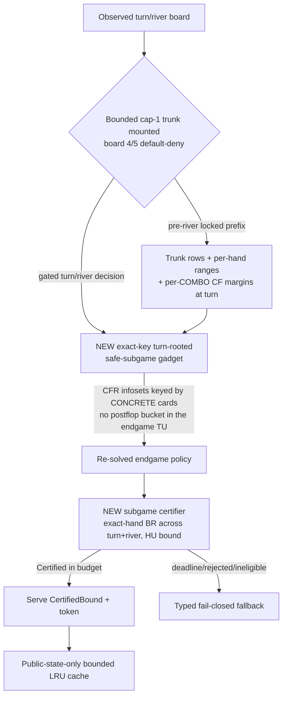

# RFC 0046: M2 Full-Street Heads-Up Blueprint — Bounded Cap-1 Trunk plus a New Exact Certified River Endgame Solver

## Summary

RFC 0045 closed with `instrument-inadequate-uniform-ehs`: a static,
uniformly bucketed postflop policy played directly cannot certify the
full heads-up 100 BB range, and an uncapped exact static blueprint is
structurally infeasible. This RFC proposes a hybrid: a bounded cap-1
offline blueprint **trunk** solved through the turn, plus a **new
real-time, exact per-combo-card-keyed, independently certified
turn-rooted endgame solver** that replaces the merged river bucket on
the hands that matter.

The decisive component does NOT exist today and is not the current
subgame resolver: the RFC 0011 subgame resolver covers turn+river but is
uncertified (`SubgameResolveStatus::Solved` served as
`ResolveOutcome::Approximate`) and keys its CFR information sets on
`kNSeatCardKind`, which degenerates postflop to only nine hand
categories — coarser than the EHS grids RFC 0045 rejected. Building an
exact, certified endgame solver (multi-action-street gadget, a
subgame-capable certifier, exact card keying, and per-combo boundary
margins) is the central, largest shared-solver change in this RFC and is
explicitly new work. Whether it can certify inside the 10 s wall at full
HU ranges is an open hypothesis that MUST be falsified by a
measurement-only prototype before any production, artifact, or serving
work; the gates have predeclared numeric predicates and can REDIRECT or
CLOSE the RFC.

Approval of this RFC authorizes only the measurement stages and their
pre-frozen gate addendum. It does not authorize the production solver,
artifact schema, mount, serving, or enablement.

## Motivation

Evidence:

- RFC 0045 run 2 (368/368 valid, independently reviewed VALID): at the
  300M rung a uniform EHS river policy passes the exact-hole QUAL bar
  (<=0.03 BB) at k_river 128/256 (worst 0.02241 / 0.01895) but fails the
  within-abstraction CERT bar (<=0.005 BB) at every frozen grid (worst
  bucket 0.01240 / 0.01531 / 0.01594), non-improving as k_river refines,
  half-widths <=0.0006. The same grids certify on the ten-hand W1 range
  (0.002768). The error is specifically full-range strategically
  distinct hands collapsed into one static river bucket.
- The CURRENT subgame resolver retains that exact failure. Its online
  CFR is keyed on the nine-category postflop merge and each concrete
  hand is mapped back to its category row when served (verified in
  `engine/src/resolver/subgame_resolver.cpp` trainer setup and candidate
  extraction). It is therefore not a candidate to remove the RFC 0045
  floor.
- G3 census: the uncapped cap-0 HU 100 BB flop-rooted River-terminal
  tree exceeds 100 M nodes / ~55 GiB. A stored exact static blueprint is
  infeasible; an online exact endgame over a much smaller turn-rooted
  subtree is the remaining offline route, provided its exact-key
  information-set expansion stays solvable and certifiable in budget.
- Learned/nested alternatives are closed (RFC 0041 never built, failed
  Stage 1; RFC 0039 nested matrices ~0.26 BB exact floor).

Expected value: an HU full-street opponent whose river decisions use the
actual two hole cards and observed board under a true two-player
safe-subgame bound, with a bounded stored trunk and a bounded real-time
budget; residual abstraction error is moved into the turn trunk/action
cap and measured directly. Surface: offline engine, engine-host,
practice, resident artifact only; no network or client change.

## Goals

- Serve full-street HU (2 seats, 100 BB) where every gated turn/river
  decision is either an independently **certified exact-key endgame**
  resolve or a typed fail-closed fallback — never an uncertified
  nine-category approximation presented as certified.
- Eliminate the merged static river bucket from the SERVED endgame
  policy (the RFC 0045 failure), proven by a behavioral test and a
  zero-merge-key audit, not asserted.
- Quantify, by per-street decomposition, the residual error attributable
  to the turn trunk, the action cap, and the turn-boundary margin input.
- Keep the stored trunk inside the G3 bounded object and the cold
  decision inside a frozen real-time budget, with explicit stop
  conditions if either bound is missed.

## Non-Goals

- 3..10-seat full-street (M3+); strictly two-player zero-sum.
- Serving the existing approximate nine-category subgame resolve as if
  it were certified, or enabling board 4/5 production before the
  exact-key path certifies.
- Production enablement, mount flip, schema, or serving change before a
  separate enablement RFC; implementation of the production solver
  before the measurement gates return.
- Learned models, network play, platform clients, new credentials,
  heuristic-strategy production paths; storing exact static river rows.

## Current State and Evidence

Facts (verified in source; fact vs assumption separated):

- **Terminal-only resolving gadget, certified, narrow scope.**
  `bs::resolver::resolve` builds the Brown-Sandholm gadget over an
  immutable blueprint with an independently written best-response
  certifier; at two seats it is exactly the RFC 0005 responder
  non-regression bound. `ResolveStatus` is
  `Certified / CertificationRejected / SolveDeadline / CertifyDeadline
  / Ineligible / CoverageMiss / InvalidInput`
  (`engine/include/bs/resolver.hpp`). BUT the certifier covers a single
  terminal hero decision and throws if it reaches an action node
  (`engine/src/resolver/certifier.cpp`); it cannot certify a
  multi-action-street turn+river subtree. `ResolveLimits` defaults to a
  10,000 ms p95 wall and 5,000,000 nodes / 1,000,000 information sets /
  1 GiB.
- **Subgame resolver, broad scope, uncertified and merged.**
  RFC 0011 (`engine/src/resolver/subgame_resolver.{hpp,cpp}`) rebuilds a
  turn-rooted River-terminal subtree (remaining action streets + the
  44-card river chance; concrete joint deals for sampling) via
  `train_nseat` with default `NSeatTrainerLimits` (so
  `card_kind = kNSeatCardKind = Preflop169`). Postflop, Preflop169
  collapses to `CategoryTiersV1` = nine categories, discarding all
  rank/kicker information (`engine/src/abstraction/abstraction.cpp`).
  Candidate extraction maps each concrete hand to its nine-category row.
  Status is `Solved/Ineligible/SolveDeadline/CoverageMiss/InvalidInput`
  with no Certified state; the host emits it as
  `ResolveOutcome::Approximate` plus token
  `subgame-resolve:approximate` (`apps/engine-host/main.cpp`).
  `derive_prior_ranges` produces per-hand ranges from the flop-terminal
  blueprint but there is no per-combo continuation-margin model and no
  locked turn prefix in the resolving sense.
- **Host already resolves board 4/5 approximately behind env flags.**
  `BIGSHARK_SUBGAME_RESOLVER` (default on) and
  `BIGSHARK_SUBGAME_UNIFORM` gate the approximate path independently of
  the resident library's board-0/3 mount gate. Any rollback must name
  these explicitly.
- **Wire guarantee semantics exist.** `Guarantee` includes
  `Approximate = 1` and `CertifiedBound = 4`
  (`engine/include/bs/guarantee.hpp`); promoting a board-4/5 decision
  from Approximate to Certified changes an existing on-wire semantic
  even with no new field.
- Fallback chain blueprint -> terminal-only resolver -> subgame
  resolver -> operational fallback is wired in the host.
  `BlueprintSource` is implemented over the resident policy set;
  BSFLIB03 mmap bucket validation is reject-closed.
- **G3 tree sizes are FLOP-rooted.** The 4.77-6.29 M node / 3.03-3.08
  GiB objects are FLOP-rooted River-terminal trees
  (`docs/plans/ablation/rfc0045-g3-structural-preliminary.csv`). The
  online object is TURN-rooted: it excludes the flop street and the
  turn chance fan-out and is roughly 1/49 of the flop-rooted node count
  (the public-tree turn chance is 49 cards — 52 minus the three flop
  cards, `public_runout_cards` removing only public cards; the river
  chance is then 48 public-card options, and the joint-deal-conditioned
  count is 45 = 52-3-4 as in RFC 0045's
  C(49,2)xC(47,2)xC(45,2) universe). The turn-rooted object therefore
  fits the resolver 5 M-node / 1 GiB default under the CURRENT
  nine-category keying. That does NOT bound the exact-key size
  (assumption, measured in Gate 2).
- RFC 0045 measurement code is deleted; its TypeScript evaluator,
  chance-free walker conventions, evidence, and G3 census are retained
  and reused here.

Assumptions that must be falsified, not assumed: that an exact-key
turn-rooted HU subtree's information-set count fits the resolver
resource limits and reaches the responder bound within 10 s; that
per-combo turn-boundary margins can be derived from a bounded trunk
with acceptably small error; that cap-1 is a sufficient action
abstraction.

## Design Principles

1. Exact where it matters, bounded where exact is infeasible.
2. A true two-player zero-sum guarantee at the served endgame (extend
   the responder bound to the subtree); never relabel an approximation.
3. Extend the proven primitives (terminal gadget, independent
   certifier, concrete-deal enumeration) into the missing exact endgame
   solver; do not pretend the merged RFC 0011 path is that solver.
4. Fail closed and stay offline; no learned components, no production
   heuristic strategy.
5. Measure-before-freeze with predeclared predicates; the RFC can be
   redirected or closed by its own gates.

## Proposed Design

### 5.1 New production endgame solver (the central change)

This is new, shared solver work and gets its own design review:

1. **Exact card keying in the endgame trainer.** The online subtree CFR
   information sets must key on the concrete two hole cards (and node),
   not `kNSeatCardKind`. No `card_bucket` postflop call may occur inside
   the endgame traversal/update units; this is enforced by a negative
   ctest on the endgame translation units and a behavioral test (two
   hands sharing any nine-category bucket but with distinct river-best
   actions must receive distinct served policies).
2. **Turn-rooted multi-action-street resolving gadget.** Generalize the
   RFC 0005 terminal gadget so the opponent terminates/continues at the
   TURN boundary with per-combo margins and play continues through the
   turn and river action streets to exact settlement (the terminal
   gadget currently stops at one terminal decision).
3. **Subgame-capable independent certifier.** Generalize the certifier
   that today throws on action nodes so it walks the full turn+river
   subtree and recomputes an exact-hand best response per concrete combo
   at two seats, yielding the real HU safe-subgame/responder bound for
   the candidate.
4. **Per-combo turn-boundary margins.** The bounded (card-abstracted)
   trunk supplies counterfactual margins per concrete combo at the turn
   boundary, not per bucket. Quantization/abstraction error in this
   input is reported as its own term in the per-street decomposition; if
   per-bucket margins are the only feasible input at some node, that is a
   measured boundary error, never silently folded into an "exact" solve.
5. Resource use is bounded by `ResolveLimits`; solve-vs-certify time is
   split, and failure at any bound is typed (no silent Approximate
   promotion).

### 5.2 Offline cap-1 trunk

- HU 100 BB, identity action schedule at raise cap 1, roots over the 200
  census roots and the existing flop-class mapping; solved THROUGH THE
  TURN. Exact river rows are not stored.
- The trunk may use a coarse pre-river card abstraction and is allowed a
  measured prefix error; it also supplies the per-combo margins.
  Truncation (turn rows only vs a coarse river warm-start hint that
  never alters the certified output) and the abstraction are chosen by
  Gate 1, not assumed.
- Artifact: a versioned BSFLIB trunk section (board-size 4 terminal
  rows; board-size 5 optional/absent) with codec round-trip and
  deterministic packing; schema is frozen in an addendum AFTER Gate 1.

### 5.3 Mount, serving, cache

- The exact endgame path for board 4/5 is admitted only through the
  resident board allow-list (extended from 0/3 by an explicit validated
  list), fail-closed otherwise; mmap validation stays reject-closed.
- The host promotes a gated decision to `CertifiedBound` only when the
  new certifier returns Certified; otherwise it keeps the existing
  Approximate/fallback behavior. This on-wire guarantee change and its
  client compatibility are documented in the mount addendum (no new
  field, but a changed meaning on gated boards; Approximate stays
  available until enablement).
- In-process LRU cache keyed only by canonical public state, with entry
  and byte caps; cold correctness independent of the cache; no
  hole-card keying. Budgets derive from public request data only.

## Dependency Rules

Permitted: new endgame solver/certifier using the poker core, abstract
tree, resolver gadget primitives, and concrete-deal enumeration; trunk
builder using the trainer/sealed artifacts; measurement harness using
benchmark-only seams and the retained RFC 0045 TS evaluator. Forbidden:
the certified endgame path depending on a postflop card bucket, a
learned model, network/credentials, or a concrete storage type; tools
depending on non-evaluator engine internals.

## Compatibility and Migration

- Persisted data: new versioned BSFLIB trunk kind; old artifacts keep
  loading; old mounts reject the new kind. Exact schema after Gate 1.
- Existing board-4/5 approximate serving behind the env flags is the
  migration baseline; the exact certified path is separately gated and
  defaults off until enablement.
- Wire: no new field, but gated boards move from guarantee
  Approximate(1) to CertifiedBound(4); the mount addendum states client
  compatibility and keeps Approximate available until enablement.
- Temporary gate/shim removal conditions are set at enablement.

## Security and Operational Impact

No network or credentials; all work stays in the offline engine
process. Fairness: budgets never derive from hero holdings; the cache
cannot leak holdings. Observability: per-gated-board counts of Certified
vs CertificationRejected/SolveDeadline/CertifyDeadline/Ineligible/
CoverageMiss, cache hit/miss, solve/certify time split, RSS, and a
boundary-margin-error counter. Incident recovery is the typed fallback
chain plus artifact/flag rollback.

## Alternatives Considered

- **Serve/extend the current RFC 0011 subgame resolver.** Rejected as
  the goal: it is uncertified and nine-category merged, i.e. it retains
  the RFC 0045 floor. Retained only as scaffolding for the new solver.
- **Non-uniform/strategic static river bucketing.** Still plays a merged
  policy with no monotone convergence predicate (RFC 0043/0045); possible
  pre-river trunk compression only.
- **RFC 0039 nested continuation values.** ~0.26 BB floor; predeclared
  REDIRECT target if Gate 2 shows the exact endgame cannot certify in
  budget.
- **RFC 0041 neural continuation values.** Closed Stage 1; conflicts with
  the offline/no-learned direction.
- **Exact static full-tree blueprint.** Flop-rooted >100 M nodes;
  rejected.

## Risks

- Exact-key information-set expansion at the turn root could exceed the
  1 GiB/5 M-node resolver limits or miss the 10 s certification. This is
  the project's primary feasibility risk and is exactly what Gate 2
  falsifies; stop condition redirects to Route C or closes the RFC.
- Boundary-margin error could reintroduce a merged floor at the turn;
  mitigated by per-combo margins and the dedicated error term/audit.
- Trunk prefix error could dominate even with an exact river; measured
  by the Gate 1 hybrid NashConv decomposition.
- Cap-1 action error at HU 100 BB unmeasured (Gate 3).
- Build cost over 200 roots / 1,755 classes for the turn trunk; re-costed
  after Gate 1 before committing compute.
- Cache correctness/leak; mitigated by public-only keys and cold-path
  tests.

## Verification Plan

### Stage 0 — pre-frozen gate addendum (before any gate runs)

An independently reviewed addendum MUST freeze, before any measurement
is examined: the six frozen strata (they already INCLUDE the W1 board
`2c3d7hJs9c` — not "six plus W1"), the (betting root, turn board) states
Gate 2 times, seeds and t multipliers (reuse RFC 0045 conventions),
and the mechanical numeric predicates below. Predicates cannot be
loosened after seeing results.

- **Gate 1 (trunk selection).** A provisional hybrid NashConv acceptance
  bar plus a mechanical rule for finalizing it post-gate (a fixed
  function of the measured CI, e.g. upper confidence bound vs a frozen
  target, never an author-adjusted constant), and explicit
  CLOSE/REDIRECT conditions. Candidate trunks are compared only through
  that predicate on the full range.
- **Gate 2 (endgame feasibility/exactness).** Predicate: at each frozen
  stratum, a cold exact-key turn-rooted resolve independently CERTIFIES
  the candidate within the frozen wall (p50/p95, solve+certify split)
  and RSS/node limits, with the responder margin and determinism
  recorded; the served policy passes the zero-merge audit and the
  same-nine-category-hand behavioral discriminator. CLOSE/REDIRECT
  (Route C) is predeclared for any stratum that cannot certify.
- **Gate 3 (action cap).** A frozen materiality threshold on the
  cap-0-vs-cap-1 full-range gap; the predeclared action is to change the
  ONLINE subtree cap (independently of the stored trunk) or to stop.

### Stage 1 — measurement-only endgame harness

Gates 1-2 cannot be measured on the merged production resolver; a
benchmark-only prototype of the exact-key gadget + subtree certifier is
built strictly as a measurement arm (RFC 0045-style benchmark TU/seam,
not linked into engine-host, pack, serve, or practice), independently
reviewed. It produces ONLY the gate numbers. No-legacy is applied
explicitly: measurement code is deleted unless a later, separately
reviewed production stage promotes a named subset. Gate 1/2 numbers must
come from this exact-key variant, never the merged path (timing the
merged path measures the wrong object).

### Acceptance test families

- Negative audit: zero postflop `card_bucket` references in the
  certified endgame translation units; behavioral discriminator for
  same-bucket/different-river-optimum hands; margin-channel error test.
- Full-game hybrid NashConv (primary metric): chance-free summed BB on
  the full 1,326-combo HU range at the six frozen strata (which include
  W1), n>=3 independent seeds, t half-widths, with per-street
  decomposition (trunk, boundary margin, action cap, river) showing the
  river term consistent with exactness.
- Project-native C++ ctests; full release + ASan; npm/proto/docs/RFC
  checks; the hybrid exploitability campaign gets its own independent
  evidence review via the frozen TS evaluator.

## Rollout Plan

1. RFC approval — authorizes Stage 0/1 and the measurement gates ONLY.
2. Pre-frozen gate addendum (Stage 0) approved.
3. Measurement-only harness (Stage 1) approved, built, then Gates 1-3
   run. A gate CLOSE/REDIRECT stops production work (Route C or no-go).
4. Only after all gates pass and an evidence review: a production
   design addendum for the solver, trunk schema, and mount.
5. Production implementation behind default-deny; ctests.
6. Hybrid exploitability certification + independent evidence review.
7. Separate enablement RFC for any serving flip.

## Rollback Plan

The exact certified path is default-off and board-gated; rollback is
configuration, not data migration: set `BIGSHARK_SUBGAME_RESOLVER=0`
and/or `BIGSHARK_SUBGAME_UNIFORM=0` (the existing host flags) and remove
board 4/5 from the mount allow-list, restoring today's resident
board-0/3 + fallback behavior (including today's optional approximate
board-4/5 path if the flags are left on). New trunk artifacts are a
distinct versioned kind; old artifacts remain mounted; a bad trunk is
simply not mounted. The resolver/cache hold no persistent state. The
measurement harness leaves no production code.

## Open Questions

- Final hybrid NashConv bar (mechanical rule pre-frozen in Stage 0,
  finalized per that rule after Gates 1-3).
- Trunk truncation/abstraction and per-combo margin feasibility —
  Gate 1.
- Exact-key turn-rooted information-set size and 10 s certifiability —
  Gate 2 (the feasibility hypothesis of the whole RFC).
- Online action cap if cap-1 fails Gate 3.
- Cache bounds and cold-vs-cache p95 split; solve/certify budget split.
- Turn-trunk G4 build envelope over 200 roots / 1,755 classes.

## Acceptance Criteria

- **Primary:** the served hybrid strategy's full-range chance-free
  NashConv on the full 1,326-combo HU range across the six frozen strata
  (incl. W1), n>=3 with t half-widths, meets the Stage-0-frozen bar;
  per-street decomposition localizes residual error to
  trunk/boundary/action-cap and the river term is exact-consistent.
- Every gated turn/river decision is new-certifier `Certified` under
  the HU subtree responder bound or a typed fail-closed fallback; zero
  uncertified decisions presented as certified.
- The certified endgame path has no postflop merged card key (negative
  + behavioral tests pass).
- Cold solve p50/p95 and RSS within the frozen budget; public-only
  budgets and cache.
- Versioned trunk BSFLIB packs deterministically and round-trips;
  board 4/5 allow-list rejects others; old artifacts load; mmap stays
  reject-closed; the guarantee-level change is documented and
  Approximate remains available until enablement.
- No network/credential dependency; full release + ASan ctest,
  npm/proto/docs/RFC green; no measurement code on the production path;
  enablement is a separate RFC.

## Decision

**Accepted 2026-11-04 (round 2).** Round 1 returned Changes Requested;
all nine findings were resolved in the revision and independently
re-verified in round 2. Round 2 also conditioned one factual erratum
(turn chance fan-out is 49 public-card / 45 deal-conditioned, not 47),
which is corrected in Current State per the RFC 0045
approval-conditioned-erratum precedent; no third round is required.

Review outcome: Approved

Author agent: Claude (zzzode agent session)
Approved by: independent approval agent a773f969f6a46bbf2 (separate, non-author)
Decision date: 2026-11-04
Reviewed scope: two rounds over the complete RFC against the RFC 0045
evidence and G3 census, with independent source verification of the
resolver/subgame/certifier, abstraction, host, guarantee and rollback
claims. Round 1 returned Changes Requested (B1-B9); round 2 re-verified
all nine as resolved and approved. The approval-conditioned turn
fan-out erratum (49 public-card / 45 deal-conditioned, not 47) was
independently confirmed in the tree source and is corrected here.

Review summary: the RFC no longer treats the RFC 0011 subgame resolver
as exact or certified (it serves Approximate and merges postflop to nine
categories), and makes the exact per-combo-keyed, independently
certified turn-rooted endgame solver (multi-street gadget, subgame
certifier, per-combo margins) explicit new shared work; Stage 0 freezes
numeric gate predicates before measurement, Stage 1 is a benchmark-only
no-legacy harness, Gates 1-3 carry CLOSE/REDIRECT predicates, the primary
metric is full-range hybrid NashConv, and wire-guarantee/rollback/enum
facts are corrected. Authorization is limited to measurement stages;
production solver, schema, mount, serving, and enablement are excluded.

Decision record of record (verbatim):

> 2026-11-04 independent approval agent (auto_model/alwaysday1_max),
> round 2: Approved — B1-B9 resolved (exact certified endgame solver is
> explicit new shared work; Stage 0 pre-frozen predicates; Stage 1
> benchmark-only harness; exact metric/wire/rollback/enum corrections),
> authorization limited to Stage 0/1 and Gates 1-3 only, one
> approval-conditioned erratum: turn chance fan-out is 49
> (public_runout_cards) / 45 deal-conditioned, not 47 (RFC lines
> 155-157), fix when recording this decision.

Approval authorizes ONLY Stage 0 (a pre-frozen gate addendum, itself
independently reviewed), Stage 1 (a measurement-only exact-key gadget +
subgame certifier prototype under benchmark-only links and no-legacy),
and running Gates 1-3 with their own evidence review. It explicitly does
NOT authorize a production solver, artifact schema, mount, serving
change, or enablement; any gate CLOSE/REDIRECT stops work and routes to
the RFC 0039 nested-value alternative or a documented no-go.
