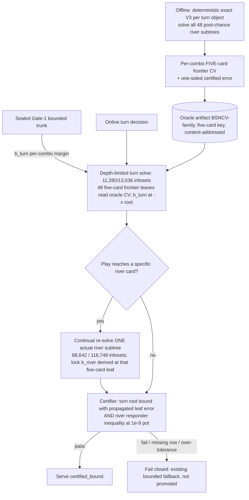

# RFC 0047: Depth-Limited Per-River Certified Resolve with an Offline Per-Combo Turn Continuation-Value Oracle

## Summary

RFC 0046 Route A (a single real-time exact per-combo TURN-ROOTED certified
endgame) was closed at governance level on 2026-11-04: the fully-mixed
exact-key footprint is 4,266,096-5,617,440 concrete infosets on the five
full-range frozen strata (4.3-5.6x over the frozen 1,000,000-infoset envelope
for EVERY algorithm), and the only in-envelope stratum (the ten-hand W1
anchor) plateaus around 8-11 chips under external-sampling RM+ with the
locked reference co-driving the floor. This RFC proposes the successor that
the RFC 0046 Stage-0 decision table and the independent closure review both
point to ("REDIRECT to Route C; nested-boundary route needs its own RFC"):
a **depth-limited, per-river-card certified resolver fed by an offline,
CERTIFIED, per-combo turn continuation-value (CV) oracle**. An offline
deterministic exact solver builds per-combo turn-boundary CVs with a shipped
per-entry error bound; the online path solves only the small turn action tree
and, on reaching a river, re-solves the single actual-river subtree
(88,642-116,748 infosets) with locked margins and certifies the responder
bound. This is a MEASUREMENT-FIRST proposal: Stage 0 freezes the feasibility
gates and Stage 1 is benchmark-only. No production solver, artifact mount,
serving change, or enablement is authorized by this RFC; implementation
budget additionally requires explicit user approval (TechLead D-058).

## Motivation

The M2 goal is a heads-up 100 BB full-street GTO policy whose online
decisions carry a certified exploitability bound. RFC 0046 established that
the bound cannot be produced by one real-time turn-rooted exact solve:

- **Envelope wall (algorithm-independent, measured without solving).**
  Betting actions are public, so every live combo reaches every action node
  of its street. Exact concrete infosets = turn_action_nodes x C(48,2) +
  river_action_nodes x C(47,2) = turn x 1128 + river x 1081. The cap-1
  turn-rooted tree gives 4,266,096 infosets on the limped shape and
  5,617,440 on the raised-SRP shape. The guarded no-solve counter
  (`bigshark-rfc0046-infoset-count`) supplies only the measured action-node
  counts (10/3,936 and 12/5,184) from the actually built trees; the 4.27M /
  5.62M products are the fully-mixed footprint. The independent closure
  ruling separately hand-derived the W1 table identity - 10x10 turn +
  82x460 river-live + 10 responder gadget rows = **37,830** - and matched it
  to the solver's measured `information_sets = 37,830`, which establishes 100%
  structural coverage (the counter itself prints the full-range 4,266,096 even
  for W1 and does not compute that identity).
- **Convergence/reference wall.** On W1 the corrected-wiring responder slack
  decays N^-0.51 -> N^-0.29 -> N^-0.21 -> N^-0.03 and plateaus at 11.10 chips
  by 2M gadget iterations against a 400k reference. A margin-iters ladder at
  fixed 1M gadget (13.30 / 11.33 / 9.17 / 8.28 chips at 200k/400k/1M/2M
  reference) shows the locked reference co-drives the floor once the gadget
  error is small; both are the same slow external-sampling RM+ family. The
  responder tolerance is 1e-6 of the 4-chip pot = 4e-6 chips; the floor is
  ~2e6x higher.

The closure review identified the surviving architecture: decompose the
turn-rooted object into a small depth-limited turn solve plus one per-river
re-solve, and supply turn boundary values OFFLINE where there is no 10 s
limit. A single river subtree is only 82x1081 = 88,642 concrete infosets
(108x1081 = 116,748 raised), comfortably inside the envelope; the open
problem is certified CV quality and offline coverage cost, NOT online
footprint. The margin ladder is direct evidence that tighter boundary values
materially reduce the responder violation, and the reference-floor result
shows the oracle must be built by a solver that changes the convergence law
and must SHIP A CERTIFIED ERROR BOUND rather than a larger MCCFR iteration
count. Evidence: [0046-gate2-close-report.md](../plans/0046-gate2-close-report.md),
[0046-solver-probe.md](../plans/0046-solver-probe.md),
[gate2-feasibility-probe.md](../plans/ablation/rfc0046/gate2-feasibility-probe.md).

## Goals

- **G1 Online envelope (two per-request distributions).** A TURN decision
  request performs only the depth-limited turn solve (11,280/13,536 concrete
  infosets; the river tree is not enumerated at turn time); a later request
  ON the dealt river performs one exact river re-solve (88,642/116,748
  infosets). Each kind is a SEPARATE timing/resource distribution: per kind,
  R=30 cold resolves per stratum (3 full seeds x 10), nearest-rank
  Hyndman-Fan type 1, predicate p95 <= 10,000 ms AND max <= 12,000 ms, with
  peak concrete infosets <= 1,000,000, peak RSS <= 1 GiB, nodes <= 5,000,000,
  on the frozen n37-100-184 machine profile. Both kinds must pass
  independently.
- **G2 Oracle certified accuracy.** The offline per-combo turn-CV oracle has
  a per-entry certified error against an exact high-accuracy reference, and
  the oracle and the served strategy clear the inherited RFC 0044/0045 bars
  SIMULTANEOUSLY (no object has ever passed both): the within-instrument
  convergence gap **CERT <= 0.005 BB with seed half-width <= 0.001 BB** and
  the exact-hole summed gap **QUAL <= 0.03 BB HU** (1.5 BB/100/seat; summed
  over both live seats / BB). The superiority comparison names the only
  incumbent boundary values in the engine and measures them identically - the
  RFC 0011 nine-category policy and the equity/check-down frontier - and the
  oracle must beat both per seed.
  These, propagated through G3, must also yield B0 = 0.010 summed-BB hybrid
  NashConv and R0 = 0.002 summed-BB river term on all six frozen strata at
  full range.
- **G3 Error-propagation certification (falsifiable; binding Stage-0
  checklist).** In ABSOLUTE BB (RFC 0043 mandate; calibrated first on tiers;
  RFC 0043's 20%-relative predicate, campaign, and nonexistent r* are
  forbidden for reuse), certify the worst-case mapping oracle-CV-error ->
  full-game exploitability so a non-probed mounted node inherits a numeric
  bound. The Stage-0 addendum MUST freeze, before data:
  (a) units/norms - values and errors are stored in CHIPS with root pot p
  frozen per key; gates convert to BB (1 BB = 2 chips) and pot fraction;
  `e_max = max_{seat,c} |Delta v| / p` and
  `e_l2 = sqrt( sum_{seat,c} rho(seat,c) (Delta v/p)^2 )` with rho the leaf
  counterfactual reach under the turn equilibrium, normalized per leaf per
  seat (exact formula frozen in the addendum);
  (b) perturbation design - additive CV perturbations at predeclared
  pot-fraction levels spanning 1e-6 to the gate scale, including a zero-mean
  arm and an adversarial coherent same-sign-over-a-player's-combos arm;
  (c) sampling/statistics - a predeclared coverage frame drawn from the G4
  census, a one-sided UCB worst-case upper-envelope coefficient (not a mean),
  and the tiers-calibration-first sequence;
  (d) determinism split - the V3 builder and artifact are SEEDLESS
  (bitwise-identical rerun; no pseudo-replication); only the NashConv
  deal-batch estimator and the node sample carry seed variance (full seeds
  4320/4321/4322, t=4.303);
  (e) production acceptance inequality - with every mounted entry's one-sided
  error <= e_max_frozen, UCB(hybrid NashConv) <= 0.010 BB and
  UCB(t_river) <= 0.002 BB.
- **G4 Coverage and build cost (turn-boundary census; build is four-card,
  stored rows are five-card).** A NEW census frozen in Stage 0:
  - board universes (RFC 0043 evidence): 16,432 canonical TURN classes /
    270,725 concrete turn boards; 134,459 canonical RIVER (five-card) classes
    / 2,598,960 concrete five-card boards; identity 270,725 x 48 =
    12,994,800 = 5 x 2,598,960. STORED oracle rows are keyed on the
    five-card post-chance frontier (the 134,459-class universe, per
    component 2); BUILD work solves 48 river subtrees per four-card turn
    object;
  - the betting-shape / public-frontier-leaf factor per board and valid
    sharing across suit-isomorphic boards and betting shapes get an explicit
    pre-frozen enumeration/dedup rule; suit-isomorphism validity is itself a
    Stage-1 test (suit symmetry holds only under symmetric ranges);
  - inherited METHODOLOGY and FROZEN BUDGETS: AC6 projected disk over the
    STORED five-card universe,
    `sum_L B(L) x (134,459 canonical classes x frozen shape/leaf factor) x
    overhead <= 200 GB`; AC7 projected build wall (build traverses the
    four-card turn objects and their 48 river solves)
    `classes x per-class full-range seconds / W(L) <= 7 days`; but byte
    per-row B(L), per-class seconds, and RSS(L) are RE-MEASURED for the HU
    exact per-combo object and new codec on the frozen machine (RFC 0043's
    inputs were six-way and deleted under no-legacy), the 1.0249 overhead is
    re-derived for the new codec or dropped, and W(L) uses the frozen
    build-host RAM rather than RFC 0043's host constant;
  - the canonical-class enumerators were deleted in RFC 0043 Stage 4; Stage 1
    RE-IMPLEMENTS `enumerate_canonical_river_classes()` and the turn
    counterpart in the guarded harness with native tests pinning 134,459 and
    16,432.
- **G5 Certified serve at BOTH serve points; menu materiality.** Serve point
  A (turn decision): the depth-limited turn gadget is certified at its
  responder `-x` root with the frontier leaves treated as BOUNDED inputs (the
  certifier slack includes the reach-propagated G3 oracle error plus finite
  gadget solution error); the whole-strategy confirmation is the B0 hybrid
  NashConv UCB, and both the local bound and the empirical UCB are required.
  Serve point B (river decision): the online river re-solve
  satisfies the per-combo responder inequality at production tolerance
  (`1e-9 * root_pot`, the RFC 0005 standard; the benchmark instrument used
  1e-6 - the ~1e3 tighter production tolerance is a deliberate predeclared
  kill gate, never relaxed post hoc) and is served only as `certified_bound`;
  a failed certification at either serve point
  fails closed to the existing bounded path and is never promoted from
  `approximate`. The cap-1 online action menu's materiality vs the cap-0
  exact reference inherits RFC 0046 Gate 3: per-stratum
  (NC_cap1 - NC_cap0) UCB <= M = 0.002 BB, sole escalation a cap-2 remeasure
  under the unchanged envelope.
- **G6 Dual quality reporting (RFC 0039 D1).** Every oracle/serve result
  records BOTH the within-instrument convergence predicate AND the exact-hand
  gap plus the composed full-strategy M2 delta; reporting only the
  converged/within-instrument number is rejected as quality laundering.
- All G gates use full 1,326-combo ranges (W1 is diagnostic only), the frozen
  six strata, the frozen seeds/statistics (full 4320/4321/4322 n=3 t=4.303;
  W1 4320..4324 n=5 t=2.7764, UCB never point estimates), and a second
  non-author evidence review.

## Non-Goals

- No multiway extension in this RFC; HU (2-seat) 100 BB only.
- No postflop card bucket anywhere on the certified path (the failure mode of
  RFC 0011/RFC 0044/RFC 0045).
- No learned/neural CV estimator in the production oracle (RFC 0041 failed at
  Stage 1 on label-noise/unlabellable boards); the oracle is tabular,
  produced by an exact deterministic solver. A learned surrogate would need a
  separate RFC and a certified bound.
- No online relaxation of the frozen 1M/5M/1GiB/10s envelope; the whole
  point is to fit it by decomposition.
- No flop or preflop M2 coverage; the boundary is the TURN.
- No production enablement, artifact mount, host default change, or client
  shipping here. Those need a later enablement RFC plus user budget approval.
- No re-opening of turn-rooted Route A: even a dramatic W1 result from the
  RFC 0046 V3 probe reopens only this depth-decomposed river architecture.

## Current State and Evidence

Verified current implementation (file:line details are part of Stage-0
review):

- **Certified gadget spine that already keys on CONCRETE per-combo holdings.**
  `engine/src/resolver/` (`bigshark_resolver`) implements the RFC 0005
  safe-subgame construction: a synthetic `-x` root per non-hero seat keyed by
  `GadgetKey{seat, cards[2]}` (concrete cards, not buckets), TERMINATE pays a
  centered per-combo margin b_s(c), CONTINUE enters the subtree; an
  independently written certifier enforces
  `BR_s(c) <= b_s(c) + kCertPotTolerance*root_pot` for every positive-mass
  infoset, with `kCertPotTolerance = 1e-9` (`engine/include/bs/resolver.hpp`).
  This resolver is TERMINAL-ONLY: both exact walks throw on an action node, so
  it cannot itself certify a turn+river tree.
- **Depth-limit and boundary-value seams exist but are unused on the certified
  path.** `tree::DepthLimit`/`NodeKind::TerminalFrontier` exist in
  `engine/include/bs/abstract_tree.hpp`; `FrontierEvaluator` and the RFC 0039
  per-OWN-combo marginal object (`ContinuationValueModel`,
  `ContinuationMatrix`, `RiverBoundaryLeaf` in
  `engine/include/bs/continuation_value.hpp`) define the right value-input
  shape. In production `SubgameResolver` calls `train_nseat(...,
  continuation = nullptr)`, `ResolveLimits::depth_limit` is inert in the
  certified TU, and `NestedRiverValueModel` is solve-scoped/non-persistent.
  The depth limit is POST-chance: the tree keeps the river chance and emits
  one `TerminalFrontier` per river card at the river Action phase (48
  five-card siblings per turn line), and the trainer consults the
  continuation seam only when `state.board().size() == 5` - so the only
  boundary-value contract that fits is a per-combo value at the five-card
  frontier, not a four-card aggregate.
- **No offline turn-CV artifact exists.** BSF1 is a flop, per-joint-deal,
  explicitly non-certified declared table; BSFLIB/BSWARM are blueprint/
  checkpoint formats; RFC 0041 reserved a `BSNCV01` codec name but no such
  codec was ever built.
- **The uncertified RFC 0011 path must not be reused.** It serves
  `Approximate` with no Certified state and its postflop key collapses to nine
  categories via `(score>>20)&0xF` (`engine/src/resolver/subgame_resolver.cpp`,
  `engine/src/abstraction/abstraction.cpp`).
- **Wire surface needs NO schema change to express certification.** The
  protobuf `GuaranteeLevel.CERTIFIED_BOUND = 5`, the internal
  `Guarantee::CertifiedBound`, and the string token `certified_bound` already
  exist; board-4/5 decisions are currently labeled approximate behind
  default-on env flags in `apps/engine-host/main.cpp`. Promotion changes host
  mapping, not the protocol.
- **The RFC 0046 benchmark is a validated SPECIFICATION, not a link target.**
  `engine/benchmarks/rfc0046/` (concrete keyer, turn gadget, 48-river
  certifier at 1e-6 pot, margin extractor, partition walker, strata) is
  behind the configure-time `rfc0046_link_guard` and cannot be linked into
  production. Production realizations are re-implemented in
  `bigshark_resolver`/`bigshark_solver` and the bench is deleted under
  no-legacy unless a later addendum promotes a named subset.

Assumptions (tested in Stage 1, not asserted as facts): that a deterministic
range-vectorized solver can produce turn CVs at the G2 accuracy offline; that
the G3 slope is favorable; and that the offline object count fits G4. Prior
evidence is adverse on all three (RFC 0039, RFC 0043, RFC 0044, RFC 0045),
which is why this RFC is measurement-first.

## Design Principles

- Exact concrete per-combo information sets on every certified path; no
  postflop card abstraction.
- Move convergence cost OFFLINE; the oracle is the only heavy compute and it
  carries a numeric error bound, never just an iteration count.
- Online solves stay small by street decomposition; certify exactly what is
  solved online and inherit the rest via the depth-limit margin identity.
- Safety follows Brown-Sandholm depth-limited continual re-solving: the
  boundary carries the opponent best-response MARGIN, and a certified oracle
  error bound propagates through the gadget; point estimates without a bound
  are never certified.
- Fail closed: missing/non-matching/expired oracle rows or a failed river
  certification return the existing bounded outcome, never a promoted
  approximate.
- No-legacy and benchmark isolation; reuse the certified gadget spine, do not
  relabel the nine-category resolver.
- Platform neutrality: CPU only; no GPU, no network, no credentials.

## Proposed Design

### Components and ownership

1. **Offline oracle builder (new; `engine` solver code + an offline C++
   driver under a guarded `engine/benchmarks/` target, with the
   TypeScript gate evaluator under `tools/rfc/`).** A deterministic,
   range-vectorized public-tree CFR (the RFC 0046 probe V3 family: all live
   combos integrated per public node, blocker-aware showdown matrix, no Monte
   Carlo deal/river sampling) is applied per turn-boundary object. Following
   the RFC 0024 depth-limit placement, each turn betting line ends in a river
   CHANCE with 48 post-chance frontier siblings, each at a specific FIVE-card
   board. The builder solves the river subtree at EACH such post-chance
   frontier exactly and stores the per-OWN-combo value for that specific
   five-card leaf plus a one-sided certified error; it does NOT collapse the
   48 leaves into one four-card aggregate (an aggregate cannot seed the
   on-river gadget margin). It emits the oracle artifact. This is offline,
   bounded by build-time/storage gates (G4), not the online envelope.
2. **Oracle artifact + codec + immutable reader (new; `bigshark_solver` /
   `bigshark_artifacts`).** Content-addressed, fail-closed, little-endian
   with a versioned header and external SHA-256, following the BSF1/BSFLIB
   codec conventions. Rows are keyed by (root/betting-shape id, canonical
   FIVE-card river board of the post-chance frontier, turn public
   frontier-leaf index incl. ledger/shape, dense own-combo) ->
   `{cv_chips, certified_error_chips}`. A new magic in the `BSNCV01`
   neighborhood (exact token frozen in the Stage-0 addendum). Values and
   errors are stored in CHIPS with the per-key root pot frozen alongside the
   row; BB conversion happens only in gate checks. The pot-fraction
   certifier tolerances (1e-9 production / 1e-6 instrument) are kept
   explicitly distinct from the BB gates (0.005/0.03/0.010/0.002). No
   four-card aggregate row is stored unless a named consumer is identified
   in the addendum; the five-card row is the only input the online river
   gadget consumes.
3. **Online depth-limited certified resolver (new production code in
   `bigshark_resolver`).** It builds a TURN-rooted RFC 0024 depth-limited
   tree: turn action nodes, then the river CHANCE (48 public children), and a
   post-chance `TerminalFrontier` at the river Action phase for EACH of the 48
   specific five-card boards (verified at `engine/src/tree/abstract_tree.cpp`
   Phase::Action depth-limit branch). The frontier leaves obtain per-combo
   values from the oracle through a persistent `ContinuationValueModel`.
   There are TWO distinct gadget margins, from different sources:
   - *turn-root margin* `b_turn_s(c)` for the turn gadget's `-x` root:
     Stage 1 uses the per-combo margin extracted from the Gate-1 sealed
     bounded-trunk reference (the RFC 0046 `margin_extract`); production uses
     the per-combo turn-boundary margin derived from the sealed Gate-1 trunk
     artifact - a named trunk-margin INPUT, NOT the five-card CV oracle, whose
     own error is the T_boundary decomposition term;
   - *river-root margin* `b_river_s(c)` for the on-river re-solve: when the
     actual river card is dealt this is the responder counterfactual
     continuation value at that specific five-card frontier under the
     certified turn depth-limited equilibrium, in the same
     `b(c) = sum_d w(d) C(d) / m(c)` form as RFC 0046 margin extraction but
     evaluated at the post-chance leaf.
   The river gadget then continual-re-solves that ONE river subtree
   (88,642/116,748 infosets) locked to `b_river_s(c)` and certifies the
   responder inequality. It returns `Certified` only when the bound passes and
   the oracle rows/errors are within the frozen tolerance; otherwise the
   existing bounded fallback.
4. **Depth-limited certifier (new production code in `bigshark_resolver`).**
   Extends certification across the turn tree + oracle-valued leaves + the
   river re-solve. The bound explicitly contains (a) the per-gadget solution
   error and (b) the propagated oracle error from G3; it reuses the
   independently-written-certifier pattern and the exact runout enumeration.
   The production tolerance is 1e-9 of root pot; the benchmark used 1e-6.

### Data flow



### Certification method (the core research content)

- **Oracle entry error and the locked margin identity.** At a frozen sample
  of post-chance FIVE-card frontier leaves,
  `e_max = max_{seat,c} |CV_hat(seat,c) - CV_ref(seat,c)|` and the
  reach-weighted `e_l2` are measured against an exact high-accuracy
  deterministic reference; each shipped row carries its one-sided error. The
  quantity the on-river gadget locks is the responder margin at that leaf,
  `b_river_s(c) = sum_d w(d) C(d) / m_s(c)`, a fixed non-negative linear
  combination of the leaf values; the shipped `certified_error_chips` must
  therefore bound THIS margin (the same linear combination of the per-entry
  bounds, not merely the raw CV). Stage 1 pins the identity with a native
  test on a tiny game solved both as one full tree and depth-limited with
  exact leaf values: the depth-limited `b_river_s(c)` must equal the
  full-game margin within numerical tolerance.
- **Turn-root margin provenance.** `b_turn_s(c)` is sourced from the sealed
  Gate-1 trunk (Stage 1: RFC 0046 locked reference; production: the sealed
  trunk-margin artifact); it is never read from the five-card river oracle.
- **Error-to-exploitability slope (G3).** The continual re-solving margin
  identity means the strategy is exploitable only through (i) finite gadget
  solution error and (ii) the boundary margin error, amplified by reach.
  Stage 1 empirically certifies the absolute-BB function
  exploitability_delta = f(e_max, e_l2) across nodes by injecting known CV
  perturbations and measuring full-strategy exact best-response hybrid
  NashConv (the RFC 0046 partition walker, reused as a spec). The production
  operating point must lie where the UCB of the propagated delta plus the
  online river term is <= R0 and the total <= B0. This is the RFC 0043
  mandated absolute-BB slope certification, not an assumed constant.
- **Online exactness.** The river subtree is solved exact-key and certified
  with the existing per-combo responder inequality; the zero-postflop-bucket
  negative ctest and the frozen behavioral hand-pair discriminator from RFC
  0046 addendum section 6.1 carry over.
- **Probe-vs-mounted.** Probe nodes are end-to-end exact-BR certified.
  Mounted nodes that were solved offline but not re-probed online inherit the
  G3 propagated bound; any node without an in-tolerance oracle row is not
  served as certified.

### Infoset budget (G1 basis, measured S1 shapes)

> **S1 measurement note (2026-11-04, see
> [0047-stage1-tracker.md](../plans/0047-stage1-tracker.md)).** The tree walk
> separates two river granularities. Continual re-solving reaches ONE turn
> betting line and ONE river card, so the ONLINE re-solve subtree has at most
> **12** river action nodes on both frozen shapes (some (line,card) leaves are
> a direct showdown with 0) -> **14,053 concrete infosets** including 1,081
> responder gadget rows. The 82/108-node figures are a fixed river card
> AGGREGATED across all 9/11 turn lines (3,936/48 = 82; 5,184/48 = 108),
> which is the OFFLINE per-card builder grouping and is never resident
> online. The envelope conclusion is strengthened; the table below keeps the
> action-only counts for continuity with the closure review.

| piece | limped shape | raised-SRP shape |
|---|---:|---:|
| depth-limited turn action infosets (10/12 nodes x 1128) | 11,280 | 13,536 |
| ONLINE reached river re-solve (max 12 action nodes x 1081) | 12,972 | 12,972 |
| online subtree incl. 1,081 gadget rows (measured peak) | **14,053** | **14,053** |
| OFFLINE per-card grouping (82/108 action nodes x 1081; not resident) | 88,642 | 116,748 |
| conservative online sum if both online tables are cached | 26,461 | 28,717 |

A single TURN decision request performs only the 11,280/13,536-infoset
depth-limited solve with oracle-valued leaves (the river tree is NOT
enumerated online at turn time); a later request ON the dealt river performs
the at-most-14,053-infoset exact re-solve. The online per-request peak is
~71x under the 1,000,000 bar even on the raised shape. These action counts
exclude per-row action/regret/sum storage (the counter is a strict lower
bound); exact peak RSS and wall are measured in S3 on the frozen machine. The
offline 48-river aggregate (4.27-5.62M infosets of transient work per boundary
node) is NOT resident online.

## Dependency Rules

- Allowed: `bigshark_resolver` -> `bigshark_solver`, `bigshark_artifacts`
  (oracle reader); offline builder tool -> `bigshark_solver`; host ->
  resolver as today.
- Forbidden: `bigshark_solver`/`bigshark_resolver` -> host; any certified
  production TU linking `bigshark_rfc0046_bench` (link guard stays);
  certified-path TUs calling postflop `card_bucket` (negative ctest).
- The oracle codec owns its format; the resolver consumes it through an
  immutable reader interface, never by reaching into a resident blueprint
  structure.

## Compatibility and Migration

- No transport change: reuse `GuaranteeLevel.CERTIFIED_BOUND = 5` /
  `certified_bound`. No persisted blueprint migration; the oracle is a NEW
  artifact mounted alongside existing ones.
- Rollout is additive and default-off behind a new env flag (name frozen in
  the addendum); absence or verification failure of the oracle leaves current
  board-4/5 behavior unchanged.
- No backward-compatibility shim for an internal oracle format revision:
  under no-legacy a replaced format deletes the old builder/codec in the same
  change (an external protocol field is not introduced).

## Security and Operational Impact

- Offline boundary only: the builder and artifact perform no game-network
  I/O and read no credentials.
- Artifacts are verified by external SHA-256 and schema digest; a wrong-board
  /wrong-shape lookup fails closed (the RFC 0033 board-addressing lesson).
- Online resource caps are the frozen ResolveLimits; observability emits a
  distinct diagnostic token for oracle-hit certified vs fallback, with margin
  and propagated-error fields.
- Incident recovery: unmount the oracle and disable the flag to restore the
  prior path instantly.

## Alternatives Considered

- **Single turn-rooted exact online solve (RFC 0046 Route A):** closed;
  4.27-5.62x infoset over for every algorithm.
- **More external-sampling MCCFR iterations:** rejected; gadget and reference
  both floor ~8-11 chips on W1 (N^-0.03 leg; margin leg ~-0.21), ~2e6x over
  the bound.
- **Learned/neural CV (RFC 0041):** failed Stage 1 (15.3% unlabellable turn
  boards; label-noise floor); not the production oracle.
- **Nine-category / coarse EHS approximation (RFC 0011/0042/0044/0045):**
  exact QUAL fails (0.0484 BB > 0.03 floor) and within-abstraction CERT
  (0.005 BB) is never met; cannot satisfy R0.
- **Equity/frontier leaf as turn CV:** silently assumes everyone checks
  down; rejected.
- **Range-conditioned tabular oracle (rows keyed on reach/conditioned range
  in addition to node/combo):** static per-node per-combo CVs are consistent
  only along equilibrium ranges and may be ill-defined on off-path
  deviations; a range-conditioned table is a credible fallback if the static
  rows fail G2/G3 off-path, at higher storage cost - evaluated as an explicit
  Stage-1 branch (Open Question 3), not assumed away.
- **GPU acceleration:** violates platform-neutral CPU-only deployment and is
  unnecessary at the single-river scale.

## Risks

- **Oracle accuracy unreachable offline (highest).** The deterministic V3
  law is unproven and the lineage (RFC 0039 ~0.26 BB; RFC 0043 T^-0.55 no
  plateau) is adverse. Mitigation: G2/G3 are predeclared Stage-1 kill gates;
  stop before production.
- **Coverage/build cost open (RFC 0043 AC6/AC7, 134,459-class).** The number
  of turn boundary objects and valid sharing are unknown; could make the
  offline build/storage infeasible. Mitigation: G4 census before any
  optimization.
- **Unfavorable error-propagation slope.** A small CV error could cause a
  large exploitability delta. Mitigation: absolute-BB empirical slope gate;
  do not assume DeepStack's L2 result transfers.
- **Online 88k-infoset river solve not certifiable in 10 s.** Smaller than
  W1's failing object but still exact-key; tighter locked margins help (the
  margin ladder) but this is unproven. Mitigation: G1/G5 timing gate.
- **Oracle staleness / mis-addressing / range mismatch.** Mitigation:
  content hash, board+shape keying, conditioned-range checks, fail-closed.

## Verification Plan

- Native ctests (compiled assertions, not text grep): zero postflop card
  bucket in certified TUs (negative test); concrete vs bucket behavioral
  discriminator on the frozen monotone hand pair; oracle codec round-trip +
  tamper/fail-closed; determinism (deterministic builder bitwise rerun;
  online cold/cold and cold/warm within tolerance); the per-combo responder
  bound; the G3 perturbation-to-exploitability identity and the
  depth-limited-vs-full-tree `b_river_s(c)` margin identity on a tiny exact
  game; and the rebuilt canonical-class enumerators pinned to 134,459 river
  and 16,432 turn classes.
- A frozen evaluator of record `tools/rfc/rfc0047-gates.ts` (+ node tests)
  implementing the six-stratum UCB, G1-G6 predicates, and fail-closed
  accounting, independently reviewed before any gate (same convention as
  rfc0045/rfc0046).
- Full release ctest + ASan on affected suites and the offline build guard;
  `node bin/check-docs.mjs`, `node bin/check-rfcs.mjs`, `npm run check`,
  `npm run proto:check`.
- A second non-author evidence review of any gate result before a production
  design addendum.

## Rollout Plan

- **Stage 0 (this RFC + an addendum):** freeze, BEFORE examining data, the
  strata reuse, the post-chance five-card oracle key/token/chip units, both
  margin provenances (`b_turn` from the sealed Gate-1 trunk; `b_river` derived
  at the five-card leaf), the G3 binding checklist (norms, perturbation grid,
  coverage frame, determinism split, acceptance inequality), G1-G6 numeric
  predicates and their two timing distributions, statistics, machine profile,
  the G4 census algorithm, re-measurement rules, and 200 GB/7-day budgets,
  the evaluator, and the default-off flag name; then obtain independent
  addendum approval. This RFC is the architecture decision; Stage 0 numeric
  freeze is a separately approved addendum (the RFC 0046 precedent).
- **Stage 1 (benchmark-only):** deterministic V3 oracle builder, depth-limited
  certifier, census enumerators, and measurement harness live in C++ TUs under
  a NEW guarded `engine/benchmarks/rfc0047/` target (not under `tools/`, which
  holds TS/CI); the frozen evaluator is `tools/rfc/rfc0047-gates.ts`. Stage 1
  may reuse the RFC 0046 algorithms as a re-implemented specification but is
  deliberately kept independent: it does NOT link `bigshark_rfc0046_bench`
  (avoiding cross-RFC benchmark coupling and the bench's production edge
  ban), a new rfc0047 configure-time target-graph guard keeps Stage 1 out of
  host/practice/resident/pack, and it links no production resolver. The
  no-legacy disposition is explicit: all Stage-1 TUs are deleted after the
  gates unless a later independently reviewed PRODUCTION addendum promotes a
  named subset into `bigshark_resolver`/the codec. Gates in order: G4 coverage
  census -> G2 oracle accuracy -> G3 slope -> G1/G5 online envelope and
  certification on both serve points.
- **Decision:** all gates pass AND second evidence review clean -> a separate
  PRODUCTION DESIGN addendum and then an ENABLEMENT RFC (artifact mount, host
  wiring, default); any gate fail -> close the route and record the failure,
  reusing the RFC 0041/0043/0045/0046 governance precedent.
- Implementation work and artifact production begin only after user budget
  approval (TechLead D-058); RFC acceptance by the approval agent authorizes
  the measurement design, not spend or enablement.

## Rollback Plan

- During Stage 1 nothing production changes; deleting the benchmark TUs and
  tool fully reverts.
- After a future production addendum, the feature is default-off and
  artifact-gated; rollback is unmounting the oracle and clearing the flag,
  which restores current board-4/5 behavior with no data migration (no
  transport or persisted-format change is introduced by this RFC).

## Open Questions

- Canonical turn-object count (build, four-card: 16,432-class universe) and
  five-card frontier row count/storage (134,459-class universe) with the
  betting-shape factor and valid sharing - a new G4 census using a rebuilt
  enumerator and HU per-combo bytes/seconds/RSS, projected to the frozen
  200 GB/7-day budgets; resolved by G4, not assumed.
- Whether deterministic V3 reaches the G2 CV accuracy at any offline budget.
- Whether a single per-node CV suffices or the oracle must key on
  reach/conditioned range (affects artifact size and the ContinuationValue
  contract).
- Production responder tolerance for the depth-limited certifier (1e-9 pot is
  the existing certified standard; whether it is reachable here is measured,
  not relaxed post hoc).
- Oracle artifact size target and build-hour budget (numbers frozen in the
  Stage-0 addendum from the G4 census).

## Acceptance Criteria

- This RFC may move to `Accepted` on independent approval-agent review of the
  measurement design; it may move to `Implemented` ONLY when, on the frozen
  six strata at full range with upper-confidence-bound statistics:
  1. G1 online peak <= 1,000,000 infosets / <= 1 GiB / <= 5M nodes and p95
     <= 10,000 ms / max <= 12,000 ms;
  2. G2 oracle CERT <= 0.005 BB (half-width <= 0.001) AND QUAL exact summed
     <= 0.03 BB HU, propagated through the G3 certified absolute-BB slope,
     yields hybrid NashConv UCB <= 0.010 summed BB and river term UCB
     <= 0.002 summed BB; both numbers and the composed M2 delta are reported
     (G6);
  3. G4 turn-boundary census and the AC6/AC7 projection are within the frozen
     200 GB / 7-day budgets (or a pre-approved coarser topology);
  4. G5 BOTH serve points certify - the turn depth-limited gadget bound with
     propagated leaf error and the exact river re-solve's per-combo responder
     bound at 1e-9 root pot; the cap-1-vs-cap-0 gap UCB is <= 0.002 BB; and
     nothing is promoted from `approximate`;
  5. the zero-bucket negative ctest, frozen behavioral discriminator,
     determinism, and codec fail-closed tests pass; full release ctest and
     ASan are green; a second non-author evidence review concurs; and
  6. a separate enablement RFC and explicit user budget approval precede any
     mount or serving change.

## Decision

Accepted 2026-11-04 by an independent non-author approval agent after two
review rounds (round 1 returned Changes Requested with six blockers B1-B6 and
six nits; all resolved and re-verified in round 2).

```text
Author agent: Claude (zzzode agent session)
Approved by: independent approval agent 364e539e-f244-4a36-97af-c82504f6aa7e
             (auto_model/alwaysday1_max; non-author; separate launch)
Decision date: 2026-11-04
Review outcome: Approved
Reviewed scope: two independent rounds over the complete RFC, the RFC 0046
closure evidence (gate2-close-report, solver-probe, Stage-0 addendum,
quarantined feasibility probe), RFCs 0005/0024/0039/0041/0043/0044/0045/0046,
and source verification in engine resolver/tree/gto/CMake and
apps/engine-host; check-rfcs (47) and check-docs (450) re-run green by the
approval agent.
Review summary: the post-chance five-card oracle key, the b_river margin
identity with a native tiny-game test, two-serve-point certification, the
one-sided absolute-BB G3 error envelope, the 16,432-build / 134,459-stored
G4 census, and the measurement-only guards are specified. Authorization is
limited to the Stage-0 freeze addendum (itself independently approved) and
Stage-1 benchmark-only measurement under a new rfc0047 configure-time link
guard; no production solver, codec mount, host mapping, wire change,
enablement, or spend is authorized - implementation and artifact production
require explicit user budget approval (TechLead D-058), and serving requires a
later enablement RFC. No shared module or established public contract is
changed by this approval.
```

Carried forward to the Stage-0 addendum (non-blocking approval items):
explicit composed accounting for serve point B (the 1e-9-pot certificate is
against a locked-but-bounded `b_river_hat`; residual margin error is covered
by the G3(e) envelope and the empirical R0 term); and the exact construction
of the one-sided per-entry error including the higher-accuracy reference's
own residual uncertainty.

Implementation budget is NOT authorized by this acceptance; it requires
explicit user approval per TechLead D-058.
