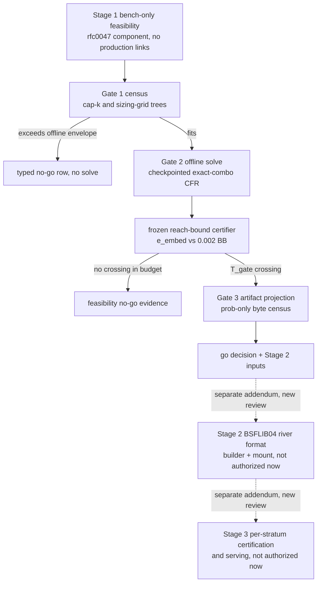

# RFC 0049: Offline Wide-Menu Equilibrium Blueprint and Embedded Online Consumption

## Summary

RFC 0048 established that no bounded action menu can satisfy the
0.002 BB river quality gate inside the G1 online envelope
(10 s p95, 1 GiB, 5M nodes) and named Path A — pre-solving the widened
equilibrium OFFLINE and consuming it online through embedding or
continuation values — as the primary surviving route. This RFC adopts
Path A and defines a three-stage program: (1) a bench-only offline
feasibility probe that decides whether ANY widened menu on the binding
deep river anchor can be converged to e_embed <= 0.002 BB inside a
pre-registered offline process budget, together with the artifact-size
census a later format needs; (2) a separately approved addendum for a
new packed river/turn blueprint format, builder, and mount; (3) a
separately approved per-stratum certification and serving addendum.
Only Stage 1 is authorized for implementation by this RFC; it changes
no production solver, schema, mount, protocol, or service. The quality
contract is reused unchanged: the same 0.002 BB e_embed metric and the
existing reach-bound certifier. RFC 0048 Path C (reopening the quality
contract with a menu-error term) remains rejected and is not revisited.

## Motivation

The measured decomposition on the frozen w1 Coarse cap-1 reached-river
anchor (D195 telescope, bit-exact single-walk split) is

```
e_embed 31.24489667 BB = bounded NC 0.02761552 + pure menu 31.21728115
```

where the pure-menu term is 99.91% of the error and exists because the
cap-1 policy cannot place mass on cap-0-only edges. Four orthogonal
in-envelope update experiments (D249 sizing density, D198 averaging
weight, D251 regret clipping, D252 time discounting) all made the
policy tier strictly worse at 300 iterations, and D253 showed the best
in-domain policy still needs 6.45x the G1 latency max to approach the
gate. No in-envelope lever remains. Widening the menu online is
infeasible: D164 measured cap-6 at 700 s per 1,000 iterations (70x G1)
with unconverged NashConv, and RFC 0045 established the exact cap-0 HU
river tree exceeds 100M nodes. The only structurally sound response is
to move widened equilibrium computation outside the online envelope —
the standard offline-blueprint plus online-lookup architecture used by
published near-equilibrium poker systems — and first prove, with
bounded measurement, that an offline solve can actually reach the
frozen quality bar and that its result can be packed and mounted.

## Goals

- Stage 1 (this RFC's implementable scope):
  - G1.1 Produce a full-tree node/infoset/byte census for every
    pre-registered widened-menu candidate on the binding w1 anchor,
    rejecting candidates that exceed the offline process envelope
    before any solve spend.
  - G1.2 For each census-passing candidate, measure whether an exact
    concrete-combo river solve reaches e_embed <= 0.002 BB through the
    existing reach-bound certifier within a pre-registered offline
    wall/iteration budget, recording the full checkpoint curve, the
    crossing iteration T_gate, and the projected packed-artifact size.
  - G1.3 Emit a binary go/no-go decision table and, on go, the measured
    inputs (menu identity, tree shape, row counts, bytes, T_gate, wall)
    required to scope the Stage 2 format addendum.
- Program-level goals (Stage 2-3 addenda, not authorized here):
  - a packed, digest-pinned river/turn blueprint the online engine can
    mmap and look up with no heap allocation on the request path;
  - per-stratum MAX (not single-anchor) certification against the
    unchanged 0.002 BB contract, followed by any serving enablement.

## Non-Goals

- No change to the quality contract: 0.002 BB, B0 = 0.010 BB, and the
  G1 envelope are frozen; Path C is excluded and no menu-error term,
  relative threshold, or new metric is introduced.
- No production code in Stage 1: no changes under engine/include,
  engine/src, apps, proto, or the engine-host mount/serve path; the
  stage-1 link guard that forbids the benchmark from linking
  production composition roots stays in force.
- No turn-rooted, multiway (3+ seat), flop, or preflop blueprint work:
  Stage 1 is heads-up, river-rooted, on the frozen w1 anchor and the
  existing six strata's census only.
- No new card abstraction: the bench river kernel keys all 1,081
  concrete combos directly, so Stage 1 carries zero card-bucketing
  error; equity/EHS bucketing lines (RFC 0042-0045) are not reopened.
- No cloud, network, credential, or funded compute; all runs are local
  single-instance processes. No retry, sweep beyond the pre-registered
  candidate list, or cumulative training pool.
- No end-to-end M2 claim: a single-anchor crossing is feasibility
  evidence only; M2 requires the Stage 3 per-stratum campaign.

## Current State and Evidence

- Bench river kernel. `engine/benchmarks/rfc0047/river_solver.{hpp,cpp}`
  is a deterministic seedless full-deal two-player river CFR solver:
  1,081 own combos, exact full best response, checkpoint API,
  `RiverSolveConfig::action_abstraction` accepts any declared menu, and
  `ActionAbstraction::identity(cap)` builds cap-k trees; D252 added an
  optional discount path that defaults off, leaving every prior numeric
  path byte-identical.
- Frozen certifier. `reach_bound_from_snapshot`
  (`reach_bound.{hpp,cpp}`) returns bounded_nash_conv_bb and
  exact_exploitability_bb against an empirical cap0-subset or union
  reference (D184 Stage-2b addendum); the D195 T13 telescope reconciles
  bounded NC with the solver NC and splits the removable pure-menu term
  bit-exactly on single walks (1e-12 across independent walks). Every
  D184-D253 receipt uses this instrument; the sealed cap-1 control NC is
  0.02761552 BB with policy hash 1922761369290757593.
- Menu machinery. `patha_grid_budget.{hpp,cpp}` already defines
  Coarse, Identity, Wide, and Fine pot-fraction grids at a declared
  raise cap; `union_menu.{hpp,cpp}` constructs the conservative superset
  reference that makes non-prefix grids legally measurable.
- Tree census. `tree_budget.{hpp,cpp}` and `rfc0047_census.cpp`
  enumerate shapes and counts; `AbstractTree` throws typed
  `tree_resource_exhausted` at `TreeLimits{2,000,000 nodes, 256 depth,
  1 GiB bytes}`. The bench probes already construct wider trees with an
  explicitly passed `TreeLimits`, so a bench-local offline limit needs no
  production change.
- Pack/mount contract (independently audited for this RFC). BSFLIB03
  (`engine/include/bs/mmap_library.hpp`) is the only mounted format: it
  stores probabilities only (no regrets/CVs), one menu per public node,
  Codebook8/16/Doubles layouts, SHA-256 sidecar pinning, mmap with
  zero-heap warm lookups (~30 ns measured in RFC 0026). Its structural
  limits that matter here: three-card board bytes and a dense
  1,755-class flop index (no river/turn section writer exists),
  root_count <= 256, one range vector per section, a strict mount
  singleton enforced by the engine host, per-node menu <= 32 actions,
  and `u16` compact chip targets (<= 65,535). The established evolution
  convention is a magic bump (BSFLIB04) with the old reader deleted,
  never dual-reading.
- Scale precedents. RFC 0043 measured the river class universe at
  134,459 canonical classes / 2,598,960 concrete boards and a 200 GB
  disk budget question it left open; RFC 0036 rejected a full
  turn/river library as terabyte-class under the older design; the
  shipped six-way flop library is 188,432,384 bytes with a measured
  1.0249 packing overhead. D164 recorded cap-6 solve cost at roughly
  700 s per 1,000 iterations and 351 MB RSS; the D253 cap-1 throughput
  is 17.153 ms/iteration.

## Design Principles

- Reuse before inventing: the quality metric, certifier, solver, menu
  builders, union reference, and probe scaffolding all exist; Stage 1
  adds measurement drivers, no strategy code.
- Empirical stop conditions, not aspirations: every gate has a
  pre-registered numeric envelope and a typed no-go outcome; a failed
  feasibility probe closes Path A on evidence rather than prompting a
  budget increase.
- Single-anchor honesty: the w1 anchor is the binding deep root used by
  every prior measurement, but a crossing there is never presented as
  per-stratum or M2 coverage.
- Format decision follows data: no BSFLIB04 field is designed before
  the census measures actual node/row/byte/menu distributions; a format
  built on assumed sizes is prohibited.
- Offline/online boundary preserved: all new Stage 1 code is
  benchmark-only and offline; the stage-6 offline build guard and the
  rfc0047 link guard are unchanged.

## Proposed Design

### Architecture



### Stage 1 candidate set (fixed before any run)

Two widening families, per the RFC 0048 Path A requirement not to anchor
on raise count alone:

1. Raise-cap family: `ActionAbstraction::identity(k)` for k = 2, 3, 4,
   5, 6 on the w1 anchor. Identity menus share the existing pot-fraction
   schedule and only change the per-street raise cap.
2. Sizing-grid family at cap 1: the existing Coarse, Wide, and Fine
   grids from `patha_grid_budget`, each evaluated against its union
   reference. No new grid is introduced in Stage 1; a denser grid
   requires its own pre-registered amendment.

The current cap-1 Coarse menu is included as the sealed control row and
must reproduce 0.02761552 BB bitwise; a control mismatch invalidates the
run before any candidate row is accepted.

The exact cap-0 identity menu is deliberately NOT a Stage 1 candidate.
D164 froze cap-0 as the reference domain rather than a bounded policy
(its full-fan-out tree is the >100M-node infeasibility RFC 0045
measured), and on this single anchor a cap-0 tree already exists inside
the reach-bound instrument purely as the scoring reference. Solving it
as a policy candidate would test zero-menu-error policy convergence in
isolation; that diagnostic remains a pre-registered option for a later
amendment but is excluded now to keep the candidate list inside the
two-family Path A scope.

### Gate 1 — offline tree census (no long solve)

A new manual probe builds each candidate's full `AbstractTree` on the w1
root under a bench-local `OfflineTreeLimits{25,000,000 nodes, 256 depth,
8 GiB bytes}` constant owned by the benchmark TU (the production
`TreeLimits` default is untouched). It records action nodes, total
nodes, maximum per-node menu width (and rejects any menu exceeding the
pack format's 32-action ceiling with a typed row), depth, and projected
infoset count (action nodes x 1,081 combos). Candidates exceeding either
offline limit emit a `census_rejected` row and never enter Gate 2.
Scope calibration from sealed receipts: on this single w1 anchor the
measured trees are small (cap-6 bounded tree 1,924 online nodes; cap-0
reference tree 33,693 nodes), so Gate 1 is not expected to reject a
Stage 1 candidate on node count — the >100M-node cap-0 figure from RFC
0045 is a full-fan-out River-terminal tree and belongs to Stage 3, not
to this single-anchor census. Gate 1's Stage 1 value is therefore the
Gate 3 row/byte projection, the 32-action menu-width precheck, and the
infoset census, with the 25M/8 GiB constant kept as a typed fail-closed
bound against unexpectedly explosive trees rather than an anticipated
no-go source. The 8 GiB envelope is roughly 10x the online 1 GiB / 5M
caps; an untracked local machine observation (a gitignored session
trial that peaked around 21 GB RSS on a different workload) suggests the
machine has headroom, but that figure is not a repository receipt and is
not used as a gate basis.

### Gate 2 — offline convergence to the frozen gate

Each census-passing candidate is solved in one single-instance process
by the existing river kernel with the fixed logarithmic rung ladder
{100, 200, 400, 800, 1,500, 3,000, 6,000, 12,000, 20,000}, bounded by
both T_max = 20,000 iterations and a 1,800 s steady-clock wall budget.
RSS is sampled, never used as a kill switch beyond the Gate 1 byte
bound.

Required bench-only kernel seams (both additive and default-off, inside
`bigshark_rfc0047_bench` under the link guard; the default call sequence
stays byte-identical in the D252 pattern):

1. An optional `TreeLimits` field on `RiverSolveConfig`, defaulting to
   the current implicit construction, so the probe can pass the bench
   offline limits; the production `TreeLimits` default and every
   production caller are untouched.
2. An optional checkpoint sink plus an optional stop predicate. The
   sink is invoked at each pre-registered rung with the iteration index
   and the `snapshot_sigma()` average-strategy snapshot, scores it, and
   flushes a row. The stop predicate is polled ONCE PER ITERATION at
   the top of the driver loop, outside every traversal floating-point
   operation, as
   `stop(iteration, elapsed_wall_ms) -> bool`; a `steady_clock::now()`
   poll costs tens of nanoseconds against a per-iteration cost of at
   least ~17 ms on the sealed receipts (up to ~700 ms on cap-6). The
   poll is an integer clock read placed outside every floating-point
   operation, so it structurally cannot change any FP order or numeric
   result; its relative cost is on the order of 1e-5 or less, and the
   exact single-poll nanosecond cost is measured on the target host
   during Stage 1 and recorded in the receipt. With
   neither seam installed the loop is unchanged and no snapshot storage
   or clock call is added; the seams are the only new surfaces and no
   result struct grows unconditionally.

The probe's stop predicate returns true as soon as cumulative wall time
crosses 1,800 s; the loop latches the flag at the next iteration poll
and breaks immediately, leaving the most recent completed rung row
already flushed. Because rung spacing is wide (the last rung interval is
8,000 iterations, longer than the 100 s OS margin on the slow
candidates), a rung-boundary-only check could be preempted by the outer
OS stop and lose the typed verdict; per-iteration polling is what makes
the in-process trip structurally fire first on every candidate. The
sink still scores and flushes a row at every completed rung (bounded NC,
exact exploitability, pure-menu term, e_embed, wall, RSS) through the
frozen reach-bound instrument (cap-k candidates use the cap0 subset
reference when mappable and the union reference otherwise; grid
candidates always use their union reference). The OS `timeout` launcher
is an outer hard stop set with margin (1,900 s versus the 1,800 s
in-process budget) and is expected never to be the binding stop.

Per-candidate verdicts are fully typed:

- PASS: the first rung with e_embed <= 0.002 BB
  (`candidate_gate_pass=1`); T_gate, wall at crossing, and the full
  curve are recorded and the solve stops.
- CONVERGENCE_NO_GO: all nine rungs complete inside the wall budget
  without a crossing; the minimum measured e_embed and a terminal
  log-log slope fit are recorded. No rerun.
- BUDGET_NO_GO: at least one finite rung row has been flushed and no
  crossing occurred before the per-iteration stop predicate latched;
  the partial curve (every flushed rung row up to the trip) and its
  terminal slope are the evidence. No rerun: a deterministic rerun
  reproduces the same trip, so retrying cannot manufacture information
  and would only spend budget.
- INCONCLUSIVE: a true instrumentation failure before the first finite
  rung row exists (process crash, non-finite checkpoint value, mapper
  exception, or the outer OS stop firing ahead of the in-process
  predicate, which would itself indicate an instrumentation defect
  given the 100 s margin). Exactly one rerun under the identical
  pre-registration is permitted and journaled. If the rerun reproduces
  the failure, the candidate is recorded BLOCKED rather than silently
  retried again, and Stage 1 cannot close until the blockage is resolved
  or the candidate is removed by an approved amendment (see change
  control below).

There is no threshold relaxation, no argv override of the ladder or
budgets, and no run outside the pre-registered envelope.

### Gate 3 — packed-artifact projection

For passing candidates only, the probe computes a hypothetical
probability-only storage projection using existing BSFLIB row math
(per-node menu block, 8-byte bucket entries, 3-byte compact actions,
Codebook16 probability runs, and an overhead factor): total section
bytes, probability entries, distinct menu actions, and projected mmap
page count. The 1.0249 packing overhead measured on the shipped six-way
flop library is used as an explicitly UNVERIFIED flop-derived
assumption, not a proven constant: river sections have different
node/menu distributions, so Stage 2 must re-measure the overhead on the
real river layout before any format size is committed. Nothing is
serialized and no format is modified; the output is the measured input a
Stage 2 addendum must use to justify BSFLIB04 fields and limits.

### Stage-exit verdict table

Stage 1 ends in exactly one of:

- GO: at least one candidate is a Gate 2 PASS and its Gate 3 projection
  is finite; the RFC authors open the Stage 2 addendum with the measured
  rows attached. No production implementation may start before that
  addendum is independently approved.
- NO-GO: every candidate is census-rejected, CONVERGENCE_NO_GO, or
  BUDGET_NO_GO; Path A is recorded infeasible on the binding anchor with
  evidence, mirroring the RFC 0043 closure discipline (measurement code
  retained only where a later instrument reuses it; otherwise deleted).
- BLOCKED: one or more candidates remain INCONCLUSIVE after the single
  permitted rerun, or an unresolvable instrumentation failure prevents
  scoring; the stage cannot be silently closed and is reported to the
  owner with the failure evidence. Resolving a BLOCKED state requires
  either an instrument fix under the same RFC or an approved pre-
  registration amendment removing the candidate.

### Pre-registration change control

The candidate list, rung ladder, offline tree limits, iteration and
wall budgets, and gate threshold are frozen at approval. Any change to
them — including adding or dropping a candidate, moving a rung, or
altering a budget — is a pre-registration amendment that requires a fresh
independent review round; implementation may not proceed on the changed
envelope until that review approves. The probe binary hard-codes these
constants and rejects argv overrides (the D253 pattern, where a
non-registered iteration count exits with a usage error), so an
envelope change requires a reviewed code change rather than a launch-
time parameter.

### Stage 2 sketch (design intent only; no implementation authorization)

A new packed format, expected magic BSFLIB04, that adds five-card board
identity and a river/turn class index while preserving BSFLIB03's
per-node menus, codebook layouts, digest pinning, and zero-heap lookup
model; a direct train-and-pack builder following the RFC 0027 pattern;
and a mount design that resolves the current single-library singleton
(likely an explicitly enumerated ordered library set with independent
digests). All of these touch persisted format, the resident reader, and
the engine-host startup contract, so they require their own RFC addendum
with compatibility and rollback terms. Under the no-legacy policy the
BSFLIB03 flop path is not dual-read into the new magic; whether flop and
river coexist in one file or two mounted files is an Open Question for
that addendum.

### Stage 3 sketch (design intent only; no implementation authorization)

Per-stratum MAX certification over the six frozen strata and their
432/528 frontier leaves, campaign wall/byte measurement against the
RFC 0043 class-universe cost question, certified-bound serving through
the existing guarantee vocabulary, and practice-table enablement. M2
closes only on the per-stratum MAX, never on the Stage 1 anchor.

## Dependency Rules

Permitted in Stage 1: new benchmark probes and native tests inside
`engine/benchmarks/rfc0047` and `engine/tests`, linking only
`bigshark_rfc0047_bench`; reuse of the solver, abstraction, tree,
reach-bound, union-menu, and grid components already in that component.
Forbidden: any include of a Stage 1 TU from engine/src, engine/include,
or apps; any change to production `TreeLimits`, `ResolveLimits`, the
resident mapper, mmap codecs, proto IDL, or the engine host; any new
external dependency. The existing configure-time link guards are the
enforcement mechanism and must stay green. Stage 2/3 dependencies are
defined by their addenda and cannot be anticipated by Stage 1 code.

## Compatibility and Migration

Stage 1 has no runtime, protocol, persisted-format, CLI, or artifact
compatibility surface: it adds non-installed manual benchmark binaries
and native tests exactly as RFC 0047/0048 did. No migration is possible
or required. Stage 2 will introduce the first real compatibility surface
(BSFLIB04 plus mount semantics) and must define its migration and the
deletion of superseded paths in its own addendum; nothing in Stage 1
pre-approves that change.

## Security and Operational Impact

No credentials, network I/O, game-platform contact, or hidden-card
inference are introduced; the offline boundary is unchanged. Stage 1
processes are local and bounded by the Gate 1 byte envelope and Gate 2
wall tripwire; every receipt records wall, CPU, and RSS. Operationally
the only impact is local CPU/disk use for pre-registered single
instances; there is no service deployment, and the published engine
binary behavior is unchanged. The fairness boundary is preserved because
the solver remains the deterministic seedless full-deal kernel with no
sampling.

## Alternatives Considered

- Keep widening online and accept the latency: rejected by the measured
  70x G1 overrun (D164) and the D253 6.45x minimum overshoot; the
  online envelope is the constraint the whole program respects.
- Reopen the quality contract with a menu-error allowance (RFC 0048
  Path C): rejected; B0 = 0.010 already has 8.72e-3 allocated and the
  D164 evidence forbids lowering or re-opening the bar. Excluded again
  here.
- Another in-envelope update-rule variant: rejected on the D249/D198/
  D251/D252 four-axis negative evidence and the D253 closure argument;
  none can create mass on absent menu edges.
- Equity/EHS card-bucketing blueprints (RFC 0042-0045): closed or
  failed on their own evidence; the river kernel's exact combo keying
  avoids the card-abstraction floor that defeated them, and this RFC
  does not reuse their bucket schemes.
- Design BSFLIB04 before measuring: rejected; format fields must follow
  the Gate 1/3 census rather than assumed row counts.

## Risks

- An unexpectedly explosive tree fails the Gate 1 census on the single
  anchor (the >100M-node cap-0 figure RFC 0045 measured is a full-fan-out
  Stage 3 object, and sealed single-anchor counts are far smaller, so
  this is a bound rather than an expectation; the 32-action menu width is
  the more likely Stage 1 rejection). Mitigation: the sizing-grid family
  is co-registered as an equal first-class candidate, and census
  rejection is a cheap, typed no-go row rather than a failed campaign.
- Even with the pure-menu term removed, the T^-0.52 policy-tier wall
  makes T_gate exceed 20,000 iterations / 1,800 s. Mitigation: this is
  the exact question Gate 2 answers; the per-iteration stop predicate
  and rung-row flushing guarantee a finite partial curve before any
  outer stop, so an overrun closes as a typed BUDGET_NO_GO on measured
  evidence instead of an OS-killed empty run, and no production
  investment precedes the answer.
- A pre-first-rung instrumentation failure pushes a candidate into
  INCONCLUSIVE. Mitigation: exactly one journaled rerun; a reproduced
  failure is BLOCKED and escalated rather than retried until it passes.
- Single-anchor optimism: shallower roots may behave differently.
  Mitigation: the RFC forbids M2 claims from Stage 1 and makes the
  per-stratum MAX a Stage 3 acceptance gate.
- Pack-format limits bind unexpectedly (32-action menus, u16 chip
  targets). Mitigation: Gate 1 records max menu width and rejects
  over-limit rows before solving; deep 198-chip stacks keep targets
  inside u16, but this is verified rather than assumed.
- Scope creep into production or a hidden budget increase. Mitigation:
  bench-only link guards, the addendum requirement for every
  format/mount/service change, hard-coded probe constants with no argv
  override, the amendment-and-re-review change-control rule, and the
  explicit stop-and-report condition in the authorizing directive.

## Verification Plan

Stage 1 uses the project's native test discipline (behavioral tests on
the real kernel; no source-text matching):

- Native ctests: census determinism and typed rejection at the offline
  limits; the two additive bench seams (optional `TreeLimits` field and
  default-off snapshot sink) leave the default solve bitwise identical
  (hash and NashConv against the sealed path); sink invocation and
  per-rung row flushing on a tiny fixture, with continuation/stop owned
  solely by the stop predicate; control-row bitwise
  reproduction of the sealed
  0.02761552 BB / hash 1922761369290757593; gate-pass fail-closed
  semantics (a wall trip can only suppress a pass); per-iteration stop
  predicate latching and immediate loop break with the last rung row
  already flushed, including a native test that the in-process trip
  fires before any outer stop on a deliberately tiny budget; verdict
  routing for
  PASS / CONVERGENCE_NO_GO / BUDGET_NO_GO / INCONCLUSIVE, including that
  a post-first-rung trip is a no-go with no rerun and a reproduced
  pre-first-rung failure is BLOCKED; checkpoint curve finiteness;
  artifact-projection arithmetic against hand-computed fixtures.
- Manual probe receipts: one CSV per gate with the pre-registered
  columns, stored under `docs/plans/ablation/rfc0049/`, plus empty
  stderr and recorded exit codes; each run is a single instance with no
  retry except the defined single INCONCLUSIVE rerun, and no argv path
  can alter a frozen constant.
- Regression: the existing rfc0047 subset
  (link_isolation, river_solver, reach_bound, union_embedding, rm_mode,
  dcfr, fine_grid) plus full release ctest, `npm run check`,
  `proto:check`, `check-docs`, and `check-rfcs` at stage closure;
  ASan and the multi-seat matrix remain one stage-closure run, not
  per-gate runs, per the directive's targeted-verification policy.
- Stage 2/3 verification is defined in their addenda (codec round-trip,
  mount reject-closed tests, digest verification, per-stratum MAX).

## Rollout Plan

1. RFC 0049 accepted on this design; Stage 1 implementation begins with
   the census probe (Gate 1), native tests written RED first.
2. Gate 2 convergence probes run only for census-passing candidates, one
   process at a time, each journaled before the next starts; rung rows
   are flushed as produced and the per-iteration stop predicate
   guarantees an in-process typed BUDGET_NO_GO receipt before the outer
   OS stop can bind.
3. Gate 3 projection runs only for Gate 2 PASS candidates; the Stage 1
   verdict table (GO / NO-GO / BLOCKED) is finalized and reviewed
   independently.
4. On GO, author the Stage 2 BSFLIB04/mount addendum and seek a fresh
   independent approval; on NO-GO, close Path A and report the surviving
   options to the owner without opening production work; on BLOCKED,
   resolve the instrument or amend the pre-registration before any
   further run.
5. Stage 3 follows only after Stage 2 is implemented and its own
   acceptance evidence exists. Each stage has its own local commit set
   and can be reverted independently.

## Rollback Plan

Stage 1 adds only benchmark TUs, tests, CMake probe wiring, and
documentation; rollback is reverting the Stage 1 commit series, which
cannot affect any shipped behavior because no production TU references
the new code (enforced by the link guard). No artifact, format, or
service state is created, so no data rollback exists. If Stage 1 ends
NO-GO, its measurement code follows the established no-legacy rule:
probes without a future consumer are deleted in the closure change,
evidence CSVs and the evaluator components reused by other instruments
are retained. Stage 2/3 rollback (format and mount) is defined when
those addenda exist.

## Open Questions

- If Gate 2 passes only for a sizing grid and not for any raise cap, is
  a grid-only BSFLIB04 acceptable for Stage 2, or is raise-cap widening
  a hard requirement? Deferred to the Stage 2 addendum with the measured
  rows as input.
- Should a future river library be one BSFLIB04 file or an ordered
  multi-file mount set, and how does the host singleton generalize?
  Deferred to Stage 2.
- Does the offline envelope (8 GiB / 25M nodes / 1,800 s) need to scale
  for the six-stratum campaign, and what local disk budget does Stage 3
  assume against the RFC 0043 200 GB figure? Deferred to Stage 3.

## Acceptance Criteria

Stage 1 (the only scope this RFC can close):

- AC1. Every pre-registered candidate has a Gate 1 census row or a typed
  census-rejection row, produced by a native-tested probe, with the
  sealed control reproduced bitwise.
- AC2. Every census-passing candidate has a Gate 2 receipt whose rung
  rows were flushed as produced, carrying one of the four typed
  verdicts (PASS, CONVERGENCE_NO_GO, BUDGET_NO_GO, INCONCLUSIVE) with
  every flushed finite rung row present (a partial curve up to the trip
  for BUDGET_NO_GO, the full nine-rung curve for CONVERGENCE_NO_GO and
  PASS), and no run outside the pre-registered budget or through an
  argv override.
- AC3. Every Gate 2 PASS candidate has a Gate 3 finite artifact
  projection; the final GO / NO-GO / BLOCKED decision table is recorded
  with independent review and every figure traces to a receipt.
- AC4. No production, protocol, schema, mount, or threshold file
  changes; the rfc0047 link guard and stage-6 offline guard pass; the
  full release verification set is green at stage closure.

Stage 2 and Stage 3 acceptance criteria are defined by their respective
addenda; neither may claim Implemented under this RFC.

## Review Round 1 Dispositions (2026-11-16)

Independent approval-agent round 1 returned Changes Requested with one
major, two minor, and three nit findings; all are resolved in this
revision before re-submission, and the RFC stays Proposed.

- F1 (major): Gate 2 as written could not produce per-rung e_embed
  rows under the current bench API (snapshots exist only at the final
  iteration; the solver has no wall deadline, so a slow candidate would
  be OS-killed with no output), and the old INCONCLUSIVE rule could trap
  a deterministic overrun in endless reruns with no stage closure.
  Resolved by specifying two additive default-off bench seams (an
  optional `RiverSolveConfig::TreeLimits` field and a checkpoint
  snapshot sink with a continue/stop return), in-process wall trips
  that always preserve a partial curve, four typed verdicts
  (PASS / CONVERGENCE_NO_GO / BUDGET_NO_GO / INCONCLUSIVE) where a
  post-first-rung overrun is a no-go with no rerun, and a BLOCKED
  stage-exit state for a reproduced instrumentation failure. The
  trip mechanism itself was tightened in round 2 (see R2-1 below).
- F2 (minor): the census risk conflated single-anchor trees with the
  >100M-node full fan-out. Resolved with sealed single-anchor node
  counts (cap-6 1,924; cap-0 33,693) and a re-scoped Gate 1 purpose
  (row/byte census, 32-action precheck, fail-closed bound).
- F3 (minor): no change control on the pre-registered constants.
  Resolved with a dedicated change-control subsection: any envelope,
  ladder, or candidate change is an amendment needing a fresh review,
  and the probe hard-codes constants with no argv override.
- F4 (nit): the 21.4 GB RSS figure had no tracked source. Resolved by
  relabeling it an untracked local observation that is not a gate
  basis.
- F5 (nit): the 1.0249 overhead factor was presented as measured for
  river storage. Resolved by marking it an unverified flop-derived
  assumption that Stage 2 must re-calibrate on real river sections.
- F6 (nit): the cap-0 exclusion was unexplained. Resolved with an
  explicit paragraph citing the D164 reference-only freeze and the
  RFC 0045 full-fan-out infeasibility, leaving a cap-0 diagnostic as a
  future pre-registered option rather than a silent omission.

## Review Round 2 Dispositions (2026-11-16)

The same independent approval agent re-reviewed the revision and
returned Changes Requested with one major and one nit; both are
resolved below and the RFC remains Proposed.

- R2-1 (major): rung-boundary-only wall checks could not fire before
  the outer OS stop on the four wide raise-cap candidates. Using the
  sealed D164 per-iteration throughputs, the reviewer showed the last
  rung interval (12,000 to 20,000 iterations) exceeds the 100 s
  in-process/OS margin for cap-3 through cap-6, so those processes
  would be OS-killed between rungs, classified INCONCLUSIVE, reproduce
  deterministically on the single permitted rerun, and end BLOCKED —
  making the core widening family unable to reach a typed no-go.
  Resolved by replacing the rung-boundary check with an optional stop
  predicate polled once per iteration at the top of the driver loop,
  outside all traversal floating-point work
  (`stop(iteration, elapsed_wall_ms) -> bool`); the integer clock read
  sits outside all FP work, so no FP order or numeric result changes,
  and its relative cost is order 1e-5 or less (the exact ns/poll figure
  is measured on the target host during Stage 1). The predicate latches
  at 1,800 s,
  the loop breaks at the next poll with the latest completed rung row
  already flushed, and the result is a typed BUDGET_NO_GO; the 1,900 s
  OS launcher is now genuinely an outer-only stop. The native test plan
  adds a tiny-budget case proving the in-process trip fires before any
  outer stop.
- R2-2 (nit): AC2's "full finite curve" wording contradicted the
  partial-curve definition of BUDGET_NO_GO. Resolved by requiring
  every flushed finite rung row, explicitly a partial curve for
  BUDGET_NO_GO and the full nine-rung curve for CONVERGENCE_NO_GO and
  PASS.

## Review Round 3 Dispositions (2026-11-16)

The same independent approval agent re-reviewed the round-2 revision,
independently re-derived the per-candidate trip arithmetic under the
sealed D164 throughputs (cap-3 last observable rung 12,000; cap-4
6,000; cap-5 3,000; cap-6 1,500; each latching in-process around
1,800-1,801 s with a 99-100 s margin to the 1,900 s outer stop), and
returned Approved with no blocker and two non-blocking nits, both
resolved before the status transition:

- R3-1 (nit): the "below 2e-6" overhead bound was machine-dependent
  and too tight. Replaced with the structural argument (integer clock
  read outside all FP work, so no FP order or numeric result can
  change), an order-1e-5 relative-cost statement, and a Stage 1
  requirement to measure and record the exact single-poll nanosecond
  cost on the target host.
- R3-2 (nit): a verification bullet still said "sink continuation
  control" after continuation/stop moved to the predicate. Reworded to
  sink invocation and per-rung row flushing, with continuation/stop
  explicitly owned by the stop predicate's native test.

## Decision

Accepted 2026-11-16 by an independent non-author approval agent after
three review rounds (round 1 Changes Requested: one major, two minor,
three nits; round 2 Changes Requested: one major, one nit; round 3
Approved with two non-blocking nits; every finding resolved and
re-verified).

```text
Author agent: Claude (zzzode agent session)
Approved by: independent approval agent a3b79f9094b30ac97
             (non-author; separately launched; three review rounds)
Decision date: 2026-11-16
Review outcome: Approved
Reviewed scope: the complete RFC across three rounds; RFCs 0043, 0045,
  0046, 0047, 0048; the rfc0047 bench kernel, reach-bound certifier,
  grid/union/menu/tree-budget machinery; BSFLIB03 and the resident
  mount contract including its river-format limits; the rfc0047 and
  stage-6 link guards; sealed D164/D195/D249-D253 receipts; check-rfcs
  (49 RFCs) and check-docs (541 files) re-run green by the approval
  agent.
Review summary: the bench-only three-gate Stage 1 is safe to implement
  as written — additive default-off TreeLimits and snapshot/stop-predicate
  seams with byte-identical defaults, per-iteration wall latching that
  makes every candidate reach a typed PASS/NO-GO verdict inside the
  pre-registered envelope, four typed verdicts with a BLOCKED stage
  exit, hard-coded constants with no argv override and amendment-based
  change control, and no production, schema, mount, protocol, or
  threshold change. Stage 2 (BSFLIB04 river/turn format, builder,
  mount) and Stage 3 (per-stratum MAX certification, serving) remain
  non-authorized sketches requiring separate addenda and fresh
  approvals; the likely NO-GO outcome implied by D195/D164 is the
  designed falsifiable result, not a defect.
Authorization limit: Stage 1 measurement implementation only, under
  the existing D-067 single-instance local-process grant. No
  production solver, schema, codec, mount, host, wire, enablement,
  funded compute, or push is authorized by this approval.
```
