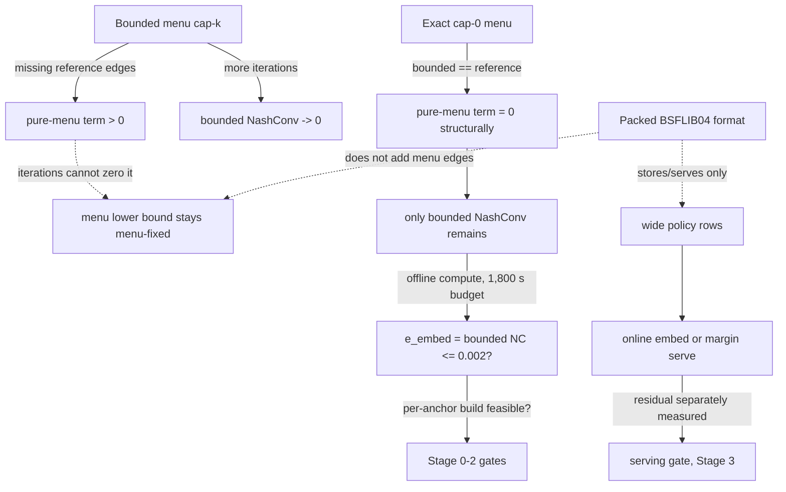

# RFC 0050: Exact-Menu Offline River Blueprint Feasibility and the Packed River/Turn Format Campaign

## Summary

RFC 0049 Stage 1 returned a designed NO-GO: no bounded cap-1..6 or
sizing-grid menu on the binding w1 deep river anchor reaches
e_embed <= 0.002 BB inside the offline single-process envelope, and the
structural pure-menu term never falls below 4.8x the gate even on the
widest bounded menu. This RFC does not repeat that experiment. It
attacks the one structural lever RFC 0049 deliberately did not test: an
EXACT (cap-0-equivalent) menu, whose pure-menu term is zero by
construction, solved offline and later consumed online through a new
packed river/turn format. A deleted T6 cap-0 solve exists as a
convergence prior but leaves no typed memory or convergence receipt in
the current harness, which is the gap this RFC measures. It states up
front the causal fact that
motivates and bounds the whole program: a packed storage format cannot
by itself reduce the pure-menu term; only representing the missing menu
edges can. The RFC is therefore a feasibility campaign with hard FAIL
gates, not a promise of M2. It first measures (Stage 0, cheap and
decisive) whether an exact-menu full RiverGame even fits the offline
memory envelope and converges on the smallest ledger anchor, then maps
the feasibility boundary across a small ledger-level anchor set, and
defers the packed BSFLIB04 format and online serving to a separately
approved addendum that may only proceed if the build feasibility gates
pass. Path C (re-opening the 0.002 BB quality contract) remains
rejected.

## Motivation

RFC 0049 decomposed the gate metric on every receipt as

```
e_embed = bounded_nash_conv_bb  (policy convergence; iteration-driven)
        + pure_menu_term_bb     (representability; menu-width-driven)
```

and measured two distinct behaviors. The bounded NashConv is a
convergence quantity: the cap-1 control drove it to 0.00006391 BB at
20,000 iterations, already far below 0.002. The pure-menu term is a
structural quantity whose positive lower bound is fixed by the menu
width: on cap-1/grid policies it stays at 22.13-31.43 BB regardless of
iteration count (weak reach-weight drift, never a zeroing), and even the
widest tested bounded menu (cap-6) leaves 0.00959 BB, 4.8x the gate by
itself. The two terms have different causes and therefore different
remedies. Convergence is fixed with compute; the menu term's lower bound
is fixed only by representing more menu. Every RFC 0049 candidate kept a
bounded menu, so none could zero the menu term. The exact menu is the
unmeasured-in-this-harness endpoint where the menu term vanishes
identically and the problem reduces to pure convergence. Whether that
endpoint is computable and servable is the open question this RFC sets
out to settle on evidence.

## Goals

- Answer, with measured receipts rather than assertion:
  - G1 whether an exact-menu full river solve fits the offline
    TreeLimits/byte envelope on a real anchor (the RFC 0049 cap-0
    evidence covered only the 33,693-node public tree, explicitly never
    a cap-0 RiverGame whose regret/sum layout was noted to exceed 1 GiB).
  - G2 whether such a solve converges to bounded NashConv <= 0.002 BB
    with zero pure-menu term inside a pre-registered wall budget.
  - G3 whether the result generalizes across a small, justified anchor
    set, or whether the w1 NO-GO defines a hard boundary.
- Produce, on a GO, the measured per-anchor memory/wall/infoset inputs a
  BSFLIB04 format addendum needs, including an honest statement of the
  online-serving residual problem.
- Keep every measurement bench-only under the existing link guard with
  no production, schema, mount, protocol, or threshold change.

## Non-Goals

- No re-opening of the 0.002 BB gate, B0 = 0.010 BB, or the G1 envelope;
  Path C is rejected and no menu-error allowance is introduced.
- No full 134,459-class river campaign in this RFC; that is a later
  per-stratum effort whose cost is estimated from these per-anchor
  measurements, not committed.
- No BSFLIB04 writer/reader, mount change, engine-host change, or
  serving enablement; Stage 3 is an addendum with its own approval.
- No turn-rooted, multiway (3+ seat), flop, or preflop exact-menu work;
  the scope is heads-up river-rooted subgames already enumerated by the
  frontier machinery.
- No claim that a feasible offline build implies a feasible 0.002 BB
  online serve; the serving residual is an explicit measured risk.
- No cloud, network, credential, or funded compute; local
  single-instance processes only.

## Current State and Evidence

- RFC 0049 receipts (`docs/plans/ablation/rfc0049/`): Gate 1 census and
  Gate 2 eight-candidate curves. Key figures: cap-6 single-anchor public
  tree 5,769 total / 1,924 action nodes, projected 2,079,844 infosets at
  ~3.0 MB accounted; the cap-0 reference public tree is 33,693 nodes and
  is built today only as a fixed-policy evaluator, never as a solving
  RiverGame (`cap_embedding.hpp:98-104`).
- Causal evidence that the menu term is menu-driven, not
  convergence-driven: across RFC 0049 rungs the cap-1 pure-menu term
  stays in 31.04-31.22 BB while bounded NashConv falls through four
  orders of magnitude; widening the menu moves the term (cap-1 ~31 BB,
  cap-6 0.00959 BB) while more iterations at a fixed menu do not.
- Identity construction: `ActionAbstraction::identity(0)` already builds
  the exact menu and the reach-bound instrument already treats
  bounded == reference as the zero-menu-error case with native coverage.
- Historical cap-0 solve prior (T6, kept as prior, not a typed receipt):
  a cap-0 RiverGame WAS once built and solved on the w1 first reached
  subgame before the no-legacy deletion, recording NashConv
  0.655 / 0.490 / 0.211 BB at 50/100/200 iterations over 11,232 action
  nodes (~T^-0.55; ~9.4 min for the 100-iteration run at 16 threads),
  i.e. reaching 0.002 needs thousands of iterations. The same note
  estimates the full regret layout at ~1.4 GB against the then-1 GiB
  online envelope; that figure is an engineering estimate, not a measured
  byte receipt, and the code was later deleted, so no typed cap-0
  RiverGame allocation or convergence receipt exists in the current
  harness. Stage 0/1 are therefore still necessary: they produce the
  missing typed memory row under the 8 GiB offline envelope and the
  convergence curve under the 1,800 s process budget, with the T6 curve
  carried explicitly as a deep-anchor prior rather than ignored.
- Anchor universe: `enumerate_frontiers` yields 432 limped / 528 raised
  leaves, deduped to 240 unique w1 subgames = five distinct
  (pot, contribution) ledgers times 48 river cards; menus are
  card-independent, so the action-tree shape and its memory/menu-term
  profile repeat across the 48 cards and across the card-texture strata.
- Campaign-scale precedents: RFC 0043 measured the river class universe
  at 134,459 canonical classes / 2,598,960 concrete boards under a fixed
  200 GB disk / 7-day wall budget and left the per-class build cost open.
- Efficacy baseline for budgeting: the full release ctest suite is
  112/112 green in 3,808.39 s at Stage 1 closure (a local run recorded in
  the session; the rfc0047 family alone is 29/29 in 2,154 s, likewise a
  local observation). RFC 0049 Gate 2 measured per-process wall from
  485.0 s (control, full ladder) to 1,830.4 s (cap-6, partial curve at
  the trip); the 457 s fine-cap-1 figure in the pre-run budget estimate
  was an estimate and the measured fine value is 611.6 s. Peak RSS was
  46.9-802 MB, all eight processes RC 0 with empty stderr; the ASan
  preset configures but its full build currently fails in the vendored
  open_spiel/abseil third-party tree under GCC 12 (a constexpr
  incompatibility with zero rfc0047/bench error sites), so the
  stage-closure ASan evidence for these seams is the targeted native
  tests run under the release sanitizer path and is documented as such.
  The steady_clock stop-poll is measured at 22.8 ns.

## Design Principles

- Causal honesty: distinguish the convergence remedy from the
  representability remedy and never attribute a menu-term improvement
  to a storage change.
- Cheapest decisive gate first: do not design a format or campaign
  before proving the exact-menu solve fits and converges on one anchor.
- Few and precise anchors: exploit card-independence to measure at the
  ledger (betting-shape) level rather than enumerating card classes.
- Every gate has a typed FAIL receipt and a stop; no threshold is moved
  to convert a failure.
- Bench-only measurement under the link guard; production contracts are
  touched only by an independently approved addendum.

## Proposed Design

### The causal chain the whole RFC depends on



A packed format changes expression (five-card board identity, river/turn
class index, per-node wide menus), storage density, and mount/query, but
it stores whatever policy it is given; it cannot create a menu edge the
solved tree did not contain. The pure-menu term therefore cannot improve
from packing alone. The only route to a zero menu term is solving the
exact menu, and the only role of the format is to persist and serve that
larger policy within the online lookup envelope. If an exact-menu solve
is infeasible offline, no format can rescue the gate; if it is feasible,
the format is necessary but the online residual still has to be proven.

### Anchor set and ordering (answers the generalization question)

The w1 NO-GO does not logically generalize. It tested bounded menus on
the single deepest leaf and never tested an exact menu; D164 explicitly
flagged that shallower post-bet roots may clear the gate at smaller
caps. Because action-tree shape is card-independent, the feasibility
question lives at the ledger (betting-shape) level, not the 134,459-class
level. The native frontier enumerator pins the structure: the w1 limped
root has 432 leaves = 9 betting lines x 48 river cards deduped to five
distinct (pot, contribution) ledgers x 48 cards, and the raised root has
528 leaves over six distinct SRP ledgers.

The RFC does not assume a "shallowest" label. Stage 0 begins with a
cheap cap-0 PUBLIC-tree census (the tree builder, no solve) over the
eleven distinct ledgers — five limped plus six SRP — recording per
ledger action nodes, total nodes, projected infosets, and max per-node
menu width, and names the anchors in the deterministic ascending order
of measured cap-0 action-node count. The pre-registered Stage 1/2 anchor
set is then the first six ledgers in that measured order. It is
expected (not promised) to span both the limped and SRP shape families;
the actual family composition follows the census output and is reported
as measured, with any deviation handled by the amendment rule because
the hard-coded list must obey the measured order rather than any family
quota. The exact ordered list is hard-coded
in the probe from the census output (RFC 0049 no-argv pattern), never
selected at run time. The representative river card per ledger is fixed
by the same deterministic rule the frontier enumerator already uses (the
first card in DFS card order), and card-dependent bounded-NashConv
variation is explicitly deferred to a later campaign.

The monotonicity that makes a smallest-first gate decisive is stated
in the measured dimension. The storage formula is identical across
ledgers and total allocation is monotone in the measured tuple
(action nodes, projected infosets, maximum per-node menu width);
equal-sized ledgers are ties tested together as one group. A hard
structural NO-GO is invoked only once the Step 0a census confirms every
later anchor's projected byte tuple is no smaller than the failing
one's. If the smallest measured cap-0 RiverGame cannot be allocated
within the 8 GiB byte envelope and no smaller tie exists, no larger
cap-0 tree can. If the smallest passes but a deeper anchor fails, the
census localizes a measured feasibility boundary rather than asserting
one. A gate result is therefore a hard structural NO-GO or a located
boundary, never an artifact of an arbitrary ordering.

### Stage 0 — exact-menu memory feasibility (cheap, decisive)

Stage 0 has two ordered steps.

Step 0a, the eleven-ledger cap-0 public-tree census (no solve): a
bench-only probe builds the cap-0 `AbstractTree` for each of the eleven
distinct ledgers (five limped, six SRP) and emits one CSV row per ledger
with action nodes, total nodes, projected infosets, and maximum
per-node menu width (also checked against the BSFLIB 32-action ceiling
as an early Stage 3 de-risk). This census determines the hard-coded
ordered anchor list the later steps use; nothing about the order is
assumed before it runs.

Step 0b, exact RiverGame allocation on the measured-smallest ledger:
the probe takes the ledger whose cap-0 tree has the smallest measured
(action nodes, projected infosets, max menu width) tuple from Step 0a
and attempts the full exact-menu RiverGame allocation under the offline
`TreeLimits{25M nodes, depth 256, 8 GiB}`, recording the actual
regret/sum byte allocation (not just the public-tree node count) and a
construction-fail row typed as a memory NO-GO. FAIL condition: the exact
RiverGame cannot be allocated within 8 GiB. This is the single most
important gate: if the measured-smallest exact solve does not fit
offline, the exact-menu route is closed and the RFC terminates without
building any format. The T6 note that an SRP cap-0 tree (7,824 action
nodes) is smaller than the w1 tree (11,232) is exactly why the smallest
ledger is chosen by measurement rather than by name.

### Stage 1 — exact-menu convergence on the feasible anchor

For an anchor that passes Stage 0, solve the exact menu with the
existing seedless river kernel (reusing the RFC 0049 sink/stop-predicate
seams unchanged) on the frozen rung ladder
{100, 200, 400, 800, 1,500, 3,000, 6,000, 12,000, 20,000}, a
1,800-second per-process in-process wall with the per-iteration stop
predicate latching before any outer OS timeout, scoring each rung
through reach-bound where the pure-menu term must read zero. PASS means
bounded NashConv (== e_embed with zero menu term) reaches 0.002 BB; the
typed verdicts are PASS / CONVERGENCE_NO_GO (full ladder, no crossing) /
BUDGET_NO_GO (finite rungs flushed before the wall, no rerun) /
INCONCLUSIVE (pre-first-rung instrumentation failure, one journaled
rerun, then BLOCKED if reproduced). These constants are hard-coded in
the probe with no argv override; any change to the ladder, wall, anchor
list, or gate is an amendment requiring a fresh independent review. FAIL
condition: no rung reaches 0.002 inside the budget.

### Stage 2 — anchor boundary map

Repeat Stages 0-1 across the six-ledger set, one process per anchor, and
record the feasible/infeasible boundary with per-anchor memory and wall.
The output is the measured input to any campaign sizing (extrapolation
to the 134,459 classes uses the RFC 0043 framing and is labeled an
estimate). FAIL condition: no anchor reaches a PASS, which closes the
exact-menu route on measured evidence.

### Stage 3 — format and serving (addendum only; not authorized here)

Only after a Stage 1 PASS may a BSFLIB04 addendum be drafted. It must
address the online residual explicitly: an exact policy cannot be served
by exact key match inside G1, and embedding it into a bounded online
tree reintroduces a menu-mapping residual. The two candidate serving
mechanisms are (a) embedding with a measured wide-to-bounded residual
that must itself clear the budget — the addendum must pre-register its
target tree and reconcile against the already-measured ~31 BB cap-1
embedding residual rather than re-testing a known-failing mapping — and
(b) the RFC 0047 margin-based safe subgame gadget fed by offline
per-combo continuation values, whose certification path was previously
blocked on the deep anchor. The addendum selects on evidence and carries
its own FAIL gates; nothing here pre-approves it.

## Dependency Rules

Permitted: new benchmark probes/tests in `engine/benchmarks/rfc0047`
linking only `bigshark_rfc0047_bench`, their native ctests under
`engine/tests/test_rfc0047_*.cpp` (the established RFC 0049 layout),
and reuse of the RFC 0049 census/convergence/sink machinery. Forbidden:
any include from engine/src, engine/include, or apps; any change to
production TreeLimits/ResolveLimits, resident, mmap codecs, proto, or
the engine host; new external dependencies. The rfc0047 and stage-6 link
guards stay green. Stage 3 dependencies are defined by its addendum.

## Compatibility and Migration

Stages 0-2 add non-installed manual binaries and native tests; there is
no runtime, protocol, persisted-format, CLI, or artifact compatibility
surface and no migration. Stage 3 introduces the first real compatibility
surface (BSFLIB04 and mount semantics) and must define its migration and
no-legacy deletion in its own addendum.

## Security and Operational Impact

No credentials, network I/O, platform contact, or hidden-card inference;
the offline boundary is unchanged. Processes are local and bounded by the
8 GiB byte envelope and 1,800 s wall; receipts record wall, CPU, RSS. No
service deployment and no change to the published engine behavior. The
seedless full-deal kernel preserves the fairness/determinism boundary.

## Alternatives Considered

- Re-run bounded cap-k menus with more iterations: rejected by RFC 0049;
  iterations do not move the structural pure-menu term.
- Build BSFLIB04 first and assume it helps: rejected as the exact causal
  error this RFC is written to avoid; storage cannot add menu edges.
- Re-open the quality contract with a menu allowance (Path C): rejected;
  B0 is already allocated and RFC 0048/D164 forbid re-opening the bar.
- Equity/EHS card bucketing: closed by RFC 0042-0045 on the card
  abstraction floor; the exact-combo river kernel sidesteps card error
  and this RFC does not reuse those bucket schemes.
- Margin-only online resolving without an exact offline build: the RFC
  0047 G5 path already failed on the deep anchor; it remains a Stage 3
  candidate, not a starting point.

## Risks

- The exact RiverGame exceeds the 8 GiB offline envelope even on the
  measured-smallest cap-0 ledger. Mitigation: Stage 0 Step 0b is a cheap
  typed memory gate that terminates the RFC before any campaign spend,
  with Step 0a proving which ledger is actually smallest.
- The exact solve fits but cannot converge to 0.002 in budget.
  Mitigation: Stage 1's typed no-go with a curve and wall extrapolation;
  this is an empirical stop, not a threshold change.
- A feasible offline build still cannot be served at 0.002 because the
  embedding/margin residual dominates. Mitigation: Stage 3 is gated and
  explicitly un-authorized until build feasibility is proven; the RFC
  never claims serving success from a build pass.
- Single-anchor optimism in the campaign extrapolation. Mitigation: the
  six-ledger boundary map and the explicit label on any 134,459-class
  estimate.
- Scope creep into production. Mitigation: link guards, the addendum
  requirement, and hard-coded probe constants with amendment-based change
  control.

## Verification Plan

- Native ctests: exact-menu construction determinism; zero pure-menu
  identity when bounded == reference; default-off byte-identity of the
  reused RFC 0049 seams (already pinned); verdict routing; FAIL-row
  typing on an injected memory limit; ledger enumeration against the
  native frontier constants; and a census-order test asserting the
  hard-coded six-anchor list matches the eleven-ledger Step 0a cap-0
  census measured ascending order (the R2-1 consistency gate).
- Manual probe receipts under `docs/plans/ablation/rfc0050/`, one CSV per
  gate with empty stderr and recorded exit codes, single instances, no
  argv override of frozen constants.
- Regression: the rfc0047 subset plus full release ctest and the
  check-docs/check-rfcs tools at stage closure; ASan and any multi-seat
  matrix remain a single stage-closure run. `npm run check` and
  `proto:check` are expected to be no-ops for these bench-only changes
  (no TypeScript or proto IDL is touched) and are run once at closure to
  confirm, rather than per gate.
- Stage 3 verification is defined in its addendum.

## Rollout Plan

1. RFC accepted; Stage 0 implemented RED-first — Step 0a eleven-ledger
   cap-0 census, then Step 0b exact RiverGame allocation on the
   measured-smallest ledger.
2. Stage 1 convergence only on a Stage-0-passing anchor.
3. Stage 2 six-ledger boundary map; stage closes GO or NO-GO on receipts.
4. Only on GO, author the BSFLIB04/serving addendum with fresh approval;
   on NO-GO, close the exact-menu route and report the surviving options.
Each stage has its own local commit set and is independently reversible.

## Rollback Plan

Stages 0-2 add only benchmark TUs, tests, CMake probe wiring, and docs;
rollback is reverting the commit series, which cannot affect shipped
behavior under the link guard. No artifact, format, or service state is
created, so there is no data rollback. Stage 3 rollback is defined when
that addendum exists.

## Open Questions

- If the exact solve fits only on the measured-smallest ledgers, is a
  mixed policy (exact on the small-feasibility anchors, bounded on the
  rest with a measured residual) capable of an aggregate 0.002, or does
  the largest-feasibility root dominate the per-stratum MAX? Deferred to
  the Stage 2 boundary data.
- Which serving mechanism (embedding vs margin gadget) yields the smaller
  online residual for an exact offline policy? Deferred to Stage 3.
- What is the true per-anchor exact-solve wall, and what campaign
  duration does it imply against the RFC 0043 7-day budget? Measured in
  Stage 1/2, not assumed.

## Acceptance Criteria

- AC1. Stage 0 Step 0a produces an eleven-row cap-0 public-tree census
  CSV (action nodes, total nodes, projected infosets, max menu width per
  ledger) and a hard-coded ordered six-anchor list derived from it, with
  a native determinism test asserting the hard-coded order equals the
  census's measured ascending (action nodes, projected infosets, max menu
  width) order and the frontier ledger constants. Step 0b then produces
  an exact RiverGame allocation row or a typed memory NO-GO for the
  measured-smallest ledger, native-tested.
- AC2. Every Stage-0-passing anchor has a Stage 1 receipt with the
  zero-menu identity asserted and a typed PASS/NO-GO verdict.
- AC3. Stage 2 records the six-ledger feasibility boundary with every
  figure traceable to a receipt and an independent review, including the
  measured family composition of the anchor set; the stage exits GO or
  NO-GO, never an untyped inconclusive campaign.
- AC4. No production, protocol, schema, mount, or threshold file changes;
  the link guards pass and the stage-closure verification set is green.

## Review Round 1 Dispositions (2026-11-17)

Independent approval-agent round 1 returned Changes Requested with no
blocker, two major, four minor, and four nit findings; all are resolved
in this revision while the RFC stays Draft.

- M1 (major, anchor pre-registration): replaced the assumed
  shallowest-to-deepest ordering with a Stage 0 cap-0 public-tree census
  over all eleven distinct ledgers (five limped, six SRP) that names the
  first six anchors in deterministic ascending measured action-node
  order, hard-coded in the probe; stated the monotonicity in the measured
  dimension (smallest cap-0 RiverGame over 8 GiB implies every larger one
  fails) and fixed the representative-card rule to the enumerator's DFS
  order.
- M2 (major, missing T6 prior): added the deleted T6 cap-0 convergence
  curve (NC 0.655/0.490/0.211 at 50/100/200 iterations, ~T^-0.55) as an
  explicit deep-anchor prior, labeled the ~1.4 GB layout figure an
  engineering estimate rather than a receipt, and reworded "unmeasured"
  to mean no typed receipt in the current harness.
- m1 (minor, budget traceability): replaced the 457 s estimate with the
  measured 485.0-1,830.4 s wall range and 611.6 s fine value, and labeled
  the 2,154 s / 3,808.39 s ctest figures local observations; documented
  the third-party-only ASan build failure under GCC 12.
- m2 (minor, self-contained gates): pinned the rung ladder, 1,800 s wall,
  four-verdict taxonomy with BLOCKED handling, and amendment change
  control directly in the Stage 1 text.
- m3 (minor, allowed paths): added engine/tests/test_rfc0047_* to the
  permitted dependency list to match the actual ctest layout.
- m4 (minor, over-strong invariance): reworded the menu-term claim to a
  menu-width-fixed positive lower bound with weak reach drift, and the
  measured band to 22.13-31.43 BB.
- n1-n4: fixed the Mermaid wall label; added a Stage 0 max-menu-width
  check against the 32-action ceiling; required the Stage 3 embedding to
  reconcile against the measured ~31 BB residual; stated npm/proto checks
  are closure-time no-op confirmations for bench-only changes.

## Review Round 2 Dispositions (2026-11-17)

The same independent approval agent re-reviewed and returned Changes
Requested with no blocker, one major, one minor, and one nit; all are
resolved and the RFC remains Draft.

- R2-1 (major, anchor-rule sync): four stale "shallowest w1" references
  (Stage 0 instruction, AC1, a risk, an open question) encoded an anchor
  semantics the round-1 census design had replaced, made binding by the
  T6 fact that an SRP cap-0 tree (7,824 action nodes) is smaller than the
  w1 tree (11,232). Stage 0 is now explicitly two steps — an
  eleven-ledger no-solve cap-0 public-tree census (Step 0a) followed by
  the exact RiverGame allocation on the measured-smallest ledger (Step
  0b); AC1 and the verification plan now require the eleven-row census
  CSV, the derived hard-coded six-anchor order, and a native test
  asserting their consistency; all four stale phrases point to the
  measured-smallest cap-0 ledger instead.
- R2-2 (minor, monotonicity wording): corrected the false claim that
  per-infoset layout width is menu-independent; the storage formula is
  shared but row width equals the node's action count, so total
  allocation is monotone in the measured (action nodes, projected
  infosets, max menu width) tuple, ties are tested as a group, and a hard
  NO-GO requires the census to confirm every later tuple is no smaller.
- R2-3 (nit, family composition): the "spans both shape families" claim
  is downgraded to an expectation; the actual family mix follows the
  census and any deviation goes through the amendment rule.

## Decision

Accepted 2026-11-17 by an independent non-author approval agent after
three review rounds (round 1 Changes Requested: two major, four minor,
four nit; round 2 Changes Requested: one major, one minor, one nit;
round 3 Approved with one non-blocking observation; every finding
resolved and re-verified).

```text
Author agent: Claude (zzzode agent session)
Approved by: independent approval agent a9d54ce655b493fe6
             (non-author; separately launched; three review rounds)
Decision date: 2026-11-17
Review outcome: Approved
Reviewed scope: the complete RFC across three rounds; RFCs 0043, 0046,
  0047, 0048, 0049; the rfc0047 bench kernel, reach-bound instrument,
  cap-0 identity and cap-embedding identity tests, frontier enumerator
  and the 432/528/240/5-ledger/6-ledger constants, river_solver storage
  layout; all eight RFC 0049 Gate 2 receipts and the Gate 1 census; the
  T6 historical cap-0 solve note; BSFLIB03/resident mount limits; the
  rfc0047 link guard; check-rfcs (50) and check-docs (552) re-run green
  by the approval agent.
Review summary: the central causal claim is sound and independently
  re-derived from the receipts — a packed format stores a policy and
  cannot add menu edges, so it cannot reduce the pure-menu term; only an
  exact cap-0 menu zeroes it structurally, leaving bounded NashConv as
  the sole convergence problem. Stage 0 is a cheap decisive two-step
  memory gate (eleven-ledger cap-0 census then exact RiverGame
  allocation on the measured-smallest ledger) that can terminate the
  campaign before any format work; anchors are ordered by measured
  census output with a native consistency test, not by an assumed
  shallowest label; every gate is typed and fail-closed with 0.002 BB
  frozen and no argv override; the online serving residual is honestly
  deferred to a gated, un-authorized Stage 3 addendum; Path C stays
  rejected. The non-blocking observation (projected-infoset column is
  deterministic on action-node count and the three-tuple monotonicity is
  a conservative engineering gate, not a theorem) is absorbed by the
  per-anchor typed rows and the census-order test.
Authorization limit: Stages 0-2 measurement implementation only under
  the existing local single-instance grant. No production solver,
  schema, codec, mount, host, wire, enablement, funded compute, or push is
  authorized; the BSFLIB04/Stage 3 addendum needs a separate RFC.
```
